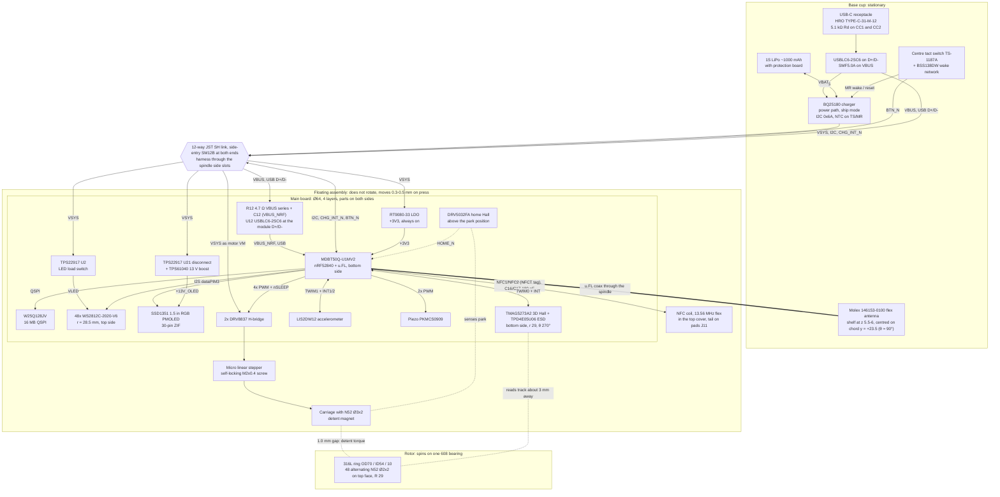

# dial-me-spinner: system architecture (rev A)

This document explains how the dial-me-spinner is put together and why. It
covers the requirements, the subsystem choices (with the alternatives that lost
and why), the power tree, the power budget and battery life, the RF strategy,
the risks, the open decisions and a rough cost.

* **Architecture of record:** [`hardware/design/SPEC.md`](../hardware/design/SPEC.md).
  The pin map and net names are in [`hardware/design/nets.py`](../hardware/design/nets.py),
  and the schematics are generated from [`hardware/design/sheets/`](../hardware/design/sheets/).
  Where this document and SPEC disagree, SPEC wins, except where the generated
  schematic has already moved ahead of SPEC. Problems found in SPEC, including
  those places, are listed in [§13](#13-issues-found-in-spec-during-this-review).
* **Mechanical detail:** [`docs/mechanical.md`](mechanical.md).
* **Firmware, including the charger register settings:** [`docs/firmware.md`](firmware.md)
  (charger driver in its [§13](firmware.md#13-bq25180-charger-driver); the
  verified register values are summarised in [§6.5](#65-power-and-charger)).
  A separate `docs/power.md` is planned but not yet in the repository.
* **Fabrication, hand assembly and bring-up:** [`docs/assembly.md`](assembly.md)
  and [`docs/bringup.md`](bringup.md).
* **Where the numbers come from:** each subsystem was researched, and an
  independent reviewer then checked the research against datasheets. This
  document uses the reviewer's **corrected** values. Values marked
  *estimate* are engineering estimates. Values marked *to verify on
  prototype* have not been measured yet and must be. Values cited as
  "(hardware/sim, ID)" come from the netlist-driven SPICE suite
  ([docs/simulation.md](simulation.md), [results page](../hardware/sim/results/report.md));
  ID is the finding or test name there.

Status: rev A. The schematics are captured (ERC clean), and both boards are
placed and routed by `hardware/design/layout.py`: Freerouting first, then the
grid router `hardware/tools/finish_route.py` completes whatever is still open.
Both pass KiCad DRC with schematic parity (main: 0 errors, 0 warnings,
0 unconnected; base: 0 errors, 0 unconnected, 2 silkscreen-to-edge warnings).
`hardware/design/release.py` wrote the Gerbers, JLC BOM/CPL, order notes,
PDFs and 3D renders to `hardware/fab/{main,base}/` only after that DRC and
parity gate passed. Nothing has been fabricated or measured yet.

---

## Contents

1. [Overview](#1-overview)
2. [Requirements and how each is met](#2-requirements-and-how-each-is-met)
3. [System block diagram](#3-system-block-diagram)
4. [Board partition and the 12-way link](#4-board-partition-and-the-12-way-link)
5. [Mechanical concept (summary)](#5-mechanical-concept-summary)
6. [Subsystem design decisions](#6-subsystem-design-decisions)
7. [Power tree](#7-power-tree)
8. [Power budget and battery life](#8-power-budget-and-battery-life)
9. [RF strategy and its risk](#9-rf-strategy-and-its-risk)
10. [Risk register](#10-risk-register)
11. [Open decisions](#11-open-decisions)
12. [Rough BOM cost](#12-rough-bom-cost)
13. [Issues found in SPEC during this review](#13-issues-found-in-spec-during-this-review)
14. [References](#14-references)

---

## 1. Overview

The dial-me-spinner is a desk object about Ø70 × 36 mm. A heavy stainless
ring spins around a centre that does not rotate. The centre holds a 1.5 in
colour OLED and a ring of 48 RGB LEDs under a frosted diffuser. Pressing the top
clicks. A tiny linear stepper slides a magnet over a 48-magnet track on the
ring, which switches the ring between **free spin** and **24 clicks per turn**
(the click strength is variable). The stepper holds its position with zero
power. A 3D Hall sensor reads the same magnet track to measure rotation. An
nRF52840 handles BLE, USB and NFC tag emulation (through a coil in the top
cover). A ~1000 mAh LiPo and the USB-C charger sit in the base.

It serves three use cases with the same hardware:

* **Game / decision spinner.** You flick the ring, the LEDs and OLED animate a
  prize wheel, a piezo ticks on every detent, and the result is shown when the
  ring stops.
* **PC / phone controller.** It acts like a Surface Dial: a BLE or USB HID
  Radial Controller on Windows, and a wheel or consumer-control device
  elsewhere. Turning gives clicks or smooth scrolling, and pressing is a button.
* **Fidget toy.** It gives long free spins or clicky spins, and counts spins and
  RPM.

| Parameter | Value | Source |
|---|---|---|
| Envelope | Ø70 × 36 mm | SPEC §8 |
| Rotor | 316L ring OD 70 / ID 54 / 10 mm, 124 g, I = 1.22e-4 kg·m². Rotor about 140 g with its PA12-GF carrier (*estimate*) | mechanical research (verified) |
| Bearing | One 608-2Z on a stationary hollow Ø8 spindle, with ≥ 2.5–3 N wave-spring preload | SPEC §8 |
| Detents | 24 × 15°, continuously variable 0 to 16.5 mN·m peak. Free-spin residual ≤ 3 µN·m | detent research (re-simulated by the verifier) |
| Rotation sensing | TMAG5273A2 3D Hall on the same track. 24 electrical periods/rev, about 3.1 kSPS, µA-level wake on rotation | SPEC §1, sensing research |
| Display | SSD1351 128×128 RGB PMOLED, 26.9 mm square active area behind a Ø30 window | SPEC §5.3 |
| LEDs | 48 × WS2812C-2020-V6 at r = 28.5 mm (7.5° pitch, 2 LEDs per detent) | SPEC §5.4 |
| Inputs | Press (0.3–0.5 mm travel), rotation, IMU tap and pick-up | SPEC §1, §5.5 |
| Audio | Magnet-free piezo, about 72 dB(A) at 10 cm (research figure; *to verify* with the 470 Ω series resistors, [§6.4](#64-led-ring-and-audio)) | LED research |
| Radio | nRF52840 module MDBT50Q-U1MV2 with u.FL, and an off-board flex antenna in the base. TX at +8 dBm by default | SPEC §5.2, §8, [§6.6](#66-mcu-module-rfantenna-and-firmware-platform) |
| NFC | NFC-A tag emulation (Type 2 / Type 4) on the nRF52840 NFCT (P0.09/P0.10), 13.56 MHz coil in the top cover on pads J11 | SPEC §4, [§6.6](#66-mcu-module-rfantenna-and-firmware-platform) |
| Battery | 1S LiPo, about 1000 mAh with protection board, ≤ 6.0 mm thick so the swelling gap to the base board stays ≥ 1 mm (D8). BQ25180 charger, 400 mA charge (about 3 h) | SPEC §3, §8, power research |
| Runtime (estimates, [§8](#8-power-budget-and-battery-life)) | Game about 9 h continuous. Desk use about 4 weeks per charge. Sleep about 38 µA (25 °C typical) | this document |

---

## 2. Requirements and how each is met

Rows **R** are the user's hardware requirements, rows **U** the three use
cases, and rows **D** requirements derived from them.

| # | Requirement | How it is met | Where | How to verify |
|---|---|---|---|---|
| R1 | Dial spinner of about 70 mm | Ø70 × 36 mm stack-up. The ring OD is the product OD | SPEC §8, [§5](#5-mechanical-concept-summary) | CAD fit check, then a printed mock-up |
| R2 | BLE (nRF52840) | Raytac MDBT50Q-U1MV2 module, BLE HID over GATT plus a custom GATT service, USB HID as a second path | SPEC §5.2, [§6.6](#66-mcu-module-rfantenna-and-firmware-platform) | Pair with Windows, macOS, Android and iOS |
| R3 | Centre OLED that stays readable | The OLED sits on the stationary floating assembly (FA) and the ring spins around it. No slip ring, no rotating optics | SPEC §1, [§6.3](#63-display) | Read the display while the ring spins at 10 rev/s |
| R4 | Ring of addressable RGB LEDs | 48 × WS2812C-2020-V6 on the stationary main board under an opal diffuser. Animations follow the measured ring angle in software | SPEC §5.4, [§6.4](#64-led-ring-and-audio) | Smoothness and colour checks at VBAT 3.4–4.2 V |
| R5 | Free spin vs click spin, switched electronically with magnetic detents | An alternating 48-magnet track on the ring plus a stationary detent magnet on a sliding carriage. The carriage moves 7.5 mm radially inward to go free. The actuator is a micro stepper with a self-locking screw, so holding a position takes zero power | SPEC §1, [§6.2](#62-detents-mechanism-and-actuator) | Residual cogging below the threshold of feel. 0 µA hold, measured |
| R6 | Balanced flywheel | Turned 316L ring, concentricity ≤ 0.02 mm TIR, balanced to ISO G2.5 at 15 rev/s (≤ 3.9 g·mm). Magnets are bought in matched lots. The IMU can measure 1×/rev vibration for an optional balancing assistant | [§5](#5-mechanical-concept-summary), docs/mechanical.md | Static balance, then IMU vibration at 10 rev/s |
| R7 | Long free spins | One low-friction 608 (instead of a large-bore thin-section bearing, about 10× less drag), non-magnetic ring, no copper pours facing the track, ferrous keep-outs | SPEC §7, §8 | Spin-down from 10 rev/s: verified acceptance **≥ 45–60 s** (mechanical verifier). SPEC's ≥ 2.5–3 N bearing preload is predicted to give only 20–65 s, so it may miss; the preload is the tuning variable (D3, [§13](#13-issues-found-in-spec-during-this-review) item 9). *To verify on prototype* |
| R8 | Press-down click | The whole FA (with the rotor) floats on 3 springs (≈ 4 N preload) and presses a centre tact switch on the base board. Pressing also wakes the device from ship mode | SPEC §3, §8 | Click force map (rim vs centre), no rocking |
| U1 | Game / decision spinner | Free or click spin, an LED wheel plus a 30–60 fps OLED wheel, piezo ticks synced to detent crossings, stop prediction from the measured spin-down, phone app over the custom GATT | [§6](#6-subsystem-design-decisions) | Game demo firmware |
| U2 | Surface-Dial-like controller | Composite HID: Windows Radial Controller (0.1° units, 150 units per detent), Consumer Control and Mouse wheel, over BLE and USB. Press = button | [§6.6](#66-mcu-module-rfantenna-and-firmware-platform) | Windows Wheel settings, Linux `evtest`, Android |
| U3 | Fidget toy | Long free spins, clicky mode, spin counter and RPM, wake on pick-up or tap | [§6.1](#61-rotation-sensing), [§6.2](#62-detents-mechanism-and-actuator) | User testing |
| D1 | Battery powered, USB-C charging | BQ25180 power-path charger, USB-C sink (Rd 5.1 kΩ), ESD/TVS at the connector, plus a 4.7 Ω VBUS series resistor (R12) and a second USBLC6 (U12) at the nRF on the main board | SPEC §3, §6, [§7](#7-power-tree) | Charge from empty, check temperature |
| D2 | Long standby, instant wake | About 38 µA sleep floor (25 °C typical, [§8.2](#82-per-subsystem-currents)). Wake on rotation (TMAG Wake-up&Sleep mode), press, pick-up (IMU) or USB. Ship mode about 6 µA | [§8](#8-power-budget-and-battery-life) | PPK2 sleep-current measurement |
| D3 | Firmware updates without a debugger | MCUboot with its secondary slot on QSPI flash, SMP over BLE and USB, USB serial recovery | [§6.6](#66-mcu-module-rfantenna-and-firmware-platform) | DFU test on each OS |
| D4 | Audible ticks (magnetic detents are silent) | Piezo driven by complementary PWM, triggered on each detent crossing the encoder reports | SPEC §5.5 | Listening test |
| D5 | No magnetic interference with the detents or encoder | Alternating track (zero DC field). Ferrous and inductor keep-out ≥ 10 mm from the track and Hall sensor. No copper pours on B.Cu/In2.Cu at r ≥ 26 mm | SPEC §7, §8 | No preferred rest angle in free mode (histogram of 50 rests) |
| D6 | Buildable by a hobbyist | JLC-assemblable parts (two-sided assembly on the main board) except the module (no JLC stock: JLC Global Sourcing or consigned), the OLED panel and the mechanics | [§12](#12-rough-bom-cost) | First build |

---

## 3. System block diagram



Not shown: the 32.768 kHz crystal, the TC2030 SWD pads (J10, top side,
r 20.8, θ 238.5°, beside the module's SWD pins), the DNP SN74LV1T34 LED-data level shifter (U43, [§6.4](#64-led-ring-and-audio)),
and the per-part decoupling, pull-ups and test pads. The +3V3 rail also feeds
the flash, TMAG, IMU, OLED logic, DRV8837 VCC and DRV5032.

---

## 4. Board partition and the 12-way link

### 4.1 Partition

| Board | Where | Moves on press? | Contents | Why it lives there |
|---|---|---|---|---|
| **main**: Ø64 mm, 4 layers (In1 = GND plane), 1.6 mm, ENIG, parts on both sides | Top of the FA, z 29.1–30.7 mm, 3.5 mm above the ring's magnet face | Yes, with the rotor | nRF52840 module, crystal, QSPI flash, 3V3 LDO, VBUS series resistor R12 + second-stage USB ESD U12, OLED ZIF + 13 V boost with its load switch, 48 LEDs + load switch, TMAG5273 + encoder ESD, LIS2DW12, piezo, 2× DRV8837, DRV5032, NFC tuning caps + coil pads J11, motor and link connectors, SWD pads | Every part that interacts magnetically with the rotor (encoder, detent carriage, home sensor) rides on the same body as the rotor's bearing, so magnet gaps stay constant during a press and no magnetic force crosses the press suspension. The OLED, LEDs and NFC coil sit directly under the top cover. The module's u.FL end faces outward (u.FL at r ≈ 23); the coax runs back under the board beside the module to the spindle's top slot ([§6.6](#66-mcu-module-rfantenna-and-firmware-platform)). |
| **base**: Ø46 mm plus a tab to r = 35 at θ = 0° for the USB-C, 4 layers (In1 = GND plane, In2 = signals/power), 1.6 mm, ENIG, parts on the top side only | Base cup, z 9.5–11.1 mm. Supports: one M2 boss (H1) at r = 20, θ 270° (outside the pack), a printed rib under the θ 90° edge (y 17.75–18.75, between the pack and the antenna shelf) and the USB-C shell clamped in the cup wall | No | USB-C, USBLC6, SMF5.0A, BQ25180 U1 (r 19.5, θ 255°, off the pack), side-entry battery connector J2 (JST SH SM04B-SRSS-TB, r 17, θ 222°), NTC RT1 (top, r 8, θ 200°), centre press switch SW1, BSS138DW wake network, link connector J3 | The USB-C port must not float, or cable force would bias the click. The battery goes low, as about 20 g of ballast. Charger heat (0.5–0.8 W) stays away from the magnets and the Hall sensor. ENIG is needed for the 0.4 mm-pitch DSBGA charger. |

### 4.2 The link

A 12-wire harness with a JST SH (1.0 mm) side-entry `SM12B-SRSS-TB` (LCSC
C160411, about 2.95 mm tall) on each board, entry facing the board centre:
main J1 on the bottom side at r = 19.5 mm, θ = 330°, and base J3 on the top
side at r ≈ 15.5 mm, θ = 120°. The harness runs through the Ø6 bore of the
stationary spindle and enters and leaves it through side slots. The pinout is
the same on both boards (SPEC §2, `nets.py` `LINK_PINOUT`):

| Pin | Net | Direction / notes |
|---|---|---|
| 1, 2 | VSYS | Base → main. 3.0–4.4 V (VBAT on battery; SYS regulated to 4.4 V on USB, [§6.5](#65-power-and-charger)) |
| 3, 4, 8 | GND | Three returns |
| 5 | VBUS | Base → main. nRF USB detect and USB PHY supply only (a few mA), through R12 4.7 Ω on main (net VBUS_NRF at the module) |
| 6, 7 | USB_DM, USB_DP | ESD protection at the connector on the base (U2) and again at the module on main (U12) |
| 9, 10 | I2C_SCL, I2C_SDA | System TWIM1. The BQ25180 at 0x6A is on the base; the 4.7 kΩ pull-ups are on main |
| 11 | CHG_INT_N | BQ25180 /INT, open drain, 10 kΩ pull-up on main, nRF P1.03 |
| 12 | BTN_N | Press, open drain (Q1B, the second FET of the BSS138DW Q1 on the base), 100 kΩ pull-up on main |

Electrical notes:

* **Current.** JST SH is rated 1 A per contact with 28 AWG wire, which SPEC §2
  now specifies (pre-crimped SH leads) for the power pins 1–4 and 8. VSYS has
  two contacts. The worst draw that firmware allows at the same moment is
  about 0.7 A (a detent stroke during an LED chase at the sustained cap,
  [§8.4](#84-peak-current)). The
  hardware worst case without the firmware caps is about 1.35 A with the 5 mA
  LEDs and about 2.35 A with the 12 mA WS2812B-2020-V6 drop-in. **The LED
  brightness cap is therefore a hardware protection function, not a styling
  choice.** It MUST be active from the first frame after reset, in the MCUboot
  and USB-recovery images too, and those images MUST keep LED_PWR_EN,
  OLED_VCC_EN and MOT_NSLEEP low (their pull-downs R3, R25 and R70 hold them
  off through reset), because without the limiter the rails cannot be held
  (hardware/sim, PI-1). The average cap alone is not enough: see the
  instantaneous budget in [§8.4](#84-peak-current).
* **IR drop.** The real route through the spindle side slots (SPEC §8) makes
  the harness about 50–80 mm long (the CAD path is 43 mm and the wires are
  cut to 58 mm, `hardware/mechanical/calcs_output.txt` §12). At 80 mm in
  28 AWG (0.21 Ω/m) the two VSYS
  wires give about 8.5 mΩ and the three GND wires about 5.7 mΩ, so about 10 mV
  at 0.7 A. (In 32 AWG it would be about 25 mV.) Either is negligible.
* **USB.** Full speed (12 Mbit/s) tolerates 50–80 mm of unshielded,
  uncontrolled-impedance wire. Twist D+ and D− together in the harness.
* **Ship mode.** In ship mode SYS is off, so the main board is unpowered. The
  base drives only open-drain lines (CHG_INT_N, BTN_N, I2C), so nothing
  back-powers the main board.
* **Mechanical path** (SPEC §8; the original gap is
  [§13](#13-issues-found-in-spec-during-this-review) item 2, risk R26):
  * The spindle bore cannot open downward on the axis: the spindle ends at the
    FA lower plate (z 12.8), exactly where the centre boss presses the
    TS-1187A (switch z 11.1–12.6, pre-gap 0.15). SPEC §8 therefore gives the
    spindle **side slots at z ≈ 14.5–16** (below the carrier web) **and just
    under the main board**.
  * The FA lower plate is a **3-spoke spider** (spokes at θ 60°/180°/300°),
    with a through-notch in its outer ring at θ 0° for the USB-C receptacle.
    Its open sectors, centred on θ 0°/120°/240°, clear the tall base-board
    parts from the plate, so **no plate window is needed**. J3 sits in the
    θ 120° sector, and its top (about z 14.05) is about 2.95 mm below the
    rotor carrier web (z 17), or about 2.45 mm with the FA pressed 0.5 mm.
    The open sectors clear only the FA plate, not the carrier web, so the
    battery connector J2 is also a side-entry JST SH (SM04B-SRSS-TB, 2.95 mm
    tall, pins 1–2 BAT+, 3–4 GND). The PH header it replaced (about 5.5 mm)
    reached 0.1 mm into the pressed web (risk R36, closed). The pack is
    re-terminated with 28 AWG pre-crimped SH leads, two per rail, which run
    beside the pack at z ≈ 10 under the spider and come up over the board
    edge at θ ≈ 222°.
  * On the main board J1 hangs only about 2.95 mm (to z ≈ 26.15) at r = 19.5,
    clear of the 608, and the back of its mated plug stays outside the
    rotating hub zone (r 9.5–12.5; risk R25, closed). The harness lies flat
    against the board bottom into the upper slot. The CAD clash check passes
    on the current boards with only the intended contacts
    ([docs/mechanical.md §3B](mechanical.md#3b-pcb-placement-findings-for-the-layout-owner-from-board_partsscad-and-the-clash-check)).
  * The harness and coax cross from the stationary base to the floating FA.
    They need a **service loop of about 5 mm or more** to absorb the 0.3–0.5 mm
    press travel (up to about 0.75 mm at the rim) without pre-loading the
    click. SPEC still defines no volume for it (R26).
  * Threading pre-crimped leads through the Ø6 bore is described in
    [docs/assembly.md §6](assembly.md#6-link-harness-12-way-jst-sh-through-the-spindle).

---

## 5. Mechanical concept (summary)

Full detail, drawings and tolerances are in [docs/mechanical.md](mechanical.md);
hand assembly is in [docs/assembly.md](assembly.md).
The essentials:

* **Topology: a mushroom on a spindle.** A stationary hollow Ø8 × 1.0 mm spindle
  is clamped to the FA lower plate and to the main board. The rotor spins
  around it on **one 608 bearing**. The OLED, LED ring, diffuser and top cover
  sit on top and never rotate. All wiring, and the antenna coax, pass through
  the spindle bore. They enter and leave it through side slots (SPEC §8:
  z ≈ 14.5–16 and just under the main board), because neither end of the bore
  is open on the axis ([§4.2](#42-the-link)). The spindle flange screws to the
  main board through three plated GND M2 holes (H1–H3 at r = 6.5 mm,
  θ 90°/210°/330°), which gives the touchable ring an ESD bleed path: ring →
  conductive epoxy → 608 races → spindle → GND. The brass hub flange
  (r ≤ 8.5) is clamped against the board bottom by the M4 nut (about 120 N),
  so the main board has no tracks or vias on B.Cu at r < 8.8 (only H1–H3 and
  the GND pour; the hub is GND), none on F.Cu at r < 4.6 under the nut, and
  none on any layer within 0.35 mm of the Ø5 centre hole (SPEC §8).
* **Why a 608 and not a large-bore bearing.** In the SKF friction model, drag
  scales roughly with the bearing's mean diameter to the power 1.96. For the
  same rotor, an oiled 61808 (40×52) gives about 1.6 N·mm at 10 rev/s and a
  608 about 0.15 N·mm, so the 608 spins about 10× longer (verified). Contact
  seals (RSH/RS1) stop the rotor in under 1 s and are banned. Non-contact
  2Z (or 2RSL) bearings are degreased and re-oiled with ISO VG 2–10 oil.
* **Flywheel.** A turned 316L ring, OD 70 / ID 54 / 10 mm, 124 g. 316L is
  dense, non-magnetic and corrosion-proof, and its conductivity (about
  1.35 MS/m) is about 11× lower than brass, which keeps eddy drag from the
  stationary detent magnet negligible. The carrier web that holds the 608 outer
  race is **PA12-GF**. The research proposed 6061 aluminium; the reviewer
  rejected it because a conductive web under the detent magnet would cost
  0.13–1.6 N·mm of eddy drag.
* **Magnet track.** 48 alternating-polarity N52 Ø2×2 mm discs on the ring's
  **top face** at R = 29.0 mm. They give the detent torque and act as the
  encoder scale.
* **Stack (SPEC §8).** From the bottom up: feet, base cup floor, LiPo bay
  (z 2.5–8.5, pack ≤ 6.0 mm, ≥ 1 mm below the base board) with the antenna shelf beside the pack
  (z 5.5–6), base board (9.5–11.1), press switch, FA lower plate (12.8–14.3,
  a 3-spoke spider), rotor (15.6–25.6, magnet face at 25.6), detent carriage in the
  1.0 mm gap above the track (26.6–28.6), main board (29.1–30.7), LEDs and
  light box, OLED glass (33.0–34.7), diffuser and top cover (to 36.0).
* **Press.** Three springs push the FA up against stops with about 4 N of
  preload. A centre boss on the FA lower plate presses the TS-1187A
  (1.6 N, 100k cycles) on the base board. With this geometry and the TS-1187A
  the research predicts a click force of about **2.0–2.1 N at the rim and
  4.1–4.3 N at the centre** for a preload of 3.9–4.15 N (the verifier
  corrected the spring preload to 4.15 N at the specified installed length).
  The force is the same all the way round the circumference, with no rocking.
  The higher KSC2xx figures from the research apply only to option D9.
* **Bearing preload vs spin time.** The off-axis detent force (±0.7 N at
  R = 29 mm, about ±20 N·mm, reversing 24 times per turn) would rock a single
  608, because gravity alone only holds alignment up to about 11 N·mm. SPEC
  therefore adds a **≥ 2.5–3 N wave-spring preload**. That raises the
  rolling-friction term roughly by (4.4 N / 1.44 N)^0.54 ≈ 1.8×, and the
  sliding term by more. The verified spin-down estimate without preload is
  **40–120 s from 10 rev/s** (the model may under-predict friction). With the
  preload expect roughly **20–65 s**. The verified acceptance test is
  **≥ 45–60 s from 10 rev/s**, so SPEC's preload is predicted to miss it at
  the low end. Keep 45 s as the acceptance and treat the preload as the
  variable: measure spin-down and click-mode rocking against preload
  ([§11](#11-open-decisions), D3). These are model estimates and must be
  verified on the prototype.
* **Balance.** ISO G2.5 at 15 rev/s allows a residual imbalance of about
  3.9 g·mm for the rotor. A ring eccentricity of 0.02 mm TIR contributes about
  1.2 g·mm. Correct the rest with drilled holes or brass set screws.
* **Known mechanical hazards.**
  * A hard flick (about 0.23 N·s at 10 rev/s) can slide a 235 g puck. Use
    micro-suction feet, not high-friction gel feet, which make it tip instead.
  * The 608's axial limit is 0.25 × C0 = 0.34 kN, so a 10 cm drop onto a hard
    floor (about 290 N) is already near it. Treat the bearing as a
    replaceable part.

---

## 6. Subsystem design decisions

### 6.1 Rotation sensing

**Decision.** One **TI TMAG5273A2** 3D linear Hall sensor (SOT-23-6, I2C,
LCSC C3715882, about $0.58), U30. It sits on the main-board underside at
θ = 270°, opposite the detent carriage, with its long axis radial and its
**Hall element** (not the package centre, which is at r ≈ 29.4) at
r = 29.0 mm. It reads the **same 48-magnet alternating track** that makes the
detents. The ring therefore gives 24 electrical periods per revolution, one per
detent, and the angle comes from atan2 of the tangential (X) and axial (Z)
field components. A **TPD4E05U06DQAR** (U32, LCSC C138714) next to the sensor
clamps TMAG_SCL, TMAG_SDA and TMAG_INT_N, because the touchable steel ring
passes a few millimetres below it.

**Why.**
* It is the only part found that combines off-axis tracking, resolution far
  above the need, built-in µA-level wake on rotation and a 1.7–3.6 V supply in
  one JLC-stocked chip.
* Merging the encoder with the detent track (rather than using the sensing
  research's separate 32-pole track) means logical clicks line up with physical
  detents through a single calibrated phase. It also needs only one set of
  magnet pockets.
* The sensor and the ring move together during a press, so the gap does not
  change.

**Key numbers.**

* Field at about 3 mm gap: Bt/Bz ≈ 15/18 mT, with zero DC field (detent
  research, re-simulated by the verifier). At 2 mm it is 40/51 mT, still inside
  the A2's ±133 mT range.
* Gap budget: the Hall element is about 0.73 mm inside the package. With the
  sensor on the board underside at z 29.1, the element-to-magnet gap is
  ≈ 2.8–3.1 mm, depending on the package-height tolerance.
* Sampling: XZX pseudo-simultaneous mode with 4× averaging gives about
  3.1 kSPS. The internal oscillator is untrimmed, so measure the sample rate
  at run time. Reads use the 1-byte frame (about 167 µs at the ≈ 390 kHz
  errata-219 setting below) on the dedicated
  TWIM0, triggered by INT through PPI and DMA, so the CPU does no per-sample
  work. Firmware MUST write TWIM0 FREQUENCY = 0x06200000 after init
  (nRF52840 errata 219): at the stock 400 kHz setting SCL low is only
  1.25 µs, under the 1.3 µs tLOW minimum of the TMAG5273 and of I2C Fast
  mode (hardware/sim, NF-1). The system bus TWIM1 runs at 250 kHz or
  100 kHz for the same reason. Both TWIMs keep the default S0D1 pin drive:
  stronger pull-ups or H0D1 would need series resistors in the bus
  (hardware/sim, PB-2, NF-3).
* Speed limits: at 30 rev/s the electrical advance is 84° per sample. The
  aliasing limit is about 65 rev/s (43 rev/s with a conservative 120°-per-sample
  tracker). A hand-flicked ring reaches about 5–20 rev/s.
* Resolution: noise is about 0.15 mT RMS at 1× averaging, which is
  ≈ 0.01° mechanical RMS after averaging. After a one-spin self-calibration
  (a LUT measured against the nearly constant speed of the flywheel), accuracy
  is about 0.05–0.1° mechanical. HID only needs 0.1° units.
* Wake: Wake-up&Sleep mode with thresholds re-armed for each rest position.
  Current is about 3 µA at a 100 ms interval and 17–20 µA at 10 ms (modelled;
  *to verify on prototype*). It triggers within a few degrees of rotation.
  **After a threshold interrupt the TMAG stays in standby at 0.45 mA until
  firmware re-arms it**, so a firmware watchdog for re-arming is mandatory.
* Tracking current: 2.3 mA (TMAG) + 0.31 mA (pull-ups) + about 0.4–0.65 mA
  (nRF peripherals).

**Consequences.**
* Absolute ring position after a power loss is known only modulo one detent
  pitch, because SPEC has no index magnet. That is fine for an unmarked ring;
  game graphics are virtual.
* The 15/18 mT signal is weaker than a dedicated Ø4×2 track (50/61 mT), but
  still far above the noise floor.
* SPEC §5.5 allows an optional DNP DRV5012 latch as a fallback wake sensor,
  but rev A does not carry its footprint (the only DNP parts are R11, C43 and
  U43).

**Alternatives considered.**

| Option | Why rejected |
|---|---|
| Dedicated 32-pole Ø4×2 track on the ring underside (sensing research's primary) | It would need a second set of pockets, and click and encoder phase would not be tied together. SPEC merged the tracks under the condition the sensing research gives in its alternatives: merging is valid, and better, if the detent ring alternates polarity and has at least 20 magnets. |
| TMAG5170 (SPI 10 MHz) | 4× the price, 2.3 V minimum supply, 3.4 mA, 5 MCU pins. Its extra bandwidth is not needed. Kept as a re-spin fallback. |
| Two analog Halls (DRV5055) in sin/cos | About 5.3 mA with the SAADC, no µA wake, and two parts to calibrate. |
| Hall latches in quadrature (DRV5012 ×2) | Only 4 counts per pole pair (96 CPR here), and counts are lost at speed. Kept only as SPEC's optional wake fallback (no footprint in rev A). |
| Integrated angle ICs (MT6701, MA732, MA600, MT6835) | 7.5–22 mA with no µA wake, and they need an on-axis magnet, but the OLED occupies the axis. |
| iC-MU nonius encoder | 5 V, about 48 mA, 0.06 mm eccentricity tolerance. |
| AS5311 / AS5306 | 16–21 mA, and a 650 mm/s maximum speed against a track speed of about 5.5 m/s at 30 rev/s. |
| Optical (code strip, reflective pairs, mouse sensor) | mA-level LED current, sensitive to dust and grease, and low-power mouse sensors cannot track 5 m/s. |
| Inductive (LX3302A, IPS2200) | mA-level current, custom coil design, and the coils would compete with the LEDs for the same PCB annulus. |

### 6.2 Detents: mechanism and actuator

**Decision.**

* The **rotor track** is 48 alternating N52 Ø2×2 mm discs on the ring top face
  at R = 29.0 mm. A **stationary N52 Ø3×2 mm detent magnet** sits 1.0 mm above
  it. Together they give **24 detents of 15°**.
* Strength is set by an **in-plane radial-inward offset** of the detent magnet,
  at a constant 1.0 mm gap. 0 mm offset is full click, and r ≤ 21.5 mm
  (offset ≥ 7.5 mm) is free spin.
* The carriage is driven by a **micro PM linear stepper with a self-locking
  M2×0.4 lead screw** (VIC-TECH VSM08102 class; the 10 mm sibling does not fit
  the bowl, [docs/mechanical.md](mechanical.md) §7) through
  **2× DRV8837** and a side-entry JST SH 4-pin connector (J40, SM04B-SRSS-TB,
  main-board bottom at r 25.5, θ 132°). The θ 60–120° sector stays free of
  parts. J40 sits inside the wider actuator corridor (θ 30–160°, r 8.5–27,
  where bottom parts must be ≤ 1.3 mm tall, SPEC §8), so its clearance to
  the actuator was checked part by part in
  `hardware/mechanical/calcs_output.txt` §11. A **DRV5032FA** Hall switch (U42, top
  side at r 21.5, θ 90°) above the park position confirms homing.
* Holding position takes zero power: the lead angle (4.2°) is below the
  friction angle (about 9.8°), and both end positions are magnetically
  force-neutral.

**Why.**
* The alternating track has zero mean field. Compared with a same-polarity
  track this gives 1.57× lower peak pull on the carriage, 10–100× less cogging
  from stray steel, and a clean encoder signal with no DC offset.
* In-plane retraction needs a shorter stroke (7.5 mm vs about 9.4 mm for
  ≤ 3 µN·m residual) and puts about 2.4× less magnetic load on the actuator
  than pulling the magnet straight away from the face.
* The stepper gives variable strength and repeats to ±1–2 full steps
  (±0.015–0.03 mm at 0.015 mm of carriage per full step, about ±1.5–3 %
  torque; 500 full steps for the 7.5 mm stroke, [docs/mechanical.md](mechanical.md) §7).

**Key numbers (verified by independent re-simulation, within about 1 %).**

| Offset (mm) | 0 | 1.5 | 3.0 | 5.0 | 7.5 |
|---|---|---|---|---|---|
| Peak detent torque (mN·m) | 16.5 | 9.5 | 2.0 | 0.14 | 0.0027 |

* For comparison, an Alps EC11 encoder detent is about 10–12 mN·m and a Bourns
  PEC11H about 20.6 mN·m. At the 35 mm rim, 16.5 mN·m is only 0.47 N of
  fingertip force, so default to the strongest setting for a crisp feel.
* Barrier energy is 2·T/N = 1.4 mJ, so the ring is captured in a detent below
  about 0.74 rev/s. The natural frequency in a well is about 9 Hz at full
  strength.
* Actuator load. The research said ≤ 0.55 N; the verifier corrected it to a
  worst case of **0.8–1.15 N** once guide friction on both preloaded faces and
  the anti-lash spring are included. That is **above the 8 mm VSM08102's
  0.78 N minimum thrust**, which is rated only at 500 PPS. The SPICE motor
  model puts its thrust at 0.93 N at best from any battery VSYS, so no
  driver change closes the gap (hardware/sim, MD-4; risk R4, still open).
  * The 10 mm sibling (about 1.7 N claimed) is not an option: its Ø10 can
    does not fit the 10.1 mm bowl ([docs/mechanical.md](mechanical.md) §7).
  * So reduce preloads to about 0.4–0.5 N on a PTFE/POM pair, make the
    anti-lash spring push toward PARK, and step at ≤ 446 PPS through the
    loaded 0–4 mm zone (firmware.md §5.3); if that is not enough, fall back
    to an N20 or a Ø6 planetary gearmotor with a lead screw (same connector,
    mechanical.md §7).
  * Expect **about 0.8–1.2 s per full stroke** (500 full steps; 0.83–1.18 s
    in mechanical.md §7) and about 0.045–0.08 mAh per stroke.
  * Peak battery current is 0.36–0.42 A.
* Homing: a gentle stall at the force-free PARK end at ≤ 50 % PWM. **The stall
  is the position reference; the DRV5032 only confirms it.** HOME must read
  asserted after every park stall, including the one that ends every return
  to free mode, and firmware never takes a position from a HOME edge. After 3
  failed attempts the firmware goes to FAULT with the driver asleep
  ([firmware.md §5.4](firmware.md#54-homing-with-the-drv5032)).
* HOME margin at full click is thin. With the DRV5032 on the top side, the
  detent magnet's return field at the click end is about 1.0–1.4 mT, against a
  BOP minimum of 1.5 mT, so some units may assert HOME near full click
  (firmware.md §5.4, risk R35). Factory test 19 checks that HOME is released
  at full click (x = 0) and rejects or reworks units where it is not.

**Ringing in a detent (to verify on prototype).** The detent is conservative
and the 608 has low friction, so after capture the ring rocks back and forth
in the well. The decay per cycle is 4·T_friction / k, where
k = 24 × 16.5 mN·m = 0.40 N·m/rad.

| Bearing friction | Decay per cycle | Rocking time (from ±7.5°) |
|---|---|---|
| 0.15 mN·m | 0.09° | about 86 cycles, ≈ 10 s |
| 0.3 mN·m (with preload) | 0.17° | about 43 cycles, ≈ 5 s |
| Optional felt/UHMW shoe on the carriage, about 1.6 mN·m, touching only at full click | 0.93° | ≈ 8 cycles, ≈ 1 s |

Firmware should also decide the landing detent as soon as the velocity reverses
inside a well, so game results never wait for the ringing to stop.

**Alternatives considered.**

| Option | Why rejected |
|---|---|
| N10/N20 gearmotor with an M3 lead screw (fallback, same connector and driver) | About 45 mm long, 1.8–9 s per stroke, gear whine, and binary positions only without an encoder. Kept as a fallback because of its huge thrust margin. |
| Micro linear RC servo (1.8 g class) | Unpowered hold is uncertain, durability is hobby-grade and sourcing is intermittent. Good for breadboarding the magnetics. |
| Latching solenoid | 2–5 mm stroke (7.5 mm needed), binary only, a loud clack, and a strong magnet plus a steel plunger near the track. |
| Electro-permanent magnet (Logitech MagSpeed principle) | 8–11 A pulses at 15–25 V need a boost converter and a 10 A bridge. It also needs a steel-tooth rotor, which removes the magnet-track encoder. Kept as the long-term upgrade path. |
| Rotating diametric magnet between steel poles ("Magswitch") | The steel poles stay next to the track in OFF, giving 25–450 µN·m of cogging, which is at least the bearing friction. |
| SMA wire with a latch | Stroke and force do not match (150–250 mm of wire for 7.5 mm), it is binary only, and it is sensitive to temperature. |
| 24 same-polarity Ø3×2 magnets | DC field: 1.6× more carriage pull, 10–100× more stray-steel cogging (8 mm keep-out needed), and a poor encoder. Acceptable fallback if 48-magnet assembly proves impractical. |
| Retracting the magnet along the face normal | About 2.4× more actuator load and a longer stroke. |
| Steel pole instead of a magnet | About 10× weaker at practical gaps. |
| BLDC haptics (SmartKnob style) | Draws hundreds of mA continuously whenever detents are active, which contradicts the zero-hold-power requirement. Motor cogging also kills long spins. |

### 6.3 Display

**Decision.** A bare-glass **1.5 in 128×128 RGB PMOLED with the SSD1351**
controller:
* Panel: Newhaven NHD-1.5-128128G. The proven pin-identical second source is
  the Orient AOC128128A0-1.50W.
* Connection: a 30-pin 0.5 mm FPC folded behind the glass into a
  **bottom-contact** ZIF (J20, AFC01-S30FCA-00, LCSC C262671) on the
  main-board top side at r 9.5, θ 270°.
* Interface: write-only 4-wire SPI.
* Panel VCC: 13.0 V from a **TPS61040** boost (U20; R26 499 kΩ 0.5 % /
  R27 52.3 kΩ 0.1 % divider) behind a **TPS22917** input load switch (U21:
  VIN = VSYS with C41 10 µF, ON = OLED_VCC_EN with R25 100 kΩ pull-down,
  C37 1 nF from CT to VIN for about a 4 ms ramp, QOD tied to VOUT =
  OLED_VIN). The TPS61040's EN is tied to its own VIN (OLED_VIN).
  With OLED_VCC_EN low the boost input is disconnected and the QOD holds
  OLED_VIN at about 0 V (0.05–5.4 mV over −10…60 °C), so the TPS61040 stays
  in shutdown in sleep and through an MCU reset (OLED_VIN below 0.4 V within
  1.6 ms of reset) (hardware/sim, LSW-1/SLP-1). With QOD open, D21's reverse
  leakage had floated OLED_VIN up to the boost's UVLO and the boost
  hiccupped in sleep. The panel's VCC still floats behind D21, held at about
  2.7 V by the panel's VCI→VCC ESD path; the price of the fix is D21's
  reverse leakage through the QOD in sleep
  ([§8.2](#82-per-subsystem-currents)). Without the switch, a disabled
  TPS61040 would still pass VSYS minus a diode drop to VCC through L20 and
  D21. The TPS22917 also blocks reverse current at all times (IIN,RCB ≤ 1 µA,
  [SLVSDW8B](https://www.ti.com/lit/ds/symlink/tps22917.pdf) §7.5), so
  OLED_VIN cannot back-feed VSYS. It replaces the earlier AO3401A + 2N7002
  disconnect, which had no controlled slew. L20 is rated Isat 0.72 A
  (0.92 A typical), against a 0.49 A peak need (`display` sheet).

**Why.**
* It is the only colour OLED whose full frame (32 KiB, 12.5 % of RAM) fits the
  nRF52840's RAM and SPI bandwidth with margin. A full-screen prize wheel
  redraws in 32.8 ms at 8 MHz (30 fps) or 16.4 ms at 16 MHz (61 fps), against
  the controller's 20 MHz SPI limit.
* There is a mainline Zephyr `solomon,ssd1351` driver.
* The reference circuit is documented consistently by Newhaven, Orient and
  Solomon.

**Key numbers.**

* Brightness: 90 cd/m² typical. Good indoors, unreadable in direct sun.
* Visible area: the active area is 26.86 mm square. Behind SPEC's Ø30 window,
  90 % of the pixels are visible and the UI is drawn in a circle.
* Current: logic draws 0.24 mA. Battery-side current with the boost at about
  80 % efficiency:

  | Screen content | Battery current |
  |---|---|
  | All black, VCC on | 5.3 mA |
  | Typical dark UI, 15 % lit | 26 mA |
  | 30 % lit | 58 mA |
  | Full white | 146 mA |

  The master-current register C7 scales the content term: 08h = 56 %,
  0Ah = 69 %.
* Wake latency: about 200–400 ms. The vendor sequence needs 200 ms after VCC
  comes up before display-on (command AFh), plus about 200 ms before the panel
  scans.
* Sleep: about 17.6 µA typical at 25 °C. That is ICI 4 µA, plus about
  5 µA leaking from VCI through the panel's internal ESD path into the boost
  feedback divider, plus 3.3 µA in the 1 MΩ RES# pull-down while RES# is held
  high, plus about 5.4 µA of D21 (B5819W) reverse leakage from the ESD-held
  +13V_OLED through U21's QOD (about 30 µA at 60 °C, 1.0 µA at −10 °C). With
  datasheet-maximum IC currents the OLED block draws 45.4 µA at 25 °C and
  70.0 µA at 60 °C, budgeted as 46 / 72 µA in [§8.2](#82-per-subsystem-currents)
  (hardware/sim, SLEEP BUDGET).
* Boost headroom: at VBAT 3.0 V and the minimum current limit, the TPS61040
  delivers only about 33–35 mA, and at 3.6 V the worst-case stack (ILIM,
  L20 −20 %, DCR and U21 RON at their limits) still cannot supply the 42 mA
  full-white maximum at VCC ≥ 12.5 V. Firmware MUST therefore cap master
  current at C7 ≤ 08h and white area at ≤ 30 % below VBAT_est 3.75 V
  (0.979 × the rested reading, rule R1' of firmware.md §12.4, i.e. a reading
  below 3.8304 V),
  and whenever the LED current is above its 150 mA sustained cap
  (hardware/sim, OLED-BST-2). This is the same threshold as
  [firmware.md §7.4](firmware.md#74-burn-in-mitigation-and-power-caps)
  (OLED-V4).

**Firmware notes.**
* The panel runs on **SPIM3 at 16 MHz** on P0.13–P0.16 (SPEC §4), with the
  workarounds for nRF52840 anomaly 198 (TX-buffer corruption: the TX/LVGL
  draw buffers live in a dedicated RAM AHB slave block, slaves 0 and 1, that
  nothing else uses) and anomaly 195 (about 900 µA after disable: write 1 to
  0x4002F004 after disabling the SPIM). Details are in
  [firmware.md §7.1](firmware.md#71-spi-link-and-the-spim3-errata).
  **SPIM2 at 8 MHz** on the same pins is the fallback: no errata, 30 fps, and a
  devicetree-only change (D6).
* The mainline driver needs a patch: VCC sequencing after init, RAM clear
  before AFh, and ABh low-power sleep.
* Burn-in policy: dark theme, static elements at ≤ 40 % grey, auto-dim at 10 s,
  sleep at 30 s, and a ±2 px orbit.

**Alternatives considered.**

| Option | Why rejected |
|---|---|
| 1.43 in round AMOLED, 466×466 (CO5300/SH8601) | The nRF52840 cannot drive its quad interface (the QSPI block is a flash controller), so it gets about 9 fps over 1-wire SPI. The 424 KiB frame exceeds RAM, and there is no stable Western-distributor part number. It is the upgrade path if a true round display matters more than frame rate. |
| SH1107 128×128 mono (Wisevision, in stock at LCSC) | No colour, which the game UI needs. It is **not** a drop-in: different FPC and pitch, 33.9×37.3 glass and an 11.5–12.5 V VCC window. Supply-chain fallback only. |
| SSD1327 128×128 grey | No colour, same boost complexity, no stocked bare panel. |
| SH1106 / SSD1309 128×64 | A 2:1 strip in a round window. Monochrome. |
| SSD1331 96×64 RGB | 0.95 in, too small for the window. Out of stock. |
| GC9A01 1.28 in round LCD | Not an OLED: constant backlight current and glowing blacks. Needs SPIM3 at 32 MHz. |

### 6.4 LED ring and audio

**Decision.**

* **LEDs:** 48 × **WS2812C-2020-V6** (D101–D148, 5 mA per channel), LCSC
  C55109522, on the main-board top at r = 28.5 mm, each with its own 100 nF
  (C101–C148). That is 7.5° per LED, 2 per detent, D101 at θ = 0°, numbered
  CCW.
* **Supply:** VSYS directly, through a **TPS22917** load switch (U2: C7 = 1 nF
  from CT to VIN, about 4 ms turn-on; QOD through R4 = 68 Ω to VLED, so VLED
  falls to 10 % in about 20–27 ms, [§7](#7-power-tree); R3 100 kΩ pull-down
  on ON; C8/C9 2 × 22 µF bulk). No 5 V boost.
* **Data:** nRF **I2S0 SDOUT** (P0.06, LED_DIN_MCU) at 3.3 V logic, through
  R40 = 220 Ω to LED_DIN_R (SPEC §5.4; it limits DIN clamp current if P0.06 is
  ever high while VLED is off), then the fitted 0 Ω R43 to LED_DIN at D101.
  100 kΩ pull-downs on LED_DIN_R (R41) and on the last DO (R42, LED_D48, with
  TP40), because V6 DI/DO pins are auto-swappable. The DC drop across 220 Ω
  into the DI pull-down is about 6 mV. R40 sits next to the nRF pin (U10
  pad 22), so the long trace to D101 is source-terminated (hardware/sim,
  LED-DATA-1). P0.06 MUST use `nordic,drive-mode = <NRF_DRIVE_H0H1>` in its
  default pinctrl state: standard drive does not guarantee the WS2812C
  timing windows (hardware/sim, LED-DATA-V1). No level shifter is fitted by default.
  A **DNP SN74LV1T34** (U43, powered from VLED, with DNP C43) is the
  fallback: remove R43 and fit U43 and C43 if the margin test fails (R27).
  BOM rule: D101–D148 MUST be V6 parts. A pre-V6 WS2812B needs
  VIH = 0.7 × VDD, which the default path cannot meet, so any other LED
  needs U43/C43 fitted and R43 removed (hardware/sim, LED-DATA-2).
* **Optics:** a white-interior, opaque-exterior light box, about 2.7 mm of air,
  then an opal PMMA diffuser ring (r 27–30).
* **Audio:** a magnet-free Murata **PKMCS0909E4000-R1** piezo (BZ1, main-board
  bottom at r 22, θ 22°), driven complementary from one PWM instance through
  2 × 470 Ω (R57/R58). R59 = 1 MΩ across the piezo bleeds charge from shock
  while the drive pins are disconnected in sleep.

**Why the V6 part.** It is the only widely stocked 2020-size single-wire RGB
LED whose datasheet covers all of these at once:
* a 3.3–5.3 V supply, so it runs straight off a LiPo;
* ≤ 1 µA standby (older parts idle at 0.5–1 mA each);
* VIH = 0.55–0.6 × VDD, which 3.3 V logic meets at VLED ≤ 4.5 V;
* 2 kHz PWM.

The 5 mA "C" variant caps full white at 48 × 3 × 5 mA = 0.73 A, against 1.74 A
for the 12 mA "B" variant, and is still 30–50× brighter than the OLED through
the diffuser. 48 LEDs are 2 per detent, and at the short (about 2.7 mm)
diffuser gap that SPEC's stack allows they give a far smoother ring than 24 or
36 would.

**Key numbers.**

* Data timing: I2S at SCK 3.2 MHz, nibble 0x8 for a 0 and 0xC for a 1, gives
  T0H 312 ns and T1H 625 ns, inside the V6 windows. Use a reset delay of
  ≥ 300 µs. The I2S clock MUST come from the HFXO: firmware requests the
  HFXO and waits for it to start before every LED frame, and releases it
  afterwards, because the HFINT's ±8 % breaks the T1H/T0L windows
  (hardware/sim, LED-DATA-V2). The tightest width is T1H, with about 15 ns
  of margin (LED-DATA-2). A frame of 48 LEDs takes about 1.74 ms
  (575 fps maximum at line rate).
* Logic margin: the LED's input threshold VIH is 0.55–0.6 × VLED, and
  VLED = VSYS is highest on USB. The nRF's guaranteed VOH is VDD − 0.4 V
  (nRF52840 PS). With the RT9080 at its −2 % limit (3.23 V, [DS9080-09](https://www.richtek.com/assets/product_file/RT9080/DS9080-09.pdf))
  that is about 2.83 V. At VSYS 4.59 V (SYS_REG 4.5 V at +2 %) the SPICE
  suite gives a DC margin of about +427 mV with realistic parts and +41 mV
  with every PS limit stacked; adding the RT9080's cold drift and load
  transients, the combined worst case is about 40–55 mV (hardware/sim,
  LED-DATA-2, LDO-2). Firmware therefore MUST set SYS_REG to 4.4 V on USB
  ([§6.5](#65-power-and-charger)), which raises the worst-case DC margin to
  about +116 mV (0.6 × 4.488 V + 0.4 V = 3.093 V needed at VDD), and MUST
  never set it above 4.5 V while the LEDs may run (LED-DATA-V3). On battery
  (VSYS ≤ 4.2 V, VIH ≤ 2.52 V) the margin is ≥ 0.3 V. H0H1 drive and the HFXO
  are requirements for these figures, not optional mitigations. This is why
  the nRF runs at 3.3 V ([§6.5](#65-power-and-charger)), and it is listed as
  risk R27. The DNP U43 level shifter is the hardware fallback.
* Diffuser uniformity: at 3.73 mm pitch and about 2.7 mm gap (pitch/height
  about 1.4), an ideal Lambertian diffuser gives roughly 0.75–0.8 min/max
  brightness along the ring. Expect slight beading; *to verify on prototype*.
* Firmware power limit: 300 mA burst, 150 mA sustained (average), 100 mA
  below VBAT_est 3.60 V and while the actuator moves, a dim red cue only
  below VBAT_est 3.53 V
  ([firmware.md §6.3](firmware.md#63-power-limiter)), plus the instantaneous
  lit-channel budget of [§8.4](#84-peak-current). When the loaded VSYS falls
  below about 3.3 V (the LED VDD minimum), firmware MUST send an all-zero
  frame and then drop LED_PWR_EN (hardware/sim, LED-DATA-3).

**Alternatives considered.**

| Option | Why rejected |
|---|---|
| WS2812B-2020-V6 (12 mA, same footprint) | Allowed as a drop-in and now much better stocked (about 897k vs 47k at LCSC), but full white is 1.74 A, above the BQ25180's 1.5 A SYS limit, and with aligned PWM its ring peak is 1.73 A even under the 300 mA average cap. Fitting it requires the instantaneous lit-channel cap (sum of lit channels × 12 mA within the [§8.4](#84-peak-current) budget: 1.0 A only from VBAT_est ≥ 3.92 V, the PI-2 rows in amperes below that) from first boot; otherwise it has to be dropped from the SPEC §5.4 alternates (hardware/sim, PI-3). |
| Legacy WS2812B-2020 | 3.7 V minimum supply, about 0.6 mA idle per LED, discontinued. |
| SK6805-EC15 / EC20, SK6812MINI-E | VIH 0.78 × VDD (needs a level shifter) or VDD ≥ 3.5–3.7 V, 1 kHz PWM, about 0.5 mA idle per LED. |
| APA102-2020 / SK9822 (clocked) | 5 V class, so a boost plus a level shifter; about 1 mA idle per LED. Worth it only for high-speed video. |
| Side-emitting LEDs into a light guide | Poor pixel separation, which is bad for prize-wheel segments. |
| Driving the data line from SPIM (ZMK style) | T0L is out of spec, though it works in practice. Kept as a fallback if I2S is needed elsewhere. |
| PWM + DMA, or bit-bang | PWM needs a custom driver; bit-banging is not BLE-safe. |
| Magnetic buzzer, micro-speaker, LRA haptics | Each contains a magnet that would bias the Hall sensor and cog the track. The only I2S peripheral is taken by the LEDs. |

### 6.5 Power and charger

**Decision.**

* **Charger (base board):** TI **BQ25180** I2C linear charger with power path.
  On USB it regulates SYS to 4.4 V (SYS_REG, set by firmware); on battery
  SYS = VBAT. Ship mode with push-button wake draws 3.2 µA, and shutdown
  draws 15 nA. The input tolerates
  25 V. A 10 kΩ B3435 NTC (RT1) sits on TS/MR, on the base-board top side at
  r 8, θ 200°. The base board is single-sided, so RT1 reads board/pack-air
  temperature, not the cell skin ([§8.5](#85-charging)).
* **Ship-mode wake network:** the centre switch, through a BSS138DW, both
  wakes the charger (TS/MR pulled low: ship-mode wake after about 2 s, hardware
  reset after 20 s) and pulls the nRF's BTN_N low (instant wake from sleep).
  The two FETs isolate the shared TS/MR pin from the nRF. The gate pull-down
  (base R4) is 100 kΩ, not 1 MΩ, so the Q1 gates discharge within the
  BQ25180 deglitch after a release (worst 38.5 µs); it costs about 42 µA
  from VBAT only while the dial is held (hardware/sim, charger_ts-2).
* **Main board:** the nRF52840 runs in **normal-voltage mode**:
  * VDD and VDDH are both on +3V3 from an **RT9080-33** LDO
    (2 µA typical / 4 µA maximum quiescent, 600 mA, about 310 mV dropout at
    600 mA; its ground current at the ~20 µA sleep load is not specified and
    is a bring-up measurement; hardware/sim, LDO-1, LDO-6). SPEC's alternate
    is the TPS7A0233 (25 nA quiescent, 200 mA, same SOT-23-5 pin functions;
    confirm the pinout before swapping).
  * The module's internal REG1 DC/DC is enabled.
  * Every heavy or high-voltage load is fed from VSYS through its own gate:
    LEDs through TPS22917 U2, the OLED boost through a second TPS22917 (U21),
    and the motor through DRV8837 nSLEEP.
  * Battery voltage is read through an always-on divider (R1 2.2 MΩ, LCSC
    C11490; R2 1 MΩ; C5 100 nF) into AIN0 (P0.02), costing about 1.2 µA.
    After the one-point production calibration the reading is within
    about ±10 mV at 25 °C and ±24 mV at 15–35 °C on a fresh board; over
    −10…60 °C it drifts by about +48/−55 mV, and an aged board read at −10
    or 60 °C by about +73/−79 mV. The error is a gain error that grows with
    VSYS, to about 2.1 % of the reading. Firmware therefore compares every
    threshold that protects a datasheet limit against VBAT_est = 0.979 ×
    reading (rule R1'), which puts the SHIP point at a 3.5393 V reading
    ([§7](#7-power-tree)) (hardware/sim, VSENSE-1/4). The VSYS_SENSE node is
    high-impedance: 4.5 nA of surface leakage uses the whole ±10 mV (25 °C)
    budget, so keep it away from other copper and clean (VSENSE-4). On the
    main board R1, R2 and C5 sit on the top over the module's AIN0 pin, so
    the node is 4.8 mm long.

**Why normal-voltage mode, when the power research recommended high-voltage
mode (VDDH = SYS, REG0 DC/DC → 3.0 V)?** SPEC chose normal mode, and the
reasons are sound:

1. **LED logic margin.** At VLED up to about 4.49 V (SYS_REG 4.4 V at +2 %)
   the WS2812-V6 needs a data high of up to about 2.69 V. A 3.0 V REG0 rail
   can be as low as 2.7 V (−10 % tolerance), where the guaranteed VOH is
   VDD − 0.4 ≈ 2.3 V: a **negative margin of about −0.4 V, so high-voltage
   mode fails outright** without a level shifter. At 3.3 V (RT9080 ±2 %) the
   worst-case DC margin is about +116 mV with SYS_REG at 4.4 V
   ([§6.4](#64-led-ring-and-audio)).
2. **No REG0 load limits.** In high-voltage mode, external loads on VDD are
   limited to 25 mA with TX ≤ +4 dBm, 5 mA above +4 dBm, and 1 mA in System OFF.
   Rev A transmits at **+8 dBm by default** ([§6.6](#66-mcu-module-rfantenna-and-firmware-platform),
   [§9](#9-rf-strategy-and-its-risk)), which would leave only 5 mA for the
   flash, TMAG, IMU, OLED logic and pull-ups on VDD.
3. **No dependence on REG0 silicon behaviour.** REG0 DC/DC is broken on Rev 1
   silicon (anomaly 197), and the reviewer flagged the high-voltage-mode
   active-current efficiency as unverified.
4. **No extra ferrite.** High-voltage mode would add a 10 µH DCCH inductor, one
   more ferrite part to keep 10 mm away from the magnets.

The cost is small (recomputed in [§8](#8-power-budget-and-battery-life)):
* about 0.8 mA in desk-active use (≈ 3 %);
* about 1.2 mA in game use (≈ 1 %);
* about 3 µA in sleep (the LDO quiescent current plus the divider, ≈ 8 % of
  the floor);
* the free VDDHDIV5 battery measurement is lost, hence the divider.

**Charger settings.** The full register list and write order are in
[firmware.md §13.1](firmware.md#131-register-init-table). These are the
values from the verified research, with the two SPICE-driven changes
(SYS_REG and TS_CONTROL):

| Register | Value | Setting |
|---|---|---|
| ICHG_CTRL | 0x43 | ICHG 400 mA |
| TMR_ILIM | 0xCD | ILIM 500 mA code, 475 mA typical |
| VBAT_CTRL | 0x46 | 4.20 V |
| CHARGECTRL1 | 0x92 | BATOCP 1.5 A, BUVLO 3.0 V |
| IC_CTRL | 0x97 | Watchdog off; write it in the first I2C exchange |
| SHIP_RST | 0x09 | Long press = hardware reset |
| SYS_REG (0x0A) | 0x20 | SYS 4.4 V on USB (SYS_REG_CTRL = 001; was 0x40 = 4.5 V) for the LED data margin (hardware/sim, LED-DATA-V3, LDO-2) |
| TS_CONTROL (0x0B) | 0x90 | TS_HOT 50 °C, TS_COLD 3 °C (WARM 45 °C, COOL 10 °C unchanged), so the 0 °C / 60 °C JEITA charge-prohibit limits still hold with the threshold, bias and NTC tolerances (hardware/sim, charger_ts-1) |

* **SYS_REG MUST be 4.4 V (0x20) or 4.5 V (0x40), never higher and never
  pass-through, while the LEDs may run.** Above 4.5 V the LED data margin is
  gone, and in pass-through VBUS on VSYS could exceed the LEDs' 5.3 V
  absolute maximum. Firmware asserts this whenever it writes SYS_REG
  (hardware/sim, LED-DATA-V3).
* Write these registers at every boot and on every VIN_PGOOD interrupt. The
  power-on default is a 10 mA charge.
* SPEC has no CC-line sensing, so the 500 mA / 700 mA fast-charge path from the
  research is not available. Charging is about **2.8–3 h** at 400 mA.
* For USB compliance, limit input current to about 100 mA until the nRF
  enumerates, or set bMaxPower to at least 500 mA.
* **USB suspend.** The BQ25180 has no input high-impedance mode and draws
  about 1 mA from VBUS (IQ_IN 0.75 mA typical) whatever the battery does, so
  the device can meet the 2.5 mA suspend limit only as a high-power device
  with remote wakeup. Firmware MUST enumerate as high-power with remote
  wakeup and, on suspend, disable charging or drop ILIM to the 50 mA
  setting (hardware/sim, V-2).
* **No supplement.** With the pack absent, below BUVLO or in precharge, the
  BQ25180 cannot supplement SYS from the battery, so every load must fit
  under ILIM. Firmware reads precharge from STAT1 BUVLO_STAT = 1: CHG_STAT
  reports precharge as CC, and with VLOWV = BUVLO = 3.0 V BUVLO_STAT stays
  set through precharge (firmware.md §6.3). Firmware cannot see an absent pack directly (CHG_STAT may then
  read done), so the pack counts as absent until a battery-only reading in
  this power-up. Firmware MUST then run a "no supplement" profile: while
  ILIM is the 100 mA code, LEDs at most the ≤ 20 mA charging cue, OLED off,
  no flash erase, TX 0 dBm, total ≤ 70 mA; at the 500 mA code, no actuator
  moves, LEDs ≤ 100 mA peak-limited, OLED C7 ≤ 08h, total ≤ 400 mA. The POF
  handler sheds the OLED as well as the LEDs and motor (hardware/sim, PI-4),
  after the 10 ms POF blanking of [§7](#7-power-tree). The OLED rule for
  this case is in [§7](#7-power-tree) (NEW-1).

**Alternatives considered.**

| Option | Why rejected |
|---|---|
| nRF52840 high-voltage mode (power research's primary) | See the four reasons above. |
| Nordic nPM1300 PMIC | Best integration (96 ms ship wake, fuel gauge, CC detection), but LCSC stock was 51 QFN / 897 WLCSP. Revisit if stock appears. |
| Nordic nPM1100 | 400 mA charge maximum, no I2C, larger package. |
| External buck (TPS62840) or buck-boost (TPS63900/63802) for 3.3 V | Adds an inductor near the magnets, cost and area. A LiPo holds less than 5 % of its capacity below 3.3 V, so a buck-boost buys almost nothing. The LDO wastes only about 3 % at these loads. |
| BQ24072/74 | No ship mode or button wake. |
| MCP73831 / TP4056 with a discrete load-sharing circuit | No real power path, no ship mode. |
| BQ25120A | 300 mA maximum, about 8–30 pcs in stock. |
| BQ21080 / BQ25185 | Higher battery quiescent current, or (BQ25185) VIN-only wake from factory mode. |
| AW32001 | Datasheet could not be verified. |
| 5 V boost for the LEDs | About 50 % more LED energy, plus noise and an inductor. The V6 LEDs run directly from VBAT. |
| Discrete P-FET switch (LED rail or OLED boost input) | No defined slew and no output discharge. The TPS22917 costs $0.36, so rev A uses it on both rails (U2, U21). |
| Fuel gauge (MAX17048) | Adds 3 µA. A load-compensated voltage table is enough for a battery indicator in 5–10 % steps. |

### 6.6 MCU module, RF/antenna and firmware platform

**Decision.**

* **Module:** **Raytac MDBT50Q-U1MV2** (U10, nRF52840, u.FL, LCSC C2688382),
  on the main-board bottom centred at r 17.3 mm, θ 215°, long axis radial,
  inner end at r ≥ 8.8 (clear of the brass hub), with the u.FL end facing
  outward (u.FL at r ≈ 23, over the bowl, where nothing rotates above the
  web) (SPEC §8, `layout.py`). The coax runs back under the board beside the
  module to the spindle's top slot at θ 270°. On the way it passes between
  U12 and the module's inner corner, 0.84 mm from U12 and 0.44 mm above the
  rotating cap ring (r 9–13), so it MUST be tacked up with Kapton tape at
  assembly. The CAD clash check passes with only the intended contacts
  (risk R25, closed;
  [docs/mechanical.md §3B](mechanical.md#3b-pcb-placement-findings-for-the-layout-owner-from-board_partsscad-and-the-clash-check)).
  * It exposes all 48 GPIO plus USB, VDDH and DCCH.
  * The 32 MHz crystal and the REG1 inductor are inside. The 32.768 kHz crystal
    (SC-20S, 2 × 12 pF) is on the board.
  * It holds an FCC grant (SH6MDBT50Q), and KiCad 9 ships its symbol and
    footprint.
* **Antenna:** an off-board **Molex 146153-0100** balanced flex (34.9 × 9 mm,
  100 mm coax) on a printed shelf in the base cup at z ≈ 5.5–6, centred on
  the chord y = +23.5 (θ ≈ 90°; strip y 19.0–28.0, corners r ≤ 33) (SPEC §8,
  [§9](#9-rf-strategy-and-its-risk)).
* **TX power: +8 dBm by default in rev A.** The link budget in [§9](#9-rf-strategy-and-its-risk)
  assumes it, and at 0 dBm the severely-detuned case would have only about
  1.5 dB of margin at desk distance. It costs about +10 mA while transmitting
  (14.8 mA vs 4.8 mA, nRF52840 PS), which averages to about +3 µA in connected
  idle and about +0.2 mA in desk-active use (*estimate*, included in
  [§8](#8-power-budget-and-battery-life)). Normal-voltage mode puts no VDD
  load limit on it. Backing the power off on strong links is a later firmware
  optimisation, to be decided from the RSSI tests.
* **NFC tag:** the nRF52840 NFCT is used as an NFC-A tag. P0.09/P0.10 are
  NFC1/NFC2, with 180 pF C0G tuning caps C16/C17 (LCSC C78636) to GND, sized
  for a coil of about 1.4–1.5 µH and to be retuned on the prototype for the
  coil's measured inductance. The 13.56 MHz flex coil lives in the top
  cover; its tail solders to flat pads J11 (NFC_COIL) on the main-board top
  at r 21.5, θ 222°. UICR NFCPINS stays in NFC mode in every image,
  including MCUboot, so no image may set `nfct-pins-as-gpios`. CHG_INT_N,
  which used to sit on P0.09, is on P1.03.
  * Firmware emulates an NFC-A Type 2 or Type 4 tag (nRF Connect SDK
    `nfc_t2t` / `nfc_t4t`), with the NDEF content and NFCID1 changeable at
    run time. A field can wake the MCU from System OFF.
  * The nRF52840 cannot read tags. "Read a tag" is done by the phone app
    (phones are readers), which sends the content to the spinner over BLE.
    Encrypted badges and payment cards cannot be emulated.
* **Flash:** **W25Q128JV** 16 MB QSPI for the MCUboot secondary slot and the
  UI assets.
* **Firmware:** nRF Connect SDK (Zephyr) with the SoftDevice Controller.
  * MCUboot: signed images, swap-using-move, secondary slot in QSPI. Size
    MCUboot from a real build (about 64 KB with USB CDC serial recovery), which
    leaves a primary slot of about 928 KB.
  * Updates: SMP over BLE and USB CDC.
  * UI: LVGL on SPIM3 at 16 MHz (D6). LEDs: `worldsemi,ws2812-i2s`.
  * HID: `bt_hids` and Zephyr USB HID with one composite report map:
    * ID 1: Windows Radial Controller, 0.1° units, 150 units per detent;
    * ID 2: Consumer Control;
    * ID 3: Mouse with wheel and AC Pan.
  * A custom 128-bit GATT service for the phone or Web Bluetooth app, under its
    own identity in a second extended-advertising set.
  * Multi-host bonding following the nRF Desktop pattern.
  * Code will live in `firmware/` (planned); the design is in
    [docs/firmware.md](firmware.md).

**Why a u.FL module.**
* It separates antenna placement from the PCB, which is the only robust answer
  in a 70 mm puck where a steel ring and a 4-layer board cover the whole top
  plane.
* It needs only a few support parts and gives 48 GPIO. SPEC uses 38 GPIO
  (including the two NFC pins), with 6 no-connect and 4 test pads.
* The JLC stock gap (0 pcs on 2026-10-18) is handled by global sourcing or
  consigned parts.

**Alternatives considered.**

| Option | Why rejected |
|---|---|
| Ebyte E73-2G4M08S1CX (u.FL, stocked at JLC) | 32 GPIO with only 15 fast-capable, no verified modular grant, no KiCad footprint. JLC-stock plan B only. |
| MDBT50Q-1MV2 / -P1MV2 (chip or PCB antenna on the module) | The on-module antenna needs a copper-free board edge away from metal, and every edge here sits over the steel ring. |
| nRF52840 directly on the board (QIAA) | Cheapest, but needs aQFN73 fan-out, a matching network, VNA tuning and loses the modular grant. Revisit in a cost-down revision once the antenna is proven. |
| u-blox NINA-B30x, Fanstel BT840, Minew MS88SF2/3, Holyiot 18010, Insight ISP1807, Seeed XIAO | 2–3× the price, fewer GPIO, unverifiable specs, an integrated antenna that metal would detune, or a fixed antenna position. |
| Arduino Adafruit nRF52 core + UF2 bootloader | Fast to prototype, but built on the nRF5 SDK and S140, which are in maintenance. Weak multi-host support, composite USB and signed DFU. |
| ZMK firmware | Keyboard-centric, with no Radial Controller. |
| Other flex antennas (Taoglas FXP73, Kinghelm) | Longer (47 mm) or unverified. The Molex is balanced, so it works without a ground plane. |

---

## 7. Power tree

```
USB-C VBUS (5 V) ──SMF5.0A TVS──┬── BQ25180 IN ─[ILIM 475 mA]─┐
                                │                            ├── SYS = VSYS: VBAT on battery, 4.4 V on USB
                                └── link pin 5 ── main VBUS  │      (off in ship/shutdown mode)
1S LiPo + PCM (3.0–4.2 V) ── BQ25180 BAT (BATOCP 1.5 A) ─────┘
                                                             │
VSYS ─┬─ RT9080-33 LDO U1 ────── +3V3 (always on): nRF VDD+VDDH, W25Q128, TMAG5273, LIS2DW12,
      │                                           OLED VCI/VDDIO, DRV8837 VCC, DRV5032, pull-ups
      ├─ TPS22917 U2 (LED_PWR_EN; QOD via R4 68 Ω) ── VLED ── 48× WS2812C-2020-V6 (D101–D148)
      ├─ TPS22917 U21 (OLED_VCC_EN; QOD to VOUT) ── OLED_VIN ── TPS61040 U20 ── +13V_OLED ── SSD1351 VCC
      ├─ 2× DRV8837 VM (MOT_NSLEEP) ── micro stepper coils A/B
      └─ R1 2.2 MΩ / R2 1 MΩ ── VSYS_SENSE (C5) ── AIN0 (P0.02)

main VBUS ── R12 4.7 Ω ── VBUS_NRF (C12 4.7 µF; U12 USBLC6 rail) ── nRF VBUS (USB detect, PHY)
```

| Rail | Source | Voltage | Switched by | Design current | Notes |
|---|---|---|---|---|---|
| VBUS | USB-C | 4.5–5.25 V supported (USB 2.0); nRF VBUS minimum 4.35 V | none | ≤ 475 mA into the charger; a few mA to the nRF | The nRF VBUS absolute maximum is 5.8 V. R12 and C12 keep the hot-plug ring off the nRF pin (see VBUS protection below). |
| VBAT | cell | 3.0–4.2 V | PCM / BQ25180 BATFET | 1.5 A (BATOCP) | Firmware enters ship mode below VBAT_est 3.465 V, i.e. a rested reading below 3.5393 V (VBAT_est = 0.979 × reading, rule R1'; it was a 3.54 V reading under the flat 75 mV margin, and 3.53 V and 3.48 V before that): an aged board read at −10 or 60 °C can over-read by about 72 mV, and the true VBAT must stay above the BQ25180 battery-only power-up threshold VBATPOR (3.46 V max, SLUSE99C) so a button press can wake it; the worst case is a true 3.4669 V (hardware/sim, VSENSE-1/4). |
| VSYS | BQ25180 SYS | 3.0–4.4 V (4.4 V ± 2 % on USB) | ship / shutdown | 1.5 A DC, 2.5 A for < 20 ms | Unswitched capacitance is about 82 µF nominal, 93.6 µF at +tolerance (main C1, C2, C6, C41, C74, C70/C72; base C2, C4), against the BQ25180's 100 µF maximum (SLUSE99C Table 9-2): do not add VSYS bulk; if more is ever needed, put it behind U2 on VLED (hardware/sim, NF-2). The 10 µF parts main C2, C6, C41 and base C4 are 25 V CL10A106MA8NRNC (C96446), because a 10 V 0603 keeps only about 28 % of its value at 5 V; the effective VSYS capacitance at 5 V is still only 32.1 µF worst case (MD-5). |
| +3V3 | RT9080-33 | 3.3 V; tracks VSYS minus dropout below about 3.35 V | always on | about 50 mA peak (TX + CPU + QSPI erase) | W25Q128 needs ≥ 2.7 V. With BUVLO at 3.0 V the rail stays ≥ 2.9 V. |
| VLED | TPS22917 U2 | = VSYS | LED_PWR_EN (R3 100 kΩ pull-down) | 0.73 A hardware max; firmware cap 0.3 A burst, 0.15 A sustained | Load is about 49 µF nominal (2 × 22 µF + 48 × 100 nF). CT 1 nF (C7, from CT to VIN) gives a slew of about 1.9 V/ms, so about 90 mA of inrush, a 1.6 ms rise and a turn-on time tON of about 4 ms (3.8 µs/pF at 3.6 V, [SLVSDW8B](https://www.ti.com/lit/ds/symlink/tps22917.pdf) §7.6). QOD goes through R4 = 68 Ω (RC0402FR-0768RL, C163455), in series with the internal ≈ 150 Ω (RDIS ≈ 218 Ω, SLVSDW8B §9.3.3), so the fall time is about 2.2 × 218 Ω × 49 µF ≈ 24 ms. SPICE puts VLED at 10 % after about 20–27 ms: about 24 ms nominal, 25.9 ms Monte Carlo maximum, 25.7 ms from 4.2 V, and 26.6 ms worst case (3.465 V start, C8/C9 +20 %, DC bias), inside the firmware's ≥ 30 ms wait (hardware/sim, LSW-2; it was 30.6 ms with R4 = 100 Ω). Bring-up measures tFALL, because the datasheet tFALL row implies a QOD of about 170 Ω (NEW-4). DC-bias derating of the 22 µF parts makes the real inrush lower. U2 has no current limit (see LED fault below). |
| OLED_VIN | TPS22917 U21 | = VSYS | OLED_VCC_EN (R25 100 kΩ pull-down) | ≤ 0.2 A (boost input) | C37 1 nF from CT to VIN: tON about 4 ms. The inrush is about 0.3 A for about 2 ms with a 0.4 A peak, set by the TPS61040 soft start, not by C37: the boost (EN tied to OLED_VIN) starts at its UVLO while U21 is still ramping, so U21 carries the boost's current-limited charging current in its linear region and absorbs up to about 0.65 mJ per turn-on (hardware/sim, LSW-4, OLED-BST-3; SLVSDW8B gives no SOA data). Bring-up checks U21's temperature and the VSYS sag at the first OLED enable. C41 10 µF bypasses VIN. QOD is tied to OLED_VIN (VOUT): with OLED_VCC_EN low, OLED_VIN is held at about 0 V, the boost stays in shutdown (U21 itself draws 10 nA typical) and the panel VCC floats behind D21; reverse-current blocking keeps OLED_VIN from back-feeding VSYS (IIN,RCB ≤ 1 µA). The build's ERC waiver for the QOD–VOUT pin pair is documented in `hardware/design/build.py`. |
| +13V_OLED | TPS61040 | 13.0 V (12.5–13.5 V window) | as above | ≤ 40 mA | The high-impedance FB divider (R26 499 kΩ / R27 52.3 kΩ) turns the TPS61040's FB bias current (1 µA max) into ±0.5 V on VCC, which uses up the whole window at the datasheet worst case. A lower divider would cost about 21 µA of sleep current, because the panel's ESD path holds VCC at about 2.7 V across it, so the parts stay and every board is screened for VCC 12.7–13.3 V at bring-up (B-9.9a) and in production (hardware/sim, OLED-BST-1, accepted risk). With the OLED off, FB − OLED_VIN is 0.26–0.29 V against the 0.3 V absolute maximum (R31). |
| VM | VSYS | = VSYS | MOT_NSLEEP | 0.36–0.42 A for ≤ 1.1 s | Firmware starts a non-park move only from VSYS_est ≥ 3.54 V, i.e. an idle reading ≥ 3.6159 V (VSYS_est = 0.979 × reading; it was 3.615 V under the flat 75 mV margin, 3.55 V measured, and 3.40 V before that), so the coils still get their rated current under load when the reading is 2.1 % (75.9 mV) high (hardware/sim, MD-2). Every stop path, FAULT and abort included, MUST brake first (IN1 = IN2 = 1 on U40/U41 for ≥ 3 ms, then IN = 00 and nSLEEP low), and the drive stays sine microstepping, never full-current full steps on USB: a coast dumps the coil energy into VSYS, and on USB after charge termination only the ceramic capacitance absorbs it (MD-1). With the shared VM bulk C74 the worst coast peak is 5.31–5.36 V against the BQ25180 SYS 5.5 V absolute maximum; without C74 it is 5.42–5.48 V (MD-5). |

**VBUS protection.**
* R12 (4.7 Ω, FRC0402F4R70TS, LCSC C2909356) runs from link VBUS to the
  module's VBUS_NRF, with C12 (4.7 µF) on the module side and the second
  USBLC6 (U12, C7519) railed on VBUS_NRF at the module's D+/D−. R12·C12
  ≈ 20 µs filters a legacy-cable hot-plug ring, so the nRF pin peaks at the
  settled VBUS value: 4.49–5.49 V for 4.5–5.5 V sources, worst 5.488 V
  against the 5.8 V absolute maximum (it was 6.5–8.4 V without R12)
  (hardware/sim, USB-1).
* The price is a DC drop: at VBUS 4.5 V and a 1.1 A charger load the nRF pin
  still sees 4.378 V, 28 mV over its 4.35 V minimum, and the 28 mV rests on
  the typical 2.4 mA USB current. nRF52840 PS §7.3 recommends this 4R7,
  although PS §5.3.8.6 asks for RSOURCE,VBUS ≤ 2 Ω including the cable.
  Bring-up confirms enumeration from a 4.5 V supply through a 1 m cable.
* R12 also limits a C12 short to about 1.2 A, which opens the 0402 (V-5).
* Supported VBUS is 4.5–5.25 V. At about 5.5 V the BQ25180 VIN_OVP (5.5 V
  minimum) may stop charging, and the device then runs from the battery
  (NF-4). A VIN_OVP flag within about 30 ms of plug-in is the hot-plug
  overshoot (IN 6.2–7.8 V), not a charger fault, and firmware MUST NOT
  report it as one (V-3).
* The SMF5.0A (VR 5.0 V) and USBLC6 (VRM 5.25 V) stand-offs are below the
  5.5 V vSafe5V maximum: leakage only, no damage, accepted (USB-4).
* ESD on D+/D− into the nRF pads is an accepted residual risk (R37, USB-2).

**Sequencing.**
* **Reset and boot images:** R3, R25 and R70 hold LED_PWR_EN, OLED_VCC_EN and
  MOT_NSLEEP low through reset. MCUboot and the USB-recovery image MUST never
  drive them high (hardware/sim, PI-1).
* **OLED on:** +3V3 is already up. Pulse RES#, initialise, clear RAM, set
  OLED_VCC_EN, wait ≥ 200 ms, then send AFh. Rules:
  * Never set OLED_VCC_EN while the BQ25180 input limit is still the 100 mA
    code (TMR_ILIM = 0xC9) unless the battery can supplement (no BUVLO_STAT
    and VBAT_est ≥ 3.21 V from a battery-only reading in this power-up; at
    −10 °C the boost surge needs about a 3.204 V cell to keep the BQ25180
    BAT pin above BUVLO). Until ILIM is 500 mA, show the charging cue on
    the LEDs (≤ 20 mA) instead. Otherwise a dead battery plus USB gives a
    reboot loop, exactly in the "battery empty, plug in" case
    (hardware/sim, NEW-1, OLED-V1).
  * Do not toggle OLED_VCC_EN during an actuator move when VBAT_est < 3.6 V;
    enable the OLED before the park move (NEW-2).
  * Record OLED_VCC_EN in retained RAM. If the next reset is a brown-out or a
    BAT_OCP_FAULT, leave the OLED off and show an error on the LEDs (OLED-V3).
* **OLED off:** send AEh, then clear OLED_VCC_EN.
* **LEDs on:** keep DIN (P0.06) low, set LED_PWR_EN and wait ≥ 10 ms with
  P0.06 still low (tON is about 4 ms; DIN must not go high before VLED has
  reached 2.67 V, because the DI absolute maximum is VDD + 0.7 V and +3V3
  can be 3.366 V; VLED is at least 2.97 V at 10 ms) (hardware/sim,
  LED-DATA-V4). Request the HFXO and wait for it (LED-DATA-V2), then send
  the first frame.
* **LEDs off:** send an all-zero frame, drive DIN low, then clear LED_PWR_EN.
  Allow ≥ 30 ms for the QOD discharge before treating VLED as off (VLED
  reaches 10 % in ≤ 26.6 ms, LSW-2). **Never drive DIN high while VLED is
  off** (SPEC §5.4): P0.06 would push about 5 mA through R40 into D101's DIN
  clamp with DIN more than 0.7 V above VLED, past the WS2812C absolute
  maximum (hardware/sim, LSW-3). This is a hard firmware rule; fitting the
  DNP U43 (SN74LV1T34, Ioff) with C43 and removing R43 would enforce it in
  hardware.
* **LED fault:** U2 has no current limit, so a shorted LED or a VLED solder
  bridge is stopped only by the BQ25180 BATOCP and the pack PCM. If a
  brown-out, POF (outside the POF blanking below) or BAT_OCP_FAULT follows
  LED_PWR_EN within about 50 ms twice, firmware MUST latch VLED off and show
  a service fault; after any BAT_OCP_FAULT or brown-out with LED_PWR_EN set
  it keeps the LEDs off for the session and logs a VLED fault (hardware/sim,
  NF-3, NEW-5). A
  current-limited switch for VLED is an option, not fitted.
* **POF blanking:** firmware MUST ignore POFWARN for 10 ms after it raises
  OLED_VCC_EN or LED_PWR_EN. Those enables can dip +3V3 to 2.87–3.02 V for up
  to 5.8 ms (dead battery on USB at the 80 mA ILIM minimum with the charging
  cue; the NEW-1 supplement branch), below the 3.045 V upper bound of the
  2.9 V POF threshold but above VBOR and the W25Q128's 2.7 V, so without it
  the handler sheds the load it has just enabled ([firmware.md §12.4](firmware.md#124-battery-measurement-and-low-battery-policy);
  hardware/sim, NEW-1, PI-4).
* **Charger:** write the BQ25180 registers before the first 160 s of I2C
  activity end. The watchdog starts at the first I2C transaction.

---

## 8. Power budget and battery life

### 8.1 Assumptions

* **Cell:** about 1000 mAh nominal; **900 mAh usable** (*estimate*) to the
  SHIP point, a rested reading of 3.5393 V (VBAT_est 3.465 V, [§7](#7-power-tree)), with some ageing
  margin. Currents are battery-side at VBAT ≈ 3.7 V and **25 °C typical**;
  [§8.2](#82-per-subsystem-currents) gives the temperature and maximum
  figures separately.
* **3V3 loads** pass through a linear LDO, so battery current equals load
  current, plus 2 µA typical (4 µA maximum).
* **OLED** figures are battery-side, from the display research: boost about
  80 % efficient; black screen 5.3 mA; 15 % lit 26 mA; 30 % lit 58 mA at full
  master current; scaled by C7 (08h = 56 %).
* **nRF currents** are from nRF52840 PS v1.1 (DC/DC at 3 V; slightly
  conservative at 3.3 V):

  | State | Current |
  |---|---|
  | CPU at 64 MHz from flash | 3.3 mA |
  | TX at 0 dBm / +8 dBm | 4.8 mA / 14.8 mA |
  | RX | 4.6 mA |
  | System ON idle | 2.35 µA in the PS; budget about 3 µA under Zephyr |
  | System OFF | 0.4 µA |

  The radio transmits at **+8 dBm** (rev-A default, [§6.6](#66-mcu-module-rfantenna-and-firmware-platform)),
  so TX costs about 10 mA more than at 0 dBm. The budget assumes about 150 µs
  of TX per empty connection event and about 300 µs per event that carries an
  HID report (*estimate*).

  Duty cycles are *estimates*. **Measure every mode with a PPK2 before
  trusting runtimes.**
* **Modes:**
  * **Sleep:** host away. System ON idle, no radio, TMAG Wake-up&Sleep at
    100 ms, IMU wake-on-motion, display asleep with GDDRAM retained, flash in
    deep power-down.
  * **Desk idle:** bonded host connected at a 15 ms interval with peripheral
    latency 30. TMAG Wake-up&Sleep at 10 ms for a fast response. Display and
    LEDs off.
  * **Desk active:** the dial is being turned. HID reports every connection
    event, TMAG tracking, a dim UI (15 % lit, C7 = 08h), and an LED position arc
    of 6 LEDs at 20 % in one colour.
  * **Game:** continuous spinning. A full-colour wheel (about 30 % white
    equivalent, C7 = 08h), an LED chase averaging 60 mA (see the LED row), a
    phone connection, piezo ticks, and about 30 detent strokes per hour.
  * **Fidget (dim):** spin counter on a mostly black screen (C7 ≈ 03–04h), LEDs
    off, no radio.

### 8.2 Per-subsystem currents

| Subsystem | Sleep (µA) | Desk idle (µA) | Desk active (mA) | Game (mA) | Fidget dim (mA) | Basis |
|---|---|---|---|---|---|---|
| nRF52840 module (CPU, radio, peripherals) | 3.0 | 10.3 | 2.2 | 3.7 | 1.5 | Idle about 3 µA, including the NFCT field sense (about 0.1 µA). 15 ms interval with latency 30 adds about 4.3 µA at 0 dBm, plus about 3 µA for TX at +8 dBm (10 mA × 150 µs every 465 ms). Active: CPU about 15 % (desk) or 60 % (game), plus HFXO, TWIM/SPIM/I2S/PPI and radio; +8 dBm adds about 0.2 mA (10 mA × 300 µs every 15 ms). *Estimate.* |
| RT9080 LDO quiescent | 2.0 | 2.0 | ~0 | ~0 | ~0 | 2 µA typical, 4 µA worst case (DS9080-09). The ground current at the ~20 µA sleep load is not specified: measure it at bring-up (hardware/sim, LDO-1, LDO-6/SLP-3). TPS7A02: 0.025 µA |
| VSYS_SENSE divider | 1.2 | 1.2 | ~0 | ~0 | ~0 | 3.7 V / 3.2 MΩ |
| BQ25180, battery only | 4.0 | 4.0 | ~0 | ~0 | ~0 | 3 µA, 4 µA with the TS/MR button function |
| Pack PCM | 3.0 | 3.0 | ~0 | ~0 | ~0 | 3–6 µA for typical hobby packs |
| TMAG5273 | 3.0 | 20 | 2.6 | 2.6 | 2.6 | Wake-up&Sleep at 100 ms / 10 ms (modelled). Tracking 2.3 mA plus 0.31 mA in the pull-ups |
| LIS2DW12 | 1.5 | 1.5 | ~0 | 0.1 | ~0 | Low-power mode 1 at 12.5 Hz (1 µA at 1.8 V, more at 3.3 V). High-performance mode in game for the balance assistant |
| DRV5032FA home Hall (always on) | 1.6 | 1.6 | ~0 | ~0 | ~0 | 1.6 µA typical, 3.5 µA maximum |
| 2× DRV8837 + actuator | 0.1 | 0.1 | (counted per day) | 1.8 | ~0 | 70 nA typical / 240 nA maximum asleep. 0.06 mAh per stroke, 30 strokes/h in game |
| OLED + 13 V boost | 17.6 | 17.6 | 17.2 | 35.1 | 7.7 | Sleep: 4 µA ICI, about 5 µA ESD-path leak into the FB divider, 3.3 µA in the RES# pull-down, and ≈ 5.4 µA of D21 reverse leakage from the ESD-held +13V_OLED (≈ 2.7 V) through U21's QOD (≈ 30 µA at 60 °C) (hardware/sim, SLEEP BUDGET). With datasheet-max IC currents: maximum 46 µA at 25 °C, 72 µA at 60 °C (45.4 / 70.0 µA simulated). U21 off, 10 nA typical. Active: see assumptions |
| W25Q128 QSPI flash | 1.0 | 1.0 | 0.1 | 1.0 | 0.05 | About 1 µA in deep power-down (tens of µA in standby if deep power-down is not entered). Reads are an *estimate* |
| LED ring (48× V6 + TPS22917) | 0.01 | 0.01 | 7.3 | 60 | 0 | Desk: 6 × 5 mA × 20 % = 6 mA, plus 6 × 0.2 mA per-IC operating current (*assumption from the PCN, to verify*). Game: 48 LEDs at 3 % white (22 mA), a 6-LED comet at 50 % on 2 channels (30 mA), plus about 10 mA operating current |
| Piezo | 0 | 0 | 0.02 | 0.1 | 0.05 | About 0.5 mA while sounding, low duty |
| **Total** | **≈ 38 µA** | **≈ 62 µA** | **≈ 29.4 mA** | **≈ 104 mA** | **≈ 12 mA** | Sleep: the sum of the lines, 38.0 µA (25 °C typical). SPICE gives 36.0 / 37.4 / 37.5 µA at VBAT 3.0 / 3.7 / 4.2 V (hardware/sim, SLEEP BUDGET) |

* **Temperature and maxima.** The sleep floor above is **25 °C typical**. At
  VBAT 3.7 V the SPICE suite gives 31.5 µA at −10 °C, 37.4 µA at 25 °C and
  70.0 µA at 60 °C, where D21 leaks about 30 µA and the nRF52840 about
  10.8 µA. With every IC at its datasheet maximum it gives 95.2 µA at 25 °C
  (hardware/sim, SLEEP BUDGET, SLP-2/SLP-5; `test_sleep_max_corner`).
* **Accepted for rev A.** The D21 leak is the price of tying U21's QOD to
  OLED_VIN ([§6.3](#63-display)); the design before that fix drew 36.9 µA
  in sleep anyway, because the boost hiccupped. Rev-B options, not done:
  a low-IR rectifier for D21, or the TPS61040 EN on its own GPIO with a
  ≤ 400 kΩ pull-down and U21's QOD open (32.2 µA simulated; EN must never
  rise before VIN, EN abs max VIN + 0.3 V) (D15).

Other states:
* **Ship mode:** the BQ25180 BATFET is off, so the main board is unpowered.
  3.2 µA (BQ25180) + about 3 µA (PCM) ≈ **6.2 µA**.
* **Shutdown:** about 3 µA (the PCM only). Wakes on USB only.
* **System OFF:** about 35 µA (*estimate*: the sleep floor minus about
  2.6 µA of nRF System ON idle). That is barely lower than System ON idle,
  because the always-on peripherals dominate. So **System ON idle is the
  everyday "off"** (instant wake), and ship mode is for storage and transport.

What dominates:
* **Sleep:** OLED leakage (46 %, of which D21 is 14 %), BQ25180 + PCM (18 %),
  nRF (8 %), TMAG (8 %), LDO (5 %).
* **Desk active:** OLED (59 %), LEDs (25 %), TMAG (9 %).
* **Game:** LEDs (58 %), OLED (34 %).

### 8.3 Battery life (900 mAh usable)

| Scenario | Average | Runtime |
|---|---|---|
| Game, continuous | 104 mA | **≈ 8.6 h**. Range 4–14 h for LED averages of 30–150 mA and OLED 25–60 mA |
| Fidget with a dim spin counter | 12 mA | ≈ 76 h |
| Fidget "dark" (counting only; display and LEDs off) | 4.2 mA (the fidget-dim column minus the 7.7 mA OLED) | ≈ 215 h |
| Desk, typical day: 1 h turning, 7 h connected idle, 16 h asleep, 20 detent strokes | 31.6 mAh/day | **≈ 4 weeks (28–29 days)** |
| Desk, heavy: 2 h turning, 40 strokes | 62 mAh/day | ≈ 2 weeks |
| Desk, light: 0.5 h turning, 10 strokes | 16 mAh/day | ≈ 8 weeks |
| Desk, display left on as a dim clock face for 7 h/day (about +7 mA) | 81 mAh/day | ≈ 11 days |
| Connected idle 24/7, never touched | 62 µA | about 1.6 years on electronics alone; in practice limited by the cell |
| Sleep | 38 µA | about 0.9 mAh/day. With 2–3 %/month LiPo self-discharge, a full cell reaches cutoff after roughly 1.4 years (1.43 years with the simulated 37.4 µA, hardware/sim). At 60 °C (70 µA) the electronics alone take about 1.7 mAh/day |
| Ship mode | 6.2 µA | Limited by the cell's self-discharge |

Comparison with the research (high-voltage mode): game 11.9 h (on 24 LEDs, no
actuator) and desk 22–39 days. The verifier's corrected expectation was game
8–12 h. The numbers here are lower mainly because SPEC has **48** LEDs and
because the corrected OLED master-current scaling is used. The SPEC choices of
normal-voltage mode and an LDO cost about 3 % of desk runtime, and TX at
+8 dBm costs under 1 %.

**Levers, in order of payoff.**
1. Display auto-off (30 s) and C7 master current.
2. LED brightness and the number of lit pixels.
3. TMAG Wake-up&Sleep interval.
4. Remove the D21 leak in rev B (D15): about −5.2 µA at 25 °C and −30 µA at
   60 °C (hardware/sim, SLEEP BUDGET).
5. Hold RES# low in deep sleep: −3.3 µA, but GDDRAM is lost and needs a redraw.
6. Use TPS7A0233 instead of RT9080: −2 µA (more if the RT9080's unspecified
   light-load ground current proves high, LDO-6).

Raising the boost divider is no longer a lever: with R26 at 499 kΩ the FB
bias current already uses the whole VCC window (hardware/sim, OLED-BST-1).

### 8.4 Peak current

| Load | Hardware worst case | With firmware caps |
|---|---|---|
| LED ring, full white | 730 mA (C variant); 1738 mA (B variant) | 300 mA burst |
| OLED, full white | 146 mA | about 60 mA (master-current cap, no full-white screens below 3.75 V, [§6.3](#63-display)) |
| LED ring during a detent stroke | (as above) | ≤ 100 mA, no bursts, while the stepper moves ([firmware.md §6.3](firmware.md#63-power-limiter)); the coincident line below counts the 150 mA sustained cap as a conservative bound |
| Detent stepper | 420 mA | 420 mA |
| nRF + QSPI erase | ~50 mA | ~50 mA |
| **Coincident** | **≈ 1.35 A (C), ≈ 2.35 A (B)** | **≈ 0.7 A**: a stroke during an LED chase, 420 + 150 + 60 + 50 = 680 mA. An LED burst without a stroke is about 0.41 A |

* Game mode makes about 30 strokes per hour while an LED chase runs, so the
  stroke-plus-LEDs case is the normal capped peak, not a corner case.
  **Firmware rule:** no LED burst while the stepper is energised; firmware
  derates the LEDs to 100 mA then, which gives about 0.63 A. Holding the LEDs
  at ≤ 60 mA during strokes would bring the peak down to about 0.59 A if that
  is ever needed.

* **Instantaneous lit-channel budget** (hardware/sim, PI-2). The caps above
  limit the average only: the limiter dims by PWM duty, and each lit channel
  still sinks 5 mA while its PWM is on. With all 48 LEDs lit at any
  brightness and their 2 kHz PWM in phase, the ring draws 0.72 A for
  70–210 µs every 500 µs, and the battery path settles in about 150 µs, so
  VLED sags almost as far as at DC. Firmware MUST also cap the sum of lit
  channels × 5 mA at 0.19 / 0.26 / 0.33 / 0.42 / 0.51 / 0.69 A for VBAT_est
  3.48 / 3.53 / 3.60 / 3.65 / 3.70 / 3.80 V (the full ring is allowed from
  3.90 V), minus about 0.23 A while the actuator moves. The rows assume the
  OLED dimming below VBAT_est 3.75 V ([§6.3](#63-display)) and keep at least
  +13 mV over the WS2812C VDD minimum at the worst corner. On USB VBAT
  cannot be measured: while VBAT_est (the last battery-only estimate) is
  ≥ 3.48 V, firmware MUST use the 3.48 V row until CHG_STAT reports CV or
  done, or keep the instantaneous on-USB sum (lit channels × 5 mA + OLED
  boost input + actuator, not an average) ≤ 0.40 A; below 3.48 V or with
  VBAT_est unknown, only the charging cue (NF-1). Bring-up scopes the summed
  VLED current after power-up to see whether the LED PWM phases align.
* The BQ25180 limits are 1.5 A SYS DC (2.5 A for < 20 ms), with BATOCP set to
  1.5 A. **The C-variant LEDs keep the hardware worst case just inside the
  limit; the B variant does not** (PI-3, [§6.4](#64-led-ring-and-audio)).
* Battery sag at 0.8 A with about 0.25 Ω of pack plus path resistance is about
  0.2 V, so firmware derates the LEDs on VBAT measured under load.

### 8.5 Charging

* ICHG 400 mA, input limit 475 mA typical: about **2.8–3 h** from empty.
* Charger dissipation is (VSYS − VBAT) × ICHG + (VBUS − VSYS) × IIN: about
  0.8 W at VBAT 3.0 V and 0.54 W at 3.7 V. The BQ25180 sits on the base board,
  away from the magnets. Its NTC (RT1) enforces the JEITA charge-prohibit
  limits of 0 °C and 60 °C: firmware writes TS_CONTROL = 0x90, which moves
  the charger's COLD/HOT thresholds in to 3 °C and 50 °C (COOL 10 °C, WARM
  45 °C), so the threshold, bias and NTC tolerances cannot let charging run
  past 0 °C or 60 °C (hardware/sim, charger_ts-1). RT1 is not coupled
  to the cell. The base board is single-sided (SPEC §8), so `layout.py` puts
  RT1 on the top side at r 8, θ 200°, over the middle of the pack and about
  16 mm from U1. It reads board/pack-air temperature through the board and
  the 1 mm swelling gap, so the JEITA thresholds act on a temperature that
  lags the cell (*to verify on prototype* against a thermocouple on the
  pouch). In return there is no hard point over the pack (risk R28).
* Firmware rules for the TS/MR pin:
  * An open NTC (missing or cracked part, open joint) can disable TS
    monitoring altogether rather than read cold. Firmware MUST treat
    STAT0.TS_OPEN_STAT = 1 as a fault: set ICHG_CTRL.CHG_DIS = 1 and show
    "temperature sensor fault" (hardware/sim, charger_ts-v1). A resistive,
    partly open RT1 (about 46–90 kΩ) leaves TS_OPEN_STAT at 0, so firmware
    SHOULD also treat a TS COLD state while the nRF52840 die reads above
    about 10 °C as that fault.
  * Below about −11 °C the 38 µA bias drives TS/MR above VTS_ENZ, where
    SLUSE99C does not define the TS function. While VBUS is present,
    firmware MUST set CHG_DIS = 1 when the nRF52840 die temperature reads
    below 0 °C and clear it above about 3 °C (charger_ts-3).
  * A press pulls TS/MR low, which the charger's TS comparators read as HOT.
    Firmware MUST ignore TS_STAT, TS_FAULT and TS interrupts while BTN_N is
    low and for 5 ms after it returns high (charger_ts-v2).
* Playing the game while charging takes about 100 mA of the 475 mA input, so
  the charge time stretches to about 3.3 h.

---

## 9. RF strategy and its risk

**The problem.**
* At 2.44 GHz, λ = 123 mm.
* The 316L ring is a closed conductive loop with a circumference of 195 mm
  (about 1.58 λ).
* The main board's ground planes cover the whole ring top plane, and the OLED
  cathode film covers the centre.
* The LiPo pouch is aluminium laminate.
* The desk is directly underneath.

There is no metal-free volume above the ring. The research's preferred spot (an
RF window on the floating hub above the ring) does not exist in SPEC's stack.

**The SPEC strategy.**
* A u.FL module plus a **balanced Molex 146153-0100 flex antenna on a printed
  shelf in the base cup** at z ≈ 5.5–6, centred on the chord y = +23.5
  (θ ≈ 90°; strip y 19.0–28.0, corners r ≤ 33), ≥ 1.75 mm from the pack side
  (SPEC §8; the earlier y = +26 placement did not fit,
  [§13](#13-issues-found-in-spec-during-this-review) item 4).
* The base board keeps its copper ≥ 5 mm from the antenna. On the 4-layer
  base board the GND plane and the pours on B.Cu and both inner layers stop
  at y = 15.4, thin B.Cu/In2 tracks may come to y ≈ 17.5, and the F.Cu pour
  stops at y = 17 (SPEC §8; `layout.py` ANTENNA_KEEPOUT_*).
* That puts it about 9.5 mm below the ring's lower face and about 6 mm above
  the desk. It radiates sideways through the plastic band of the cup wall,
  between the desk and the ring.
* The coax rises to the lower spindle side slot, runs up the bore, leaves
  through the upper slot and runs back under the main board beside the
  module to its outward-facing u.FL.
* The base cup must be plastic, with no conductive paint or plating.

**Link budget** (MCU research, verified arithmetic). Allowed path loss is
8 dBm TX + G_dev − 3 + 90 − 15 dB fade margin, with an indoor exponent of 3
from 40.2 dB at 1 m. **+8 dBm is the rev-A default TX power**
([§6.6](#66-mcu-module-rfantenna-and-firmware-platform); its current is in
[§8](#8-power-budget-and-battery-life)). The last column shows what would be
left at 0 dBm: every margin is 8 dB lower.

| Case | Device antenna gain | Allowed path loss (+8 dBm) | Indoor range (+8 dBm) | Margin at 1.5 m desk distance (needs 45.5 dB), +8 dBm | Same margin at 0 dBm |
|---|---|---|---|---|---|
| A: antenna in a clear window | about −2 dBi | 78 dB | about 18 m (13 m at +4 dBm) | 32 dB | 24 dB |
| B: heavily shadowed | about −15 dBi | 65 dB | about 6.7 m | 19 dB | 11.5 dB |
| C: severely detuned | about −25 dBi | 55 dB | about 3.1 m | 9.5 dB | 1.5 dB (marginal) |

The base-shelf placement is expected to fall between A and B on a wooden or
plastic desk (*to verify on prototype*). At the default +8 dBm, desk use at
1–2 m works even in case C; at 0 dBm case C would be marginal, which is why
+8 dBm is the default and not a fallback. Range, robustness against hand
blocking and Wi-Fi coexistence are what is at stake.

**Specific risks of this placement.**

1. **Desk proximity.**
   * SPEC now puts the antenna about 6 mm above the desk surface (it was
     1–2 mm on the cup floor).
   * On wood or plastic, the dielectric loading detunes it downward, less than
     on the floor (*to verify*).
   * On a **metal desk or an aluminium laptop palm-rest**, a horizontal antenna
     about 6 mm (about λ/20) above a conductor is still heavily loaded. Expect
     a large loss (*to verify on prototype*). This is the biggest RF unknown.
2. **LiPo pouch.** The shelf lies in the pack's plane. SPEC now accepts
   about 1.75 mm from the antenna's inner edge (y 19.0) to the pack side
   (y 17.25), far less than the RF research's ≥ 5 mm (preferably ≥ 10 mm).
   A ≤ 30 mm-wide pack would restore about 4 mm
   ([docs/mechanical.md](mechanical.md) A1). Measure S11 with the real pack
   ([§13](#13-issues-found-in-spec-during-this-review) item 4).
3. **Coax.** The bore cannot be entered from below on the axis (the press
   boss is there), so the route is: antenna feed on the shelf (z ≈ 6), up
   past the base-board edge, through an open sector of the FA lower-plate
   spider, into the lower side slot in the spindle wall (z ≈ 14.5–16), up the
   bore, out of the upper side slot just under the main board, and back
   beside the module to the u.FL at r ≈ 23. The CAD model routes it in
   **79 mm** (`hardware/mechanical/calcs_output.txt` §12;
   [docs/mechanical.md §9](mechanical.md#9-antenna-placement-and-rf-options),
   [§13](#13-issues-found-in-spec-during-this-review) item 3). SPEC
   specifies the 146153-0100 (100 mm; the 50 mm -0050 is too short), which
   leaves about 21 mm to store as one gentle loop in the base at θ 100–150°,
   away from the antenna. Between U12 and the module's inner corner the coax
   passes 0.84 mm from U12 and 0.44 mm above the rotating cap ring, so it is
   tacked up with Kapton tape at assembly. The coax
   also crosses the floating boundary: it flexes by 0.3–0.5 mm on every click,
   so give it a strain-relieved service loop (minimum bend radius about 5 mm).
   u.FL is rated for about 30 mating cycles.
4. **Self-interference.**
   * Harmonics of the 32 MHz clocks (the HFXO inside the module, and the QSPI
     clock if run at 32 MHz) land in band: 75 × 32 MHz = 2.400 GHz,
     76 × = 2.432 GHz, 77 × = 2.464 GHz.
   * The OLED's SPIM3 at 16 MHz (D6) puts a harmonic every 16 MHz across the
     band (the 150th is 2.400 GHz), and the I2S LED clock at 3.2 MHz does the same
     every 3.2 MHz. These high harmonics are weak, but the OLED FPC is a long
     unshielded run, so test sensitivity with the display animating.
   * The WS2812 data line, the 13 V boost and the 25 kHz motor PWM also
     radiate.
   * All of them are on the main board, more than 20 mm from the antenna, with
     the board's ground in between, which helps.
5. **Certification.** The FCC modular grant's coverage of this antenna type and
   gain is unverified. That is fine for personal builds; any sale needs a
   permissive change or new testing.

**Validation plan (before PCB release, on a printed mock-up with the real
ring, battery and base board).**
1. Measure S11 with a NanoVNA through a u.FL-to-SMA pigtail, in the assembled
   mock-up:
   * on a wooden desk;
   * on a steel sheet or laptop palm-rest;
   * with a hand over the dial.

   Target S11 below −10 dB across 2400–2483.5 MHz on wood.
2. Load the nRF Connect SDK Radio Test sample (constant carrier) or a BLE
   peripheral on a dev kit wired to the antenna. Measure RSSI at 1, 3 and 5 m
   against a reference (an nRF52840 dongle at the same spot).
3. Measure at the default +8 dBm and again at 0 dBm, to know how much of the
   margin the TX power is buying. Normal-voltage mode puts no VDD-budget limit
   on +8 dBm; it costs about +10 mA during TX.

**Fallback ladder if the shelf placement fails.**
1. Move the antenna onto the inside of the cup wall (z about 3–12 mm, curved
   to the wall at r ≈ 33). That gives more height above the desk at some cost
   in clearance to the ring.
2. Use a different flex antenna (Molex 204281, 35 × 11 mm; Taoglas FXP73).
3. Use a non-conductive flywheel with ZrO2 balls in a PA12 carrier. This is the
   last resort: about 40 % of the inertia and about 0.58× the spin time.

TX power is not on this ladder: rev A already runs at the module's maximum of
+8 dBm, so there is no power headroom left to fall back on.

---

## 10. Risk register

L = likelihood, I = impact (H / M / L).

| ID | Risk | L | I | Mitigation / next action |
|---|---|---|---|---|
| R1 | Antenna on the base shelf (about 6 mm above the desk) detuned by the desk (metal desks especially), the LiPo and the ring, giving short range and drop-outs | M | H | Mock-up VNA and RSSI tests ([§9](#9-rf-strategy-and-its-risk)) before PCB release. Wall-mount fallback. TX is already +8 dBm by default, so there is no power headroom left. |
| R2 | Antenna coax flexes 0.3–0.5 mm on every click. **Length and route: closed.** It was too short (the -0050 is 50 mm); SPEC §5.2/§8 name the 146153-0100 (100 mm), and the CAD route to the outward-facing u.FL is 79 mm, leaving about 21 mm to stow ([§9](#9-rf-strategy-and-its-risk)). Near U12 it passes 0.84 mm from the part and 0.44 mm above the rotating cap ring | L | M | Service loop and strain relief. Tack the coax up with Kapton tape beside U12 (assembly step). |
| R3 | Spin time below expectation (bearing preload ≥ 2.5–3 N, oil migration, shield rub; the model may under-predict friction). The verified acceptance is ≥ 45–60 s from 10 rev/s, and SPEC's preload is predicted to give 20–65 s | M | H | Measure spin-down with 3–5 bearings of each type. Keep **≥ 45 s from 10 rev/s** as the acceptance and treat the preload as the variable (D3): the lowest preload that stops click-mode rocking. Bearing prep step in assembly. |
| R4 | Detent actuator under-powered: the worst-case load is 0.8–1.15 N, and the SPICE motor model gives the 8 mm VSM08102 at most 0.93 N from any battery VSYS (rated ≥ 0.78 N at 500 PPS) (hardware/sim, MD-4). Fit: a radial lead screw from r 21.5 inward hits the hub, so the mechanical model uses an inclined-slot chord path sweeping θ ≈ 35–160° ([docs/mechanical.md](mechanical.md) A11) | M | H | **Still open.** Cut the carriage preload and anti-lash spring so the worst-case load stays ≤ 0.5 N; if the thrust gate still fails, fall back to the N20 or a Ø6 planetary gearmotor with a lead screw ([docs/mechanical.md](mechanical.md) §7). The 10 mm sibling is not a remedy: its Ø10 can does not fit the 10.1 mm bowl. No change on the `detent` sheet closes the gap. Slow PPS in the loaded zone. |
| R5 | Detent ringing: 5–10 s of rocking after capture | M | M | Optional felt/UHMW shoe (about 1.6 mN·m). Firmware predicts the landing detent. |
| R6 | Eddy drag or cogging from copper or ferrous parts near the track (pours, screws, inductors, tact-switch frames, the stepper can and lead screw) | M | M | SPEC §7/§8 keep-outs. Non-magnetic fasteners. Acceptance test: no preferred rest angle over 50 free-spin rests. |
| R7 | SSD1351 panel sourcing: 0 stock, 8–16 week lead time | H | H | Buy ≥ 3 panels per unit now, from Newhaven or Orient. SH1107 fallback needs its own footprint. |
| R8 | MDBT50Q-U1MV2 (LCSC C2688382) at 0 stock at JLC | H | M | JLC Global Sourcing or consign from TME/DigiKey. E73 plan B needs a board variant. |
| R9 | WS2812C-2020-V6 is new and single-source, and its low-voltage behaviour is characterised only at 5 V | M | M | Bench-test 5–10 parts at 3.3/3.5/3.7/4.2 V. The B variant fallback requires the firmware cap. |
| R10 | Firmware cap failure means peak current above 1.5 A (B variant 1.74 A of LEDs alone), so BATOCP trips, the system browns out or overheats. Without the limiter the hardware cannot hold the rails: at about 1.33 A a 200 mΩ pack pulls VLED below 3.3 V at VBAT 3.7 V (hardware/sim, PI-1). Aligned 2 kHz PWM draws 0.72 A peaks even under the average cap (PI-2) | L | M | Cap enforced in the LED driver layer from the first frame after reset, in MCUboot and USB recovery too ([§4.2](#42-the-link)). The C variant by default. A per-frame average limiter plus the instantaneous lit-channel budget ([§8.4](#84-peak-current)). VLED fault latch after repeated brown-outs ([§7](#7-power-tree), NF-3). |
| R11 | BQ25180 defaults (10 mA charge, 160 s watchdog) or a firmware bug leaves the device effectively not charging | M | M | Write the registers at boot and on VIN_PGOOD. Watchdog off in the first exchange. A production "is it charging" test. |
| R12 | Charger heat (up to about 0.8 W) next to the cell inside a closed puck | M | M | BQ25180 (base-board U1) at r 19.5, θ 255°, off the pack, with GND stitching vias around ball D2 into the In1 GND plane and the pours (SPEC §8). NTC RT1 on the board top (r 8, θ 200°) reads board/pack-air temperature, not the cell, so check how far it lags the cell on the prototype ([§8.5](#85-charging)). Cut ICHG to 300 mA above 40 °C. |
| R13 | Hobby LiPo with reversed connector polarity destroys the BQ25180 | M | H | Every pack is re-terminated with pre-crimped SH leads for the SM04B J2 (pins 1–2 BAT+, 3–4 GND), so check the polarity at re-termination and before plugging in. BAT+/GND silkscreen at J2: done. Order a specified polarity. |
| R14 | **Closed.** Base-board support bosses (r = 15) fell inside the battery footprint ([§13](#13-issues-found-in-spec-during-this-review) item 5) | – | – | Done in SPEC §8 and the base board: the pack's long axis is now along θ 0°/180°, and the board stands on one M2 boss (H1) at r = 20, θ 270°, outside the pack, a printed rib under the θ 90° edge (y 17.75–18.75) and the USB-C shell clamped in the cup wall. A θ 90° boss would have sat on the antenna strip, so it was dropped. The θ 270° boss clears the pack envelope by only about 0.25 mm ([docs/mechanical.md §2](mechanical.md#2-stack-up)), so check it against the vendor's pack drawing (D8). |
| R15 | Accidental clicks while flicking or gripping (rim click about 2 N), and FA lift-off on hard flicks | M | M | Firmware flick rejection using rotor acceleration. Preload adjustable up to 4.6 N. Fallback: only the centre presses. |
| R16 | 608 brinelling on a drop (axial limit 0.34 kN; a 10 cm drop is about 290 N) | M | M | Compliant bearing seat. Replaceable bearing. Spare bearings. |
| R17 | **Closed.** TPS22917 CT capacitor captured to GND; the datasheet requires CT to VIN ([§13](#13-issues-found-in-spec-during-this-review) item 1) | – | – | Fixed: `main_power.py` ties C7 (1 nF) from CT to VIN (VSYS), giving about a 4 ms turn-on, and SPEC §5.1 now says CT to VIN and that the TPS22918 is not a drop-in. The OLED switch U21 uses the same arrangement (C37). The U2 discharge resistor R4 is now 68 Ω: VLED reaches 10 % in at most 26.6 ms at the DC-bias worst corner, inside the firmware's 30 ms (30.6 ms with the earlier 100 Ω) (hardware/sim, LSW-2). U21's QOD is tied to OLED_VIN (LSW-1, [§6.3](#63-display)). |
| R18 | Sleep current higher than budgeted. The D21 reverse leakage through U21's QOD is now in the budget (5.4 µA at 25 °C, about 30 µA at 60 °C), and the board draws 70.0 µA at 60 °C typical and 95.2 µA at the 25 °C datasheet-max corner ([§8.2](#82-per-subsystem-currents)). Still open: the RT9080 ground current at the ~20 µA sleep load is unspecified (hardware/sim, LDO-6/SLP-3); a TMAG left in standby after an interrupt draws 0.45 mA; flash not in deep power-down draws tens of µA | M | M | Firmware re-arm watchdog. Enable deep power-down in the QSPI driver, with pull-downs on SCK and IO0–IO3 in the QSPI sleep pinctrl (SLP-4). Measure U1's input current at 0, 22 and 50 µA loads at bring-up (TPS7A0233 if it is above a few µA). PPK2 sleep test in production. Rev-B fix for the D21 leak (D15). |
| R19 | SPIM3 errata cause display glitches with BLE active (198) or about 900 µA after disable (195). **Closed by decision D6** | L | L | SPIM3 at 16 MHz with both workarounds (SPEC §4, [firmware.md §7.1](firmware.md#71-spi-link-and-the-spim3-errata)): TX/LVGL buffers in a dedicated RAM AHB slave block (198) and a write of 1 to 0x4002F004 after disable (195). Confirm with the bring-up sleep measurement. Fallback: SPIM2 at 8 MHz on the same pins, a devicetree-only change. Periodic full-frame refresh. |
| R20 | VBUS above the nRF VBUS 5.8 V absolute maximum. **Hot-plug ringing: closed.** R12 4.7 Ω with C12 on the module side filters a legacy-cable hot plug, so the nRF pin peaks at the settled VBUS, 4.49–5.49 V for 4.5–5.5 V sources (worst 5.488 V; it was 6.5–8.4 V) (hardware/sim, USB-1). Still open: a steady VBUS above 5.8 V from a non-compliant charger kills the pin (the BQ25180 survives 25 V) | L | M | Accept for a hobby build. Supported VBUS is 4.5–5.25 V ([§7](#7-power-tree), NF-4). A verified OVP with OVLO below 5.8 V for any product (the TPD1S514-1 trips at 5.9–6 V and does **not** protect). Bring-up: USB enumeration from a 4.5 V supply through a 1 m cable, since R12 leaves only 28 mV over the nRF's 4.35 V VBUS minimum at a 1.1 A charger load. |
| R21 | nRF52840 Rev 3 hardware APPROTECT locks SWD after a production image | M | L | Keep APPROTECT disabled in development builds. `nrfutil device recover`. MCUboot serial recovery. |
| R22 | OLED burn-in in desk use | M | L | Dark theme, ≤ 40 % grey static elements, auto-dim and sleep, pixel orbit. |
| R23 | Detent torque spread: about −10 % per +0.1 mm of gap, ±10 % from magnet grade | M | L | Face runout ≤ 0.05 mm. Per-unit self-calibration from the measured in-well frequency. |
| R24 | 48-magnet hand assembly: a magnet flips or is reversed, giving a missing detent and an encoder phase jump | M | L | Polarity jig plus viewing film. A firmware self-test checks for 24 uniform periods per turn. |
| R25 | **Closed.** Stationary parts hanging from the main-board bottom over the rotating hub, 608 (top at z 25, r ≤ 11) and wave spring. (a) J1, a side-entry SM12B-SRSS-TB about 2.95 mm tall, sat at r = 17.5 with the back of its mated plug at r 11.9, 0.15 mm above the rotating hub. (b) The module sat at r 14.5 with its u.FL toward the centre, overlapping the brass hub by about 1.5 mm and putting the plug 0.2 mm into the rotating cap ring ([§13](#13-issues-found-in-spec-during-this-review) item 15) | – | – | Done in SPEC §8 and the main board: J1 is at r 19.5, θ 330°, so its plug back stays outside the rotating hub zone (r 9.5–12.5); U10 is centred at r 17.3, θ 215°, inner end at r ≥ 8.8, with the u.FL end outward (u.FL at r ≈ 23, over the bowl), and the coax runs back under the board to the top slot. Bottom parts over the hub zone hang ≤ 2.8 mm (SPEC §8). The CAD clash check passes with only the intended contacts ([docs/mechanical.md §3B](mechanical.md#3b-pcb-placement-findings-for-the-layout-owner-from-board_partsscad-and-the-clash-check)). The coax beside U12 is tacked up (R2). |
| R26 | Harness and coax path at the base end. **Mostly closed:** SPEC §8 now gives the spindle side slots (z ≈ 14.5–16 and just under the main board), makes the FA lower plate a 3-spoke spider whose open sectors clear the tall base-board parts, and puts a side-entry J3 (about 2.95 mm) at r ≈ 15.5, θ 120° inside one of them, so no plate window is needed. The CAD clash check passes with the modelled harness, coax and battery leads, including the J3 plug under the pressed rotor web (2.45 mm). **Still open:** SPEC defines no service-loop volume ([§13](#13-issues-found-in-spec-during-this-review) item 2) | M | M | Define the service-loop volume in SPEC §8, for example in the θ 120° open sector beside J3, and fix the wires so they cannot touch the web. |
| R27 | LED data errors on USB power. **Resolved in the design** by the requirements in the next column; only the bench test is left. At VSYS 4.59 V (SYS_REG 4.5 V +2 %) the WS2812-V6 data-high DC margin is about +427 mV with realistic parts but +41 mV with every nRF52840 PS limit stacked, and about 40–55 mV in the combined worst case (SYS_REG tolerance, RT9080 cold drift, load transients). The tightest timing width is T1H, with 15 ns of margin (hardware/sim, LED-DATA-2, LDO-2) | L | M | Requirements, not options ([§6.4](#64-led-ring-and-audio)): P0.06 at H0H1 drive (LED-DATA-V1), the HFXO for every frame (LED-DATA-V2), SYS_REG 4.4 V on USB, which gives about +116 mV (LED-DATA-V3), and ≥ 10 ms with P0.06 low after LED_PWR_EN (LED-DATA-V4). D101–D148 must be V6 parts (BOM note). Bench test at VSYS 4.6 V with the worst LED of 5–10. If the test fails, remove R43 and fit the DNP U43 SN74LV1T34 (powered from VLED) and C43. The footprint is on the board, and SPEC §5.4 now allows it ([§13](#13-issues-found-in-spec-during-this-review) item 11, resolved). |
| R28 | LiPo swelling or puncture. SPEC's bay left about 0.7 mm above a 6.3 mm pack; SPEC §8 now limits the pack to ≤ 6.0 mm, which leaves ≥ 1 mm to the base-board underside ([§13](#13-issues-found-in-spec-during-this-review) item 6, resolved). The base board is single-sided (RT1 is on the top), so nothing on it presses into the pack | L | H | Buy only packs whose maximum drawing thickness, with PCM and swelling allowance, is ≤ 6.0 mm (D8). Keep the base-board underside free of parts. |
| R29 | Hot NTC on TS/MR reads as a press: below about 2.37 kΩ on USB (38 µA bias, about 68 °C) or 1.5 kΩ on battery (about 84 °C), e.g. in a parked car. Causes hardware-reset loops every ~21 s or a wake from ship mode (power verifier) | L | M | Firmware sets PB_LPRESS_ACTION = 00 (no action) while the NTC reads hot, and detects the condition from the charger status. Otherwise accept it as outside the cell's −20 to 60 °C rating. |
| R30 | **Closed.** CHG_INT_N sat on P0.09 (NFC1), which works as a GPIO only once UICR NFCPINS is set to GPIO in every image (MCU verifier) | – | – | Superseded by the NFC tag: CHG_INT_N moved to P1.03 (10 kΩ pull-up R55 unchanged), P0.09/P0.10 are NFC1/NFC2, and UICR NFCPINS stays in NFC mode, so no image sets `nfct-pins-as-gpios` ([§6.6](#66-mcu-module-rfantenna-and-firmware-platform)). The NFC risk is R39. |
| R31 | With the boost off (U21 off, its QOD holding OLED_VIN at about 0 V), the panel's VCI→VCC ESD path puts FB − OLED_VIN at 0.26 V (generic panel-ESD clamp) to 0.29 V (assumed very strong clamp), against the TPS61040 FB absolute maximum of VIN + 0.3 V (SLVS413L §5.1) (hardware/sim, LSW-1/SLP-1) | M | L | Measure FB with the OLED off on the first boards (bring-up). If it is above 0.3 V, add a small series resistor in front of FB or a bleed on +13V_OLED. |
| R32 | No TE line on the SSD1351 FPC, so 30–60 fps full-screen wheel updates cannot sync to the panel scan and will tear (display verifier) | H | L | Partial-window updates; frame pacing tuned to the B3h/B1h scan rate; accept slight tearing in the game wheel. |
| R33 | Audible whine: TPS61040 PFM falls to about 15 kHz at near-black loads (about 1.5 mA), and 13 V MLCCs can sing (display research) | M | L | Put the panel to sleep (VCC off) instead of showing black. Keep a minimum C7 or lit content when dim. Bench listening check. If it whines: raise CFF, add a 0.5–1 mA preload, or use a fixed-frequency boost. Shielded inductor, 0805 MLCCs on 13 V. |
| R34 | Knurling cold-works the 316L ring OD (about 6 mm from the track) and can magnetise it locally, causing free-mode cogging (mechanical verifier) | M | M | Anneal the ring after knurling, or check it with an N52 magnet. Run the 50-rest cogging test (R6) after knurling and again after assembly. |
| R35 | DRV5032FA asserts HOME near full click on some units: on the top side its die is about 2.4–2.8 mm above the detent magnet, and the return field at the click end (about 1.0–1.4 mT) is only 0.1–0.5 mT below BOP min (1.5 mT) ([firmware.md §5.4](firmware.md#54-homing-with-the-drv5032)) | M | L | Firmware takes the position from the park stall and never from a HOME edge; HOME only confirms the stall ([§6.2](#62-detents-mechanism-and-actuator)). Factory test 19 checks that HOME is released at full click and rejects or reworks units that fail. Hardware options (for example a DRV5032DU, or a spacer under the sensor) are in [firmware.md §18](firmware.md#18-open-items-and-to-verify-list). |
| R36 | **Closed.** The base-board battery connector J2, a PH S2B-PH-SM4-TB (about 5.5 mm tall), at r 17, θ 222° was too tall for the open sector: its top reached 0.1 mm into the pressed rotor carrier web and its mated plug into the spider's outer ring ([§13](#13-issues-found-in-spec-during-this-review) item 17) | – | – | Done in SPEC §6/§8 and the base board: J2 is a side-entry JST SH SM04B-SRSS-TB (LCSC C160404, the motor connector's part), 2.95 mm tall, pins 1–2 BAT+, 3–4 GND, mouth radially outward. The pack is re-terminated with 28 AWG pre-crimped SH leads, two per rail, run beside the pack at z ≈ 10 under the spider. The CAD clash check passes. |
| R37 | IEC 61000-4-2 ±8 kV on USB D+/D− pushes more than the nRF52840's HBM-2 kV-class current (1.33 A) into its USB pads. With the second-stage USBLC6 (U12) at the module and both arrays at their datasheet-maximum clamps, SPICE gives 1.27 A at a 100 mm harness (5 % margin, at an assumed 3 Ω on-chip clamp) and 1.62 A at 50 mm; typical clamps give 0.64–0.84 A (hardware/sim, USB-2) | L | M | **Accepted for rev A** (kept as a strict xfail in the suite). Rev B: a lower-clamp second stage (TPD2E2U06 class). |
| R38 | +3V3 rail edge cases (hardware/sim, LDO-3/4/5): (a) when VSYS collapses faster than +3V3 (a shorted LED behind U2, or a BATOCP trip), the +3V3 capacitors (up to 37.6 µF nominal) discharge through the RT9080's PMOS body diode, past its +0.3 V VOUT − VIN absolute maximum; (b) the start-up inrush into +3V3 peaks at about 0.95 A for a typical-ILIM LDO, 5 % under the BQ25180's power-on IBAT_OCP of 1 A; (c) a USB plug-in at low VBAT overshoots +3V3 to 3.42–3.45 V, 50–80 mV under the SSD1351 VCI maximum of 3.5 V | L | M | (a) **Accepted for rev A** (about 0.1 mJ per event; the fix, if needed, is a low-leakage Schottky from +3V3 to VSYS at U1). (b) Bench-measure IBAT at battery insertion and ship-mode wake. (c) Scope +3V3 on a USB plug-in with VBAT at about 3.0–3.1 V; if it exceeds 3.5 V, add VCI-side protection or try the TPS7A0233. |
| R39 | NFC tag range short or detuned: the coil sits in the top cover, close to the OLED, the main-board ground plane and the closed steel ring, and C16/C17 (180 pF) are sized for an assumed 1.4–1.5 µH | M | L | Measure the coil's inductance on the prototype and retune C16/C17 (sheet formula in `mcu.py`). Test read range with Android and iOS phones. Route NFC1/NFC2 as a pair away from the TMAG and the LED data line. |

---

## 11. Open decisions

| ID | Decision | Options | Recommendation | Decide when |
|---|---|---|---|---|
| D1 | Final antenna location | Base shelf at z ≈ 5.5–6, centred on y = +23.5 (SPEC), base floor (the earlier SPEC position), base wall, a different antenna, a ≤ 30 mm-wide pack for more pack clearance | Keep the shelf for rev A (SPEC §8 now closes its geometry, at 1.75 mm from the pack: [§13](#13-issues-found-in-spec-during-this-review) item 4), but make the cup accept a wall-mounted antenna too, and decide on mock-up VNA/RSSI data | Before PCB release |
| D2 | Detent actuator and linkage | 8 mm VSM08102, 10 mm sibling, N20 gearmotor | 8 mm VSM08102 with the preloads cut to ≤ 0.5 N; the N20 or a Ø6 planetary gearmotor as the fallback. The 10 mm sibling's Ø10 can does not fit the 10.1 mm bowl ([docs/mechanical.md](mechanical.md) §7). The 8 mm motor reaches at most 0.93 N from battery VSYS, below the 0.8–1.15 N worst-case load, so it works only with preloads cut to ≤ 0.5 N (hardware/sim, MD-4; R4). Chord path with an inclined-slot link in the mechanical model ([docs/mechanical.md](mechanical.md) A11) | Before mechanical CAD freeze |
| D3 | Bearing preload | 1.5 N, 2.5–3 N (SPEC), a preloaded pair | Start at SPEC's value, then measure click-mode rocking and spin-down at 1.5, 2.5 and 3.5 N. Pick the lowest preload that stops rocking; it must meet the verified ≥ 45 s acceptance (R3). If no preload does both, the conflict goes back to SPEC | First rotor prototype |
| D4 | Detent damping shoe | None, felt, UHMW | Make it removable and decide by feel | First rotor prototype |
| D5 | Production LED variant | WS2812C-V6 (5 mA), WS2812B-V6 (12 mA) | C for rev A. B only with the instantaneous lit-channel cap (1.0 A from VBAT_est ≥ 3.92 V) implemented and verified, otherwise drop it from the alternates (hardware/sim, PI-3). Either way, V6 parts only (LED-DATA-2) | Before the PCBA order |
| D6 | OLED SPI instance | SPIM3 at 16 MHz, SPIM2 at 8 MHz | **Decided: SPIM3 at 16 MHz** (SPEC §4) with the anomaly 198 and 195 workarounds ([§6.3](#63-display)). SPIM2 at 8 MHz on the same pins is the fallback | Done |
| D7 | 3V3 LDO | RT9080-33 (2 µA typical, 4 µA max), TPS7A0233 (25 nA) | TPS7A0233 if stocked: −2 µA sleep. Pin-compatible SOT-23-5, so check the EN/NC pins. The rev-A sheet fits the RT9080-33GJ5 (U1, LCSC C841192); measure its ground current at the ~20 µA sleep load on the first boards and switch if it is above a few µA (hardware/sim, LDO-6/SLP-3) | Before the PCBA order |
| D8 | Battery pack | Any protected pack ≤ 6.0 mm at the drawing maximum (the SPEC §8 envelope; a 603450-class pack only if its drawing maximum incl. PCM is ≤ 6.0 mm), the 503450/523450-class BOM pick (≤ 5.6 mm, SPEC §8, docs/mechanical.md §13), a deeper bay | Get the vendor drawing with PCM and leads. SPEC §8 now sets the envelope: long axis along θ 0°/180°, \|x\| ≤ 27.5, \|y\| ≤ 17.25, leads at the θ 180° end, inside Ø66.8, clear of the θ 270° boss (r = 20), the θ 90° rib (y 17.75–18.75) and the antenna shelf. **Maximum drawing thickness ≤ 6.0 mm, which leaves ≥ 1 mm to the base-board underside as the swelling allowance.** A 6.3 mm pack does not fit. Nothing sits on the base-board underside. A 5.0 mm pouch holds roughly 15–20 % less (*estimate* by volume) | Before the base CAD freeze |
| D9 | Press switch | TS-1187A (1.6 N, 100k cycles), KSC2xx (2 N, 0.5–5M cycles, 3.5 mm tall) | TS-1187A for rev A (fits the 1.5 mm zone; about 2.0–2.1 N at the rim, 4.1–4.3 N at the centre). KSC2 needs a 3.6 mm zone and gives about 2.3 N at the rim and 4.7–4.95 N at the centre | Mechanical CAD |
| D10 | Fast charge | 400 mA fixed, add CC sensing for 500 mA | 400 mA for rev A | Rev B |
| D11 | Fuel gauge | Voltage table, MAX17048 | Voltage table | Rev B |
| D12 | Phone app concurrency | Exclusive game slot, concurrent second identity | Concurrent, with 2 extended-advertising sets | Firmware |
| D13 | Automatic free spin on a flick (SmartShift-like) | Off, partial retract | Rate-limited partial retract (3.5 mm, 233 full steps, in about 0.5 s). The full stroke is too slow (about 0.9–1.1 s) | Firmware |
| D14 | Ship-mode wake UX | About 2 s hold (BQ25180), nPM1300 at 96 ms | Accept 2 s. System ON idle is the everyday "off" | Done unless the nPM1300 is restocked |
| D15 | D21 reverse leakage in sleep (5.4 µA at 25 °C, about 30 µA at 60 °C, through U21's QOD) | Accept; a low-IR rectifier for D21; TPS61040 EN on its own GPIO with a ≤ 400 kΩ pull-down and U21's QOD open (32.2 µA total simulated) | **Decided for rev A: accept** and budget it ([§8.2](#82-per-subsystem-currents)). Choose a fix for rev B after the bring-up sleep measurement; with the EN option, EN must never rise before VIN | Rev B |

---

## 12. Rough BOM cost

Prices are for one prototype unit in a 5-unit build (USD, Oct 2026 snapshots
from the research). Items marked *estimate* have no quote yet.

| Group | Main items | Low | High |
|---|---|---|---|
| Main-board electronics | MDBT50Q-U1MV2 ($6.8 TME to $16.8 JLC), SSD1351 panel ($15.3 Newhaven to $28 Orient/DigiKey), 48 LEDs ($3.9–5.0), W25Q128 ($1.6–2.8), LIS2DW12 ($1.1), piezo ($1.1), boost chain ($1.3–1.8), TMAG5273 ($0.58), TPD4E05U06 encoder ESD and second USBLC6 (U12) (*estimate* $0.1–0.3 each), DRV8837 ×2 + DRV5032 ($0.6–1.0), LDO + 2× TPS22917 load switch ($0.9–1.2), crystal, connectors and about 115 passives ($1.5–3) | $35 | $63 |
| Base-board electronics | BQ25180 ($1.1–1.8), USB-C, USBLC6, SMF5.0A, BSS138DW, NTC, switch, JST connectors, passives | $2 | $3.5 |
| PCBs and assembly | Main 4-layer Ø64 + base 4-layer Ø46 with the USB tab, both ENIG (*estimate* $6–15 per set, made when the base was 2-layer; *to re-quote*). JLC setup, two-sided assembly on the main board (36 bottom-side parts; the base board is single-sided) and extended-part fees spread over 5 sets (*estimate* $15–30) | $21 | $45 |
| Mechanics | 316L ring CNC ($15–40), carrier ($5–20), 608 + wave spring ($2–11), spindle ($1–5), 49 magnets ($2–5), micro stepper ($2.8–7), printed parts (*estimate* $15–40), diffuser and window ($2–8), springs, screws, feet ($1.5–4) | $46 | $140 |
| Off-board | Molex 146153-0100 ($1.5–3), 1000 mAh LiPo with PCM ($3–7), 12-wire SH harness with 28 AWG pre-crimped leads on the power pins and the 4-lead battery re-termination (*estimate* $1–3), 13.56 MHz NFC coil flex (no quote yet, not in the total) | $5.5 | $13 |
| **Total per prototype unit** | | **≈ $110** | **≈ $265** |

The unit cost is dominated by the machined ring, the printed parts, the OLED
panel, the module and per-order assembly fees. At 100 units it would plausibly
be about $60–100 (*estimate*), mainly because the CNC and fees amortise.
Tooling not included: a Tag-Connect TC2030 cable ($40–50), a J-Link EDU Mini or
an nRF52840-DK, a PPK2 and a NanoVNA.

---

## 13. Issues found in SPEC during this review

These are reported to the SPEC owner. SPEC remains the reference. Items 1,
3–7 and 10–20 are now resolved in SPEC and the sheets, item 2 mostly and
item 8 partly; they are kept, marked, so the history stays traceable. Still
open: the service-loop volume of item 2, the actuator-path wording of
item 8, and item 9.

1. **TPS22917 CT capacitor reference. Resolved.**
   * The TPS22917 datasheet says "Connect capacitor from this pin to VIN"
     ([TPS22917 DS](https://www.ti.com/lit/ds/symlink/tps22917.pdf), pin 4).
   * SPEC §5.1 gave "CT = 1 nF/50 V" with no reference terminal, and the
     `main_power` sheet tied C7 to GND. SPEC §5.1 now says "from CT to VIN",
     and the sheet ties C7 from CT to VSYS (about 4 ms turn-on). The OLED
     switch U21 follows the same rule (C37).
   * SPEC called the TPS22918 "pin-compatible", but the TPS22918's CT goes to
     GND. SPEC now says it is not a drop-in.
   * SPEC §4 labelled the LED_PWR_EN pin "TPS22918 ON"; it now says TPS22917.
2. **No workable harness and coax path at the base end** (risk R26, was
   L H / I H). **Mostly resolved.** SPEC §8 said the harness and coax run
   "through the spindle bore", but its geometry gave them no way in or out at
   the bottom:
   * **The bore cannot exit downward on the axis.** The spindle (z 12.8–29.1)
     ends at the FA lower plate on the axis, exactly where the centre boss
     presses the TS-1187A (switch z 11.1–12.6, pre-gap 0.15). The boss has to
     be solid there.
   * **J3 had no height.** A vertical BM12B-SRSS-TB on the base-board top had
     about 1.7 mm to the lower plate above it (z 11.1 to 12.8); on the board
     underside it would have had about 0.5–0.7 mm to the LiPo. The header is
     about 4.25 mm tall before the plug and the wire bend, so it would have had
     to poke through the plate toward the rotor carrier web (z 17, about 16.5
     when pressed).
   * **The service loop has no volume.** The ≥ 5 mm loop needed between the
     stationary base and the floating FA is not allocated anywhere, and wherever
     a spoke or the hub passes over the base board the gap closes from 1.7 to
     about 1.2 mm on a press, which would pinch a 1.13 mm coax or a wire bundle
     lying in it.

   Required changes and their status:
   * a **side exit in the spindle wall just above the lower plate**
     (z ≈ 14.5–16, below the carrier web at z 17) and a way through the lower
     plate for the coax and harness: **done in SPEC §8**, which adds the side
     slot and makes the plate a 3-spoke spider whose open sectors (centred on
     θ 0°/120°/240°) replace the hole and groove. The wires still have to be
     fixed so they cannot touch the rotating web;
   * for J3: **done.** It is a side-entry `SM12B-SRSS-TB` (LCSC C160411, about
     2.95 mm tall) at r ≈ 15.5, θ 120°, inside an open sector, so no window is
     needed. Its rotor-web clearance is 2.45 mm pressed in the CAD model, and
     the clash check passes;
   * a **defined service-loop volume** for both, outside the zones where a
     spoke passes over the base board: **still open** in SPEC. The θ 120° open
     sector beside J3 is the obvious place;
   * an **upper side slot** above the bearing and wave spring for the exit to
     J1 and the u.FL: **done in SPEC §8** ("just under the main board"); see
     R25 for the u.FL itself.

   The CAD model (`hardware/mechanical/dial_spinner.scad`) now has the spider
   plate, a bottom side slot facing J3 (θ 120°, z ≈ 14.45–16.35) and a top
   slot at θ 270° (z ≈ 25.8–28.25), and routes the harness J3 → bottom slot →
   bore → top slot → J1; none of it is verified on hardware yet. The method for
   threading pre-crimped leads through the Ø6 bore is in
   [docs/assembly.md §6](assembly.md#6-link-harness-12-way-jst-sh-through-the-spindle).
3. **Antenna cable length. Resolved.** SPEC §5.2 and §8 named the Molex
   146153-0050 (50 mm coax). On the real route through the spindle side slots
   (antenna feed, up past the base board, into the bottom side slot, up the
   bore, out of the upper slot, to the u.FL, then at r ≈ 8.5) the coax needed
   **about 60–75 mm** with 5 mm bend radii and the service loop (*estimate*;
   the CAD model routed it in about 63 mm). SPEC now names the 146153-0100
   (100 mm). With the u.FL now facing outward (item 15) the CAD route is
   79 mm, which still leaves about 21 mm to stow.
4. **Antenna vs battery vs cup geometry. Resolved in SPEC; the RF cost
   stays open under R1.**
   * SPEC first put the 34.9 × 9 mm antenna flat on the floor along the chord
     x = −26, where its outer corners sat at r ≈ 35.1 mm, outside the cup
     wall, and only about 2 mm from the pack.
   * SPEC §8 then turned the pack to θ 0°/180° (|y| ≤ 17.25) and put the
     antenna on a shelf at z 5.5–6 along the chord y = +26 (θ ≈ 90°), outer
     edge ≤ r 33, ≥ 4 mm from the pack side.
   * A flat 34.9 × 9 mm antenna cannot meet all three. With its ends at
     x = ±17.45 and its outer edge inside r 33, the outer edge is at
     y ≤ 28.0, so the inner edge is at y ≈ 19.0, about 1.75 mm from the pack.
     With the inner edge 4 mm from the pack (y = 21.25), the outer corners
     reach r ≈ 34.9. Centred on y = 26, they reach r ≈ 35.1. The θ 90°
     base-board boss (r = 21, at x = 0, y = 21) also lay inside that strip.
   * **Status:** SPEC §8 now centres the antenna on y = +23.5 (strip
     y 19.0–28.0, corners r ≤ 33) and accepts ≥ 1.75 mm to the pack. It
     replaces the θ 90° boss with a printed rib at y 17.75–18.75 and keeps
     base-board copper ≥ 5 mm from the antenna. The 1.75 mm gap is far below
     the RF research's ≥ 5 mm, so measure S11 with the real pack
     ([§9](#9-rf-strategy-and-its-risk), R1). A ≤ 30 mm-wide pack would
     restore about 4 mm ([docs/mechanical.md](mechanical.md) A1).
5. **Base-board bosses inside the battery footprint. Resolved.** SPEC §8 put
   3 × M2 base bosses at r = 15 (θ 60/180/300°), rising from the floor through
   the battery bay (z 2.5–9.0). A 603450 pack (about 34.5 × 50–55 mm, then with
   its long axis along θ 90/270°) covered |x| ≤ 17.25, |y| ≤ 27.5, which
   contained all three boss positions. SPEC §8 now turns the pack to
   θ 0°/180° (|x| ≤ 27.5, |y| ≤ 17.25) and supports the Ø46 base board on one
   M2 boss at r = 20, θ 270° (the board's H1), outside the pack, a printed
   rib under the θ 90° edge (y 17.75–18.75) and the USB-C shell clamped in the
   cup wall. A first fix with a second boss at r = 21, θ 90° sat on the
   antenna strip (item 4) and was dropped. The θ 180° guide pin at r = 29 now
   sits just beyond the pack end (x = −29 against −27.5), and the CAD model
   moves it to r = 30.
6. **LiPo swelling gap** (risk R28). **Resolved.** SPEC's bay was z 2.5–9.0 under
   the base board at z 9.5, and SPEC asked for a pack "≤ 6.3 thick". A 6.3 mm
   pack left about 0.7 mm to the board underside, and less under any
   bottom-side part. The verified mechanical correction asks for
   ≥ 0.8–1.0 mm, including swelling, or a pouch ≤ 5.0 mm. A swelling pouch
   pressing on solder joints or part corners is a puncture hazard. Status of
   what was required:
   * pack ≤ about 6.0 mm (maximum drawing thickness): **done**, SPEC §8 now
     gives the bay as z 2.5–8.5 for a pack ≤ 6.0 thick, ≥ 1 mm below the
     board, with a 503450/523450-class pack (≤ 5.6 mm) as the BOM pick;
   * no components on the base-board underside over the pack: **done**. The
     base board is single-sided, and RT1 is on the top side (SPEC §8,
     item 14);
   * the thickness limit added to the D8 pack criteria: **done**.
7. **Antenna 1–2 mm above the desk. Addressed in SPEC.** SPEC put the antenna
   at z 1.0–2.0, effectively on the desk surface. SPEC §8 now raises it to a
   shelf at z ≈ 5.5–6, about 6 mm above the desk. Metal surfaces remain the
   main RF risk ([§9](#9-rf-strategy-and-its-risk)); validate before PCB
   release.
8. **Actuator path wording. Addressed.** SPEC §1/§8 said the carriage
   "slides radially … along θ = 90°" with a "chord placement" actuator in the
   θ 60–120° keep-out. A radial lead screw driving the carriage from r 21.5 to
   29 cannot fit, because the about 33 mm stepper would cross the hub at
   r < 13.5. A chord path from r 29 to r 21.5 spans about 30–45° of θ and may
   leave the 60–120° sector. **Status:** docs/mechanical.md A11 now defines
   the linkage (a chord at y 15.5 with an inclined-slot link, sweeping
   θ ≈ 35–160°), and SPEC §8 adds the matching corridor rule (bottom parts in
   θ 30–160°, r 8.5–27 at most 1.3 mm tall). SPEC §1/§8 now say that the
   carriage slides along the θ = 90° radius while the actuator lies on the
   chord y = 15.5 and sweeps θ ≈ 35–160°, and they state both bottom-side
   rules together (no components in θ 60–120°, r 12–32; parts ≤ 1.3 mm tall
   in θ 30–160°, r 8.5–27; the keep-out wins where they overlap).
9. **Bearing preload vs spin time. Still open.** The ≥ 2.5–3 N wave-spring
   preload (needed against click-mode rocking) roughly halves the predicted
   free-spin time, to about 20–65 s from 10 rev/s. The verified acceptance test
   is ≥ 45–60 s from 10 rev/s, so SPEC's preload is predicted to miss it at the
   low end. This is a conflict between a verified requirement and a SPEC
   value. It should be recorded as an explicit tuning parameter (D3), with
   45 s as the acceptance and the preload as the variable.
10. **RT9080 datasheet link. Resolved.** The URL in the `main_power` sheet
    (`…/RT9080/DS9080-07.pdf`) returned 404. The sheet now cites
    `https://www.richtek.com/assets/product_file/RT9080/DS9080-09.pdf`.
11. **No fallback for a thin LED data margin** (risk R27). **Resolved.** On USB
    the guaranteed data-high margin at the first WS2812-V6 is thin: about
    40–55 mV in the SPICE worst case with SYS_REG at 4.5 V, about +116 mV at
    4.4 V ([§6.4](#64-led-ring-and-audio), item 20). SPEC §5.4 said "A
    level-shifter footprint is not needed at 3.3 V logic. Do not add one",
    which left only firmware remedies (H0H1 drive, a lower SYS_REG). SPEC §5.4
    now provides a DNP SN74LV1T34 (U43, powered from VLED) and a fitted 0 Ω
    bypass (R43); the `leds` sheet adds its DNP decoupling cap C43. If the
    bench test at VSYS 4.6 V fails, remove R43 and fit U43 and C43.
12. **OLED boost input disconnect. Resolved.** SPEC §3 (power tree) and §5.3
    described an AO3401A P-FET driven by a 2N7002 (gate 100 kΩ to VSYS, 10 kΩ
    series, 100 kΩ pull-down). The `display` sheet replaced them with a
    TPS22917 (U21: VIN = VSYS with C41 10 µF, ON = OLED_VCC_EN with R25
    100 kΩ pull-down, C37 1 nF from CT to VIN, QOD tied to VOUT = OLED_VIN),
    which gives a controlled slew, reverse-current blocking and a boost that
    is held off in sleep. SPEC §3 and §5.3 now say "TPS22917 U21
    (ON = OLED_VCC_EN, R25 100 kΩ pull-down, CT 1 nF to VIN, QOD tied to
    OLED_VIN)", and the §5.3 boost bullets name C37 and R27 0.1 %
    (hardware/sim, SLP-6, LSW-1, OLED-V4).
13. **Piezo drive resistors. Resolved.** SPEC §4 and §5.5 gave 100 Ω in series
    with each side of the piezo. The `sensors` sheet has R57/R58 = 470 Ω and
    adds R59 = 1 MΩ across the piezo as a bleed; building to SPEC's 100 Ω
    would have overloaded the nRF pins (hardware/sim, PB-1). SPEC §4
    (P0.12/P1.08) and §5.5 now read "BUZZ_A → R57 470 Ω → BZ+, BUZZ_B → R58
    470 Ω → BZ−, R59 1 MΩ across BZ1". The sound level is still to be checked
    with 470 Ω (*to verify*).
14. **Base-board underside. Resolved.** SPEC §8 said "the battery sits
    0.5 mm below it", while the ≤ 6.0 mm pack leaves 1.0 mm (0.5 mm is the
    gap to the bay top at z 9.0), and an earlier layout put the NTC RT1 on
    the underside, padded onto the cell. SPEC §8 now says 1 mm and puts RT1
    on the top side at r 8, θ 200°, so the base board is single-sided and the
    `base` sheet note (top side, reads board temperature) agrees. The cost is
    that RT1 no longer reads the cell ([§8.5](#85-charging)).
15. **u.FL end toward the centre** (risk R25). **Resolved.** SPEC §8 said the
    module's u.FL end faces the centre "so the coax runs straight into the
    spindle bore". With the module centred at r 14.5 (θ 215°), that put the
    mated u.FL plug at about r 6.7–10.3, over the 608 and the rotor hub; the
    CAD clash check showed the module overlapping the brass hub by about
    1.5 mm and the plug 0.2 mm into the rotating cap ring. SPEC §8 now centres
    the module at r 17.3, θ 215°, inner end at r ≥ 8.8, with the u.FL end
    facing outward (u.FL at r ≈ 23) and the coax running back under the
    board to the top slot at θ 270°; `layout.py` follows it and the clash
    check passes.
16. **Minor value and net differences. Resolved** (SPEC now follows the
    sheets in each case):
    * SPEC §5.3 listed the FB divider as "R1 = 499 kΩ (0.5 %), R2 = 52.3 kΩ
      (0.5 %)"; it now names R26 499 kΩ 0.5 % and R27 52.3 kΩ 0.1 %, as on the
      sheet (R1/R2 are the VSYS-sense divider).
    * SPEC §4 and §5.4 ran P0.06 "→ 220 Ω → LED_DIN" with the R41 pull-down on
      LED_DIN; they now follow the sheet: R40 → LED_DIN_R (R41) → R43 0 Ω →
      LED_DIN, so with U43 fitted R41 holds the buffer input low.
    * SPEC §5.1 gave the U2 QOD resistor as 100 Ω; it now has R4 = 68 Ω
      (hardware/sim, LSW-2).
    * SPEC §3 had "1 MΩ pulls SW_GATE to GND"; it now has R4 = 100 kΩ, as on
      the `base` sheet (charger_ts-2).
    * SPEC §3 asked for an LDO with "Iq ≤ 2 µA"; it now says "≤ 2 µA typ /
      4 µA max", which the fitted RT9080-33GJ5 meets (LDO-1).
    * SPEC §2 put main J1 at r = 17.5 mm; it now has r = 19.5 mm, as in SPEC §8
      and on the board.
    * SPEC §5.6 now rates the shared VM bulk cap ≥ 25 V (DC bias, DRV8837
      §8.1), as fitted (C74 10 µF/25 V 0805) (MD-5).
    * SPEC §3 pointed to docs/power.md, which does not exist, for the charger
      register settings; it now points to
      [firmware.md §13.1](firmware.md#131-register-init-table).
17. **Battery connector height** (risk R36). **Resolved.** SPEC §6 and §8 put
    J2, an S2B-PH-SM4-TB (about 5.5 mm tall), in the θ 240° open sector. The
    open sectors clear only the FA plate. The rotor carrier web (z 17, about
    16.5 pressed, r 11–27) still passes over them, and the mated plug reached
    the spider's outer ring (r 26–30). SPEC §6/§8 now name a side-entry JST SH
    SM04B-SRSS-TB (2.95 mm tall, pins 1–2 BAT+, 3–4 GND) at r 17, θ 222°,
    mouth radially outward, with the pack re-terminated in 28 AWG SH leads.
18. **USB protection on the main board. Resolved.** SPEC §3, §4 and §5.2 ran
    link VBUS straight to the nRF VBUS pad with 4.7 µF, and had ESD only at
    the base connector. The `mcu` sheet adds R12 4.7 Ω (FRC0402F4R70TS,
    C2909356) from VBUS to a new net VBUS_NRF with C12 on the module side, and
    a second USBLC6-2SC6 (U12, C7519) at the module's D+/D− with its rail on
    VBUS_NRF (hardware/sim, USB-1, USB-2). SPEC §2, §3, §4 and §5.2 now carry
    both.
19. **Base-board layer count. Resolved.** SPEC §2 gave the base board 2
    layers. The base board is 4 layers (In1 = GND plane, In2 =
    signals/power), still single-sided assembly and ENIG, and `layout.py`
    applies the antenna keep-outs to B.Cu and both inner layers (pours and
    plane stop at y = 15.4, B.Cu/In2 tracks at y ≈ 17.5). SPEC §2 and the §8
    antenna rule now say so.
20. **Charger SYS setting and LED data rules. Resolved.** SPEC §3 gave
    SYS = 4.5 V on USB and SPEC §5.4 quoted a 0.1–0.2 V guaranteed VIH margin
    at that voltage. The SPICE suite puts the worst case at about 40–55 mV, so
    firmware sets SYS_REG to 4.4 V and must never set it above 4.5 V while
    the LEDs may run, and H0H1 drive on P0.06 and the HFXO for every frame
    are requirements ([§6.4](#64-led-ring-and-audio); hardware/sim,
    LED-DATA-2, LED-DATA-V1/V2/V3, LDO-2). SPEC §3 now sets 4.4 V, and SPEC
    §5.4 carries the SPICE margins and these rules. SPEC §5.4 allowed the
    WS2812B-2020-V6 with a "≤ 0.75 A" ring cap; with aligned PWM it needs the
    instantaneous lit-channel cap (1.0 A from VBAT_est ≥ 3.92 V), and SPEC §5.4
    now allows it only together with that cap (PI-3).

---

## 14. References

Primary datasheets and documents cited by the verified research:

| Part / topic | Source |
|---|---|
| nRF52840 Product Specification v1.1 (currents, REG0 limits, pins) | https://cdn.sparkfun.com/assets/d/2/6/2/6/nRF52840_PS_v1.1.pdf |
| nRF52840 low-frequency-only pins | https://docs.nordicsemi.com/bundle/ps_nrf52840/page/pin.html |
| Raytac MDBT50Q module spec | https://cdn.sparkfun.com/assets/4/7/4/3/8/_nRF52840__MDBT50Q-1MV2___MDBT50Q-P1MV2_Ver.K_spec.pdf |
| nRF52840 anomalies 198 / 195 (SPIM3) | http://docs.nordicsemi.com/r/bundle/errata_nrf52840_rev3/page/err/nrf52840/rev3/latest/anomaly_840_198.html |
| Molex 146153 flex antenna | https://www.molex.com/ja-jp/products/part-detail/1461530100 |
| BQ25180 charger | https://www.ti.com/lit/ds/symlink/bq25180.pdf |
| TPS22917 load switch, SLVSDW8B (CT to VIN, QOD, reverse-current blocking) | https://www.ti.com/lit/ds/symlink/tps22917.pdf |
| TPS22918 load switch | https://www.ti.com/lit/ds/symlink/tps22918.pdf |
| RT9080 LDO | https://www.richtek.com/assets/product_file/RT9080/DS9080-09.pdf |
| TPS61040 boost | https://www.ti.com/lit/ds/symlink/tps61040.pdf |
| B5819W rectifier (D21, reverse leakage in sleep) | https://www.lcsc.com/datasheet/C8598.pdf |
| USBLC6-2SC6 USB ESD array (base U2, main U12) | https://www.st.com/resource/en/datasheet/usblc6-2.pdf |
| SPICE suite: method and results (findings cited as "hardware/sim, ID") | [docs/simulation.md](simulation.md), [hardware/sim/results/report.md](../hardware/sim/results/report.md) |
| NHD-1.5-128128G OLED | https://newhavendisplay.com/content/specs/NHD-1.5-128128G.pdf |
| SSD1351 controller | https://cdn-shop.adafruit.com/datasheets/SSD1351-Revision+1.3.pdf |
| Orient AOC128128A0-1.50W (reference circuit, currents) | https://www.lcsc.com/datasheet/C20432911.pdf |
| WS2812C-2020-V6 | https://datasheet.lcsc.com/datasheet/pdf/8c7f104c99e52e4adb687ae84e594e95.pdf |
| WS2812B V6 PCN | https://www.tme.com/Document/b595af8dc60cf69c7a13d19c3f98cb32/WS2812B+PCN.pdf |
| TMAG5273 3D Hall | https://www.ti.com/lit/ds/symlink/tmag5273.pdf |
| TPD4E05U06 ESD array (encoder bus) | https://www.ti.com/lit/ds/symlink/tpd4e05u06.pdf |
| SN74LV1T34 buffer (DNP LED level shifter) | https://www.ti.com/lit/ds/symlink/sn74lv1t34.pdf |
| LIS2DW12 (pins, SA0 pull-up) | https://www.st.com/resource/en/application_note/an5038-lis2dw12-alwayson-3d-accelerometer-stmicroelectronics.pdf |
| DRV8837 H-bridge | https://www.ti.com/lit/ds/symlink/drv8837.pdf |
| DRV5032 Hall switch | https://www.ti.com/lit/ds/symlink/drv5032.pdf |
| DRV5012 Hall latch (optional wake fallback, not fitted in rev A) | https://www.ti.com/lit/ds/symlink/drv5012.pdf |
| VIC-TECH VSM08102 micro linear stepper | https://www.micro-steppermotors.com/sale-28526335-vsm08102-8mm-4-pins-fpc-small-linear-stepper-motor-with-slider-m2-lead-screw.html |
| SKF friction model | https://cdn.skfmediahub.skf.com/api/public/0901d1968065e9e7 |
| SKF 608-2Z ratings | https://www.simplybearings.co.uk/products/608-2z-skf |
| Windows Radial Controller descriptors | https://learn.microsoft.com/en-us/windows-hardware/design/component-guidelines/radial-controller-sample-report-descriptors |
| Zephyr SSD1351 binding | https://docs.zephyrproject.org/latest/build/dts/api/bindings/display/solomon,ssd1351.html |
| Zephyr ws2812-i2s binding | https://docs.zephyrproject.org/latest/build/dts/api/bindings/led_strip/worldsemi,ws2812-i2s.html |
| Prior art: SmartKnob | https://github.com/scottbez1/smartknob |
| Prior art: DIY Surface Dial (48 magnets + Halls) | https://blog.jfedor.org/2022/07/diy-surface-dial.html |
| Prior art: Surface Dial teardown | https://www.ifixit.com/News/8601/surface-dial-teardown |
