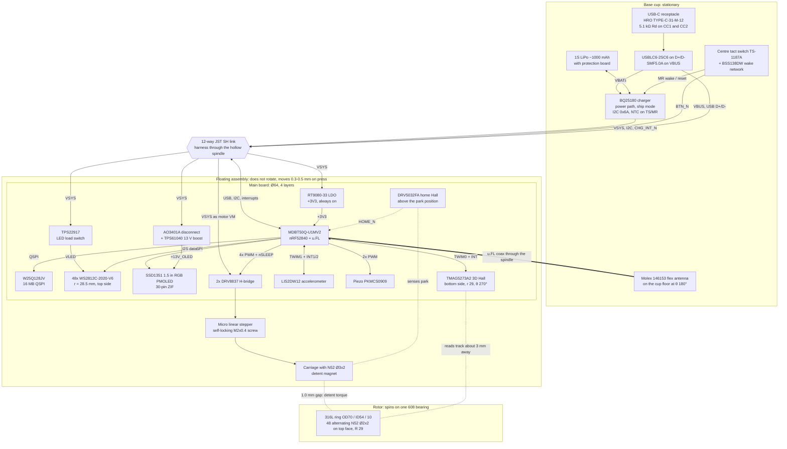

# dial-me-spinner: system architecture (rev A)

This document explains how the dial-me-spinner is put together and why. It
covers the requirements, the subsystem choices (with the alternatives that lost
and why), the power tree, the power budget and battery life, the RF strategy,
the risks, the open decisions and a rough cost.

* **Architecture of record:** [`hardware/design/SPEC.md`](../hardware/design/SPEC.md).
  The pin map and net names are in [`hardware/design/nets.py`](../hardware/design/nets.py).
  Where this document and SPEC disagree, SPEC wins. Problems found in SPEC while
  writing this are listed in [§13](#13-issues-found-in-spec-during-this-review).
* **Mechanical detail:** [`docs/mechanical.md`](mechanical.md) (in progress, not
  yet in the repository).
* **Charger register settings and power firmware:** [`docs/power.md`](power.md)
  (in progress, not yet in the repository; the verified register values are
  in [§6.5](#65-power-and-charger)).
* **Fabrication, hand assembly and bring-up:** [`docs/assembly.md`](assembly.md)
  and [`docs/bringup.md`](bringup.md).
* **Where the numbers come from:** each subsystem was researched, and an
  independent reviewer then checked the research against datasheets. This
  document uses the reviewer's **corrected** values. Values marked
  *estimate* are engineering estimates. Values marked *to verify on
  prototype* have not been measured yet and must be.

Status: rev A, schematic capture in progress. Nothing has been fabricated or
measured yet.

---

## Contents

1. [Overview](#1-overview)
2. [Requirements and how each is met](#2-requirements-and-how-each-is-met)
3. [System block diagram](#3-system-block-diagram)
4. [Board partition and the 12-way link](#4-board-partition-and-the-12-way-link)
5. [Mechanical concept (summary)](#5-mechanical-concept-summary)
6. [Subsystem design decisions](#6-subsystem-design-decisions)
7. [Power tree](#7-power-tree)
8. [Power budget and battery life](#8-power-budget-and-battery-life)
9. [RF strategy and its risk](#9-rf-strategy-and-its-risk)
10. [Risk register](#10-risk-register)
11. [Open decisions](#11-open-decisions)
12. [Rough BOM cost](#12-rough-bom-cost)
13. [Issues found in SPEC during this review](#13-issues-found-in-spec-during-this-review)
14. [References](#14-references)

---

## 1. Overview

The dial-me-spinner is a desk object about Ø70 × 36 mm. A heavy stainless
ring spins around a centre that does not rotate. The centre holds a 1.5 in
colour OLED and a ring of 48 RGB LEDs under a frosted diffuser. Pressing the top
clicks. A tiny linear stepper slides a magnet over a 48-magnet track on the
ring, which switches the ring between **free spin** and **24 clicks per turn**
(the click strength is variable). The stepper holds its position with zero
power. A 3D Hall sensor reads the same magnet track to measure rotation. An
nRF52840 handles BLE and USB. A ~1000 mAh LiPo and the USB-C charger sit in the
base.

It serves three use cases with the same hardware:

* **Game / decision spinner.** You flick the ring, the LEDs and OLED animate a
  prize wheel, a piezo ticks on every detent, and the result is shown when the
  ring stops.
* **PC / phone controller.** It acts like a Surface Dial: a BLE or USB HID
  Radial Controller on Windows, and a wheel or consumer-control device
  elsewhere. Turning gives clicks or smooth scrolling, and pressing is a button.
* **Fidget toy.** It gives long free spins or clicky spins, and counts spins and
  RPM.

| Parameter | Value | Source |
|---|---|---|
| Envelope | Ø70 × 36 mm | SPEC §8 |
| Rotor | 316L ring OD 70 / ID 54 / 10 mm, 124 g, I = 1.22e-4 kg·m². Rotor about 140 g with its PA12-GF carrier (*estimate*) | mechanical research (verified) |
| Bearing | One 608-2Z on a stationary hollow Ø8 spindle, with ≥ 2.5–3 N wave-spring preload | SPEC §8 |
| Detents | 24 × 15°, continuously variable 0 to 16.5 mN·m peak. Free-spin residual ≤ 3 µN·m | detent research (re-simulated by the verifier) |
| Rotation sensing | TMAG5273A2 3D Hall on the same track. 24 electrical periods/rev, about 3.1 kSPS, µA-level wake on rotation | SPEC §1, sensing research |
| Display | SSD1351 128×128 RGB PMOLED, 26.9 mm square active area behind a Ø30 window | SPEC §5.3 |
| LEDs | 48 × WS2812C-2020-V6 at r = 28.5 mm (7.5° pitch, 2 LEDs per detent) | SPEC §5.4 |
| Inputs | Press (0.3–0.5 mm travel), rotation, IMU tap and pick-up | SPEC §1, §5.5 |
| Audio | Magnet-free piezo, about 72 dB(A) at 10 cm | LED research |
| Radio | nRF52840 module MDBT50Q-U1MV2 with u.FL, and an off-board flex antenna in the base. TX at +8 dBm by default | SPEC §5.2, §8, [§6.6](#66-mcu-module-rfantenna-and-firmware-platform) |
| Battery | 1S LiPo, about 1000 mAh with protection board, thickness limited by the swelling gap (D8). BQ25180 charger, 400 mA charge (about 3 h) | SPEC §3, power research |
| Runtime (estimates, [§8](#8-power-budget-and-battery-life)) | Game about 9 h continuous. Desk use about 4 weeks per charge. Sleep about 32 µA | this document |

---

## 2. Requirements and how each is met

Rows **R** are the user's hardware requirements, rows **U** the three use
cases, and rows **D** requirements derived from them.

| # | Requirement | How it is met | Where | How to verify |
|---|---|---|---|---|
| R1 | Dial spinner of about 70 mm | Ø70 × 36 mm stack-up. The ring OD is the product OD | SPEC §8, [§5](#5-mechanical-concept-summary) | CAD fit check, then a printed mock-up |
| R2 | BLE (nRF52840) | Raytac MDBT50Q-U1MV2 module, BLE HID over GATT plus a custom GATT service, USB HID as a second path | SPEC §5.2, [§6.6](#66-mcu-module-rfantenna-and-firmware-platform) | Pair with Windows, macOS, Android and iOS |
| R3 | Centre OLED that stays readable | The OLED sits on the stationary floating assembly (FA) and the ring spins around it. No slip ring, no rotating optics | SPEC §1, [§6.3](#63-display) | Read the display while the ring spins at 10 rev/s |
| R4 | Ring of addressable RGB LEDs | 48 × WS2812C-2020-V6 on the stationary main board under an opal diffuser. Animations follow the measured ring angle in software | SPEC §5.4, [§6.4](#64-led-ring-and-audio) | Smoothness and colour checks at VBAT 3.4–4.2 V |
| R5 | Free spin vs click spin, switched electronically with magnetic detents | An alternating 48-magnet track on the ring plus a stationary detent magnet on a sliding carriage. The carriage moves 7.5 mm radially inward to go free. The actuator is a micro stepper with a self-locking screw, so holding a position takes zero power | SPEC §1, [§6.2](#62-detents-mechanism-and-actuator) | Residual cogging below the threshold of feel. 0 µA hold, measured |
| R6 | Balanced flywheel | Turned 316L ring, concentricity ≤ 0.02 mm TIR, balanced to ISO G2.5 at 15 rev/s (≤ 3.9 g·mm). Magnets are bought in matched lots. The IMU can measure 1×/rev vibration for an optional balancing assistant | [§5](#5-mechanical-concept-summary), docs/mechanical.md | Static balance, then IMU vibration at 10 rev/s |
| R7 | Long free spins | One low-friction 608 (instead of a large-bore thin-section bearing, about 10× less drag), non-magnetic ring, no copper pours facing the track, ferrous keep-outs | SPEC §7, §8 | Spin-down from 10 rev/s: verified acceptance **≥ 45–60 s** (mechanical verifier). SPEC's ≥ 2.5–3 N bearing preload is predicted to give only 20–65 s, so it may miss; the preload is the tuning variable (D3, [§13](#13-issues-found-in-spec-during-this-review) item 9). *To verify on prototype* |
| R8 | Press-down click | The whole FA (with the rotor) floats on 3 springs (≈ 4 N preload) and presses a centre tact switch on the base board. Pressing also wakes the device from ship mode | SPEC §3, §8 | Click force map (rim vs centre), no rocking |
| U1 | Game / decision spinner | Free or click spin, an LED wheel plus a 30–60 fps OLED wheel, piezo ticks synced to detent crossings, stop prediction from the measured spin-down, phone app over the custom GATT | [§6](#6-subsystem-design-decisions) | Game demo firmware |
| U2 | Surface-Dial-like controller | Composite HID: Windows Radial Controller (0.1° units, 150 units per detent), Consumer Control and Mouse wheel, over BLE and USB. Press = button | [§6.6](#66-mcu-module-rfantenna-and-firmware-platform) | Windows Wheel settings, Linux `evtest`, Android |
| U3 | Fidget toy | Long free spins, clicky mode, spin counter and RPM, wake on pick-up or tap | [§6.1](#61-rotation-sensing), [§6.2](#62-detents-mechanism-and-actuator) | User testing |
| D1 | Battery powered, USB-C charging | BQ25180 power-path charger, USB-C sink (Rd 5.1 kΩ), ESD/TVS | SPEC §3, §6 | Charge from empty, check temperature |
| D2 | Long standby, instant wake | About 32 µA sleep floor. Wake on rotation (TMAG Wake-up&Sleep mode), press, pick-up (IMU) or USB. Ship mode about 6 µA | [§8](#8-power-budget-and-battery-life) | PPK2 sleep-current measurement |
| D3 | Firmware updates without a debugger | MCUboot with its secondary slot on QSPI flash, SMP over BLE and USB, USB serial recovery | [§6.6](#66-mcu-module-rfantenna-and-firmware-platform) | DFU test on each OS |
| D4 | Audible ticks (magnetic detents are silent) | Piezo driven by complementary PWM, triggered on each detent crossing the encoder reports | SPEC §5.5 | Listening test |
| D5 | No magnetic interference with the detents or encoder | Alternating track (zero DC field). Ferrous and inductor keep-out ≥ 10 mm from the track and Hall sensor. No copper pours on B.Cu/In2.Cu at r ≥ 26 mm | SPEC §7, §8 | No preferred rest angle in free mode (histogram of 50 rests) |
| D6 | Buildable by a hobbyist | JLC-assemblable parts except the module (JLC global sourcing or consigned), the OLED panel and the mechanics | [§12](#12-rough-bom-cost) | First build |

---

## 3. System block diagram



Not shown: the 32.768 kHz crystal, the TC2030 SWD pads, and the per-part
decoupling, pull-ups and test pads. The +3V3 rail also feeds the flash, TMAG,
IMU, OLED logic, DRV8837 VCC and DRV5032.

---

## 4. Board partition and the 12-way link

### 4.1 Partition

| Board | Where | Moves on press? | Contents | Why it lives there |
|---|---|---|---|---|
| **main**: Ø64 mm, 4 layers, 1.6 mm, ENIG | Top of the FA, z 29.1–30.7 mm, 3.5 mm above the ring's magnet face | Yes, with the rotor | nRF52840 module, crystal, QSPI flash, 3V3 LDO, OLED ZIF + 13 V boost, 48 LEDs + load switch, TMAG5273, LIS2DW12, piezo, 2× DRV8837, DRV5032, motor and link connectors, SWD pads | Every part that interacts magnetically with the rotor (encoder, detent carriage, home sensor) rides on the same body as the rotor's bearing, so magnet gaps stay constant during a press and no magnetic force crosses the press suspension. The OLED and LEDs sit directly under the top cover. The u.FL end of the module faces the spindle bore. |
| **base**: Ø40 mm plus a tab to the USB-C, 2 layers, 1.6 mm, ENIG | Base cup, z 9.5–11.1 mm | No | USB-C, USBLC6, SMF5.0A, BQ25180, battery connector, NTC, centre press switch, BSS138DW wake network | The USB-C port must not float, or cable force would bias the click. The battery goes low, as about 20 g of ballast. Charger heat (0.5–0.8 W) stays away from the magnets and the Hall sensor. ENIG is needed for the 0.4 mm-pitch DSBGA charger. |

### 4.2 The link

A 12-wire harness with a JST SH (1.0 mm) vertical `BM12B-SRSS-TB` connector on
each board. It runs through the Ø6 bore of the stationary spindle. The pinout
is the same on both boards (SPEC §2):

| Pin | Net | Direction / notes |
|---|---|---|
| 1, 2 | VSYS | Base → main. 3.0–4.5 V (VBAT on battery, 4.5 V on USB) |
| 3, 4, 8 | GND | Three returns |
| 5 | VBUS | Base → main. nRF USB detect and USB PHY supply only (a few mA) |
| 6, 7 | USB_DM, USB_DP | ESD protection sits at the connector on the base |
| 9, 10 | I2C_SCL, I2C_SDA | System TWIM1. The BQ25180 at 0x6A is on the base; the 4.7 kΩ pull-ups are on main |
| 11 | CHG_INT_N | BQ25180 /INT, open drain, 10 kΩ pull-up on main |
| 12 | BTN_N | Press, open drain (BSS138DW Q2 on the base), 100 kΩ pull-up on main |

Electrical notes:

* **Current.** JST SH is rated 1 A per contact (for 28 AWG wire, so check the
  rating for the gauge you use), and VSYS has two contacts. The worst draw
  that firmware allows at the same moment is about 0.7 A (a detent stroke
  during an LED chase at the sustained cap, [§8.4](#84-peak-current)). The
  hardware worst case without the firmware caps is about 1.35 A with the 5 mA
  LEDs and about 2.35 A with the 12 mA WS2812B-2020-V6 drop-in. **The LED
  brightness cap is therefore a hardware protection function, not a styling
  choice.**
* **IR drop.** The real route (side slots, [§13](#13-issues-found-in-spec-during-this-review)
  item 2) makes the harness about 50–80 mm long. At 80 mm in 28 AWG
  (0.21 Ω/m) the two VSYS wires give about 8.5 mΩ and the three GND wires
  about 5.7 mΩ, so about 10 mV at 0.7 A. In 32 AWG it is about 25 mV. Either is
  negligible.
* **USB.** Full speed (12 Mbit/s) tolerates 50–80 mm of unshielded,
  uncontrolled-impedance wire. Twist D+ and D− together in the harness.
* **Ship mode.** In ship mode SYS is off, so the main board is unpowered. The
  base drives only open-drain lines (CHG_INT_N, BTN_N, I2C), so nothing
  back-powers the main board.
* **Mechanical: SPEC §8 has no workable path at the base end** (details and
  required changes in [§13](#13-issues-found-in-spec-during-this-review)
  item 2, risk R26):
  * The spindle bore cannot open downward on the axis: the spindle ends at the
    FA lower plate (z 12.8), exactly where the centre boss presses the
    TS-1187A (switch z 11.1–12.6, pre-gap 0.15). The harness and coax need a
    **side exit in the spindle wall above the lower plate** and an **off-axis
    hole or window in the lower plate**.
  * A vertical BM12B-SRSS-TB J3 on the base board has only about 1.7 mm to the
    lower plate above it (z 11.1 to 12.8) and about 0.5–0.7 mm to the LiPo
    below the board. It needs a lower-plate window, and with the FA pressed
    0.5 mm the plug and its wire bend reach toward the rotor carrier web
    (z 17, 16.5 when pressed). *To verify in CAD.* Alternatives: a low-profile
    right-angle header, or wires soldered to base-board pads.
  * The harness and coax cross from the stationary base to the floating FA.
    They need a **service loop of about 5 mm or more** to absorb the 0.3–0.5 mm
    press travel (up to about 0.75 mm at the rim) without pre-loading the
    click, and SPEC defines no volume for it.
  * Threading pre-crimped leads through the Ø6 bore is described in
    [docs/assembly.md §6](assembly.md#6-link-harness-12-way-jst-sh-through-the-spindle).

---

## 5. Mechanical concept (summary)

Full detail, drawings and tolerances will be in [docs/mechanical.md](mechanical.md)
(in progress); hand assembly is in [docs/assembly.md](assembly.md).
The essentials:

* **Topology: a mushroom on a spindle.** A stationary hollow Ø8 × 1.0 mm spindle
  is clamped to the FA lower plate and to the main board. The rotor spins
  around it on **one 608 bearing**. The OLED, LED ring, diffuser and top cover
  sit on top and never rotate. All wiring, and the antenna coax, pass through
  the spindle bore. They must enter and leave it through side slots, because
  neither end of the bore is open on the axis
  ([§13](#13-issues-found-in-spec-during-this-review) item 2).
* **Why a 608 and not a large-bore bearing.** In the SKF friction model, drag
  scales roughly with the bearing's mean diameter to the power 1.96. For the
  same rotor, an oiled 61808 (40×52) gives about 1.6 N·mm at 10 rev/s and a
  608 about 0.15 N·mm, so the 608 spins about 10× longer (verified). Contact
  seals (RSH/RS1) stop the rotor in under 1 s and are banned. Non-contact
  2Z (or 2RSL) bearings are degreased and re-oiled with ISO VG 2–10 oil.
* **Flywheel.** A turned 316L ring, OD 70 / ID 54 / 10 mm, 124 g. 316L is
  dense, non-magnetic and corrosion-proof, and its conductivity (about
  1.35 MS/m) is about 11× lower than brass, which keeps eddy drag from the
  stationary detent magnet negligible. The carrier web that holds the 608 outer
  race is **PA12-GF**. The research proposed 6061 aluminium; the reviewer
  rejected it because a conductive web under the detent magnet would cost
  0.13–1.6 N·mm of eddy drag.
* **Magnet track.** 48 alternating-polarity N52 Ø2×2 mm discs on the ring's
  **top face** at R = 29.0 mm. They give the detent torque and act as the
  encoder scale.
* **Stack (SPEC §8).** From the bottom up: feet, base cup floor and LiPo
  (z 2.5–9.0), base board (9.5–11.1), press switch, FA lower plate
  (12.8–14.3), rotor (15.6–25.6, magnet face at 25.6), detent carriage in the
  1.0 mm gap above the track (26.6–28.6), main board (29.1–30.7), LEDs and
  light box, OLED glass (33.0–34.7), diffuser and top cover (to 36.0).
* **Press.** Three springs push the FA up against stops with about 4 N of
  preload. A centre boss on the FA lower plate presses the TS-1187A
  (1.6 N, 100k cycles) on the base board. With this geometry and the TS-1187A
  the research predicts a click force of about **2.0–2.1 N at the rim and
  4.1–4.3 N at the centre** for a preload of 3.9–4.15 N (the verifier
  corrected the spring preload to 4.15 N at the specified installed length).
  The force is the same all the way round the circumference, with no rocking.
  The higher KSC2xx figures from the research apply only to option D9.
* **Bearing preload vs spin time.** The off-axis detent force (±0.7 N at
  R = 29 mm, about ±20 N·mm, reversing 24 times per turn) would rock a single
  608, because gravity alone only holds alignment up to about 11 N·mm. SPEC
  therefore adds a **≥ 2.5–3 N wave-spring preload**. That raises the
  rolling-friction term roughly by (4.4 N / 1.44 N)^0.54 ≈ 1.8×, and the
  sliding term by more. The verified spin-down estimate without preload is
  **40–120 s from 10 rev/s** (the model may under-predict friction). With the
  preload expect roughly **20–65 s**. The verified acceptance test is
  **≥ 45–60 s from 10 rev/s**, so SPEC's preload is predicted to miss it at
  the low end. Keep 45 s as the acceptance and treat the preload as the
  variable: measure spin-down and click-mode rocking against preload
  ([§11](#11-open-decisions), D3). These are model estimates and must be
  verified on the prototype.
* **Balance.** ISO G2.5 at 15 rev/s allows a residual imbalance of about
  3.9 g·mm for the rotor. A ring eccentricity of 0.02 mm TIR contributes about
  1.2 g·mm. Correct the rest with drilled holes or brass set screws.
* **Known mechanical hazards.**
  * A hard flick (about 0.23 N·s at 10 rev/s) can slide a 235 g puck. Use
    micro-suction feet, not high-friction gel feet, which make it tip instead.
  * The 608's axial limit is 0.25 × C0 = 0.34 kN, so a 10 cm drop onto a hard
    floor (about 290 N) is already near it. Treat the bearing as a
    replaceable part.

---

## 6. Subsystem design decisions

### 6.1 Rotation sensing

**Decision.** One **TI TMAG5273A2** 3D linear Hall sensor (SOT-23-6, I2C,
LCSC C3715882, about $0.58). It sits on the main-board underside at r = 29 mm,
θ = 270°, opposite the detent carriage, with its long axis radial. It reads the
**same 48-magnet alternating track** that makes the detents. The ring therefore
gives 24 electrical periods per revolution, one per detent, and the angle comes
from atan2 of the tangential (X) and axial (Z) field components.

**Why.**
* It is the only part found that combines off-axis tracking, resolution far
  above the need, built-in µA-level wake on rotation and a 1.7–3.6 V supply in
  one JLC-stocked chip.
* Merging the encoder with the detent track (rather than using the sensing
  research's separate 32-pole track) means logical clicks line up with physical
  detents through a single calibrated phase. It also needs only one set of
  magnet pockets.
* The sensor and the ring move together during a press, so the gap does not
  change.

**Key numbers.**

* Field at about 3 mm gap: Bt/Bz ≈ 15/18 mT, with zero DC field (detent
  research, re-simulated by the verifier). At 2 mm it is 40/51 mT, still inside
  the A2's ±133 mT range.
* Gap budget: the Hall element is about 0.73 mm inside the package. With the
  sensor on the board underside at z 29.1, the element-to-magnet gap is
  ≈ 2.8–3.1 mm, depending on the package-height tolerance.
* Sampling: XZX pseudo-simultaneous mode with 4× averaging gives about
  3.1 kSPS. The internal oscillator is untrimmed, so measure the sample rate
  at run time. Reads use the 1-byte frame (about 163 µs) on the dedicated
  TWIM0, triggered by INT through PPI and DMA, so the CPU does no per-sample
  work.
* Speed limits: at 30 rev/s the electrical advance is 84° per sample. The
  aliasing limit is about 65 rev/s (43 rev/s with a conservative 120°-per-sample
  tracker). A hand-flicked ring reaches about 5–20 rev/s.
* Resolution: noise is about 0.15 mT RMS at 1× averaging, which is
  ≈ 0.01° mechanical RMS after averaging. After a one-spin self-calibration
  (a LUT measured against the nearly constant speed of the flywheel), accuracy
  is about 0.05–0.1° mechanical. HID only needs 0.1° units.
* Wake: Wake-up&Sleep mode with thresholds re-armed for each rest position.
  Current is about 3 µA at a 100 ms interval and 17–20 µA at 10 ms (modelled;
  *to verify on prototype*). It triggers within a few degrees of rotation.
  **After a threshold interrupt the TMAG stays in standby at 0.45 mA until
  firmware re-arms it**, so a firmware watchdog for re-arming is mandatory.
* Tracking current: 2.3 mA (TMAG) + 0.31 mA (pull-ups) + about 0.4–0.65 mA
  (nRF peripherals).

**Consequences.**
* Absolute ring position after a power loss is known only modulo one detent
  pitch, because SPEC has no index magnet. That is fine for an unmarked ring;
  game graphics are virtual.
* The 15/18 mT signal is weaker than a dedicated Ø4×2 track (50/61 mT), but
  still far above the noise floor.
* There is a DNP DRV5012 latch footprint as a fallback wake sensor.

**Alternatives considered.**

| Option | Why rejected |
|---|---|
| Dedicated 32-pole Ø4×2 track on the ring underside (sensing research's primary) | It would need a second set of pockets, and click and encoder phase would not be tied together. SPEC merged the tracks under the condition the sensing research gives in its alternatives: merging is valid, and better, if the detent ring alternates polarity and has at least 20 magnets. |
| TMAG5170 (SPI 10 MHz) | 4× the price, 2.3 V minimum supply, 3.4 mA, 5 MCU pins. Its extra bandwidth is not needed. Kept as a re-spin fallback. |
| Two analog Halls (DRV5055) in sin/cos | About 5.3 mA with the SAADC, no µA wake, and two parts to calibrate. |
| Hall latches in quadrature (DRV5012 ×2) | Only 4 counts per pole pair (96 CPR here), and counts are lost at speed. Kept only as the DNP wake fallback. |
| Integrated angle ICs (MT6701, MA732, MA600, MT6835) | 7.5–22 mA with no µA wake, and they need an on-axis magnet, but the OLED occupies the axis. |
| iC-MU nonius encoder | 5 V, about 48 mA, 0.06 mm eccentricity tolerance. |
| AS5311 / AS5306 | 16–21 mA, and a 650 mm/s maximum speed against a track speed of about 5.5 m/s at 30 rev/s. |
| Optical (code strip, reflective pairs, mouse sensor) | mA-level LED current, sensitive to dust and grease, and low-power mouse sensors cannot track 5 m/s. |
| Inductive (LX3302A, IPS2200) | mA-level current, custom coil design, and the coils would compete with the LEDs for the same PCB annulus. |

### 6.2 Detents: mechanism and actuator

**Decision.**

* The **rotor track** is 48 alternating N52 Ø2×2 mm discs on the ring top face
  at R = 29.0 mm. A **stationary N52 Ø3×2 mm detent magnet** sits 1.0 mm above
  it. Together they give **24 detents of 15°**.
* Strength is set by an **in-plane radial-inward offset** of the detent magnet,
  at a constant 1.0 mm gap. 0 mm offset is full click, and r ≤ 21.5 mm
  (offset ≥ 7.5 mm) is free spin.
* The carriage is driven by a **micro PM linear stepper with a self-locking
  M2×0.4 lead screw** (VIC-TECH VSM08102 class, or its 10 mm sibling) through
  **2× DRV8837**. A **DRV5032FA** Hall switch above the park position checks
  homing.
* Holding position takes zero power: the lead angle (4.2°) is below the
  friction angle (about 9.8°), and both end positions are magnetically
  force-neutral.

**Why.**
* The alternating track has zero mean field. Compared with a same-polarity
  track this gives 1.57× lower peak pull on the carriage, 10–100× less cogging
  from stray steel, and a clean encoder signal with no DC offset.
* In-plane retraction needs a shorter stroke (7.5 mm vs about 9.4 mm for
  ≤ 3 µN·m residual) and puts about 2.4× less magnetic load on the actuator
  than pulling the magnet straight away from the face.
* The stepper gives variable strength and repeats to ±1–2 full steps
  (±0.02–0.04 mm, about ±2–4 % torque).

**Key numbers (verified by independent re-simulation, within about 1 %).**

| Offset (mm) | 0 | 1.5 | 3.0 | 5.0 | 7.5 |
|---|---|---|---|---|---|
| Peak detent torque (mN·m) | 16.5 | 9.5 | 2.0 | 0.14 | 0.0027 |

* For comparison, an Alps EC11 encoder detent is about 10–12 mN·m and a Bourns
  PEC11H about 20.6 mN·m. At the 35 mm rim, 16.5 mN·m is only 0.47 N of
  fingertip force, so default to the strongest setting for a crisp feel.
* Barrier energy is 2·T/N = 1.4 mJ, so the ring is captured in a detent below
  about 0.74 rev/s. The natural frequency in a well is about 9 Hz at full
  strength.
* Actuator load. The research said ≤ 0.55 N; the verifier corrected it to a
  worst case of **0.8–1.15 N** once guide friction on both preloaded faces and
  the anti-lash spring are included. That is **above the 8 mm VSM08102's
  0.78 N minimum thrust**, which is rated only at 500 PPS.
  * Either use the 10 mm sibling (about 1.7 N claimed, not yet confirmed by a
    vendor datasheet).
  * Or reduce preloads to about 0.4–0.5 N on a PTFE/POM pair, make the
    anti-lash spring push toward PARK, and step at ≤ 300–500 PPS through the
    loaded 0–4 mm zone.
  * Expect **0.6–0.9 s per full stroke** and about 0.035–0.08 mAh per stroke.
  * Peak battery current is 0.36–0.42 A.
* Homing: a gentle stall at the force-free PARK end at ≤ 50 % PWM. The DRV5032
  must confirm HOME on every return to free mode; after 3 failures the firmware
  goes to FAULT and stays in free mode.

**Ringing in a detent (to verify on prototype).** The detent is conservative
and the 608 has low friction, so after capture the ring rocks back and forth
in the well. The decay per cycle is 4·T_friction / k, where
k = 24 × 16.5 mN·m = 0.40 N·m/rad.

| Bearing friction | Decay per cycle | Rocking time (from ±7.5°) |
|---|---|---|
| 0.15 mN·m | 0.09° | about 86 cycles, ≈ 10 s |
| 0.3 mN·m (with preload) | 0.17° | about 43 cycles, ≈ 5 s |
| Optional felt/UHMW shoe on the carriage, about 1.6 mN·m, touching only at full click | 0.93° | ≈ 8 cycles, ≈ 1 s |

Firmware should also decide the landing detent as soon as the velocity reverses
inside a well, so game results never wait for the ringing to stop.

**Alternatives considered.**

| Option | Why rejected |
|---|---|
| N10/N20 gearmotor with an M3 lead screw (fallback, same connector and driver) | About 45 mm long, 1.8–9 s per stroke, gear whine, and binary positions only without an encoder. Kept as a fallback because of its huge thrust margin. |
| Micro linear RC servo (1.8 g class) | Unpowered hold is uncertain, durability is hobby-grade and sourcing is intermittent. Good for breadboarding the magnetics. |
| Latching solenoid | 2–5 mm stroke (7.5 mm needed), binary only, a loud clack, and a strong magnet plus a steel plunger near the track. |
| Electro-permanent magnet (Logitech MagSpeed principle) | 8–11 A pulses at 15–25 V need a boost converter and a 10 A bridge. It also needs a steel-tooth rotor, which removes the magnet-track encoder. Kept as the long-term upgrade path. |
| Rotating diametric magnet between steel poles ("Magswitch") | The steel poles stay next to the track in OFF, giving 25–450 µN·m of cogging, which is at least the bearing friction. |
| SMA wire with a latch | Stroke and force do not match (150–250 mm of wire for 7.5 mm), it is binary only, and it is sensitive to temperature. |
| 24 same-polarity Ø3×2 magnets | DC field: 1.6× more carriage pull, 10–100× more stray-steel cogging (8 mm keep-out needed), and a poor encoder. Acceptable fallback if 48-magnet assembly proves impractical. |
| Retracting the magnet along the face normal | About 2.4× more actuator load and a longer stroke. |
| Steel pole instead of a magnet | About 10× weaker at practical gaps. |
| BLDC haptics (SmartKnob style) | Draws hundreds of mA continuously whenever detents are active, which contradicts the zero-hold-power requirement. Motor cogging also kills long spins. |

### 6.3 Display

**Decision.** A bare-glass **1.5 in 128×128 RGB PMOLED with the SSD1351**
controller:
* Panel: Newhaven NHD-1.5-128128G. The proven pin-identical second source is
  the Orient AOC128128A0-1.50W.
* Connection: a 30-pin 0.5 mm FPC folded behind the glass into a
  **bottom-contact** ZIF (AFC01-S30FCA-00) on the main-board top side.
* Interface: write-only 4-wire SPI.
* Panel VCC: 13.0 V from a **TPS61040** boost (499 kΩ / 52.3 kΩ divider,
  both 0.5 %, SPEC §5.3) behind an **AO3401A** input disconnect. With the boost
  off, the panel's VCC floats and draws nothing from the boost.

**Why.**
* It is the only colour OLED whose full frame (32 KiB, 12.5 % of RAM) fits the
  nRF52840's RAM and SPI bandwidth with margin. A full-screen prize wheel
  redraws in 32.8 ms at 8 MHz (30 fps) or 16.4 ms at 16 MHz (61 fps), against
  the controller's 20 MHz SPI limit.
* There is a mainline Zephyr `solomon,ssd1351` driver.
* The reference circuit is documented consistently by Newhaven, Orient and
  Solomon.

**Key numbers.**

* Brightness: 90 cd/m² typical. Good indoors, unreadable in direct sun.
* Visible area: the active area is 26.86 mm square. Behind SPEC's Ø30 window,
  90 % of the pixels are visible and the UI is drawn in a circle.
* Current: logic draws 0.24 mA. Battery-side current with the boost at about
  80 % efficiency:

  | Screen content | Battery current |
  |---|---|
  | All black, VCC on | 5.3 mA |
  | Typical dark UI, 15 % lit | 26 mA |
  | 30 % lit | 58 mA |
  | Full white | 146 mA |

  The master-current register C7 scales the content term: 08h = 56 %,
  0Ah = 69 %.
* Wake latency: about 200–400 ms. The vendor sequence needs 200 ms after VCC
  comes up before display-on (command AFh), plus about 200 ms before the panel
  scans.
* Sleep: about 10–12 µA typical, 35–40 µA maximum. That is ICI 4 µA, plus about
  5 µA leaking from VCI through the panel's internal ESD path into the boost
  feedback divider, plus 3.3 µA in the 1 MΩ RES# pull-down while RES# is held
  high.
* Boost headroom: at VBAT 3.0 V and the minimum current limit, the TPS61040
  delivers only about 33–35 mA. That is not enough for a guaranteed full-white
  screen, so firmware caps master current and white area below 3.4 V.

**Firmware notes.**
* SPEC routes the panel to P0.13–P0.16 and names SPIM3. Use **SPIM2 at 8 MHz**
  on the same pins by default: it avoids nRF52840 anomalies 198 (TX-buffer
  corruption) and 195 (about 900 µA after disable). Use SPIM3 at 16 MHz only
  with the buffers in RAM AHB slaves 6/7.
* The mainline driver needs a patch: VCC sequencing after init, RAM clear
  before AFh, and ABh low-power sleep.
* Burn-in policy: dark theme, static elements at ≤ 40 % grey, auto-dim at 10 s,
  sleep at 30 s, and a ±2 px orbit.

**Alternatives considered.**

| Option | Why rejected |
|---|---|
| 1.43 in round AMOLED, 466×466 (CO5300/SH8601) | The nRF52840 cannot drive its quad interface (the QSPI block is a flash controller), so it gets about 9 fps over 1-wire SPI. The 424 KiB frame exceeds RAM, and there is no stable Western-distributor part number. It is the upgrade path if a true round display matters more than frame rate. |
| SH1107 128×128 mono (Wisevision, in stock at LCSC) | No colour, which the game UI needs. It is **not** a drop-in: different FPC and pitch, 33.9×37.3 glass and an 11.5–12.5 V VCC window. Supply-chain fallback only. |
| SSD1327 128×128 grey | No colour, same boost complexity, no stocked bare panel. |
| SH1106 / SSD1309 128×64 | A 2:1 strip in a round window. Monochrome. |
| SSD1331 96×64 RGB | 0.95 in, too small for the window. Out of stock. |
| GC9A01 1.28 in round LCD | Not an OLED: constant backlight current and glowing blacks. Needs SPIM3 at 32 MHz. |

### 6.4 LED ring and audio

**Decision.**

* **LEDs:** 48 × **WS2812C-2020-V6** (5 mA per channel), LCSC C55109522, on the
  main-board top at r = 28.5 mm. That is 7.5° per LED, 2 per detent, LED1 at
  θ = 0°.
* **Supply:** VSYS directly, through a **TPS22917** load switch (CT 1 nF,
  QOD tied to VOUT, 2 × 22 µF bulk). No 5 V boost.
* **Data:** nRF **I2S0 SDOUT** (P0.06) at 3.3 V logic, through 220 Ω (R40,
  SPEC §5.4; it limits DIN clamp current if P0.06 is ever high while VLED is
  off), with no level shifter. 100 kΩ pull-downs on the first DI and on the
  last DO, because V6 DI/DO pins are auto-swappable. The DC drop across
  220 Ω into the DI pull-down is about 6 mV.
* **Optics:** a white-interior, opaque-exterior light box, about 2.7 mm of air,
  then an opal PMMA diffuser ring (r 27–30).
* **Audio:** a magnet-free Murata **PKMCS0909E4000-R1** piezo, driven
  complementary from one PWM instance through 2 × 100 Ω.

**Why the V6 part.** It is the only widely stocked 2020-size single-wire RGB
LED whose datasheet covers all of these at once:
* a 3.3–5.3 V supply, so it runs straight off a LiPo;
* ≤ 1 µA standby (older parts idle at 0.5–1 mA each);
* VIH = 0.55–0.6 × VDD, which 3.3 V logic meets at VLED ≤ 4.5 V;
* 2 kHz PWM.

The 5 mA "C" variant caps full white at 48 × 3 × 5 mA = 0.73 A, against 1.74 A
for the 12 mA "B" variant, and is still 30–50× brighter than the OLED through
the diffuser. 48 LEDs are 2 per detent, and at the short (about 2.7 mm)
diffuser gap that SPEC's stack allows they give a far smoother ring than 24 or
36 would.

**Key numbers.**

* Data timing: I2S at SCK 3.2 MHz, nibble 0x8 for a 0 and 0xC for a 1, gives
  T0H 312 ns and T1H 625 ns, inside the V6 windows. Use a reset delay of
  ≥ 300 µs and the HFXO clock source. A frame of 48 LEDs takes about 1.74 ms
  (575 fps maximum at line rate).
* Logic margin: at VSYS 4.5 V (on USB) the input threshold VIH is
  0.55–0.6 × VDD = 2.48–2.7 V. The nRF's guaranteed VOH is VDD − 0.4 V
  (nRF52840 PS, standard drive). With the RT9080 at its −2 % limit
  (3.23 V, [DS9080-09](https://www.richtek.com/assets/product_file/RT9080/DS9080-09.pdf))
  that is about 2.83 V, so the **worst-case margin is about 0.1–0.2 V** at
  VSYS 4.5 V, before any SYS-regulation tolerance (each +1 % on VSYS costs
  about 27 mV). On battery (VSYS ≤ 4.2 V, VIH ≤ 2.52 V) it is ≥ 0.3 V. The DI
  input draws only µA, so the real VOH sits close to VDD and the typical margin
  is about 0.6 V or more; the guaranteed figure is what is thin. This is why the
  nRF runs at 3.3 V ([§6.5](#65-power-and-charger)), and it is listed as risk
  R27.
* Diffuser uniformity: at 3.73 mm pitch and about 2.7 mm gap (pitch/height
  about 1.4), an ideal Lambertian diffuser gives roughly 0.75–0.8 min/max
  brightness along the ring. Expect slight beading; *to verify on prototype*.
* Firmware power limit: 300 mA burst, 150 mA sustained, derate at 3.50 V,
  red-only below 3.40 V.

**Alternatives considered.**

| Option | Why rejected |
|---|---|
| WS2812B-2020-V6 (12 mA, same footprint) | Allowed as a drop-in and now much better stocked (about 897k vs 47k at LCSC), but full white is 1.74 A, above the BQ25180's 1.5 A SYS limit. Fitting it makes the firmware cap mandatory from first boot. |
| Legacy WS2812B-2020 | 3.7 V minimum supply, about 0.6 mA idle per LED, discontinued. |
| SK6805-EC15 / EC20, SK6812MINI-E | VIH 0.78 × VDD (needs a level shifter) or VDD ≥ 3.5–3.7 V, 1 kHz PWM, about 0.5 mA idle per LED. |
| APA102-2020 / SK9822 (clocked) | 5 V class, so a boost plus a level shifter; about 1 mA idle per LED. Worth it only for high-speed video. |
| Side-emitting LEDs into a light guide | Poor pixel separation, which is bad for prize-wheel segments. |
| Driving the data line from SPIM (ZMK style) | T0L is out of spec, though it works in practice. Kept as a fallback if I2S is needed elsewhere. |
| PWM + DMA, or bit-bang | PWM needs a custom driver; bit-banging is not BLE-safe. |
| Magnetic buzzer, micro-speaker, LRA haptics | Each contains a magnet that would bias the Hall sensor and cog the track. The only I2S peripheral is taken by the LEDs. |

### 6.5 Power and charger

**Decision.**

* **Charger (base board):** TI **BQ25180** I2C linear charger with power path.
  On USB it regulates SYS to 4.5 V; on battery SYS = VBAT. Ship mode with
  push-button wake draws 3.2 µA, and shutdown draws 15 nA. The input tolerates
  25 V. A 10 kΩ B3435 NTC sits on TS/MR.
* **Ship-mode wake network:** the centre switch, through a BSS138DW, both
  wakes the charger (TS/MR pulled low: ship-mode wake after about 2 s, hardware
  reset after 20 s) and pulls the nRF's BTN_N low (instant wake from sleep).
  The two FETs isolate the shared TS/MR pin from the nRF.
* **Main board:** the nRF52840 runs in **normal-voltage mode**:
  * VDD and VDDH are both on +3V3 from an **RT9080-33** LDO
    (2 µA quiescent, 600 mA, about 310 mV dropout at 600 mA). SPEC's alternate
    is the TPS7A0233 (25 nA quiescent, 200 mA, same SOT-23-5 pin functions;
    confirm the pinout before swapping).
  * The module's internal REG1 DC/DC is enabled.
  * Every heavy or high-voltage load is fed from VSYS through its own gate:
    LEDs through the TPS22917, the OLED boost through the AO3401A, and the motor
    through DRV8837 nSLEEP.
  * Battery voltage is read through an always-on 2.2 MΩ/1 MΩ divider into
    AIN0, costing about 1.2 µA.

**Why normal-voltage mode, when the power research recommended high-voltage
mode (VDDH = SYS, REG0 DC/DC → 3.0 V)?** SPEC chose normal mode, and the
reasons are sound:

1. **LED logic margin.** At VLED up to 4.5 V the WS2812-V6 needs a data high of
   up to 2.7 V. A 3.0 V REG0 rail can be as low as 2.7 V (−10 % tolerance),
   where the guaranteed VOH is VDD − 0.4 ≈ 2.3 V: a **negative margin of about
   −0.4 V, so high-voltage mode fails outright** without a level shifter. At
   3.3 V (RT9080 ±2 %) the worst-case VOH is about 2.83 V, a margin of about
   0.1–0.2 V ([§6.4](#64-led-ring-and-audio)).
2. **No REG0 load limits.** In high-voltage mode, external loads on VDD are
   limited to 25 mA with TX ≤ +4 dBm, 5 mA above +4 dBm, and 1 mA in System OFF.
   Rev A transmits at **+8 dBm by default** ([§6.6](#66-mcu-module-rfantenna-and-firmware-platform),
   [§9](#9-rf-strategy-and-its-risk)), which would leave only 5 mA for the
   flash, TMAG, IMU, OLED logic and pull-ups on VDD.
3. **No dependence on REG0 silicon behaviour.** REG0 DC/DC is broken on Rev 1
   silicon (anomaly 197), and the reviewer flagged the high-voltage-mode
   active-current efficiency as unverified.
4. **No extra ferrite.** High-voltage mode would add a 10 µH DCCH inductor, one
   more ferrite part to keep 10 mm away from the magnets.

The cost is small (recomputed in [§8](#8-power-budget-and-battery-life)):
* about 0.8 mA in desk-active use (≈ 3 %);
* about 1.2 mA in game use (≈ 1 %);
* about 3 µA in sleep (the LDO quiescent current plus the divider, ≈ 10 % of
  the floor);
* the free VDDHDIV5 battery measurement is lost, hence the divider.

**Charger settings.** The full register list will be in [docs/power.md](power.md)
(in progress). Until then these are the
values from the verified research:

| Register | Value | Setting |
|---|---|---|
| ICHG_CTRL | 0x43 | ICHG 400 mA |
| TMR_ILIM | 0xCD | ILIM 500 mA code, 475 mA typical |
| VBAT_CTRL | 0x46 | 4.20 V |
| CHARGECTRL1 | 0x92 | BATOCP 1.5 A, BUVLO 3.0 V |
| IC_CTRL | 0x97 | Watchdog off; write it in the first I2C exchange |
| SHIP_RST | 0x09 | Long press = hardware reset |
| SYS_REG | 0x40 | SYS 4.5 V on USB |

* **SYS must never be set to pass-through.** VBUS on VSYS could exceed the
  LEDs' 5.3 V absolute maximum.
* Write these registers at every boot and on every VIN_PGOOD interrupt. The
  power-on default is a 10 mA charge.
* SPEC has no CC-line sensing, so the 500 mA / 700 mA fast-charge path from the
  research is not available. Charging is about **2.8–3 h** at 400 mA.
* For USB compliance, limit input current to about 100 mA until the nRF
  enumerates, or set bMaxPower to at least 500 mA.

**Alternatives considered.**

| Option | Why rejected |
|---|---|
| nRF52840 high-voltage mode (power research's primary) | See the four reasons above. |
| Nordic nPM1300 PMIC | Best integration (96 ms ship wake, fuel gauge, CC detection), but LCSC stock was 51 QFN / 897 WLCSP. Revisit if stock appears. |
| Nordic nPM1100 | 400 mA charge maximum, no I2C, larger package. |
| External buck (TPS62840) or buck-boost (TPS63900/63802) for 3.3 V | Adds an inductor near the magnets, cost and area. A LiPo holds less than 5 % of its capacity below 3.3 V, so a buck-boost buys almost nothing. The LDO wastes only about 3 % at these loads. |
| BQ24072/74 | No ship mode or button wake. |
| MCP73831 / TP4056 with a discrete load-sharing circuit | No real power path, no ship mode. |
| BQ25120A | 300 mA maximum, about 8–30 pcs in stock. |
| BQ21080 / BQ25185 | Higher battery quiescent current, or (BQ25185) VIN-only wake from factory mode. |
| AW32001 | Datasheet could not be verified. |
| 5 V boost for the LEDs | About 50 % more LED energy, plus noise and an inductor. The V6 LEDs run directly from VBAT. |
| Discrete P-FET LED switch | No defined slew and no output discharge. The TPS22917 costs $0.36. |
| Fuel gauge (MAX17048) | Adds 3 µA. A load-compensated voltage table is enough for a battery indicator in 5–10 % steps. |

### 6.6 MCU module, RF/antenna and firmware platform

**Decision.**

* **Module:** **Raytac MDBT50Q-U1MV2** (nRF52840, u.FL), on the main-board
  bottom at r 8–22 mm, θ ≈ 180–250°, with the u.FL end toward the spindle.
  At r ≈ 9 the mated u.FL plug hangs down to about z 24.5, over the rotating
  608; moving the u.FL end to r ≥ 13 is the likely fix (risk R25).
  * It exposes all 48 GPIO plus USB, VDDH and DCCH.
  * The 32 MHz crystal and the REG1 inductor are inside. The 32.768 kHz crystal
    (SC-20S, 2 × 12 pF) is on the board.
  * It holds an FCC grant (SH6MDBT50Q), and KiCad 9 ships its symbol and
    footprint.
* **Antenna:** an off-board **Molex 146153** balanced flex (34.9 × 9 mm) on the
  base-cup floor ([§9](#9-rf-strategy-and-its-risk)).
* **TX power: +8 dBm by default in rev A.** The link budget in [§9](#9-rf-strategy-and-its-risk)
  assumes it, and at 0 dBm the severely-detuned case would have only about
  1.5 dB of margin at desk distance. It costs about +10 mA while transmitting
  (14.8 mA vs 4.8 mA, nRF52840 PS), which averages to about +3 µA in connected
  idle and about +0.2 mA in desk-active use (*estimate*, included in
  [§8](#8-power-budget-and-battery-life)). Normal-voltage mode puts no VDD
  load limit on it. Backing the power off on strong links is a later firmware
  optimisation, to be decided from the RSSI tests.
* **Flash:** **W25Q128JV** 16 MB QSPI for the MCUboot secondary slot and the
  UI assets.
* **Firmware:** nRF Connect SDK (Zephyr) with the SoftDevice Controller.
  * MCUboot: signed images, swap-using-move, secondary slot in QSPI. Size
    MCUboot from a real build (about 64 KB with USB CDC serial recovery), which
    leaves a primary slot of about 928 KB.
  * Updates: SMP over BLE and USB CDC.
  * UI: LVGL on SPIM2. LEDs: `worldsemi,ws2812-i2s`.
  * HID: `bt_hids` and Zephyr USB HID with one composite report map:
    * ID 1: Windows Radial Controller, 0.1° units, 150 units per detent;
    * ID 2: Consumer Control;
    * ID 3: Mouse with wheel and AC Pan.
  * A custom 128-bit GATT service for the phone or Web Bluetooth app, under its
    own identity in a second extended-advertising set.
  * Multi-host bonding following the nRF Desktop pattern.
  * Code will live in `firmware/` (planned).

**Why a u.FL module.**
* It separates antenna placement from the PCB, which is the only robust answer
  in a 70 mm puck where a steel ring and a 4-layer board cover the whole top
  plane.
* It needs only a few support parts and gives 48 GPIO. SPEC uses 36 GPIO, with
  8 no-connect and 4 test pads.
* The JLC stock gap (0 pcs on 2026-10-18) is handled by global sourcing or
  consigned parts.

**Alternatives considered.**

| Option | Why rejected |
|---|---|
| Ebyte E73-2G4M08S1CX (u.FL, stocked at JLC) | 32 GPIO with only 15 fast-capable, no verified modular grant, no KiCad footprint. JLC-stock plan B only. |
| MDBT50Q-1MV2 / -P1MV2 (chip or PCB antenna on the module) | The on-module antenna needs a copper-free board edge away from metal, and every edge here sits over the steel ring. |
| nRF52840 directly on the board (QIAA) | Cheapest, but needs aQFN73 fan-out, a matching network, VNA tuning and loses the modular grant. Revisit in a cost-down revision once the antenna is proven. |
| u-blox NINA-B30x, Fanstel BT840, Minew MS88SF2/3, Holyiot 18010, Insight ISP1807, Seeed XIAO | 2–3× the price, fewer GPIO, unverifiable specs, an integrated antenna that metal would detune, or a fixed antenna position. |
| Arduino Adafruit nRF52 core + UF2 bootloader | Fast to prototype, but built on the nRF5 SDK and S140, which are in maintenance. Weak multi-host support, composite USB and signed DFU. |
| ZMK firmware | Keyboard-centric, with no Radial Controller. |
| Other flex antennas (Taoglas FXP73, Kinghelm) | Longer (47 mm) or unverified. The Molex is balanced, so it works without a ground plane. |

---

## 7. Power tree

```
USB-C VBUS (5 V) ──SMF5.0A TVS──┬── BQ25180 IN ─[ILIM 475 mA]─┐
                                │                            ├── SYS = VSYS: VBAT on battery, 4.5 V on USB
                                └── link pin 5 ── nRF VBUS   │      (off in ship/shutdown mode)
1S LiPo + PCM (3.0–4.2 V) ── BQ25180 BAT (BATOCP 1.5 A) ─────┘
                                                             │
VSYS ─┬─ RT9080-33 LDO ───────── +3V3 (always on): nRF VDD+VDDH, W25Q128, TMAG5273, LIS2DW12,
      │                                           OLED VCI/VDDIO, DRV8837 VCC, DRV5032, pull-ups
      ├─ TPS22917 (LED_PWR_EN) ── VLED ── 48× WS2812C-2020-V6
      ├─ AO3401A (OLED_VCC_EN) ── OLED_VIN ── TPS61040 ── +13V_OLED ── SSD1351 VCC
      ├─ 2× DRV8837 VM (MOT_NSLEEP) ── micro stepper coils A/B
      └─ 2.2 MΩ / 1 MΩ ── VSYS_SENSE ── AIN0
```

| Rail | Source | Voltage | Switched by | Design current | Notes |
|---|---|---|---|---|---|
| VBUS | USB-C | 4.4–5.5 V (nRF detect ≥ 4.3 V) | none | ≤ 475 mA into the charger | The nRF VBUS absolute maximum is 5.8 V. The SMF5.0A clamps transients only. |
| VBAT | cell | 3.0–4.2 V | PCM / BQ25180 BATFET | 1.5 A (BATOCP) | Firmware enters ship mode at ≥ 3.45 V rested: the BQ25180 needs VBAT > 3.15 V to wake by button. |
| VSYS | BQ25180 SYS | 3.0–4.5 V | ship / shutdown | 1.5 A DC, 2.5 A for < 20 ms | Unswitched capacitance is about 72 µF, against the ≤ 100 µF guideline. |
| +3V3 | RT9080-33 | 3.3 V; tracks VSYS minus dropout below about 3.35 V | always on | about 50 mA peak (TX + CPU + QSPI erase) | W25Q128 needs ≥ 2.7 V. With BUVLO at 3.0 V the rail stays ≥ 2.9 V. |
| VLED | TPS22917 | = VSYS | LED_PWR_EN (100 kΩ pull-down) | 0.73 A hardware max; firmware cap 0.3 A burst, 0.15 A sustained | Load is about 49 µF nominal (2 × 22 µF + 48 × 100 nF). CT 1 nF gives a slew of about 1.9 V/ms, so about 90 mA of inrush, a 1.6 ms rise and a turn-on time tON of about 4 ms (3.8 µs/pF at 3.6 V, [SLVSDW8B](https://www.ti.com/lit/ds/symlink/tps22917.pdf) §7.6). QOD fall time is 2.2 × 150 Ω × 49 µF ≈ 16 ms: allow ≥ 20 ms. DC-bias derating of the 22 µF parts makes the real inrush lower and the fall faster. |
| OLED_VIN | AO3401A | = VSYS | OLED_VCC_EN (100 kΩ pull-down) | ≤ 0.2 A inrush | Boost off means the panel VCC floats and draws 0 µA from the boost. |
| +13V_OLED | TPS61040 | 13.0 V (12.5–13.5 V window) | as above | ≤ 40 mA | Measure VCC on the first boards. The FB bias current can push VCC high. |
| VM | VSYS | = VSYS | MOT_NSLEEP | 0.36–0.42 A for ≤ 0.9 s | Move the motor only when VBAT ≥ 3.3 V under load. |

**Sequencing.**
* **OLED on:** +3V3 is already up. Pulse RES#, initialise, clear RAM, set
  OLED_VCC_EN, wait ≥ 200 ms, then send AFh.
* **OLED off:** send AEh, then clear OLED_VCC_EN.
* **LEDs on:** keep DIN (P0.06) low, set LED_PWR_EN, wait ≥ 5 ms (tON about
  4 ms), then send the first frame.
* **LEDs off:** send an all-zero frame, drive DIN low, then clear LED_PWR_EN.
  Allow ≥ 20 ms for the QOD discharge before treating VLED as off. Never drive
  DIN high while VLED is off (SPEC §5.4).
* **Charger:** write the BQ25180 registers before the first 160 s of I2C
  activity end. The watchdog starts at the first I2C transaction.

---

## 8. Power budget and battery life

### 8.1 Assumptions

* **Cell:** about 1000 mAh nominal; **900 mAh usable** to a 3.45 V rested
  cutoff, with some ageing margin. Currents are battery-side at
  VBAT ≈ 3.7 V.
* **3V3 loads** pass through a linear LDO, so battery current equals load
  current, plus 2 µA.
* **OLED** figures are battery-side, from the display research: boost about
  80 % efficient; black screen 5.3 mA; 15 % lit 26 mA; 30 % lit 58 mA at full
  master current; scaled by C7 (08h = 56 %).
* **nRF currents** are from nRF52840 PS v1.1 (DC/DC at 3 V; slightly
  conservative at 3.3 V):

  | State | Current |
  |---|---|
  | CPU at 64 MHz from flash | 3.3 mA |
  | TX at 0 dBm / +8 dBm | 4.8 mA / 14.8 mA |
  | RX | 4.6 mA |
  | System ON idle | 2.35 µA in the PS; budget about 3 µA under Zephyr |
  | System OFF | 0.4 µA |

  The radio transmits at **+8 dBm** (rev-A default, [§6.6](#66-mcu-module-rfantenna-and-firmware-platform)),
  so TX costs about 10 mA more than at 0 dBm. The budget assumes about 150 µs
  of TX per empty connection event and about 300 µs per event that carries an
  HID report (*estimate*).

  Duty cycles are *estimates*. **Measure every mode with a PPK2 before
  trusting runtimes.**
* **Modes:**
  * **Sleep:** host away. System ON idle, no radio, TMAG Wake-up&Sleep at
    100 ms, IMU wake-on-motion, display asleep with GDDRAM retained, flash in
    deep power-down.
  * **Desk idle:** bonded host connected at a 15 ms interval with peripheral
    latency 30. TMAG Wake-up&Sleep at 10 ms for a fast response. Display and
    LEDs off.
  * **Desk active:** the dial is being turned. HID reports every connection
    event, TMAG tracking, a dim UI (15 % lit, C7 = 08h), and an LED position arc
    of 6 LEDs at 20 % in one colour.
  * **Game:** continuous spinning. A full-colour wheel (about 30 % white
    equivalent, C7 = 08h), an LED chase averaging 60 mA (see the LED row), a
    phone connection, piezo ticks, and about 30 detent strokes per hour.
  * **Fidget (dim):** spin counter on a mostly black screen (C7 ≈ 03–04h), LEDs
    off, no radio.

### 8.2 Per-subsystem currents

| Subsystem | Sleep (µA) | Desk idle (µA) | Desk active (mA) | Game (mA) | Fidget dim (mA) | Basis |
|---|---|---|---|---|---|---|
| nRF52840 module (CPU, radio, peripherals) | 3.0 | 10.3 | 2.2 | 3.7 | 1.5 | Idle about 3 µA. 15 ms interval with latency 30 adds about 4.3 µA at 0 dBm, plus about 3 µA for TX at +8 dBm (10 mA × 150 µs every 465 ms). Active: CPU about 15 % (desk) or 60 % (game), plus HFXO, TWIM/SPIM/I2S/PPI and radio; +8 dBm adds about 0.2 mA (10 mA × 300 µs every 15 ms). *Estimate.* |
| RT9080 LDO quiescent | 2.0 | 2.0 | ~0 | ~0 | ~0 | 2 µA typical. TPS7A02: 0.025 µA |
| VSYS_SENSE divider | 1.2 | 1.2 | ~0 | ~0 | ~0 | 3.7 V / 3.2 MΩ |
| BQ25180, battery only | 4.0 | 4.0 | ~0 | ~0 | ~0 | 3 µA, 4 µA with the TS/MR button function |
| Pack PCM | 3.0 | 3.0 | ~0 | ~0 | ~0 | 3–6 µA for typical hobby packs |
| TMAG5273 | 3.0 | 20 | 2.6 | 2.6 | 2.6 | Wake-up&Sleep at 100 ms / 10 ms (modelled). Tracking 2.3 mA plus 0.31 mA in the pull-ups |
| LIS2DW12 | 1.5 | 1.5 | ~0 | 0.1 | ~0 | Low-power mode 1 at 12.5 Hz (1 µA at 1.8 V, more at 3.3 V). High-performance mode in game for the balance assistant |
| DRV5032FA home Hall (always on) | 1.6 | 1.6 | ~0 | ~0 | ~0 | 1.6 µA typical, 3.5 µA maximum |
| 2× DRV8837 + actuator | 0.1 | 0.1 | (counted per day) | 1.8 | ~0 | 70 nA typical / 240 nA maximum asleep. 0.06 mAh per stroke, 30 strokes/h in game |
| OLED + 13 V boost | 12 | 12 | 17.2 | 35.1 | 7.7 | Sleep: 4 µA ICI, about 5 µA ESD-path leak, 3.3 µA in the RES# pull-down (maximum 35–40 µA). Active: see assumptions |
| W25Q128 QSPI flash | 1.0 | 1.0 | 0.1 | 1.0 | 0.05 | About 1 µA in deep power-down (tens of µA in standby if deep power-down is not entered). Reads are an *estimate* |
| LED ring (48× V6 + TPS22917) | 0.01 | 0.01 | 7.3 | 60 | 0 | Desk: 6 × 5 mA × 20 % = 6 mA, plus 6 × 0.2 mA per-IC operating current (*assumption from the PCN, to verify*). Game: 48 LEDs at 3 % white (22 mA), a 6-LED comet at 50 % on 2 channels (30 mA), plus about 10 mA operating current |
| Piezo | 0 | 0 | 0.02 | 0.1 | 0.05 | About 0.5 mA while sounding, low duty |
| **Total** | **≈ 32 µA** | **≈ 57 µA** | **≈ 29.4 mA** | **≈ 104 mA** | **≈ 12 mA** | |

Other states:
* **Ship mode:** the BQ25180 BATFET is off, so the main board is unpowered.
  3.2 µA (BQ25180) + about 3 µA (PCM) ≈ **6.2 µA**.
* **Shutdown:** about 3 µA (the PCM only). Wakes on USB only.
* **System OFF:** about 27–30 µA. That is barely lower than System ON idle,
  because the always-on peripherals dominate. So **System ON idle is the
  everyday "off"** (instant wake), and ship mode is for storage and transport.

What dominates:
* **Sleep:** OLED leakage (37 %), BQ25180 + PCM (22 %), nRF (9 %), TMAG (9 %),
  LDO (6 %).
* **Desk active:** OLED (59 %), LEDs (25 %), TMAG (9 %).
* **Game:** LEDs (58 %), OLED (34 %).

### 8.3 Battery life (900 mAh usable)

| Scenario | Average | Runtime |
|---|---|---|
| Game, continuous | 104 mA | **≈ 8.6 h**. Range 4–14 h for LED averages of 30–150 mA and OLED 25–60 mA |
| Fidget with a dim spin counter | 12 mA | ≈ 76 h |
| Fidget "dark" (counting only; display and LEDs off) | 4.2 mA (the fidget-dim column minus the 7.7 mA OLED) | ≈ 215 h |
| Desk, typical day: 1 h turning, 7 h connected idle, 16 h asleep, 20 detent strokes | 31.5 mAh/day | **≈ 4 weeks (28–29 days)** |
| Desk, heavy: 2 h turning, 40 strokes | 62 mAh/day | ≈ 2 weeks |
| Desk, light: 0.5 h turning, 10 strokes | 16 mAh/day | ≈ 8 weeks |
| Desk, display left on as a dim clock face for 7 h/day (about +7 mA) | 80 mAh/day | ≈ 11 days |
| Connected idle 24/7, never touched | 57 µA | about 1.8 years on electronics alone; in practice limited by the cell |
| Sleep | 32 µA | about 0.8 mAh/day. With 2–3 %/month LiPo self-discharge, a full cell reaches cutoff after roughly 1.5 years |
| Ship mode | 6.2 µA | Limited by the cell's self-discharge |

Comparison with the research (high-voltage mode): game 11.9 h (on 24 LEDs, no
actuator) and desk 22–39 days. The verifier's corrected expectation was game
8–12 h. The numbers here are lower mainly because SPEC has **48** LEDs and
because the corrected OLED master-current scaling is used. The SPEC choices of
normal-voltage mode and an LDO cost about 3 % of desk runtime, and TX at
+8 dBm costs under 1 %.

**Levers, in order of payoff.**
1. Display auto-off (30 s) and C7 master current.
2. LED brightness and the number of lit pixels.
3. TMAG Wake-up&Sleep interval.
4. Use TPS7A0233 instead of RT9080: −2 µA.
5. Hold RES# low in deep sleep: −3.3 µA, but GDDRAM is lost and needs a redraw.
6. Raise the boost divider to 1 MΩ / 105 kΩ (0.5 %): about −2.5 µA, at the
   cost of the FB-bias accuracy trade-off.

### 8.4 Peak current

| Load | Hardware worst case | With firmware caps |
|---|---|---|
| LED ring, full white | 730 mA (C variant); 1738 mA (B variant) | 300 mA burst |
| OLED, full white | 146 mA | about 60 mA (master-current cap, no full-white screens below 3.4 V) |
| LED ring during a detent stroke | (as above) | ≤ 150 mA: the sustained cap; no bursts while the stepper moves |
| Detent stepper | 420 mA | 420 mA |
| nRF + QSPI erase | ~50 mA | ~50 mA |
| **Coincident** | **≈ 1.35 A (C), ≈ 2.35 A (B)** | **≈ 0.7 A**: a stroke during an LED chase, 420 + 150 + 60 + 50 = 680 mA. An LED burst without a stroke is about 0.41 A |

* Game mode makes about 30 strokes per hour while an LED chase runs, so the
  stroke-plus-LEDs case is the normal capped peak, not a corner case.
  **Firmware rule:** no LED burst above the 150 mA sustained cap while the
  stepper is energised. Holding the LEDs at ≤ 60 mA during strokes would bring
  the peak down to about 0.59 A if that is ever needed.

* The BQ25180 limits are 1.5 A SYS DC (2.5 A for < 20 ms), with BATOCP set to
  1.5 A. **The C-variant LEDs keep the hardware worst case just inside the
  limit; the B variant does not.**
* Battery sag at 0.8 A with about 0.25 Ω of pack plus path resistance is about
  0.2 V, so firmware derates the LEDs on VBAT measured under load.

### 8.5 Charging

* ICHG 400 mA, input limit 475 mA typical: about **2.8–3 h** from empty.
* Charger dissipation is (VSYS − VBAT) × ICHG + (VBUS − VSYS) × IIN: about
  0.8 W at VBAT 3.0 V and 0.54 W at 3.7 V. The BQ25180 sits on the base board,
  away from the magnets. Its NTC (JEITA 0/10/45/60 °C) must be thermally
  coupled to the cell. If it sits on the base-board underside over the pack,
  it must be the only part there, and it must touch the pouch through a soft
  thermal pad, never as a hard point, because the swelling gap is already
  short ([§13](#13-issues-found-in-spec-during-this-review) item 6, risk R28).
* Playing the game while charging takes about 100 mA of the 475 mA input, so
  the charge time stretches to about 3.3 h.

---

## 9. RF strategy and its risk

**The problem.**
* At 2.44 GHz, λ = 123 mm.
* The 316L ring is a closed conductive loop with a circumference of 195 mm
  (about 1.58 λ).
* The main board's ground planes cover the whole ring top plane, and the OLED
  cathode film covers the centre.
* The LiPo pouch is aluminium laminate.
* The desk is directly underneath.

There is no metal-free volume above the ring. The research's preferred spot (an
RF window on the floating hub above the ring) does not exist in SPEC's stack.

**The SPEC strategy.**
* A u.FL module plus a **balanced Molex 146153 flex antenna lying on the
  base-cup floor** along the chord at θ ≈ 180° (z 1–2 mm).
* That puts it about 13.6 mm below the ring's lower face. It radiates sideways
  through the 13 mm tall plastic band of the cup wall, between the desk and the
  ring.
* The coax runs up through the spindle bore to the module.
* The base cup must be plastic, with no conductive paint or plating.

**Link budget** (MCU research, verified arithmetic). Allowed path loss is
8 dBm TX + G_dev − 3 + 90 − 15 dB fade margin, with an indoor exponent of 3
from 40.2 dB at 1 m. **+8 dBm is the rev-A default TX power**
([§6.6](#66-mcu-module-rfantenna-and-firmware-platform); its current is in
[§8](#8-power-budget-and-battery-life)). The last column shows what would be
left at 0 dBm: every margin is 8 dB lower.

| Case | Device antenna gain | Allowed path loss (+8 dBm) | Indoor range (+8 dBm) | Margin at 1.5 m desk distance (needs 45.5 dB), +8 dBm | Same margin at 0 dBm |
|---|---|---|---|---|---|
| A: antenna in a clear window | about −2 dBi | 78 dB | about 18 m (13 m at +4 dBm) | 32 dB | 24 dB |
| B: heavily shadowed | about −15 dBi | 65 dB | about 6.7 m | 19 dB | 11.5 dB |
| C: severely detuned | about −25 dBi | 55 dB | about 3.1 m | 9.5 dB | 1.5 dB (marginal) |

The base-floor placement is expected to fall between A and B on a wooden or
plastic desk (*to verify on prototype*). At the default +8 dBm, desk use at
1–2 m works even in case C; at 0 dBm case C would be marginal, which is why
+8 dBm is the default and not a fallback. Range, robustness against hand
blocking and Wi-Fi coexistence are what is at stake.

**Specific risks of this placement.**

1. **Desk proximity.**
   * The antenna is about 1–2 mm above the desk surface.
   * On wood or plastic, the dielectric loading detunes it downward
     (*to verify*).
   * On a **metal desk or an aluminium laptop palm-rest**, a horizontal antenna
     1–2 mm above a conductor is close to shorted. Expect tens of dB of loss.
     This is the biggest RF unknown.
2. **LiPo pouch.** It is only about 2–4.5 mm away in-plane. The RF research
   asked for ≥ 5 mm (preferably ≥ 10 mm). See [§13](#13-issues-found-in-spec-during-this-review)
   for the geometric conflict.
3. **Coax.** The bore cannot be entered from below on the axis (the press
   boss is there), so the real route is: antenna feed (r ≈ 21–24, z ≈ 2), up
   beside the pack and the base-board edge, through an off-axis hole in the FA
   lower plate, along a groove on the plate top, into a side slot in the
   spindle wall just above the plate (z ≈ 14.5–16), up the bore, out of an
   upper side slot above the bearing, and to the u.FL at r ≈ 9. That is about
   53 mm of straight segments and **about 60–75 mm** with 5 mm bend radii and
   the service loop ([§13](#13-issues-found-in-spec-during-this-review)
   items 2–3). The **50 mm cable of the -0050 is too short**; use the
   146153-0100 (100 mm) and store the excess as a gentle loop on the base side,
   away from the antenna. The coax also crosses the floating boundary: it
   flexes by 0.3–0.5 mm on every click, so give it a strain-relieved service
   loop (minimum bend radius about 5 mm). u.FL is rated for about 30 mating
   cycles.
4. **Self-interference.**
   * Harmonics of the 32 MHz clocks (the HFXO inside the module, and the QSPI
     clock if run at 32 MHz) land in band: 75 × 32 MHz = 2.400 GHz,
     76 × = 2.432 GHz, 77 × = 2.464 GHz.
   * The OLED's SPIM2 at 8 MHz (D6) puts a harmonic every 8 MHz across the band
     (the 300th is 2.400 GHz), and the I2S LED clock at 3.2 MHz does the same
     every 3.2 MHz. These high harmonics are weak, but the OLED FPC is a long
     unshielded run, so test sensitivity with the display animating.
   * The WS2812 data line, the 13 V boost and the 25 kHz motor PWM also
     radiate.
   * All of them are on the main board, more than 20 mm from the antenna, with
     the board's ground in between, which helps.
5. **Certification.** The FCC modular grant's coverage of this antenna type and
   gain is unverified. That is fine for personal builds; any sale needs a
   permissive change or new testing.

**Validation plan (before PCB release, on a printed mock-up with the real
ring, battery and base board).**
1. Measure S11 with a NanoVNA through a u.FL-to-SMA pigtail, in the assembled
   mock-up:
   * on a wooden desk;
   * on a steel sheet or laptop palm-rest;
   * with a hand over the dial.

   Target S11 below −10 dB across 2400–2483.5 MHz on wood.
2. Load the nRF Connect SDK Radio Test sample (constant carrier) or a BLE
   peripheral on a dev kit wired to the antenna. Measure RSSI at 1, 3 and 5 m
   against a reference (an nRF52840 dongle at the same spot).
3. Measure at the default +8 dBm and again at 0 dBm, to know how much of the
   margin the TX power is buying. Normal-voltage mode puts no VDD-budget limit
   on +8 dBm; it costs about +10 mA during TX.

**Fallback ladder if the floor placement fails.**
1. Raise the antenna onto the inside of the cup wall (z about 3–12 mm, curved
   to the wall at r ≈ 33). That gives more height above the desk at some cost
   in clearance to the ring.
2. Use a different flex antenna (Molex 204281, 35 × 11 mm; Taoglas FXP73).
3. Use a non-conductive flywheel with ZrO2 balls in a PA12 carrier. This is the
   last resort: about 40 % of the inertia and about 0.58× the spin time.

TX power is not on this ladder: rev A already runs at the module's maximum of
+8 dBm, so there is no power headroom left to fall back on.

---

## 10. Risk register

L = likelihood, I = impact (H / M / L).

| ID | Risk | L | I | Mitigation / next action |
|---|---|---|---|---|
| R1 | Antenna on the base floor detuned by the desk (metal desks especially), the LiPo and the ring, giving short range and drop-outs | M | H | Mock-up VNA and RSSI tests ([§9](#9-rf-strategy-and-its-risk)) before PCB release. Wall-mount fallback. TX is already +8 dBm by default, so there is no power headroom left. |
| R2 | Antenna coax too short (-0050 is 50 mm, the real side-slot route is about 60–75 mm) and flexes on every click | H | M | Specify 146153-0100. Service loop and strain relief. |
| R3 | Spin time below expectation (bearing preload ≥ 2.5–3 N, oil migration, shield rub; the model may under-predict friction). The verified acceptance is ≥ 45–60 s from 10 rev/s, and SPEC's preload is predicted to give 20–65 s | M | H | Measure spin-down with 3–5 bearings of each type. Keep **≥ 45 s from 10 rev/s** as the acceptance and treat the preload as the variable (D3): the lowest preload that stops click-mode rocking. Bearing prep step in assembly. |
| R4 | Detent actuator under-powered (needs 0.8–1.15 N, the 8 mm motor is rated ≥ 0.78 N at 500 PPS), or does not fit: a radial lead screw from r 21.5 inward hits the hub | M | H | Prefer the 10 mm sibling after the vendor confirms it. Lower preloads. Slow PPS in the loaded zone. Resolve the linkage or chord path inside the θ 60–120° keep-out in CAD. N20 fallback. |
| R5 | Detent ringing: 5–10 s of rocking after capture | M | M | Optional felt/UHMW shoe (about 1.6 mN·m). Firmware predicts the landing detent. |
| R6 | Eddy drag or cogging from copper or ferrous parts near the track (pours, screws, inductors, tact-switch frames, the stepper can and lead screw) | M | M | SPEC §7/§8 keep-outs. Non-magnetic fasteners. Acceptance test: no preferred rest angle over 50 free-spin rests. |
| R7 | SSD1351 panel sourcing: 0 stock, 8–16 week lead time | H | H | Buy ≥ 3 panels per unit now, from Newhaven or Orient. SH1107 fallback needs its own footprint. |
| R8 | MDBT50Q-U1MV2 at 0 stock at JLC | H | M | JLC global sourcing or consign from TME/DigiKey. E73 plan B needs a board variant. |
| R9 | WS2812C-2020-V6 is new and single-source, and its low-voltage behaviour is characterised only at 5 V | M | M | Bench-test 5–10 parts at 3.3/3.5/3.7/4.2 V. The B variant fallback requires the firmware cap. |
| R10 | Firmware cap failure means peak current above 1.5 A (B variant 1.74 A of LEDs alone), so BATOCP trips, the system browns out or overheats | L | M | Cap enforced in the LED driver layer from first boot. The C variant by default. A per-frame power limiter. |
| R11 | BQ25180 defaults (10 mA charge, 160 s watchdog) or a firmware bug leaves the device effectively not charging | M | M | Write the registers at boot and on VIN_PGOOD. Watchdog off in the first exchange. A production "is it charging" test. |
| R12 | Charger heat (up to about 0.8 W) next to the cell inside a closed puck | M | M | Charger at the base-board edge with copper spreading. NTC on the cell. Cut ICHG to 300 mA above 40 °C. |
| R13 | Hobby LiPo with reversed connector polarity destroys the BQ25180 | M | H | Check every cell. Polarity silkscreen. Order a specified polarity. |
| R14 | Base-board support bosses (r = 15) fall inside the battery footprint ([§13](#13-issues-found-in-spec-during-this-review)) | H | M | Move the support to the cup wall or ribs outside the pack, or change the battery orientation. Fix in mechanical CAD. |
| R15 | Accidental clicks while flicking or gripping (rim click about 2 N), and FA lift-off on hard flicks | M | M | Firmware flick rejection using rotor acceleration. Preload adjustable up to 4.6 N. Fallback: only the centre presses. |
| R16 | 608 brinelling on a drop (axial limit 0.34 kN; a 10 cm drop is about 290 N) | M | M | Compliant bearing seat. Replaceable bearing. Spare bearings. |
| R17 | TPS22917 CT capacitor captured to GND; the datasheet requires CT to VIN ([§13](#13-issues-found-in-spec-during-this-review)) | H | M | Fix the `main_power` sheet and SPEC before layout. |
| R18 | Sleep current higher than budgeted: OLED leakage up to 40 µA; a TMAG left in standby after an interrupt at 0.45 mA; flash not in deep power-down (tens of µA) | M | M | Firmware re-arm watchdog. Enable deep power-down in the QSPI driver. PPK2 sleep test in production. |
| R19 | SPIM3 errata (198/195) cause display glitches with BLE active | M | L | Use SPIM2 at 8 MHz by default. Periodic full-frame refresh. |
| R20 | VBUS above 5.8 V from a non-compliant charger kills the nRF VBUS pin (the BQ25180 survives 25 V) | L | M | Accept for a hobby build. A verified OVP with OVLO below 5.8 V for any product (the TPD1S514-1 trips at 5.9–6 V and does **not** protect). |
| R21 | nRF52840 Rev 3 hardware APPROTECT locks SWD after a production image | M | L | Keep APPROTECT disabled in development builds. `nrfutil device recover`. MCUboot serial recovery. |
| R22 | OLED burn-in in desk use | M | L | Dark theme, ≤ 40 % grey static elements, auto-dim and sleep, pixel orbit. |
| R23 | Detent torque spread: about −10 % per +0.1 mm of gap, ±10 % from magnet grade | M | L | Face runout ≤ 0.05 mm. Per-unit self-calibration from the measured in-well frequency. |
| R24 | 48-magnet hand assembly: a magnet flips or is reversed, giving a missing detent and an encoder phase jump | M | L | Polarity jig plus viewing film. A firmware self-test checks for 24 uniform periods per turn. |
| R25 | Stationary parts hanging from the main-board bottom over the rotating hub, 608 (top at z 25, r ≤ 11) and wave spring. (a) J1 (vertical JST SH, about 4.25 mm body plus the mated plug) next to the centre hole reaches z ≈ 24.5. (b) The module's mated u.FL: the MDBT50Q is about 2.05–2.2 mm thick and a mated u.FL adds about 2.4–2.5 mm (*to verify*), so at r ≈ 9 the plug also reaches z ≈ 24.5, over the bearing. The coax must then turn into the bore with a 5 mm bend radius in the same space | M | M | J1 at r ≥ 14 mm, clear of the rotor hub, or a right-angle SH header. u.FL end moved to r ≥ 13 (over the bowl, where nothing rotates above the web at z 19), with the coax routed inward along the board underside above the bearing and wave spring to the upper spindle slot. Otherwise verify the clearance in CAD, including the rotor's axial play and wave-spring travel. (Press travel does not matter here: the rotor rides on the FA.) |
| R26 | Harness and coax have no workable path at the base end in SPEC §8: the bore cannot open on the axis over the press switch, J3 has 1.7 mm to the lower plate and 0.5–0.7 mm to the LiPo, and no volume is defined for the service loop ([§13](#13-issues-found-in-spec-during-this-review) item 2) | H | H | Side exit in the spindle wall above the lower plate, off-axis hole and groove in the lower plate, lower-plate window over J3 with a rotor-web clearance check at 0.5 mm press travel (or a right-angle header, or wires soldered to the base board), and a defined service-loop volume. Resolve in CAD before the base-board layout is released. |
| R27 | LED data errors on USB power: guaranteed WS2812-V6 data-high margin is only about 0.1–0.2 V at VSYS 4.5 V (VOH ≥ VDD − 0.4 with the RT9080 at −2 %, against VIH ≤ 0.6 × VSYS), before any SYS-regulation tolerance | L | M | Bench test at VSYS 4.6 V with the worst LED of 5–10. Set P0.06 to H0H1 high drive. Consider SYS_REG = 4.4 V (the lowest fixed setting; check the BQ25180 table) on USB. The DNP level-shifter fallback (SN74LV1T34 from the LED research) needs a SPEC change, because SPEC §5.4 forbids the footprint ([§13](#13-issues-found-in-spec-during-this-review) item 11). |
| R28 | LiPo swelling or puncture: SPEC's bay leaves about 0.7 mm between a 6.3 mm pack and the base-board underside (less under any bottom-side part); the verified correction needs ≥ 0.8–1.0 mm including swelling | M | H | Pack ≤ about 6.0 mm with a bare board underside, or ≤ about 5.3 mm if 0402/0603 parts sit there, or a deeper bay. No parts on the underside over the pack except a deliberately padded NTC ([§13](#13-issues-found-in-spec-during-this-review) item 6, D8). |
| R29 | Hot NTC on TS/MR reads as a press: below about 2.37 kΩ on USB (38 µA bias, about 68 °C) or 1.5 kΩ on battery (about 84 °C), e.g. in a parked car. Causes hardware-reset loops every ~21 s or a wake from ship mode (power verifier) | L | M | Firmware sets PB_LPRESS_ACTION = 00 (no action) while the NTC reads hot, and detects the condition from the charger status. Otherwise accept it as outside the cell's −20 to 60 °C rating. |
| R30 | P0.09 is NFC1, used here for CHG_INT_N. Until UICR NFCPINS is set to GPIO the pin does not work as a GPIO, and the NFC protection clamp is active at first boot (MCU verifier) | M | M | Set `nfct-pins-as-gpios` on the `&uicr` node (`CONFIG_NFCT_PINS_AS_GPIOS` in older SDKs) in every image, including MCUboot. Check at bring-up that CHG_INT_N interrupts arrive. P0.10 (NFC2) is a no-connect, so there is no NFC-pair leakage path. |
| R31 | With the boost off, the panel's VCI→VCC ESD path puts about 0.26–0.27 V on the TPS61040 FB pin through the divider while its VIN is about 0 V, close to the FB absolute maximum of VIN + 0.3 V (display verifier) | M | L | Check the FB absolute maximum in the TPS61040 datasheet. If needed, add a small series resistor in front of FB or a bleed on OLED_VIN or +13V_OLED. Measure FB with the boost off on the first board. |
| R32 | No TE line on the SSD1351 FPC, so 30–60 fps full-screen wheel updates cannot sync to the panel scan and will tear (display verifier) | H | L | Partial-window updates; frame pacing tuned to the B3h/B1h scan rate; accept slight tearing in the game wheel. |
| R33 | Audible whine: TPS61040 PFM falls to about 15 kHz at near-black loads (about 1.5 mA), and 13 V MLCCs can sing (display research) | M | L | Put the panel to sleep (VCC off) instead of showing black. Keep a minimum C7 or lit content when dim. Bench listening check. If it whines: raise CFF, add a 0.5–1 mA preload, or use a fixed-frequency boost. Shielded inductor, 0805 MLCCs on 13 V. |
| R34 | Knurling cold-works the 316L ring OD (about 6 mm from the track) and can magnetise it locally, causing free-mode cogging (mechanical verifier) | M | M | Anneal the ring after knurling, or check it with an N52 magnet. Run the 50-rest cogging test (R6) after knurling and again after assembly. |

---

## 11. Open decisions

| ID | Decision | Options | Recommendation | Decide when |
|---|---|---|---|---|
| D1 | Final antenna location | Base floor (SPEC), base wall, a different antenna | Keep the floor for rev A, but make the cup accept a wall-mounted antenna too, and decide on mock-up VNA/RSSI data | Before PCB release |
| D2 | Detent actuator and linkage | 8 mm VSM08102, 10 mm sibling, N20 gearmotor | 10 mm sibling if the vendor datasheet confirms ≥ 1.2 N; design the mount for both. Lever or chord path in CAD | Before mechanical CAD freeze |
| D3 | Bearing preload | 1.5 N, 2.5–3 N (SPEC), a preloaded pair | Start at SPEC's value, then measure click-mode rocking and spin-down at 1.5, 2.5 and 3.5 N. Pick the lowest preload that stops rocking; it must meet the verified ≥ 45 s acceptance (R3). If no preload does both, the conflict goes back to SPEC | First rotor prototype |
| D4 | Detent damping shoe | None, felt, UHMW | Make it removable and decide by feel | First rotor prototype |
| D5 | Production LED variant | WS2812C-V6 (5 mA), WS2812B-V6 (12 mA) | C for rev A. B only with the firmware cap verified | Before the PCBA order |
| D6 | OLED SPI instance | SPIM2 at 8 MHz, SPIM3 at 16 MHz | SPIM2 (no errata). The pins are the same | Firmware bring-up |
| D7 | 3V3 LDO | RT9080-33 (2 µA), TPS7A0233 (25 nA) | TPS7A0233 if stocked: −2 µA sleep. Pin-compatible SOT-23-5, so check the EN/NC pins | Before the PCBA order |
| D8 | Battery pack | Protected 603450-class (≤ 6.3 mm), a thinner 503450-class (5.0 mm), a deeper bay | Get the vendor drawing with PCM and leads. Must fit inside Ø66.8 and clear the bosses and antenna. **The pack's maximum drawing thickness must leave ≥ 1 mm to the base-board underside as the swelling allowance:** ≤ about 6.0 mm with a bare underside, ≤ about 5.3 mm if parts sit over the pack. A 6.3 mm pack does not meet this in SPEC's stack. A 5.0 mm pouch holds roughly 15–20 % less (*estimate* by volume) | Before the base CAD freeze |
| D9 | Press switch | TS-1187A (1.6 N, 100k cycles), KSC2xx (2 N, 0.5–5M cycles, 3.5 mm tall) | TS-1187A for rev A (fits the 1.5 mm zone; about 2.0–2.1 N at the rim, 4.1–4.3 N at the centre). KSC2 needs a 3.6 mm zone and gives about 2.3 N at the rim and 4.7–4.95 N at the centre | Mechanical CAD |
| D10 | Fast charge | 400 mA fixed, add CC sensing for 500 mA | 400 mA for rev A | Rev B |
| D11 | Fuel gauge | Voltage table, MAX17048 | Voltage table | Rev B |
| D12 | Phone app concurrency | Exclusive game slot, concurrent second identity | Concurrent, with 2 extended-advertising sets | Firmware |
| D13 | Automatic free spin on a flick (SmartShift-like) | Off, partial retract | Rate-limited partial retract (3.5 mm in about 0.3 s). The full stroke is too slow (0.6–0.9 s) | Firmware |
| D14 | Ship-mode wake UX | About 2 s hold (BQ25180), nPM1300 at 96 ms | Accept 2 s. System ON idle is the everyday "off" | Done unless the nPM1300 is restocked |

---

## 12. Rough BOM cost

Prices are for one prototype unit in a 5-unit build (USD, Oct 2026 snapshots
from the research). Items marked *estimate* have no quote yet.

| Group | Main items | Low | High |
|---|---|---|---|
| Main-board electronics | MDBT50Q-U1MV2 ($6.8 TME to $16.8 JLC), SSD1351 panel ($15.3 Newhaven to $28 Orient/DigiKey), 48 LEDs ($3.9–5.0), W25Q128 ($1.6–2.8), LIS2DW12 ($1.1), piezo ($1.1), boost chain ($1.3–1.8), TMAG5273 ($0.58), DRV8837 ×2 + DRV5032 ($0.6–1.0), LDO + load switch ($0.5–0.8), crystal, connectors and about 150 passives ($1.5–3) | $34 | $62 |
| Base-board electronics | BQ25180 ($1.1–1.8), USB-C, USBLC6, SMF5.0A, BSS138DW, NTC, switch, JST connectors, passives | $2 | $3.5 |
| PCBs and assembly | Main 4-layer Ø64 + base 2-layer Ø40, both ENIG (*estimate* $6–15 per set). JLC setup, double-sided assembly and extended-part fees spread over 5 sets (*estimate* $15–30) | $21 | $45 |
| Mechanics | 316L ring CNC ($15–40), carrier ($5–20), 608 + wave spring ($2–11), spindle ($1–5), 49 magnets ($2–5), micro stepper ($2.8–7), printed parts (*estimate* $15–40), diffuser and window ($2–8), springs, screws, feet ($1.5–4) | $46 | $140 |
| Off-board | Molex 146153-0100 ($1.5–3), 1000 mAh LiPo with PCM ($3–7), 12-wire SH harness (*estimate* $1–3) | $5.5 | $13 |
| **Total per prototype unit** | | **≈ $110** | **≈ $265** |

The unit cost is dominated by the machined ring, the printed parts, the OLED
panel, the module and per-order assembly fees. At 100 units it would plausibly
be about $60–100 (*estimate*), mainly because the CNC and fees amortise.
Tooling not included: a Tag-Connect TC2030 cable ($40–50), a J-Link EDU Mini or
an nRF52840-DK, a PPK2 and a NanoVNA.

---

## 13. Issues found in SPEC during this review

These are reported to the SPEC owner. Until SPEC changes, SPEC remains the
reference.

1. **TPS22917 CT capacitor reference.**
   * The TPS22917 datasheet says "Connect capacitor from this pin to VIN"
     ([TPS22917 DS](https://www.ti.com/lit/ds/symlink/tps22917.pdf), pin 4).
   * SPEC §5.1 gives "CT = 1 nF/50 V" with no reference terminal, and the
     `main_power` sheet ties C7 to GND.
   * SPEC also calls the TPS22918 "pin-compatible", but the TPS22918's CT goes
     to GND. A swap therefore also needs the capacitor moved.
   * SPEC §4 labels the LED_PWR_EN pin "TPS22918 ON" while §5.1 uses the
     TPS22917.
2. **No workable harness and coax path at the base end** (risk R26, L H / I H).
   SPEC §8 says the harness and coax run "through the spindle bore", but its
   geometry gives them no way in or out at the bottom:
   * **The bore cannot exit downward on the axis.** The spindle (z 12.8–29.1)
     ends at the FA lower plate on the axis, exactly where the centre boss
     presses the TS-1187A (switch z 11.1–12.6, pre-gap 0.15). The boss has to
     be solid there.
   * **J3 has no height.** A vertical BM12B-SRSS-TB on the base-board top has
     about 1.7 mm to the lower plate above it (z 11.1 to 12.8); on the board
     underside it would have about 0.5–0.7 mm to the LiPo. The header is about
     4.25 mm tall before the plug and the wire bend, so it must poke through
     the plate, and with the FA pressed 0.5 mm the plug and wires reach toward
     the rotor carrier web (z 17, about 16.5 when pressed). *To verify in CAD.*
   * **The service loop has no volume.** The ≥ 5 mm loop needed between the
     stationary base and the floating FA is not allocated anywhere, and the
     base-board-to-plate gap closes from 1.7 to about 1.2 mm on a press, which
     would pinch a 1.13 mm coax or a wire bundle lying in it.

   Required changes:
   * a **side exit in the spindle wall just above the lower plate**
     (z ≈ 14.5–16, below the carrier web at z 17) and an **off-axis hole plus
     a groove in the lower plate** for the coax and harness, with the wires
     fixed to the plate so they cannot touch the rotating web;
   * for J3, one of: a **lower-plate window** over a vertical header, with a
     rotor-web clearance check that includes the 0.5 mm press travel; a
     **low-profile right-angle SH header** (about 3 mm tall, *to verify*) under
     a window; or **wires soldered to base-board pads**;
   * a **defined service-loop volume** for both, outside the base-board-to-plate
     gap: for example the free annulus beside the pack at r ≈ 20–30 under the
     plate, where the coax already rises;
   * an **upper side slot** above the bearing and wave spring for the exit to
     J1 and the u.FL (see R25).

   The in-progress CAD model (`hardware/mechanical/dial_spinner.scad`) already
   sketches a bottom side slot at z ≈ 14.4–16.3, a coax hole and groove in the
   plate and a J3 window; none of it is verified yet. The method for threading
   pre-crimped leads through the Ø6 bore is in
   [docs/assembly.md §6](assembly.md#6-link-harness-12-way-jst-sh-through-the-spindle).
3. **Antenna cable length.** SPEC §5.2 and §8 name the Molex 146153-0050
   (50 mm coax). On the real route of item 2 (antenna feed at r ≈ 21–24, up
   beside the pack, through the lower-plate hole, along the plate groove, into
   the bottom side slot, up the bore, out of the upper slot, to the u.FL at
   r ≈ 9) the coax needs about 53 mm of straight segments and **about
   60–75 mm** with 5 mm bend radii and the service loop. Use the 146153-0100.
4. **Antenna vs battery vs cup geometry.**
   * The antenna is 34.9 × 9 mm and lies flat along the chord x = −26 inside a
     cup with an inner radius of 33.4 mm. Its outer corners would sit at
     r ≈ 35.1 mm, outside the cup wall.
   * To fit, the antenna's outer edge must be at |x| ≤ 28.4. That puts its inner
     edge at |x| ≈ 19.4, only about 2 mm from a 34.5 mm-wide pack, not the
     specified ≥ 4.5 mm.
   * Something has to give: a smaller or curved antenna, a narrower cell, or a
     wall mount.
5. **Base-board bosses inside the battery footprint.** SPEC §8 puts 3 × M2 base
   bosses at r = 15 (θ 60/180/300°), rising from the floor through the battery
   bay (z 2.5–9.0). A 603450 pack (about 34.5 × 50–55 mm, long axis along
   θ 90/270°) covers |x| ≤ 17.25, |y| ≤ 27.5, which contains all three boss
   positions. The guide springs at r = 29 θ 60/300° also sit above the pack
   corners (r ≈ 32.5 at θ ≈ ±58°).
6. **LiPo swelling gap** (risk R28). SPEC's bay is z 2.5–9.0 for a pack "≤ 6.3
   thick" under the base board at z 9.5. A 6.3 mm pack leaves about 0.7 mm to
   the board underside, and less under any bottom-side part. The verified
   mechanical correction asks for ≥ 0.8–1.0 mm, including swelling, or a pouch
   ≤ 5.0 mm. A swelling pouch pressing on solder joints or part corners is a
   puncture hazard. Required:
   * pack ≤ about 6.0 mm (maximum drawing thickness) if the base-board
     underside over the pack is bare, ≤ about 5.3 mm if 0402/0603 parts sit
     there, or a deeper bay (for example a thinner floor under the pack, away
     from the antenna recess);
   * no components on the base-board underside over the pack except a
     deliberately padded NTC;
   * the thickness limit added to the D8 pack criteria.
7. **Antenna 1–2 mm above the desk.** SPEC puts the antenna at z 1.0–2.0, which
   is effectively on the desk surface. This is the main RF risk on metal
   surfaces ([§9](#9-rf-strategy-and-its-risk)). Consider raising it, and
   validate before PCB release.
8. **Actuator path wording.** SPEC §1/§8 say the carriage "slides radially …
   along θ = 90°" with a "chord placement" actuator in the θ 60–120° keep-out.
   A radial lead screw driving the carriage from r 21.5 to 29 cannot fit,
   because the about 33 mm stepper would cross the hub at r < 13.5. A chord path
   from r 29 to r 21.5 spans about 30–45° of θ and may leave the 60–120° sector.
   The linkage needs to be defined in docs/mechanical.md and the keep-out sized
   to it.
9. **Bearing preload vs spin time.** The ≥ 2.5–3 N wave-spring preload
   (needed against click-mode rocking) roughly halves the predicted free-spin
   time, to about 20–65 s from 10 rev/s. The verified acceptance test is
   ≥ 45–60 s from 10 rev/s, so SPEC's preload is predicted to miss it at the
   low end. This is a conflict between a verified requirement and a SPEC
   value. It should be recorded as an explicit tuning parameter (D3), with
   45 s as the acceptance and the preload as the variable.
10. **RT9080 datasheet link.** The URL in the `main_power` sheet
    (`…/RT9080/DS9080-07.pdf`) returns 404. The current one is
    `https://www.richtek.com/assets/product_file/RT9080/DS9080-09.pdf`.
11. **No fallback for a thin LED data margin** (risk R27). On USB the
    guaranteed data-high margin at the first WS2812-V6 is only about
    0.1–0.2 V ([§6.4](#64-led-ring-and-audio)). SPEC §5.4 says "A
    level-shifter footprint is not needed at 3.3 V logic. Do not add one", so
    if the bench test at VSYS 4.6 V fails, the only remedies are firmware ones
    (H0H1 drive, a lower SYS_REG). Consider allowing a DNP SN74LV1T34
    footprint, powered from VLED, as the LED research proposed. This is a
    suggestion, not a defect.

---

## 14. References

Primary datasheets and documents cited by the verified research:

| Part / topic | Source |
|---|---|
| nRF52840 Product Specification v1.1 (currents, REG0 limits, pins) | https://cdn.sparkfun.com/assets/d/2/6/2/6/nRF52840_PS_v1.1.pdf |
| nRF52840 low-frequency-only pins | https://docs.nordicsemi.com/bundle/ps_nrf52840/page/pin.html |
| Raytac MDBT50Q module spec | https://cdn.sparkfun.com/assets/4/7/4/3/8/_nRF52840__MDBT50Q-1MV2___MDBT50Q-P1MV2_Ver.K_spec.pdf |
| nRF52840 anomalies 198 / 195 (SPIM3) | http://docs.nordicsemi.com/r/bundle/errata_nrf52840_rev3/page/err/nrf52840/rev3/latest/anomaly_840_198.html |
| Molex 146153 flex antenna | https://www.molex.com/ja-jp/products/part-detail/1461530100 |
| BQ25180 charger | https://www.ti.com/lit/ds/symlink/bq25180.pdf |
| TPS22917 load switch (CT to VIN) | https://www.ti.com/lit/ds/symlink/tps22917.pdf |
| TPS22918 load switch | https://www.ti.com/lit/ds/symlink/tps22918.pdf |
| RT9080 LDO | https://www.richtek.com/assets/product_file/RT9080/DS9080-09.pdf |
| TPS61040 boost | https://www.ti.com/lit/ds/symlink/tps61040.pdf |
| NHD-1.5-128128G OLED | https://newhavendisplay.com/content/specs/NHD-1.5-128128G.pdf |
| SSD1351 controller | https://cdn-shop.adafruit.com/datasheets/SSD1351-Revision+1.3.pdf |
| Orient AOC128128A0-1.50W (reference circuit, currents) | https://www.lcsc.com/datasheet/C20432911.pdf |
| WS2812C-2020-V6 | https://datasheet.lcsc.com/datasheet/pdf/8c7f104c99e52e4adb687ae84e594e95.pdf |
| WS2812B V6 PCN | https://www.tme.com/Document/b595af8dc60cf69c7a13d19c3f98cb32/WS2812B+PCN.pdf |
| TMAG5273 3D Hall | https://www.ti.com/lit/ds/symlink/tmag5273.pdf |
| LIS2DW12 (pins, SA0 pull-up) | https://www.st.com/resource/en/application_note/an5038-lis2dw12-alwayson-3d-accelerometer-stmicroelectronics.pdf |
| DRV8837 H-bridge | https://www.ti.com/lit/ds/symlink/drv8837.pdf |
| DRV5032 Hall switch | https://www.ti.com/lit/ds/symlink/drv5032.pdf |
| DRV5012 Hall latch (DNP wake fallback) | https://www.ti.com/lit/ds/symlink/drv5012.pdf |
| VIC-TECH VSM08102 micro linear stepper | https://www.micro-steppermotors.com/sale-28526335-vsm08102-8mm-4-pins-fpc-small-linear-stepper-motor-with-slider-m2-lead-screw.html |
| SKF friction model | https://cdn.skfmediahub.skf.com/api/public/0901d1968065e9e7 |
| SKF 608-2Z ratings | https://www.simplybearings.co.uk/products/608-2z-skf |
| Windows Radial Controller descriptors | https://learn.microsoft.com/en-us/windows-hardware/design/component-guidelines/radial-controller-sample-report-descriptors |
| Zephyr SSD1351 binding | https://docs.zephyrproject.org/latest/build/dts/api/bindings/display/solomon,ssd1351.html |
| Zephyr ws2812-i2s binding | https://docs.zephyrproject.org/latest/build/dts/api/bindings/led_strip/worldsemi,ws2812-i2s.html |
| Prior art: SmartKnob | https://github.com/scottbez1/smartknob |
| Prior art: DIY Surface Dial (48 magnets + Halls) | https://blog.jfedor.org/2022/07/diy-surface-dial.html |
| Prior art: Surface Dial teardown | https://www.ifixit.com/News/8601/surface-dial-teardown |
