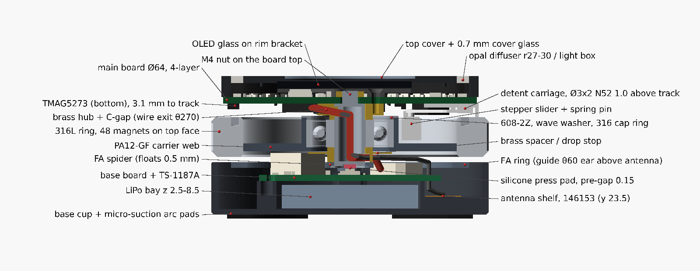
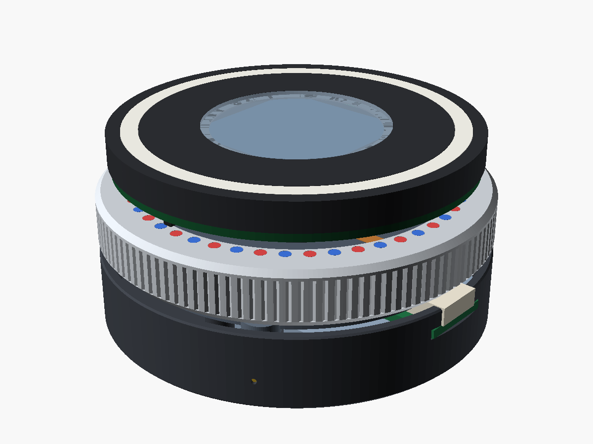
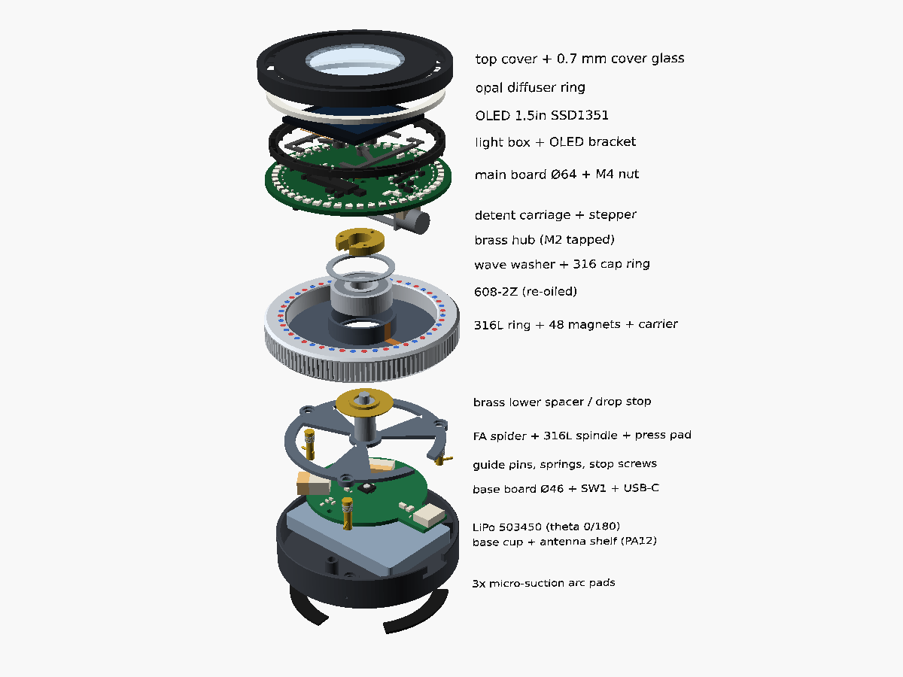
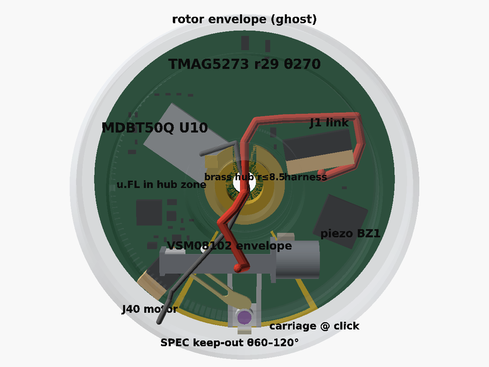
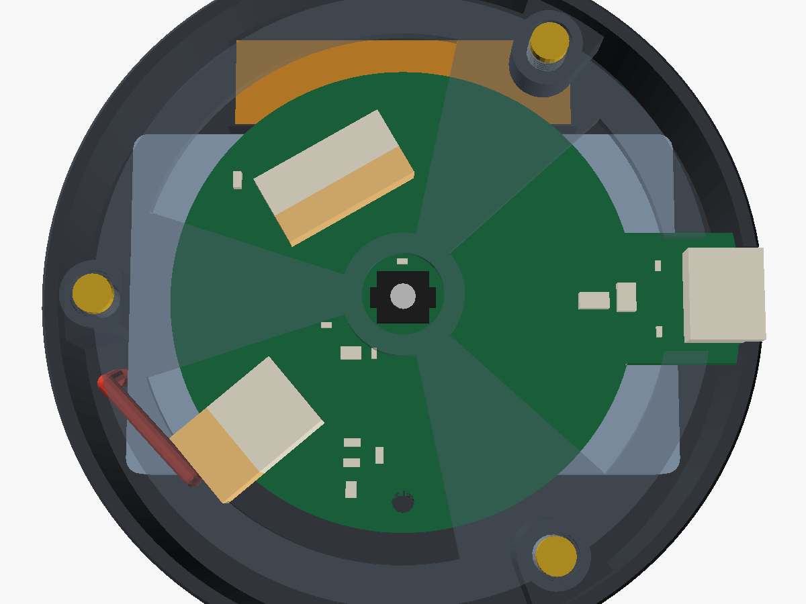
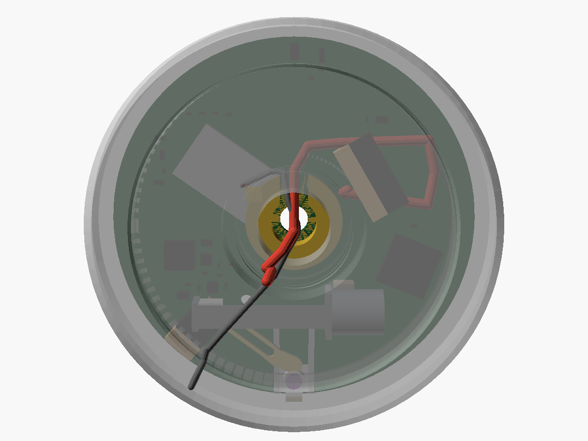
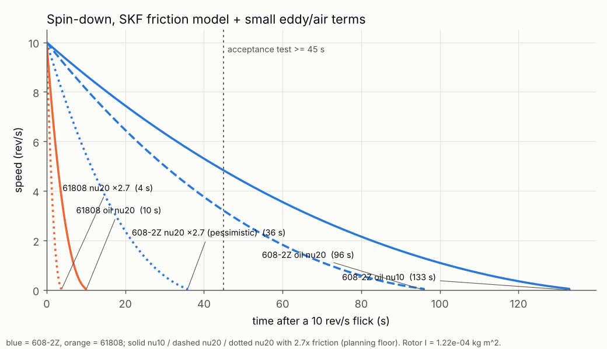
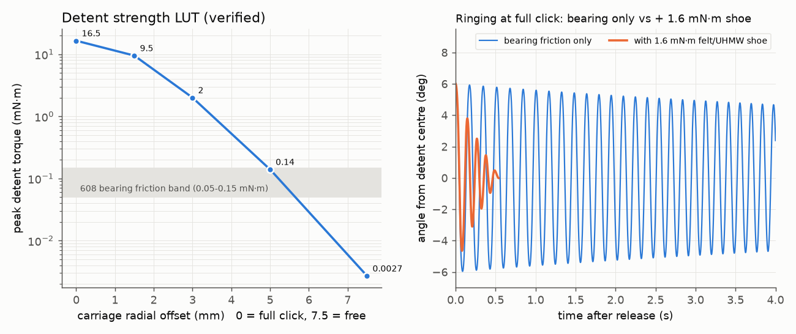
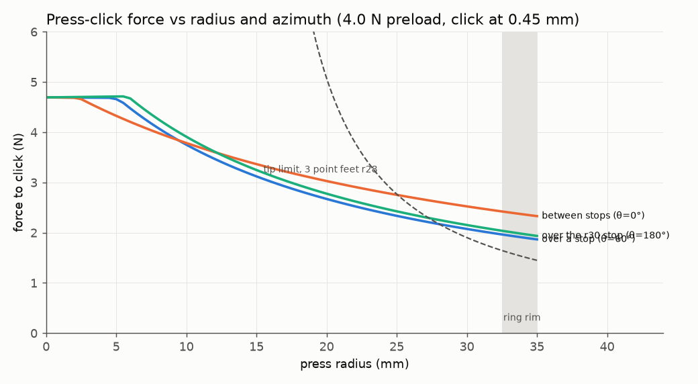
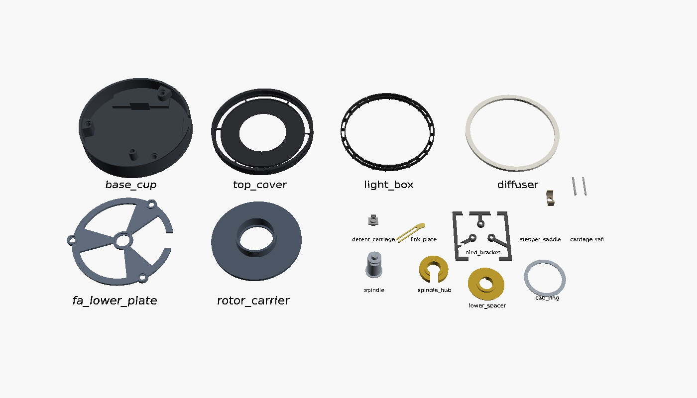

# dial-me-spinner: mechanical design (rev A)

This document covers the mechanical design of the ~70 mm BLE dial spinner, which is used as a game/decision wheel, a
Surface-Dial-style BLE controller and a fidget toy. It covers the enclosure, flywheel, bearing and axial clamp,
magnetic detent, press-click suspension, antenna placement, assembly and mechanical BOM.

* **Architecture of record:** [`hardware/design/SPEC.md`](../hardware/design/SPEC.md) §8. SPEC wins on any
  disagreement. Section 3 lists where SPEC cannot be built as written, what the model does instead (tagged `DEV:`
  in the model) and what SPEC should change to. It also records the PCB placement problems the model found and how
  they were fixed.
* **Model:** [`hardware/mechanical/dial_spinner.scad`](../hardware/mechanical/dial_spinner.scad) is a parametric
  OpenSCAD 2021.01 model of the whole device. Every SPEC number is a named constant.
* **Board parts come from the real PCBs.** [`extract_board_parts.py`](../hardware/mechanical/extract_board_parts.py)
  reads `hardware/kicad/{main,base}/*.kicad_pcb` (KiCad 9 `pcbnew`) and writes `board_parts.scad`/`.json`: one
  oriented box per footprint (Fab outline × datasheet height), plus the mated plugs of the side-entry connectors
  and the module's mated u.FL. So every clash check below tests the boards as they are placed now.
* **Calculations:** [`hardware/mechanical/calcs.py`](../hardware/mechanical/calcs.py) prints everything quoted here;
  the full output is in [`calcs_output.txt`](../hardware/mechanical/calcs_output.txt). Its section 11 reads the
  model's geometry directly (OpenSCAD `view="prims"` + `board_parts.json`).
* **Interference check:** [`check_clashes.sh`](../hardware/mechanical/check_clashes.sh) runs CGAL booleans: rotor
  envelope, press travel, rest, and same-body pairs (board parts vs actuator, hub, harness, coax; battery leads vs
  cup, plate and guide pins).
  Result: [`clash_report.txt`](../hardware/mechanical/clash_report.txt).
* **Parts:** [`hardware/mechanical/stl/`](../hardware/mechanical/stl/) (binary STL, oriented for the bed).
  `render_all.sh` regenerates every render, STL and report.

Anything marked **(to verify on prototype)** is an assumption or a model result that has not been measured yet.
Section 15 collects them into a checklist.

---

## 1. Concept



| Body | What it is | How it moves |
|---|---|---|
| **Base** | PA12 cup (Ø70, z 1.0–14.3) on 3 micro-suction arc pads. It holds the LiPo (long axis θ 0/180°), the base board (USB-C, charger, press switch), the 2.4 GHz flex antenna on a printed shelf at θ 90°, and 3 brass guide pins with stop screws. | Sits on the desk |
| **Floating assembly (FA)** | 3-spoke spider plate + turned 316L spindle + brass spacers + main board (MCU, OLED, LED ring, TMAG5273, detent actuator) + optics + top cover (with the NFC tag coil). One M4 nut on the board top clamps the whole stack. It is SPEC's "stationary hub". | Does not rotate. Three springs push it up against three stop screws. A press moves it down 0.45 mm to the click and at most 0.50 mm to the hard stop. |
| **Rotor** | 316L flywheel ring (OD 70 / ID 54 / 10) with 48 N52 Ø2×2 magnets flush in its **top face** at R 29.0, bonded to a PA12-GF carrier that holds the 608 outer race on a compliant seat | Spins on the 608 around the spindle and moves down with the FA when pressed |

The magnet track does three jobs: **detent** (a stationary Ø3×2 N52 magnet 1.0 mm above the track gives 24 detents of
15° and slides radially inward along θ = 90° to weaken it, free spin at 7.5 mm), **encoder** (TMAG5273 on the
main-board underside at r 29, θ 270°, 24 electrical periods per revolution) and **wake source**.
The 12-way link and the 1.13 mm antenna coax pass through the hollow spindle, so nothing rotates in the electrical path.

| | |
|---|---|
|  |  |
| Assembly (USB-C at θ = 0°, front right) | Exploded view, in assembly order (§12) |
|  |  |
| Main-board underside from below (parts from the PCB). Rotor envelope ghosted, SPEC keep-out in yellow, harness red, coax grey. | Base from above, FA plate ghosted: antenna shelf (top), J3 and J2 with their mated plugs, guide pins |

Key numbers (from `calcs.py`):

| Quantity | Value |
|---|---|
| Overall | Ø70 × 36 mm, **≈ 227 g** (rotor 134 g, rest of FA 50 g, base 43 g), CoG z ≈ 19.4 mm |
| Rotor | **134 g, I = 1.19·10⁻⁴ kg·m²** (the ring is 96 % of I), CoG 0.8 mm below the ball plane |
| Energy | 59 / 235 / 529 mJ at 5 / 10 / 15 rev/s |
| Free spin from a 10 rev/s flick | 95–131 s (SKF model, ν 20–10 mm²/s); **35 s** if friction is 2.7× the model. Acceptance gate ≥ 35 s, target ≥ 45 s (§4). |
| Detent | 24 × 15°, 16.5 mN·m at full click, continuously variable to < 3 µN·m (free) |
| Click force | 4.6 N at the centre, 1.9–2.4 N at the ring rim (varies with azimuth) |

---

## 2. Stack-up

z is measured from the desk. θ = 0° is the USB-C direction, CCW seen from above. "Model" is what
`dial_spinner.scad` builds. ⚠ marks a deviation that section 3 explains.

| z (mm) | Part | SPEC §8 | Model |
|---|---|---|---|
| 0.0–1.0 | feet | 3× at r 28 | ⚠ 3 arc pads, 70° each, r 25–31, at θ 0/120/240° |
| 1.0–2.5 | base cup floor, PA12 | OD 70, wall 1.6, wall top 14.3 | as SPEC; bottom chamfer 0.6 |
| 2.5–8.5 | LiPo bay | pack ≤ 6.0 thick, \|x\| ≤ 27.5, \|y\| ≤ 17.25, leads at θ 180 | as SPEC (envelope 55 × 34.5 × 6.0). BOM pack 503450-class, ≤ 5.6 max (§13). Leads (28 AWG SH, two per rail) leave the θ 180 end at y ≈ −7.5, clear of the θ 180 guide column, run beside the pack at z ≈ 10 under the spider and come up over the base-board edge at θ ≈ 222° to J2. |
| 2.5–5.5 | antenna shelf (printed, part of the cup) | "printed shelf, centred on the chord y = +23.5 (strip y 19.0–28.0)" | shelf y 18.8–33.4, \|x\| ≤ 18.25 |
| 5.5–5.75 | **antenna** Molex 146153-0100 (34.9 × 9) | centred on y = 23.5, corners ≤ r 33, ≥ 1.75 mm from the pack | as SPEC (corners at r 33.0) |
| 2.5–9.5 | base-board supports | one M2 boss at r 20, θ 270; rib under the θ 90 edge (y 17.75–18.75); USB-C shell | as SPEC: boss with an M2 × 3 heat-set insert (0.25 mm from the pack envelope); rib \|x\| ≤ 6, no screw; USB shell captured in a wall slot |
| 9.5–11.1 | base board Ø46 + USB tab to r 34.6 | 4-layer 1.6 mm, parts on the top only | from the PCB |
| 11.1–12.6 | TS-1187A at the centre | | body 5.1 × 5.1 × 1.0 (verify), actuator Ø2.5 to 12.6 |
| 11.1–14.36 | base-board parts | tall parts in the open sectors | from the PCB; tallest: USB-C J1 (top z 14.36), side-entry SH J2 and J3 (2.95 tall, top z 14.05) |
| 2.5/6.5–11.5 | 3 guide columns / ear | pins + springs at r 29, θ 60/180/300 | θ 300: column from the floor. θ 180: ⚠ column from the floor at **r 30**. θ 60: ear z 6.5–11.5 above the antenna. Stop face (top) at 11.5. Ø3 brass pins pressed + bonded + Ø1 cross pin. |
| 12.0–14.3 | **FA spider plate** PA12-GF | 3 spokes ±18° at 60/180/300, hub r ≤ 6, outer ring r 26–30 with a USB notch (\|y\| ≤ 5.6), pre-gap 0.15 | as SPEC; under-bosses Ø6.4 at the guides (z 12.0) are the hard stop: **0.50 mm** travel |
| 13.5–14.8 | M2 × 3 brass stop screws | "preload ≈ 4 N up against stops" | heads in Ø4.6 counterbores (floor 13.5) |
| 12.75 | press pad face | "centre boss over the switch, pre-gap 0.15" | Ø3 × 1.0 silicone pad in the spindle bottom; pre-gap set per unit (0.03–0.23, §8) |
| 12.8–29.05 (+ spigot to 32.3) | **spindle**, turned 316L, Ø8 h6, bore Ø6 | hollow Ø8 × 1.0, z 12.8–29.1, clamped to plate and board, slots at z ≈ 14.5–16 and under the board | bottom flange Ø10 × 0.6 in a D-recess under the plate; solid end with the pad pocket; slots θ 120 (z 14.45–16.35) and θ 270 (z 25.8–28.25), 5.0 wide; ⚠ M4×0.5 spigot through the board's Ø5 hole |
| 14.3–18.0 | brass lower spacer, Ø11.5, with drop-stop flange Ø21.2 (z 16.40–16.85) and a wire window at θ 120 | | 0.15 mm under the rotating carrier lip |
| 15.6–25.6 | **rotor ring** 316L | OD 70 / ID 54, track on the top face, R_t 29.0 | chamfers 1.0 top-outer, **1.5 bottom-outer** (USB plug clearance), 0.5 inner. Straight knurl z 17.1–24.1. 4× M2 balance holes in the bottom face at r 31. |
| 17.0–25.5 | **rotor carrier** PA12-GF, post-machined | web z 17–19, r 11–27 | web r 12.2–26.95 (bonded into the ring ID over z 17–19); collar r 11.0–12.2 bored Ø22 H7; lip r 9.9–11 under the race. **No ribs.** |
| 18.0–25.0 | 608-2Z | outer race r 11 | slip fit in the H7 collar on the lip; wave washer z 25.0–25.5; **0.5 mm 316 cap ring bonded on the collar top, z 25.5–26.0** |
| 25.0–29.1 | brass hub: inner-race spacer + flange r ≤ 8.5 with 3× M2 tapped at r 6.5 (θ 90/210/330), C-gap at θ 270 for the wires | "3× M2 at r 6.5 (spindle flange)"; rotating hub top z 26.0 | the rotor hub (cap ring) tops out at **26.0** (§3 A6, now in SPEC) |
| 19.8–29.1 | bowl: stepper (Ø8 can at x 6.5–15.5, y 15.5, axis z 23.8), saddle to the θ 60 board hole | "chord placement near θ = 90°" | sweeps θ ≈ 35–160° (§7) |
| 26.6–29.08 | detent carriage: Ø3×2 N52 (z 26.6–28.6), 0.48 plate between two rails on the board bottom, 0.8 mm FR4 link plate (z 26.7–27.5) with the inclined slot | 1.0 above the track, r 29 → 21.5 along θ 90; carriage plate 0.5 | as SPEC, except the plate is 0.48 in a 0.50 gap (§7) |
| 27.65–29.1 | TMAG5273 (bottom), package at r 29.4, θ 270° | Hall element at r 29, θ 270 | Hall element 3.13 mm above the track face |
| 29.1–30.7 | **main board** Ø64, 4-layer 1.6 mm, parts on both sides | centre Ø5 + 3× plated GND M2 r 6.5 (H1–H3) + 2× NPTH M2 r 17 θ 60/120 (H4/H5) | holes from the PCB; the board sits on the hub, clamped by the M4 nut |
| 30.7–32.2 | M4×0.5 brass nut, OD 7 | top r ≤ 4.6 kept free for it | on the board top under the OLED, in the bracket's centre hole |
| 30.7–31.6 | 48 × WS2812C-2020 at r 28.5 | | from the PCB |
| 31.7–34.2 | light box r 27–30, walls 0.6, 24 septa | 31.6–34.2 | walls stop 0.1 above the LED tops |
| 31.8–32.8 | OLED bracket: rim under the glass edge + 3 spokes to the hub-screw bosses | | pocketed 0.3 mm round / 0.2 mm above every top part taller than 0.95 mm |
| 33.0–34.7 | OLED glass 33.8 × 34.0 | active-area centre on axis | glass centre at y −1.47; 0.2 mm foam tape |
| 34.2–36.0 | diffuser r 27–30 + top cover r ≤ 32.5, Ø30 window | NFC flex coil in the cover, tail soldered to J11 on the main-board top (r 21.5, θ 222°) | **0.7 mm chemically strengthened cover glass Ø33** bonded in the cover (z 35.3–36.0); 0.6 mm air gap to the OLED glass. The NFC coil and its tail are not modelled yet (§9). |

**Running clearances (nominal, `calcs.py` §11).**

| Pair | At rest | Pressed (0.50) |
|---|---|---|
| Ring bottom to cup wall top | 1.30 | 0.80 |
| Ring bottom to stop-screw heads (base-fixed) | 0.80 | 0.30 |
| FA plate / spokes to base-board top (parts ≤ 1.0 tall allowed under them) | 1.70 | 1.20 |
| Plate top to carrier web (wires and coax run here) | 2.70 | 2.70 |
| Detent magnet to track | 1.00 | 1.00 (both on the FA) |
| Carrier lip to brass drop stop | 0.15 | 0.15 (intended crash stop) |
| Stepper bracket bar to rotating web | 0.80 | 0.80 |
| Stepper front plate to collar (plan) | 0.55 | 0.55 |
| Rotor hub top (cap ring, 26.0) to board bottom | 3.10 | 3.10 |

**Interference check (`clash_report.txt`, CGAL, plus the per-part tables in `calcs_output.txt` §11).**
With the current boards everything clears except the intended contacts listed in `clash_legend.txt`: the plate
under-bosses on the cup stop faces at full travel (hard stop), the SW1 actuator against the press pad, the bonded detent
rails and saddle on the board bottom, and two near misses at 0.3 mm margin (the felt shoe resting on the ring, and the
drop-stop flange 0.15 mm under the carrier lip). The PCB clashes found earlier are fixed (§3B). The tightest
remaining gaps:

* **Antenna coax** between U12 and the module's inner corner: 0.13 mm to U12, 0.25 mm to U10 and 0.44 mm above the
  rotating cap ring (r 9–13). It must be tacked up with Kapton tape at assembly (§12 step 12.4).
* **Harness** under C11 and R12 (0402s at r 9–10): 0.30 and 0.45 mm.
* **Coax over base J3 and its plug:** 0.47 mm at rest, 0.22 mm pressed (the free span sags with the FA).
* **J40** (motor connector, 2.95 tall): 0.35 mm to the slider nut at click, 0.55 mm to the rotor envelope.
* **U10 MDBT50Q** to the rotor envelope: 0.90 mm; to the brass hub 1.05 mm.
* **USB-C J1** (base) to the ring: 1.24 mm at rest, 0.74 mm pressed.
* **Battery leads** to the pressed spider plate: 1.40 mm (r 30.2, θ 196°, z 10).



*Board underside from below: red = interference with the rotor envelope (ghosted), orange = FA-internal interference
(board parts vs actuator, hub, harness, coax). Regenerate with `render_all.sh` after any placement change.*

---

## 3. Where SPEC §8 cannot be built as written, and what the PCBs had to change

### 3A. SPEC items (for the SPEC owner)

| # | SPEC says | Problem (numbers) | Model / recommendation | Severity |
|---|---|---|---|---|
| A1 | *(adopted in SPEC rev of 02:50)* Antenna on chord y = +26, ≥ 4 mm from the pack | At y = 26 the corners are at **r 35.1**, outside the cup ID (33.4). With corners at r ≤ 33 the centre can be at most **y = 23.5**, which leaves **1.75 mm** to the pack. | SPEC now: y 23.5, ≥ 1.75 mm, base-board copper keep-out. Remaining RF risk: a **≤ 30 mm-wide pack** (\|y\| ≤ 15) would restore 4.0 mm (~10–20 % less capacity); otherwise measure S11 (§15 #9). | Medium (RF) |
| A2 | *(adopted)* Base board: 2× M2 bosses at r 21, θ 90/270 | A boss at (0, 21) sat on the antenna. Moving it to θ 60/120 at r 21 does not help: a Ø5 boss there reaches y 15.7, inside the pack. | SPEC now: one boss at r 20, θ 270 + a rib under the θ 90 edge + the USB shell (captured in a wall slot: the board slides in radially, then the θ 270 screw locks it). Note: at r 20 the Ø5 boss is only **0.25 mm** from the pack envelope; r 21 gives 1.25 mm. | Low |
| A3 | Guide pins + springs at r 29, θ 60/180/300 | **θ 60** is above the antenna, so the pin cannot reach the floor. **θ 180** at r 29: the pin (x −30.5…−27.5) touches the pack end (x −27.5), which is also where the leads exit. | θ 300: column from the floor. **θ 180 moved to r 30** (column from the floor at x ≤ −27.8, 0.3 mm from the pack). θ 60: an ear z 6.5–11.5, 0.75 mm above the antenna. Leads must leave the pack end at \|y\| ≥ 4 (BOM). **SPEC fix:** θ 180 guide at r 30, or a pack ≤ 53 mm long (\|x\| ≤ 26.5). | Medium |
| A4 | Guide hardware at θ 60 | A brass pin, steel spring (68 mm of wire, ≈ λ/2 at 2.44 GHz) and screw sit 0.75–9 mm above the antenna's +x end. | Fit PEEK pin, PEEK cross pin and nylon screw at θ 60 from the first build. Keep the 302 spring unless S11 says otherwise (§9). The pull-out is lower with PEEK (§8). | Medium (RF) |
| A5 | 608 with "≥ 2.5–3 N wave-spring axial preload" | A spring between the outer race and the rotor cannot preload a single bearing, because both rotate. The only axial load is gravity (1.31 N) ± detent forces. The click-mode detent tilt moment ≈ 0.7 N × 29 mm ≈ 20 mN·m, against a gravity moment capacity Fa·dm/2 ≈ 10 mN·m. | The wave washer is a compliant **drop seat** (§10). For real preload: (a) gravity only (accept rocking; measure), (b) axisymmetric magnet-ring pair (rotor ring on the carrier underside + stator ring on the FA plate, ≈ +1.5–2 N, no cogging if uniform), (c) duplex 608 (≈ 2× friction, +7 mm). Fa 2.7 N costs 95 → 62 s (§4). | Medium |
| A6 | *(adopted)* "rotor hub tops out at z ≈ 25"; harness lies flat under the board on that basis | z 25.0 is the 608's own top face. Any drop-compliant outer-race seat (verifier requirement) needs a spring and a retainer above it. The minimum is a 0.5 mm wave washer + 0.5 mm cap: **top 26.0.** | SPEC now: hub top **26.0**, and **bottom parts over r 9.5–12.5 keep their bottom at z ≥ 26.3** (hang ≤ 2.8 mm). The current main board meets it (`calcs_output.txt` §11: no part flagged). In the model the harness and coax cross the hub zone with their centrelines at z ≥ 26.9; the coax, at the U12 / module corner, is the closest (0.44 mm above the cap ring, Kapton-tacked, §2). | – |
| A7 | Spindle Ø8 × 1.0 tube z 12.8–29.1 "clamped to the lower plate and to the main board" | A plain tube cannot be clamped at both ends. The bearing must go on from one end and something removable must hold the other. The old model (bonded socket, sliding hub) held nothing axially (review). | **Turned 316L spindle**: bottom flange in a D-recess under the plate, solid bottom with the press pad, **M4×0.5 spigot through the board's Ø5 centre hole + brass nut on the board top** (0.10 N·m ≈ 120 N clamp). One nut clamps board → hub → inner race → spacer → plate → flange (§4). The PCB rule is in SPEC (main-board top r ≤ 4.6 kept free for the nut, OD 7). **SPEC fix (still open):** describe the turned spindle and its spigot in the §8 stack-up. | **High** |
| A8 | *(adopted)* FA plate outer ring r 26–30 (continuous) | The USB-C receptacle (z up to 14.36) sits at r 27.7–35 under the ring. | SPEC now has the notch \|y\| ≤ 5.6. | – |
| A9 | Pre-gap 0.15, "FA moves 0.3–0.5" | TS-1187A travel is 0.25 ± 0.1 (verify). A fixed pre-gap and hard stop cannot cover that spread without crushing or missing the switch (the old 0.5 mm TPU dot put 14–26 N through the 1.6 N switch). | Hard stop **0.50** (SPEC's pressed clearance 1.2 mm kept). Silicone pad k ≈ 20–25 N/mm. **Pre-gap set per unit** = 0.38 − measured travel (0.03–0.23). The switch then sees 2.7 N (≤ 3.9 N worst) at the stop. Reject switches with travel > 0.32. §8. | Medium |
| A10 | 3 feet at r 28 | A rim press tips the 227 g device at **1.60 N**, below the rim click force (1.9–2.4 N). | 3 × 70° **arc pads** (r 25–31): tip edge 28.1 mm, tip force 11.6 N. | **High** (Surface-Dial use) |
| A11 | *(adopted)* Actuator in the bowl, chord near θ 90; bottom keep-out θ 60–120 | A ~33 mm VSM08102 cannot lie radially (hub r ≤ 12.2, ring r ≥ 27). The working chord (y 15.5, inclined-slot link) sweeps **θ ≈ 35–160°**. | SPEC now: bottom-side parts in θ 30–160°, r 8.5–27 must keep their bottom at **z ≥ 27.8** (≤ 1.3 mm tall), except where `calcs_output.txt` §11 shows clearance. Two taller parts reach into it: J40 (2.95 mm), which clears the slider nut by 0.35 mm and must not move toward the corridor, and the piezo BZ1 (1.9 mm, r 22, θ 22°), whose edge reaches θ ≈ 36° and clears the actuator by ≥ 1.0 mm (not listed in §11). The θ 120 board hole is unused. | – |
| A12 | SPEC §7: no ferromagnetic part within 10 mm of the track; SPEC §8: an 8 mm stepper in the bowl r 12–27 | **Conflict.** Any Ø8 can in the bowl is within 10 mm of the track wherever r > 17. The VSM08102 can comes within **3.1 mm** of the nearest track magnet (r 24.9 vs magnet edge r 28, overlapping z), and its steel lead screw within 4.6 mm. The can cannot move inboard: the collar (r 12.2, top 26.0) blocks it. | Rough estimate of the can's cogging on the alternating track: **10–100 µN·m**, the same order as the bearing drag at 0.1–1 rev/s (18–44 µN·m). It may give preferred rest angles in FREE mode. **Bench test before PCB freeze** (§15 #2). Non-ferrous options: piezo (e.g. squiggle-type) or SMA actuators. Confirm the MDBT50Q shield-can material too. | **High** (to verify) |
| A13 | Light box z 31.6–34.2, r 27–30 | The LED research wants a 4.0–4.5 mm air gap; this gives 2.6 mm. | Walls 0.1 above the LED tops; 24 septa (one per detent): a segmented "prize wheel" look. Uniformity to verify. | Low |
| A14 | Detent LUT (research) at R_t 30 on the ring underside | SPEC: R_t 29 on the top face (pitch 3.80 vs 3.93 mm) | Expect ~2–5 % lower torque. Firmware self-calibrates from the in-well f_n. | Low |
| A15 | *(fixed in SPEC)* §2 said base board "Ø40", and "battery 0.5 mm below" | | SPEC now Ø46 and 1 mm | – |

### 3B. PCB placement findings (for the layout owner; from `board_parts.scad` and the clash check)

All closed. The boards were re-extracted on 2026-10-19 (`board_parts.json` 08:17) and `check_clashes.sh` and
`calcs.py` pass on them (§2). Re-run `extract_board_parts.py`, `check_clashes.sh` and `calcs.py` after every
placement change. Fixed earlier: J1 and J3 face the centre, J2 sits at θ 222° with its mouth outward, Q1 left the spoke
zone, RT1 moved to the top side, the θ 90 base-board hole is gone and the antenna copper keep-out is in layout.py.

| # | Part as first placed | Problem | Done |
|---|---|---|---|
| B1 | **U10 MDBT50Q** at r 14.5, θ 215, u.FL end inward (inner end at r 6.8) | The module overlapped the brass hub (r ≤ 8.5) by **1.5 mm** (static clash). The mated u.FL (bottom z 25.8, at r 6.7–10.3) clashed with the hub and sat 0.2 mm into the rotating cap ring (needs ≥ 0.3). The coax could not reach it except through the hub. | **Closed.** U10 is centred at **r 17.3**, θ 215° on the bottom, inner end r ≥ 8.8, **u.FL end facing outward** (mated u.FL at r ≈ 23). Clearances: rotor 0.90 mm, hub 1.05 mm. The coax runs back under the board beside the module to the θ 270 top slot, threading between U12 and the module's inner corner (0.13 mm to U12, 0.44 mm above the cap ring): Kapton-tacked at assembly. Modelled coax path 79 mm. |
| B2 | **J1** (SM12B, 2.95 tall) at r 17.5, θ 330, mouth toward the centre | The back of the mated plug reached **r 11.9** at z 26.15, **0.15 mm** above the rotating hub (needs ≥ 0.3). | **Closed.** J1 moved out to **r 19.5** (θ 330°, bottom, entry facing the centre). J1 and its plug clear the hub, the rotor and the wires by ≥ 1.0 mm (not listed in `calcs_output.txt` §11). Harness path 43 mm. |
| B3 | **J2** (S2B-PH-SM4-TB, **5.5 mm tall**), base r 17, θ 222, mouth outward | Top z 16.6 under the rotor web (17.0 at rest, **16.5 pressed** → −0.10). The mated plug reached r 26.3, into the FA ring (z 12.8–14.3), and the battery leads crossed the ring. | **Closed.** J2 is a side-entry JST SH **SM04B-SRSS-TB** (LCSC C160404, the motor connector's part), 2.95 tall, pins 1–2 BAT+, 3–4 GND, at r 17, θ 222°, mouth radially outward (SPEC §6/§8). The pack is re-terminated with 28 AWG pre-crimped SH leads, two per rail; they run beside the pack at z ≈ 10 under the spider and come up over the board edge at θ ≈ 222°. J2 and its plug clear the rotor and plate by ≥ 1.5 mm; the leads clear the pressed plate by 1.40 mm. |
| B5 | **R42** (0402, LED_D48 pull-down), main top, r 30.4–31.05 | Under the top-cover skirt (r ≥ 30.6) | **Closed.** R42 is at r 24.1, inside the r 25.3 top-side limit. |


---

## 4. Bearing, axial clamp and lubrication

**Choice: SKF 608-2Z** (8 × 22 × 7, C 3.45 kN, C₀ 1.37 kN, 13 g;
[datasheet](https://www.simplybearings.co.uk/products/608-2z-skf)). Equivalents: NSK/NMB 608ZZ. **SKF 608-2RSL** is
acceptable: SKF's model gives zero seal friction for RSL at D ≤ 25 mm, and it keeps oil better. With 2RSL, turn the
hub and spacer clamp faces to Ø10.0–10.5. **Never use RSH or RS1 contact seals** (≈ 7.6 N·mm: the rotor stops in about
1 s). Buy 5+, measure each, keep the best two.

Spin-down with the rotor computed here (Fa = 1.31 N from gravity, plus eddy and air terms of < 3 %), from the
[SKF frictional-moment model](https://cdn.skfmediahub.skf.com/api/public/0901d1968065e9e7) (Table 2a constants;
it reproduces the verifier's 0.147 N·mm for the 608 and 1.6 N·mm for the 61808):

| Bearing / lubricant | from 5 rev/s | from 10 rev/s | from 15 rev/s |
|---|---|---|---|
| 608-2Z, oil ν = 10 mm²/s | 89 s | **131 s** (487 rev) | 163 s |
| 608-2Z, oil ν = 20 | 65 s | **95 s** (341 rev) | 116 s |
| 608-2Z, ν 20, **friction × 2.7** (planning floor) | 24 s | **35 s** | 44 s |
| 608-2Z, factory grease after run-in (ν 200) | 20 s | 28 s | 35 s |
| 61808 (6808), oil ν 10 / ν 20 | 11 / 7 s | 15 / 10 s | 18 / 12 s |



**Uncertainty and acceptance.** The model runs below the bearing's minimum load and with drop lubrication. The one
measured comparison (verifier) suggests it under-predicts friction by up to 2.7×. Therefore:

* **Acceptance gate: ≥ 35 s from 10 rev/s.** This equals the 2.7× planning floor, so a unit that performs as the
  pessimistic model predicts passes. Below the gate the bearing prep failed (residual grease, dirt, shield rub):
  re-clean or swap the 608.
* **Target: ≥ 45 s** (the verifier's 45–60 s band). Record the measured value: it calibrates the friction model.
* **Expectation if the model holds:** 95–131 s.

The ≈ 10× advantage of the 608 over a 61808 holds either way, because the same model error applies to both.

**Lubrication (every bearing, before assembly).**

1. Soak the 608-2Z in IPA and run it 10 min in an ultrasonic bath. 2Z shields are pressed in, so leave them in place.
   Repeat with fresh IPA, then blow dry.
2. Add 1–2 drops of **ISO VG 2–10 synthetic instrument/spindle oil** through the shield gap (e.g. Mobil Velocite
   No. 3 = VG 2 or No. 6 = VG 10; base oil not stated, to verify).
3. Spin it by hand for 1 min, wipe the outside, and spin-test it on an Ø8 arbor: > 30 s from a finger flick, no
   shield rub, no gritty stop.
4. **Maintenance:** log the spin-down monthly with the encoder (firmware) and re-oil below 70 % of the as-built value.

**Axial clamp (new: the old hub slid freely on the spindle).** The stack is held by one removable nut:

```
M4x0.5 brass nut (board top, 0.10 N*m, Loctite 222)
  -> main board (Ø5 hole over the Ø4 spigot)          z 29.1-30.7
  -> brass hub (inner-race spacer, flange r <= 8.5)    z 25.0-29.1
  -> 608 inner race                                     z 18.0-25.0
  -> brass lower spacer (+ drop-stop flange)            z 14.3-18.0
  -> FA plate hub (PA12-GF, 0.9 mm in the clamp)        z 13.4-14.3
  -> spindle bottom flange (Ø10 x 0.6, D-recess)        z 12.8-13.4   <- the spindle is the tie rod
```

* **Clamp:** 0.10 N·m ≈ 120 N (K ≈ 0.2). That is 4.4 MPa on the plate hub. Thread root of the M4 spigot: 7.7 mm²,
  ≈ 1.5 kN.
* **Creep:** the PA12-GF ring will creep a few µm and lose most of the preload over time. The joint still cannot
  separate, because the nut is thread-locked, and the residual play is µm-level. Retighten at service.
* **Angles:** the spindle has D-flats at θ 90 (flange, spacer and hub zones; the 608 seat z 18–25 stays round).
  The plate, spindle, spacer window, hub C-gap and board holes therefore all line up.
* **Inner race:** 608 on Ø8 h6, with Loctite 641 if the fit is loose. The inner race only ever sees the clamp, never a
  load through the balls.
* **ESD path (SPEC §8):** ring → conductive epoxy → 0.1 × 3 mm phosphor-bronze strap along the web and up the collar →
  316 cap ring → wave washer → 608 outer race → balls/oil film → inner race → 316L spindle → brass hub → hub face on the
  plated H1–H3 pads → GND. It is metal all the way except the bearing's oil film, which bleeds static charge (MΩ).
  Pass: ring-to-GND < 10 MΩ with the rotor turning slowly (to verify).

**Outer race seat (compliant, drop-protected, §10).** The race slips into the carrier collar, which is **bored to
Ø22 H7 after printing** (22.000–22.021; the race OD is 22 −0.009/0). It sits on a rigid lip below. Above it are a
22 mm-bore wave washer (working height 0.5, 30–50 N, ≤ 300 N/mm) and a **0.5 mm 316 cap ring** (OD 24.4, ID 19.9)
bonded with epoxy onto the collar top face (88 mm², ≈ 400 N). To replace the 608, warm the cap with an iron to ~120 °C
and lift it off. The slip torque of the clamped race (≈ 40 N × 0.2 × 11 mm ≈ 90 mN·m) is far above the bearing drag
(0.15 mN·m), so the race does not creep.

**Axial preload (SPEC A5).** Effect of the net axial load:

| Fa (N) | M at 10 rev/s (N·mm) | Fa·dm/2 tilt capacity (mN·m) | Spin from 10 rev/s |
|---|---|---|---|
| 1.31 (gravity) | 0.147 | 9.9 | 95 s |
| 2.0 | 0.179 | 15.0 | 75 s |
| 2.7 | 0.207 | 20.2 | 62 s |
| 3.5 | 0.236 | 26.2 | 53 s |

Prototype with gravity only first. Measure click-mode rocking with the TMAG (a once-per-detent wobble in the Bz
amplitude). Add a magnet-ring preload only if the rocking is audible or felt (to verify on prototype).

---

## 5. Flywheel: material, drawing notes and balancing

**Material: 316L stainless.** ρ 7.98 g/cm³, non-magnetic, corrosion-proof under fingers, σ ≈ 1.35 MS/m (about 11×
below brass, so the stationary magnet's eddy drag stays at a few µN·m). Turned at JLCCNC/PCBWay CNC or a local shop,
est. $15–40. Net ring mass 117.1 g.

| Feature | Spec |
|---|---|
| OD / ID / height | 70.00 / 54.00 +0.02/0 / 10.00 mm |
| Concentricity OD↔ID | ≤ 0.02 TIR |
| Faces | flat and square ≤ 0.02. The **top face is the detent/encoder datum.** Face runout ≤ 0.05 TIR (the detent loses ~10 % torque per +0.1 mm gap). |
| Chamfers | 1.0 × 45° top-outer (flick edge); **1.5 × 45° bottom-outer** (USB-C plug overmold clearance, §9); 0.5 × 45° on the ID |
| Knurl | straight, DIN 82 RAA 0.8, OD band z 17.1–24.1 |
| Magnet pockets | 48 × Ø2.10 +0.02/0 × 2.05 +0.02/0 deep, flat-bottom, on the top face at R 29.000 ± 0.02, every 7.5° ± 0.05° |
| Balance holes | 4 × M2 tapped, 3 deep, in the bottom face at r 31, θ 45/135/225/315° |
| Process order | rough-turn → **knurl** → N52 cling test → *only if it clings:* solution-anneal (1050 °C, water quench) → **finish-turn faces, ID, chamfers** to the TIR/flatness specs → mill pockets and drill/tap balance holes → repeat the cling test. Never anneal a finished ring (distortion, scale). Never nickel-plate (ferromagnetic). |

**Rotor carrier.** PA12-GF (SLS) or MJF PA12-GB, 5.6 g, no ribs (the old ribs at z 16.2–17 sat below SPEC's web and
in the wire space). Print with +0.4 mm stock on the bore and register, then **bore Ø22 H7 and turn the register to
Ø53.95 in one chucking** (bore-to-register ≤ 0.02 TIR). **No aluminium or copper may rotate near the detent magnet**
(verifier). The ESD strap is a 3 mm-wide radial strip, not a loop, so its eddy drag is negligible.

**Alternatives.** C360 brass ring (132 g; about 11× the eddy drag in click mode). RF-transparent ring (§9).

**Balancing.** Target ISO 1940 **G2.5 at 15 rev/s**: U_per = **3.5 g·mm** for the 134 g rotor; aim ≤ 2 g·mm.

| Error source | A: ring bonded freehand | B: bonded on an arbor (recommended) |
|---|---|---|
| Ring OD/ID eccentricity (0.02 TIR) | 1.17 g·mm | 1.17 |
| Ring-to-bearing eccentricity | 4.37 (e ≈ 0.035) | 1.25 (TIR ≤ 0.02) |
| 48 magnets, mass σ 3 %, random | 0.28 | 0.28 |
| 5 mg glue blob at r 29 | 0.14 | 0.14 |
| **RSS before correction** | **4.5** (out of spec) | **1.7** |

Procedure:

1. **Bond the ring on an arbor, before the wave washer and cap are fitted.** Slide the carrier (608 seated on its lip)
   onto a ground Ø8 arbor in a lathe or V-blocks. Spread epoxy on the register. Rotate and tap the ring until a dial
   indicator on the OD reads ≤ 0.02 TIR. Set the ring top 0.60 ± 0.03 mm above the 608 outer-race top face with a
   flat that has a 0.60 mm annular spigot (r 9.6–10.9) resting on the race. The collar top (25.5) is 0.1 mm below the
   flat, so it needs no relief. Cure undisturbed.
2. **Static balance** on knife edges or a magnetic balancer (use a second, freshly degreased 608 or spin the arbor).
3. **Correct on the bottom face at r 31:** Ø2 × 1 dimple −0.93 g·mm; empty M2 tapped hole −1.49; brass grub +1.35;
   W-alloy grub +2.70. Iterate until there is no preferred rest angle in 20 random releases.
4. Fit the wave washer, bond the cap ring, and fit the ESD strap.
5. **Dynamic check (assembled):** spin to 15 rev/s, log the LIS2DW12 at 200 Hz. The 1×/rev component must be ≤ the
   value measured with a 2 g·mm test mass taped at r 31.

**Detent and encoder gap tolerance stack.** The track height relative to the board is set by the hub length (turned
±0.02), the 608 width/face offset including axial play (±0.05), the jig (±0.03) and the board's local flatness (±0.05).
The magnet height adds the carriage/cup (printed, ±0.1).

| Gap | Nominal | RSS | Worst case | Effect |
|---|---|---|---|---|
| Detent | 1.00 | ±0.13 | ±0.25 | ±13 % detent torque |
| TMAG | 3.13 | ±0.11 | | window 2.2–4.0 |

**Measure and shim:** after assembly, check the magnet-to-track gap with feeler gauges at the click position. Correct
whole-rotor height errors with 0.05 mm **brass** shim washers between the hub top and the board (not Kapton: the hub
face is the GND contact). Correct magnet-only errors at the magnet cup.

---

## 6. Magnet track

| Item | Spec |
|---|---|
| Magnets | 48 × NdFeB **N52 Ø2.0 × 2.0 mm, axial, NiCuNi**, all from one batch (± 0.05 mm, ± 5 % Br). Buy 60. |
| Layout | Alternating N/S, **R_t = 29.0**, pitch 7.5° (3.80 mm chord): 24 electrical periods = 24 detents. Zero DC field, so stray steel causes 10–100× less cogging than a same-polarity track. |
| Pockets | Ø2.10 +0.02/0, 2.05 +0.02/0 deep. Measure your batch and set the pocket to max Ø + 0.03–0.05. |
| Flushness | ± 0.03 to the ring top face, set against a flat while the epoxy cures |
| Adhesive | low-viscosity 2-part epoxy (3M DP420 / Loctite EA 9466). Seal the cured track with a thin wiped film. Keep it ≤ 60 °C (N52; N48H for hot use). |
| Field at the sensor | Bt/Bz ≈ 15/18 mT peak at 3 mm, zero mean ([detent research, magpylib]). The TMAG5273A2 ±133 mT range is ample. |
| Centrifugal load | 5 mN per magnet at 10 rev/s, 49 mN at 30 rev/s, taken by the pocket wall |
| US sourcing | K&J D11-N52 (1/16″ × 1/16″ = Ø1.59 × 1.59) has **≈ 50 % of the volume** of a Ø2 × 2 disc, so expect roughly **40–50 % less** detent torque and encoder field. Do not substitute: order true Ø2 × 2 mm discs from a vendor that ships to the US (e.g. supermagnete, first4magnets, AliExpress). |

**Polarity jig.** Neighbours 3.8 mm apart attract hard, and a flipped magnet gives a missing detent.

1. Print a 2 mm mask ring (PA12) that covers every other pocket (24 open) and clamp it on the ring top face.
2. Put a pin-head of epoxy in each open pocket. Stack the N52 supply on a steel rod **north up** and slide them off one
   at a time with a brass/plastic tweezer into the pockets.
3. Press a PTFE-taped glass plate (200 g) on top so they cure flush.
4. Swap to the second mask and repeat **south up**.
5. Check with magnetic viewing film (48 alternating spots). After assembly, the firmware calibration spin checks for 24
   uniform electrical periods.

**Keep-outs around the track (SPEC §7, detent and sensing research):**

* No ferromagnetic part within 4 mm of the magnet faces, and none within 10 mm of the track or the TMAG. The stepper
  breaks this rule (A12).
* No power inductor within 10 mm.
* No pours on B.Cu or In2 at r ≥ 26.
* All screws near the rotor are **brass or nylon**; 316/A4 cold-headed screws are often slightly magnetic.

---

## 7. Detent mechanism

**Principle.** A stationary Ø3×2 N52 magnet sits 1.0 mm above the alternating track. Its strength is set by moving it
**radially inward, in plane**. Both end positions are magnetically force-neutral, so the actuator holds at zero power.

| Offset (mm) | 0 | 0.5 | 1.0 | **1.5** | 2.0 | 3.0 | 4.0 | 5.0 | 6.0 | **7.5** |
|---|---|---|---|---|---|---|---|---|---|---|
| Peak torque (mN·m) | **16.5** | 13.7 | 11.4 | **9.5** | 5.7 | 2.0 | 0.53 | 0.14 | 0.029 | **0.0027** |
| Rim force at r 35 (N) | 0.47 | 0.39 | 0.33 | 0.27 | 0.16 | 0.06 | 0.015 | 0.004 | – | – |
| In-well f_n (Hz) | 9.2 | 8.4 | 7.6 | 7.0 | 5.4 | 3.2 | 1.6 | 0.8 | 0.4 | 0.1 |
| Full steps from click | 0 | 33 | 67 | 100 | 133 | 200 | 267 | 333 | 400 | 500 |

The bold columns are the verified LUT points; the rest are log-linear interpolations (`calcs.py` §4). An EC11 encoder
is about 10–12 mN·m. The default CLICK strength is 1.5 mm (9.5 mN·m). In FREE (7.5 mm) the magnet's residual cogging is
2.7 µN·m. **That is not the whole free-mode cogging:** the stepper's steel can and lead screw sit 3.1–4.6 mm from the
track (A12), and their cogging is unknown and possibly comparable to the bearing drag. Do not expect "no preferred
rest angle" until §15 #2 passes.



**Carriage (`stl/detent_carriage.stl` + `stl/link_plate.stl`).**

* **Body:** printed PA12 (MJF) or POM, with a magnet cup for the Ø3×2 N52 (face 1.0 mm above the track) and a
  6 × 5 × **0.48** plate that slides between two rails bonded to the board bottom.
* **Capture:** the plate runs in a 0.50 mm gap between the board and the rail lips, PTFE tape on both faces. Shim the
  rails with Kapton so the vertical play is **≤ 0.02 mm** (feeler). Side clearance to the rail uprights is 0.05 mm.
  There is no spring preload: a preload below the ±0.7 N alternating normal force would not stop rattle anyway, and one
  above it costs ≥ 0.14 N of friction.
* **Link:** a **0.8 mm FR4/G10 plate** (cut from PCB stock, non-conductive) bonded under the carriage web, with the
  1.6 mm inclined slot (slope 0.75). In-plane deflection at 0.4 N is 0.03 mm, against 0.56 mm for the old 0.5 mm PA12
  strip.
* **Zero-lash pin:** the slider's Ø1.5 brass pin is pressed against one slot flank by a small phosphor-bronze leaf on
  the slider, at 0.5 N. That is above the ±0.36 N slot-normal component of the ±0.29 N reversing radial force, so the
  slot tolerance does not matter.
* **Screw backlash:** use the VIC-TECH slider with the spring-preloaded (anti-backlash) nut, and check total lash at the
  carriage ≤ 0.03 mm with a dial indicator and ±0.5 N reversal (§15 #6). A separate ≥ 0.3 N anti-lash spring toward
  PARK (the verifier's option) does not fit as a near-constant force in this space. A real extension spring (0.35–0.65 N
  over the stroke) drops the thrust margin below 1× (table below), so it is the fallback only with a stronger
  actuator.

**Actuator: VIC-TECH VSM08102.** Ø8 PM can-stack linear stepper with slider, M2×0.4 lead screw, 10 mm stroke,
20 Ω/phase, ≥ 80 gf (0.78 N) at 500 PPS, voltage not stated
([VIC-TECH](https://www.micro-steppermotors.com/sale-28526335-vsm08102-8mm-4-pins-fpc-small-linear-stepper-motor-with-slider-m2-lead-screw.html)).
Driver: 2× DRV8837 (SPEC §5.6).

* **Placement:** chord at y = 15.5, axis z 23.8. The can is at x 6.5–15.5, z 19.8–27.8, cradled in a printed saddle
  (`stl/stepper_saddle.stl`) screwed to the θ 60 board hole. The lead screw points toward −x.
* **Drive:** the slider pin drives the inclined slot: 10 mm of slider travel gives 7.5 mm of carriage travel (1.33×
  force advantage). That is 0.015 mm of carriage per full step and 500 full steps end to end.
* **Self-locking:** the M2×0.4 lead (4.2°) is below its friction angle (≈ 9.8°).
* **Why the 10 mm sibling is not an option:** its Ø10 can does not fit the 10.1 mm bowl (web top 19.0 to board 29.1).

**Force budget** (`calcs.py` §10). The terms are: magnetic radial 0.29 N (opposes retraction); rail friction on
N_v 0.70 + shoe 0.20 (+ tangential 0.55 while turning); the cam's lateral reaction F_x = 0.75 F_y on the rail sides;
the shoe pad's radial drag; the shoe-lift ramp (8°, flexure 0.2 N/mm, 1.5–2.3 mm zone); and the 0.5 N pin preload.

| Case (μ rail / pin / shoe) | Carriage F_y | Slider thrust | Margin on 0.78 N |
|---|---|---|---|
| Retract at rest (0.10 / 0.10 / 0.2) | 0.57 N | 0.57 N | **1.36×** |
| Retract at rest (0.15 / 0.20 / 0.3) | 0.70 N | 0.88 N | **0.88×** |
| Engage at rest (high μ) | 0.22 N | 0.35 N | 2.3× |
| Retract while the rotor turns (high μ) | 0.79 N | 0.99 N | 0.79× |
| Engage + 0.35–0.65 N anti-lash spring (high μ) | 0.95 N | 1.16 N | 0.67× |

**So the 8 mm motor is marginal (≈ 0.9–1.4× at rest) on a rating given only at 500 PPS.** The motor-drive simulation
is stricter: it finds that the verified worst-case actuator load of 0.8–1.15 N exceeds what the VSM08102 delivers at
any battery VSYS (0.93 N best case), so architecture risk R4 stays open: cut the preloads to ≤ 0.5 N or move to a
stronger actuator (the fallbacks below; the 10 mm sibling does not fit) (hardware/sim, MD-4).

* **Keep friction low:** PTFE tape on the rails, lubricated slot, ramp ≤ 8°.
* **Firmware:** move the carriage only with the rotor at rest or below 1 rev/s, and run the loaded zone (0–4 mm) at
  ≤ 300 PPS. Non-park moves MUST start only from ≥ 3.55 V measured idle VSYS, because at the old 3.40 V the
  stroke-load sag leaves the coils below the motor's 3.3 V / 165 mA rated drive (hardware/sim, MD-2; firmware.md §5.8).
* **Gate:** slider thrust ≥ 0.85 N at 3.0 V / 300 PPS against the real carriage (§15 #6). If it fails, fall back to the
  N20 or a Ø6 planetary micro gearmotor (below).

**Stroke time:** 267 steps in the loaded zone at 300–500 PPS plus 233 steps at 800 PPS = **0.83–1.18 s**
(1.6 s at 200 PPS).

**Packaging:**

* The actuator sweeps θ ≈ 35–160°. The PCB rule is A11: bottom parts in the corridor must be ≤ 1.3 mm tall.
* Measured on the current PCB (`calcs_output.txt` §11): J40 (motor connector, 2.95 tall) clears the slider nut by
  0.35 mm; every other bottom part, U40/U41 and U11 included, clears the actuator by ≥ 1.0 mm.
* The 33 mm envelope comes from a listing, not a drawing. **Request the vendor drawing** before the PCB is frozen.
* Ferrous parts: the can comes within **3.1 mm** of the nearest track magnet and the lead screw within 4.6 mm. This
  breaks SPEC §7 (10 mm) and the 4 mm research keep-out (A12).

**Fallback actuator: N20 3 V gearmotor + M3 lead screw**
([example](https://probots.co.in/100-rpm-3v-linear-actuator-n20-micro-metal-gear-dc-motor-with-m3-screw-lead-shaft.html)).
It has tens of N, uses the same connector (pins 1–2), one DRV8837 and DRV5032 end sensing. Its 10 × 12 mm section
needs a board cut-out to sink 1.6 mm into the main board. A Ø6 planetary micro gearmotor with an M2 lead screw fits
better (to verify). Both have steel too (A12).

**Home sensing.** DRV5032FA on the board **top** at (r 21.5, θ 90°), its die ≈ 2.4–2.8 mm above the parked magnet:
more than 50 mT at park, −1.0 to −1.4 mT at click ([firmware.md §5.4](firmware.md#54-homing-with-the-drv5032)). The sensor is
omnipolar with BOP min 1.5 mT, so on some units HOME may assert near full click (architecture risk R35). Home by a
gentle stall at the force-free park end: the stall is the position reference, and HOME only confirms it on every
return to FREE. Factory test 19 checks that HOME is released at full click.

**Damping shoe (ringing).** A high-inertia rotor in a conservative magnetic well is badly under-damped.

| Release at 6° in a well | Bearing friction only | + 1.6 mN·m shoe | Rest error with shoe (T_f/k) |
|---|---|---|---|
| Full click (16.5 mN·m) | 156 cycles, > 20 s | **4 cycles, 0.50 s** | **±0.23°** |
| Default (9.5 mN·m) | 121 cycles, > 20 s | 2 cycles, 0.42 s | **±0.40°** |

With the shoe engaged, a 5 rev/s click spin lasts ≈ 2.2 s (prize-wheel feel).

* **Pad:** a 3 × 0.8 mm **wool felt or UHMW-PE** pad (not PTFE, whose μ is too low) on a flexure at the carriage's outer
  tip. At click it lands on the ring top face at r ≈ 31.6–32.4, outside the magnets.
* **Force:** 0.20 N normal → 1.3–1.9 mN·m at μ 0.2–0.3, r 32.
* **Engagement window:** offsets ≤ 1.5 mm, which covers the default. An 8° ramp on the rail lifts the flexure 0.5 mm
  between 1.5 and 2.3 mm, so the pad never wipes the magnets. Detail the ramp with the real flexure.
* Firmware also predicts the landing detent.
* Felt wear, debris and μ drift: to verify on prototype.

---

## 8. Press-click mechanism

**Kinematics.**

* **Rest:** three springs (θ 60/180/300) push the FA plate up against three **M2 brass pan-head stop screws** that
  thread into the tops of the guide pins. Preload is 4.0 N total; the FA weighs 1.81 N, so 2.19 N net holds it on the
  stops: no rattle and no dead load on the switch.
* **Click:** the silicone **press pad** in the spindle's solid bottom (face z 12.75) closes the per-unit pre-gap,
  presses the TS-1187A, and the switch clicks at **0.45 mm** of FA travel.
* **Overload:** at **0.50 mm** the plate's three under-bosses land on the cup columns/ear (stop faces at z 11.5).
* **Location:** three Ø3 brass pins in Ø3.05 reamed holes, ±0.025 mm (0.03 mm at r 35, the detent-lash limit).

| Part | Spec |
|---|---|
| Switch | **XKB TS-1187A-B-A-B** (LCSC [C318884](https://www.lcsc.com/product-detail/C318884.html)), 5.1 × 5.1 × 1.5, 1.6 N, 100 k cycles. Travel 0.25 ± 0.1 (to verify: measure every unit, reject > 0.32 mm). The C&K KSC2 family is 3.5 mm tall and does not fit. |
| Springs ×3 | 302 SS, wire **0.32**, Dm 3.63 (OD 3.95), **3 active + 2 closed/ground**, L₀ **4.72**, k ≈ 0.63 N/mm. Installed **2.60** (ear/column seat z 10.5 → plate pocket z 13.1) → 1.33 N each. At the 0.50 stop: 2.10 mm, 1.65 N, τ ≈ 524 MPa (Wahl). Solid 1.60 mm → **0.50 mm margin** (0.35 worst with solid +0.05 and seats −0.10). |
| Press pad | Ø3.0 × 1.0 mm **silicone 40 Shore A**, bonded with silicone adhesive in a Ø3.6 × 0.45 pocket in the spindle bottom (it protrudes 0.55 below the Ø7.8 relief, free to bulge). k ≈ 20–25 N/mm (to verify on a scale + dial indicator). The Ø7.8 × 0.5 relief clears the switch body corners. |
| Pre-gap | **per unit: g0 = 0.38 − t_u** (t_u = measured switch travel; e.g. 0.13 for 0.25), set with 0.025/0.05 mm Kapton discs under the pad. Measure it as the centre free play with the FA up against the stops. |
| Switch load at the stop | F_sw + k_pad × 0.05 = **2.7 N** (k 22), 2.35–3.1 N for k 15–30; ≤ 3.9 N with a +0.025 shim error. Pad strain ≈ 12 %. |
| Guide pins ×3 | Ø3.0 **knurled** brass, pressed + Loctite 638, plus a **Ø1.0 brass cross pin** pushed radially from outside the cup (θ 60 at z 8.0, θ 180/300 at z 6.0; fill the hole end with epoxy). Pins are 11.0 long (θ 180/300) / 7.0 long (θ 60), with M2 tapped 3 deep at the top. At θ 60: PEEK pin, PEEK cross pin, nylon screw (A4). |
| Stop screws ×3 | M2 × 3 **brass** pan head (head Ø3.8 × 1.3), no washer, head top z 14.8 (0.8 mm under the ring at rest, 0.3 mm pressed). The head clamps on the pin top, which is flush with the counterbore floor (z 13.5); the head's outer annulus is the stop face. |

**Pull-out.** After a flat drop the FA rebounds off the stop faces and is caught by the stop screws, which puts the pins
in tension. Rough estimate: ≈ 230–800 N per pin for 0.1 m (restitution 0.3–0.6, stop stiffness 5–15 kN/mm, very
uncertain). Capacity (knurl + bond at ~3 MPa, plus the Ø1 cross pin ≈ 160 N, PA12 bearing-limited):

| Pin | Capacity |
|---|---|
| θ 180/300 (8 mm engaged) | ≈ 390 N |
| θ 60 ear (4 mm) | ≈ 270 N; less with PEEK |

The old 1.2 mm bond (20–55 N) is gone. Pull-test the first printed cup (§15 #12).

**Click force vs press point (`calcs.py` §7).** The rigid FA is solved with unilateral stops (θ 180 stop at r 30).

| r (mm) | over a stop (θ 60) | between stops (θ 0) | over the r 30 stop (θ 180) |
|---|---|---|---|
| 0 (window centre) | 4.64 N | 4.64 | 4.64 |
| 20 | 2.65 | 3.00 | 2.76 |
| 29 (diffuser) | 2.10 | 2.54 | 2.19 |
| 33.5 (ring top rim) | 1.91 | 2.36 | 1.98 |



The force falls smoothly from centre to rim, about like a Surface Dial, with ±10 % variation round the rim (three-point
stops).

**Accidental clicks.** A rim click needs only ≈ 2 N, so a hard flick can also click.

* Firmware ignores BTN_N while the rotor's angular acceleration is above a threshold (a press while the dial
  accelerates is a flick).
* If user tests still fail, raise the preload to 4.6 N total (rim ≈ 2.2–2.6 N) with **longer springs** (L₀ 5.03,
  same wire and coils) at the **same installed length**. The solid margin stays at 0.50 mm. Do not shorten the
  installed length: the old advice (2.3 mm) would have coil-bound the springs before the click.

---

## 9. Antenna placement and RF options

**Placement (SPEC).**

* **Antenna:** Molex **146153-0100**, 34.9 × 9 × 0.1, dual-band, ground-plane independent, ≈ 3 dBi
  ([Molex](https://www.molex.com/ja-jp/products/part-detail/1461530100)), on the printed shelf at z 5.5, centred at
  (0, 23.5), long axis along x (SPEC). Stick it with its own adhesive; its cable end is toward −x (verify on the Molex
  drawing).
* **Distances:** 9.9 mm below the ring bottom; 1.75 mm in plan from the pack side (SPEC, A1); 0.75 mm under the θ 60
  guide ear (A4).
* **Coax** (1.13 mm, 100 mm): from the feed it rises at (−14.6, 19.9), outside the base board (r 23) and inside the FA
  ring (r 26). It crosses over J3 at z ≈ 15, enters the spindle through the θ 120 window/slot together with the
  harness, goes up the bore and out of the θ 270 slot and hub C-gap. It then threads between U12 and the module's
  inner corner (0.13 mm to U12, 0.44 mm above the rotating cap ring at r 9–13; tack it up with Kapton tape) and runs
  back beside the module at z ≈ 26 to the outward-facing u.FL (r ≈ 23). Modelled path 79 mm (`calcs.py` §12). Stow
  the remaining ~21 mm as one gentle loop against the cup wall in θ 100–150°, away from the antenna body (to verify
  S11 with the final routing).
* **Plug passage:** the MHF/u.FL plug body (≈ Ø2.0 × 1.3 plus the crimp sleeve, verify) must pass the 5.0 × 1.9
  bottom window and the 5.0 × 2.45 top slot. Trial-fit the real plug in a spare spindle before machining the batch.
  The plug waits inside the bore while the rotor goes on (§12 step 9), so it never has to pass the 608.
* **Bends:** the turns into and out of the Ø6 bore are tighter than the cable's usual 5 × OD minimum (to verify; a
  0.81 mm coax variant would help). Leave ≥ 3 mm of slack where the coax crosses the 0.5 mm press gap.

**Metal near the antenna (check with a NanoVNA on the real build):**

* **θ 60 guide set**, 0.75–9 mm above the antenna's +x end: use PEEK pin, PEEK cross pin and nylon screw from build 1.
  The 302 spring is a 68 mm wire coil, close to λ/2 at 2.44 GHz. If S11 shifts with/without the FA fitted, try a
  polymer spring of the same rate (to verify availability) or move the guide (SPEC change).
* **Base board** (4 layers) covers the antenna's inner 4 mm, 3.75 mm above it. SPEC keeps planes and pours on B.Cu,
  In1 and In2 out of y > 15.4 (B.Cu/In2 tracks and vias may come to y ≈ 17.5) and F.Cu pours out of y > 17.
* **LiPo pouch** (aluminium laminate), 1.75 mm in plan (A1).
* **Stepper can** (steel), 14–22 mm above the antenna's inner edge.
* **USB-C shell** is at θ 0, far away.
* **The continuous 316L ring** (circumference ≈ 1.6 λ), 10 mm above and partly over the antenna, is the main detuning
  risk.

**RF options if S11 or range is bad, least to most invasive:**

1. Retune with a π-match on the RF lead, if one is added.
2. Swap the θ 60 hardware (above) and move the pack away: a ≤ 30 mm-wide pack gives 4.0 mm.
3. **RF-transparent ring:** PA12-GF or PEEK ring of the same envelope with 16–24 discrete non-magnetic W-Ni-Cu slugs or
   ZrO₂/WC-Ni balls (Ni binder, not Co), plus the same magnet pockets. I ≈ 0.5–1.0·10⁻⁴ kg·m², so the spin time scales
   the same way.
4. A segmented 316L ring: 4–8 sectors with ≥ 0.5 mm insulating gaps (re-balance per build).

**Validation:**

* S11 in the closed device, hand on and off, with and without the θ 60 set.
* BLE RSSI at 1/3/10 m against the target (+8 dBm, 15 dB fade margin).
* Spin-down with the coax routed (it must touch nothing that rotates).

**NFC tag coil (13.56 MHz, SPEC §5.2/§8).** A flex coil (~1.4–1.5 µH assumed; C16/C17 180 pF are sized for it)
lives in the top cover. Its tail solders to the flat pads J11 (NFC_COIL, no part fitted) on the main-board top at
r 21.5, θ 222°. The pads (1.2 × 2.0 mm, 2.0 mm pitch, at x −15.3 / −16.7, y −15.1 / −13.6) lie under the OLED glass
and under the OLED bracket rim (rim band |x| 14.7–16.7, z 31.8–32.8, 1.1 mm above the board), so the tail joint has
only 1.1 mm of height there. The model does not contain the coil, a recess for it in the cover or the tail's
path yet: the tail has to come down outside the glass edge (x < −16.9, inside the light box at r 27) and run under the
rim to the pads, or the rim needs a relief at J11 (to add to the model and verify on the first build). Range and
detuning (the coil sits close to the OLED, the main-board planes and the steel ring) are architecture risk R39:
measure the coil's L and retune C16/C17 on the prototype (§15 #21).

---

## 10. Drop robustness

The 608's pure-axial static limit is 0.25·C₀ = **342 N** (verifier). Rigid-seat rotor load for a flat drop onto a hard
surface:

| Drop | 0.5 mm stopping distance | 1 mm | 2 mm |
|---|---|---|---|
| 0.10 m | 263 N | 131 N | 66 N |
| 0.30 m | 788 N | 394 N | 197 N |
| 0.75 m | 1971 N | 985 N | 493 N |

Measures:

* **Compliant outer-race seat.** The wave washer (30–50 N, ≤ 300 N/mm) holds the race down from above, under the bonded
  316 cap ring. In an upright drop the carrier moves down 0.15 mm and **lands on the brass drop-stop flange**
  (stationary, clamped in the spindle stack). The balls see at most 52–95 N, plus the race's own inertia.
* **Inverted drops** (landing on the cover) load the rigid lower lip. Option: a second wave washer under the race
  (double-compliant seat; to verify).
* **Feet:** the micro-suction pads add ~0.3–0.5 mm of stopping distance.
* **Replaceable 608:** remove the cover, optics, OLED bracket and M4 nut; lift off the board and hub; lift off the
  rotor. Warm the cap ring (~120 °C) and lift it; the 608 slides out of the H7 bore.

Other parts:

* **NdFeB magnets** are brittle; they are flush, epoxied and sealed.
* **OLED glass:** the Ø30 window is open over the glass, so a press on the window goes **into the cover glass**. The
  0.7 mm chemically strengthened cover glass (simply supported on Ø30) deflects **0.025 mm at 4.4 N and 0.11 mm at
  20 N**, against a 0.6 mm air gap. Window presses therefore go through the cover glass and the cover skirt to the
  board, not into the OLED. (The old optional 0.5 mm PC lens deflected 1.65 mm at 4.4 N and pressed on the OLED.)
* **The FA** is stopped by the cup columns/ear in a drop, and by the stop screws on the rebound and when lifted by the
  cover (pull-out, §8).
* **The battery** sits on foam tape, with no sharp features nearby.

Recommended tests: 10 drops from 10 cm onto wood, flat and on the edge, then check spin-down (≤ 10 % loss), the click
and the pin pull-out.

---

## 11. Feet and anti-slip

A 10 rev/s flick puts **0.21 N·s** of lateral impulse into the base, about 7 N over 30 ms. Plain rubber gives 1.3–2.2 N
of static friction, so the puck slides unless it is held or stuck.

| Option | Behaviour |
|---|---|
| **3 × 70° micro-suction arc pads, r 25–31** (model) | Stick to glass, laminate and painted wood. Tip edge 28.1 mm: tip force 11.6 N at the rim. Recommended. |
| 3 point feet at r 28 (SPEC) | A rim press tips the device at 1.60 N, below the click force. **Do not use.** |
| High-μ gel feet | The device tips instead of sliding under a flick (verifier). Avoid. |

---

## 12. Assembly order

1. **Ring.** Measure OD/ID TIR and face runout. Do the N52 cling test (§5 process order). Clean the pockets with IPA.
2. **Magnets.** Mask-jig procedure (§6); check with viewing film.
3. **Bearing.** Degrease and oil (§4); spin-test and pick the best of 5.
4. **Rotor.**
   1. Bore/turn the printed carrier (Ø22 H7 + register, one chucking).
   2. Slide the 608 into the collar against the lower lip (slip fit).
   3. **Bond the ring** on the Ø8 arbor: OD TIR ≤ 0.02, top 0.60 above the 608 top face (flat with the 0.60 spigot).
      Cure.
   4. Statically balance (§5).
   5. Fit the wave washer, bond the 316 cap ring on the collar top, bond the PB ESD strap with conductive epoxy
      (ring ID → web → collar → under the cap). Check ring-to-outer-race continuity with a DMM.
5. **Cup.**
   1. Heat-set the M2 × 3 brass insert into the θ 270 boss.
   2. Press the three knurled guide pins with Loctite 638 (perpendicular within 0.1 mm at the top, with a printed
      square), then push in the Ø1 cross pins from outside and seal the holes with epoxy. θ 60 uses PEEK (A4).
6. **Antenna.** Stick the 146153-0100 on the shelf at (0, 23.5), cable end toward −x. Lead the coax to the riser point
   (−14.6, 19.9) and tape it.
7. **Battery.** The pack is re-terminated with 28 AWG pre-crimped SH leads, two per rail, in an SHR-04V-S housing
   (pins 1–2 BAT+, 3–4 GND; SPEC §6). Foam tape on the floor; pack against the θ 0 end stop. Lay the leads from the
   θ 180 end beside the pack at z ≈ 10 (they pass under the spider) to the board edge at θ ≈ 222°.
   **Check polarity before plugging in** (SPEC §6).
8. **Base board.** Lower it onto the θ 90 rib with the tab 1.5 mm short of the wall, slide it out into the USB slot,
   then fit the brass M2 screw at θ 270 (r 20). Bring the battery leads up over the board edge and plug them into J2
   (r 17, θ 222°, mouth radially outward).
9. **FA lower stack (on the bench).**
   1. Press the silicone pad into the spindle bottom with the per-unit Kapton shims (§8; measure the switch travel on
      the base board first).
   2. Push the spindle up through the plate's D-recess, then slide on the brass lower spacer (D-bore, window at θ 120).
   3. **Thread the harness and the coax into the bore now, but keep their top ends inside it.** The harness is 12
      pre-crimped single wires: SSH-003T-P0.2 contacts, 5 × 28 AWG for pins 1–4 and 8 (SPEC §2) and 7 × 32 AWG. The
      SHR-12V-S housings (~14 × 3 mm) cannot pass the slots. Push the contact ends in through the θ 120 window/slot and
      ~10 mm up the bore with a pull string, then the coax, plug first. Cut the wires ≈ 60–70 mm (modelled path 43 mm with
      J1 at r 19.5, plus slack for plugging J3 before the plate goes in).
   4. Insert the base-end contacts into one SHR-12V-S housing.
10. **Suspension.** Plug the housing into J3. Drop the springs into the column/ear pockets and lower the plate over the
    pins (wires and coax through the open sector at θ 120). Fit the stop screws now, while nothing covers the
    counterbores (no washers, brass-compatible threadlocker). Check the centre free play (= the per-unit pre-gap), the
    click at the centre (4–5 N) and the hard stop at 0.50 mm.
11. **Rotor onto the spindle.** Lower the rotor so the 608 inner race slides down to the brass spacer. The wires and coax
    inside the bore do not obstruct it. Then fish the wire ends and the coax plug out of the θ 270 top slot (above the
    inner race).
12. **Hub and main board (pre-assembled).**
    1. On the board: bond the rails (shim to ≤ 0.02 mm capture), fit the carriage + FR4 link + magnet, fit the stepper
       and saddle (M2 brass at the θ 60 hole) and plug in the motor.
    2. Slide the brass hub down the spindle with its C-gap over the wires (D-flat at θ 90).
    3. Lower the board onto the hub over the M4 spigot.
    4. Insert the main-end contacts into the second housing and plug J1. Plug the u.FL (module end facing outward,
       r ≈ 23). Tack the coax up with Kapton tape where it passes between U12 and the module's inner corner, so it
       stays clear of the rotating cap ring below it (0.44 mm modelled); spin the rotor by hand to check.
    5. Fit the M4×0.5 brass nut, Loctite 222, 0.10 N·m with a pin spanner.
    6. Check the magnet-to-track gap (1.0 ± 0.1) and shim the hub with 0.05 mm brass if needed (§5).
13. **First power-up.** Flash over the TC2030 (pads under the glass, so before step 14), home the actuator, run the
    encoder calibration spin and the detent f_n self-calibration, the spin-down gate (≥ 35 s; target ≥ 45 s) and the
    FREE-mode rest-angle histogram.
14. **Optics.** Bond the light box (septa between LEDs). Bond the NFC coil into the top cover and solder its tail to
    J11 while the pads are still uncovered, before the OLED bracket goes over them (§9; tail route to verify on the first
    build). Fit the OLED bracket with 3× M2 × 6 brass CSK screws through the board into the hub. Fold the FPC into the
    ZIF and stick the glass on the bracket rim (0.2 mm foam). Glue the diffuser into the cover (clear UV adhesive).
    Bond the 0.7 mm cover glass into its recess. Snap the cover onto the light box.
15. **Feet.** Apply the arc pads.
16. **Final tests.** Click force at the centre and 3 rim azimuths; BLE RSSI at 3 m; NFC tag read with a phone;
    ringing settles < 1 s at the default strength; ESD path < 10 MΩ; drop test on a test unit.

---

## 13. Purchasable mechanical BOM

Prices are rough 2026 single-unit estimates. "NM" means it must be non-magnetic.

| # | Item | Spec | Qty | Source / part | Est. | Notes |
|---|---|---|---|---|---|---|
| 1 | Main bearing | **SKF 608-2Z** (alt. NSK 608ZZ, SKF 608-2RSL) | 1 (+4) | bearing distributors; [SKF 608-2Z](https://www.simplybearings.co.uk/products/608-2z-skf) | $2–8 | degrease and oil (§4) |
| 2 | Bearing oil | ISO VG 2–10 synthetic instrument oil (Mobil Velocite No. 3 / No. 6) | 1 | industrial suppliers | $10 | base oil to verify |
| 3 | Wave washer | single-turn, **22 mm bore**, ID ≥ 19.5, **working height ≤ 0.5 mm, 30–50 N, ≤ 300 N/mm**, stainless | 2 | Smalley / Rotor Clip / generic; check the catalogue height | $1–4 | many catalogue parts work at 0.8–1.5 mm: they do not fit. Load to verify. |
| 4 | Cap ring | 0.5 mm 316 sheet, OD 24.4 / ID 19.9 (laser-cut or a shim washer) | 2 | laser-cut service / shim-washer assortment | $1 | NM |
| 5 | Track magnets | NdFeB **N52 Ø2 × 2 axial, NiCuNi** | 60 | supermagnete, first4magnets, AliExpress (one batch) | $3–6 | not K&J D11 (§6) |
| 6 | Detent magnet | NdFeB **N52 Ø3 × 2 axial** | 3 | as above; near-equivalent [K&J D21B-N52](https://www.kjmagnetics.com/d21b-n52-neodymium-disc-magnet) (1/8″ × 1/16″, slightly weaker) | $1 | |
| 7 | Flywheel ring | 316L, 70/54/10, pockets, knurl, process order §5 | 1 | JLCCNC / PCBWay CNC / local | $15–40 | magnetism check |
| 8 | **Spindle** | turned **316L** from Ø12 bar: Ø8 h6, bore Ø6 (z 14.45–28.25), flange Ø10 × 0.6 with D-flat, D-flats at θ 90 (z 12.8–18, 25–29.05), slots 5.0 wide at θ 120 (z 14.45–16.35) and θ 270 (z 25.8–28.25), pad pocket Ø3.6 × 0.45 in a Ø7.8 × 0.5 relief, **M4×0.5 spigot** Ø4 to z 32.3 (`stl/spindle.stl` as drawing aid) | 1 (+1) | CNC turning service | $15–30 | NM; check with an N52 |
| 9 | **Hub** | turned **C360 brass**, Ø17 flange × 3.0 + Ø11.5 × 1.1 spacer, D-bore, 3× **M2 tapped** 2.6 deep at r 6.5 (θ 90/210/330), 5.0 mm C-gap at θ 270 (`stl/spindle_hub.stl`) | 1 | CNC | $8–15 | no heat-set inserts (a 0.4 mm wall would split) |
| 10 | **Lower spacer** | turned C360 brass, Ø11.5 × 3.7 + flange Ø21.2 × 0.45, D-bore, 5.0 window at θ 120 (`stl/lower_spacer.stl`) | 1 | CNC | $5–10 | replaces the bonded POM spacer |
| 11 | Nut | **M4×0.5 brass**, OD 7, 1.5 thick, 2 pin-spanner holes (or a thin DIN 439 M4×0.5 turned down) | 2 | CNC / fine-thread nut suppliers | $1–3 | 0.10 N·m, Loctite 222 |
| 12 | Press pad | Ø3.0 × 1.0 silicone **40 Shore A** | 5 | punched from sheet | – | k to verify |
| 13 | Guide pins | **knurled brass Ø3.0**, 11.0 mm (×2) and 7.0 mm (×1), M2 tapped 3 deep at the top | 3 | brass rod + knurl, or Ø3 brass dowels | $1 | NM; PEEK Ø3 at θ 60 (RF) |
| 14 | Cross pins | Ø1.0 brass (×2) + Ø1.0 PEEK (×1), 7 mm | 3 | rod | $1 | |
| 15 | Press springs | 302 SS, wire 0.32, OD 3.95, **3 active + 2 closed/ground, L₀ 4.72**, ≈ 0.63 N/mm; spare set L₀ 5.03 for 4.6 N preload | 3 (+6) | Lee Spring / Associated Spring near-match, or custom | $0.1–1 | measure the rate |
| 16 | Stop screws | **M2 × 3 brass pan head** (DIN 84); 1× nylon for θ 60 | 3 | | $0.5 | NM |
| 17 | Bracket screws | **M2 × 6 brass countersunk** (DIN 963) into the brass hub | 3 | | $0.5 | NM |
| 18 | Saddle / base screws | **M2 × 4 brass pan head** | 2 | | $0.3 | NM |
| 19 | Heat-set insert | brass M2 × 3 (OD 3.2) | 1 | | $0.2 | base θ 270 boss |
| 20 | Antenna | **Molex 146153-0100** (100 mm 1.13 coax, MHF/u.FL) | 1 | DigiKey / Mouser; -0050 = LCSC [C916292](https://www.lcsc.com/product-detail/C916292.html) is too short | $2–3 | §9 |
| 21 | Battery | protected 1S LiPo, **503450 / 523450 class** (cell 5.0–5.2 × 34 × 50, ~900–1000 mAh), **≤ 5.6 mm max incl. PCM and tolerance**, ≤ 34.5 wide, ≤ 55 long incl. PCM (≤ 53 preferred, A3), leads from the PCM end at ≥ 4 mm off the centreline, re-terminated for J2 (item 36). Alternative for RF: a ≤ 30 mm-wide pack (A1). | 1 | generic protected 503450 with a vendor drawing (EEMB/PKCELL class, verify) | $4–8 | The old EEMB LP603449 (6.3 mm) breaks the ≤ 6.0 limit. Verify polarity. |
| 22 | OLED | **Newhaven NHD-1.5-128128G** (alt. Orient AOC128128A0-1.50W) | 1 (+1) | [Newhaven](https://newhavendisplay.com/content/specs/NHD-1.5-128128G.pdf), LCSC C17322695 | $15–28 | long lead time |
| 23 | Cover glass | **0.7 mm chemically strengthened glass, Ø33.0**, anti-scratch | 1 (+1) | round smartwatch cover glass (AliExpress) or waterjet | $2–5 | bond with UV/epoxy in the recess |
| 24 | Detent actuator | **VIC-TECH VSM08102** Ø8 linear stepper + slider (anti-backlash nut), M2×0.4, 10 mm | 2 | [VIC-TECH](https://www.micro-steppermotors.com/sale-28526335-vsm08102-8mm-4-pins-fpc-small-linear-stepper-motor-with-slider-m2-lead-screw.html) | $3–7 | ask for the drawing, thrust curve and a JST SH lead |
| 25 | Fallback actuator | N20 3 V gearmotor + M3 lead screw, or Ø6 planetary + M2 | 1 | [example](https://probots.co.in/100-rpm-3v-linear-actuator-n20-micro-metal-gear-dc-motor-with-m3-screw-lead-shaft.html) | $3 | §7 |
| 26 | Link plate | 0.8 mm FR4/G10 (`stl/link_plate.stl` outline; cut from a PCB panel or order as a 0.8 mm PCB) | 2 | PCB fab | – | non-conductive |
| 27 | Pin preload leaf | 0.1 mm phosphor bronze, 1.2 × 3 | 2 | shim stock | – | NM |
| 28 | Press switch | XKB TS-1187A-B-A-B (on the base PCB) | – | LCSC [C318884](https://www.lcsc.com/product-detail/C318884.html) | – | measure travel |
| 29 | Damping shoe | 1 mm wool felt or UHMW-PE tape (e.g. 3M 5423) on the printed flexure | 1 | | $1 | not PTFE |
| 30 | Feet | micro-suction tape 1.0 mm, 3 × 70° arcs, r 25–31 | 1 set | | $2 | |
| 31 | Diffuser | opal PMMA 1.8–2.0 mm, laser-cut ring r 27–30 | 1 | laser-cut | $2 | |
| 32 | Link harness | 12 single **pre-crimped SH wires** (SSH-003T-P0.2 both ends, no housings): 5 × 28 AWG (pins 1–4, 8), 7 × 32 AWG, ~100 mm; 2 × SHR-12V-S housings | 1 | JST distributors / pre-crimped SH lead sets | $4 | insert into housings after routing (§12) |
| 33 | ESD strap | 0.1 × 3 mm phosphor bronze, ~25 mm; silver conductive epoxy (e.g. MG 8331) | 1 | | $10 | |
| 34 | Adhesives | 2-part epoxy (3M DP420 / Loctite EA 9466); Loctite 638, 641, 222; UV glue; silicone adhesive | – | | $25 | |
| 35 | Printed parts | `stl/`: base_cup, top_cover, light_box (black, interior painted white), fa_lower_plate, rotor_carrier (PA12-GF, machined after printing), detent_carriage, oled_bracket, stepper_saddle, carriage_rail | 1 set | JLC3DP / PCBWay **MJF PA12** or SLS PA12-GF | $25–45 | FDM for fit checks only |
| 36 | Battery leads | 4 single **pre-crimped SH wires**, 28 AWG (SSH-003T-P0.2), two per rail, + 1 × SHR-04V-S housing for J2 (SM04B-SRSS-TB: pins 1–2 BAT+, 3–4 GND) | 1 | JST distributors / pre-crimped SH lead sets | $1–2 | replaces the pack's own leads/connector; check polarity |
| 37 | NFC coil | 13.56 MHz flex coil, ~1.4–1.5 µH (C16/C17 are sized for it), tail to the J11 pads; fits the top cover | 1 (+1) | no part chosen yet (architecture BOM: no quote) | – | retune C16/C17 for the measured L (§9) |

---

## 14. Calculation results (summary)

Full output: [`calcs_output.txt`](../hardware/mechanical/calcs_output.txt). Re-run with `python3 hardware/mechanical/calcs.py`.

**Rotor.**

| Part | Mass (g) | I (kg·m²) |
|---|---|---|
| 316L ring (net, 1.5 mm bottom chamfer) | 117.1 | 1.139e-4 |
| 48 magnets | 2.26 | 1.9e-6 |
| PA12-GF carrier (no ribs) | 5.55 | 2.1e-6 |
| 608 rotating share | 7.65 | 8.1e-7 |
| Wave washer, cap ring, strap, adhesive | 1.4 | 4.3e-7 |
| **Total** | **133.9** | **1.192e-4** |

**Energy and momentum.**

| rev/s | E (mJ) | L (mN·m·s) | Rim speed (m/s) |
|---|---|---|---|
| 5 | 59 | 3.7 | 1.1 |
| 10 | 235 | 7.5 | 2.2 |
| 15 | 529 | 11.2 | 3.3 |

**Spin-down:** §4. **Detent and ringing:** §7. **Balance:** §5.

**Press click:** §8. Centre 4.64 N, rim 1.91–2.36 N; springs 0.50 mm from solid at the stop; switch 2.7 N at the stop.

**TMAG5273 sampling vs the 24-pole-pair track at 30 rev/s** ([TMAG5273 datasheet](https://www.ti.com/lit/ds/symlink/tmag5273.pdf)).

| Mode | f_s | Electrical advance / sample | Nyquist speed | Margin over 30 rev/s |
|---|---|---|---|---|
| XZX, 4× avg (sensing research config) | 3.1 kSPS | 83.6° | 64.6 rev/s | **2.15×** (1.94× at −10 % oscillator) |
| ZX, 4× avg | 4.4 kSPS | 58.9° | 91.7 rev/s | 3.06× (2.75×) |

XZX averages two X conversions about 215 µs apart, so at 30 rev/s X shrinks to 0.88 of Z: up to 3.5° electrical (0.15°
mechanical) atan2 error. Correct it in firmware as a function of speed, or use ZX at high speed (estimate).

**Mass budget.**

| Group | Mass |
|---|---|
| Base | 43 g (cup 12.0, LiPo 19, base board 6.9, guide hardware 2.3, rest 2.5) |
| FA without rotor | 50 g (main board 12.3, optics + cover glass 8.5, OLED + bracket 5.0, brass hub + nut 4.7, spindle 3.6, stepper group 3.9, brass spacer 2.6, plate 2.4, 608 inner share 5.3, rest 2.0) |
| Rotor | 134 g |
| **Total** | **227 g**, CoG at z 19.4. Static tip angle on the arc pads ≈ 55°. |

**Detent actuator:** §7 table. Margin 0.88–1.36× at rest, stroke 0.83–1.18 s.

**Wiring and windows (`calcs.py` §12).**

| Item | Value |
|---|---|
| Fill, 12 wires + coax | bottom window 51 %, top slot 40 %, hub gap 32 %, bore 17 % |
| Harness path (current PCB) | 43 mm |
| Coax path (antenna feed to the outward-facing u.FL) | 79 mm (21 mm of the 100 mm cable left to stow) |
| Battery leads path (pack end to J2) | 21 mm |
| Cover glass deflection, 0.7 mm | 0.025 mm at 4.4 N, 0.11 mm at 20 N |
| USB-C overmold 6.5 / 7.0 mm tall: radial clearance to the ring | 1.12 / 0.87 mm at rest; 0.62 / 0.37 mm pressed |

**Cable constraint:** USB-C plugs with an overmold taller than 7 mm can touch the spinning ring while the dial is
pressed.

---

## 15. Prototype validation checklist

| # | Item | How to measure | Pass |
|---|---|---|---|
| 1 | Bearing friction / spin-down | Encoder log of a 10 rev/s flick | gate ≥ 35 s; target ≥ 45 s; record the value |
| 2 | **Free-mode cogging from the stepper can + lead screw (A12)** | Before PCB freeze: ring on its 608 + the actual VSM08102 held at its modelled position (can 3.1 mm from the track), 50 slow-release rest angles, with and without the motor | no 48/rev preferred angle; else change actuator or layout |
| 3 | Detent LUT at R_t 29 / top face | In-well f_n at offsets 0 / 1.5 / 3 mm → T1 = I(2πf_n)²/24 | within 10 % of §7 |
| 4 | Click-mode rocking (single 608, gravity preload) | TMAG Bz ripple; listen | inaudible; else preload option (A5) |
| 5 | Shoe engagement window, felt μ, wear | Ringing time at default strength; 10⁴ engagements | < 1 s, no debris |
| 6 | VSM08102 envelope, **thrust**, lash | Vendor drawing; push-scale on the real carriage at 3.0 and 3.3 V, 300 and 500 PPS; dial indicator with ±0.5 N reversal | thrust ≥ 0.85 N at 3.0 V / 300 PPS; lash ≤ 0.03 mm |
| 7 | TS-1187A travel (every unit), pad rate, click force vs radius/azimuth | Dial indicator; scale; force gauge at 0/20/29/33.5 mm, 3 azimuths | travel ≤ 0.32; k_pad 15–30 N/mm; §8 ± 15 % |
| 8 | Spring rate and preload | Scale + calipers | 1.2–1.5 N each at 2.60 mm |
| 9 | Antenna S11 and BLE range (1.75 mm to the pack, θ 60 hardware, ring) | NanoVNA, RSSI at 1/3/10 m | S11 < −10 dB at 2.40–2.48 GHz |
| 10 | Coax and u.FL plug pass the slots; bend; press slack; Kapton tack between U12 and the module | Trial fit in a spare spindle; 10⁴ press cycles; feeler/visual check under the board | passes, no kink, no drag; coax ≥ 0.3 mm above the cap ring |
| 11 | Balance | LIS2DW12 1×/rev at 15 rev/s | ≤ 2 g·mm |
| 12 | Guide-pin pull-out | Pull the pin (via the stop screw) on the first printed cup | ≥ 300 N (θ 180/300), ≥ 200 N (θ 60) |
| 13 | Drop | 10 × 10 cm onto wood | spin loss ≤ 10 %, pins hold |
| 14 | Ring magnetism after knurling | N52 cling test | none |
| 15 | Light-box uniformity (2.6 mm air gap) | Photo at mid brightness | acceptable segments |
| 16 | Battery envelope incl. PCM and swelling | Calipers, after 50 cycles | ≤ 55 × 34.5 × 6.0 |
| 17 | Detent / TMAG gaps after assembly | Feeler gauges | 1.0 ± 0.1 / 3.1 ± 0.3 |
| 18 | ESD bleed path | Megohmmeter ring → GND, rotor turning slowly | < 10 MΩ |
| 19 | Wave washer load and height | Scale + calipers | 30–50 N at 0.5 mm |
| 20 | XZX speed-dependent ellipse | Encoder error vs speed on a turntable | < 0.2° after correction |
| 21 | NFC coil fit, tail route to J11, tuning, read range (R39) | Trial fit in the cover with the OLED bracket on; LCR meter on the coil in the closed device; Android and iOS phones | tail clear of the bracket rim and the glass; C16/C17 retuned to the measured L; tag reads on both phones |

---

## 16. Model files and how to regenerate

| File | Purpose |
|---|---|
| `hardware/mechanical/dial_spinner.scad` | Parametric model. Views: `assembly`, `section`, `section_xz`, `exploded`, `board_bottom`, `base_top`, `clash`, `clash_geom`, `prims`, `part` |
| `hardware/mechanical/extract_board_parts.py` | KiCad boards → `board_parts.scad` / `board_parts.json` (needs KiCad 9 `pcbnew`) |
| `hardware/mechanical/calcs.py` | All calculations in this document; writes `renders/calc_*.png`. §11 reads the model via `view="prims"`. |
| `hardware/mechanical/check_clashes.sh [margin]` → `clash_check.py` | CGAL interference check (rotor, press, rest, FA-internal pairs); legend in `clash_legend.txt` |
| `hardware/mechanical/export_stl.sh` | Exports the 15 printed/machined parts to `stl/` |
| `hardware/mechanical/parts_plate.scad` | Overview render of the STLs (`renders/parts.png`) |
| `hardware/mechanical/render_all.sh` | Regenerates everything (about 6 min) |

```
cd hardware/mechanical
python3 extract_board_parts.py              # after any PCB change
xvfb-run -a openscad -o renders/assembly.png --imgsize=1200,900 \
  --camera=118,-136,104,0,0,17 --colorscheme=Tomorrow -D 'view="assembly"' dial_spinner.scad
openscad -o stl/top_cover.stl --export-format binstl -D 'view="part"' -D 'part="top_cover"' dial_spinner.scad
xvfb-run -a openscad -o /tmp/free.png -D 'view="section"' -D 'det_offset=7.5' dial_spinner.scad   # free-spin state
```


