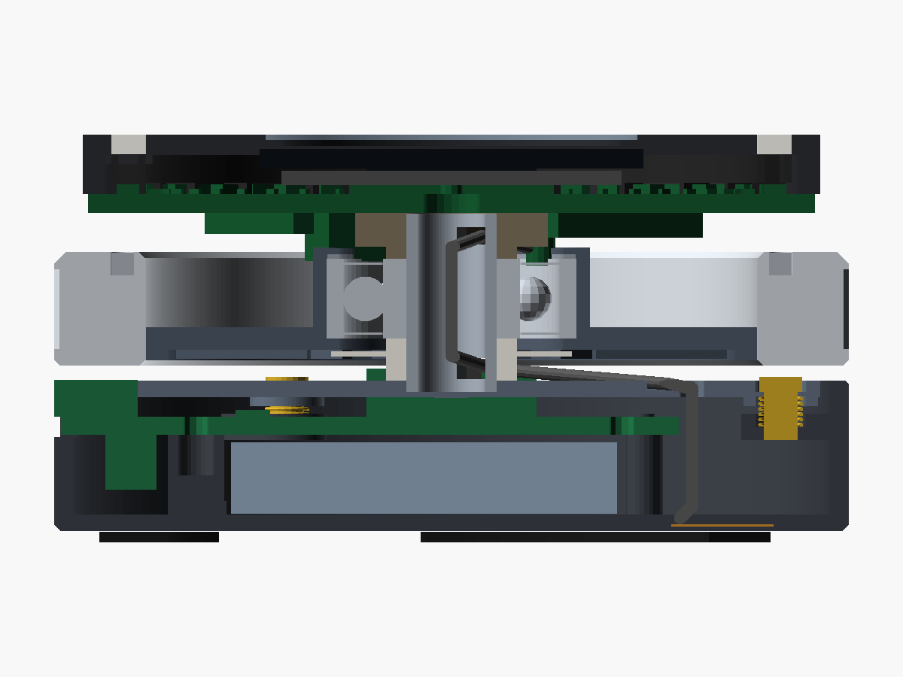

# dial-me-spinner: mechanical design (rev A)

This document covers the mechanical design of the ~70 mm BLE dial spinner, which is used as a game/decision wheel, a
Surface-Dial-style BLE controller and a fidget toy. It covers the enclosure, flywheel, bearing, magnetic detent,
press-click suspension, antenna placement, assembly and mechanical BOM.

* **Architecture of record:** [`hardware/design/SPEC.md`](../hardware/design/SPEC.md) §8. SPEC wins on any
  disagreement. Section 3 below lists where SPEC cannot be built as written, what the model does instead and
  what SPEC should change to.
* **Model:** [`hardware/mechanical/dial_spinner.scad`](../hardware/mechanical/dial_spinner.scad) is a parametric
  OpenSCAD 2021.01 model of the whole device. Every SPEC number is a named constant, and deviations are tagged `DEV:`.
* **Calculations:** [`hardware/mechanical/calcs.py`](../hardware/mechanical/calcs.py) prints everything quoted here.
  Its full output is in [`calcs_output.txt`](../hardware/mechanical/calcs_output.txt).
* **Interference check:** [`check_clashes.sh`](../hardware/mechanical/check_clashes.sh) runs a CGAL boolean check
  of the rotor's swept envelope and of the press travel. Its result is in
  [`clash_report.txt`](../hardware/mechanical/clash_report.txt).
* **Printable parts:** [`hardware/mechanical/stl/`](../hardware/mechanical/stl/) (binary STL, oriented for the bed).
  `render_all.sh` regenerates every render, STL and report.

Anything marked **(to verify on prototype)** is an assumption or a model result that has not been measured yet.
Section 15 collects them into a checklist.

---

## 1. Concept


The device has three bodies:

| Body | What it is | How it moves |
|---|---|---|
| **Base** | PA12 cup (Ø70, z 1.0–14.3) on 3 micro-suction arc pads. It holds the LiPo, the base board (USB-C, charger, press switch), the 2.4 GHz flex antenna on its floor, and 3 brass guide pins with stop screws. | Sits on the desk |
| **Floating assembly (FA)** | FA lower plate + stationary Ø8 spindle + main board (MCU, OLED, LED ring, TMAG5273, detent actuator) + light box + diffuser + top cover. It is the "stationary hub" of SPEC §1. | Does not rotate. Three springs push it up against three stop screws. A press moves it down 0.42 mm to the click and at most 0.60 mm to the hard stop. |
| **Rotor** | 316L flywheel ring (OD 70 / ID 54 / 10) with 48 N52 Ø2×2 magnets flush in its **top face** at R 29.0, bonded to a PA12-GF carrier that holds the 608 outer race | Spins on the 608 around the spindle and moves down with the FA when pressed |

The magnet track does three jobs:

1. **Detent.** A stationary Ø3×2 N52 magnet sits 1.0 mm above the track and gives 24 detents of 15°. It slides
   radially inward along θ = 90° to weaken the detent, reaching free spin at 7.5 mm.
2. **Encoder.** The TMAG5273 on the main-board underside at r 29, θ 270° sees 24 electrical periods per revolution.
3. **Wake source.** The same sensor wakes the device on rotation.

Wires (12-way link, 1.13 mm coax) pass through the hollow spindle, so nothing rotates in the electrical path.

| | |
|---|---|
|  |  |
| Assembly (USB-C at θ = 0°, front right) | Exploded view, in assembly order (§12) |
|  |  |
| Main-board underside seen from below. The rotor envelope is ghosted and the SPEC keep-out is outlined in yellow. | XZ section: USB-C (left), guide pin + spring at θ 180°, coax from the floor antenna into the spindle (right) |

Key numbers (from `calcs.py`):

| Quantity | Value |
|---|---|
| Overall | Ø70 × 36 mm, **≈ 222 g** (rotor 136 g, rest of FA 46 g, base 40 g), CoG z ≈ 19.3 mm |
| Rotor | **136 g, I = 1.22·10⁻⁴ kg·m²** (the ring is 95 % of I), CoG 0.9 mm below the ball plane |
| Energy | 60 / 240 / 540 mJ at 5 / 10 / 15 rev/s |
| Free spin from a 10 rev/s flick | 96–133 s (SKF model, ν 20–10 mm²/s). **Planning floor 36 s** if friction is 2.7× the model. Acceptance test ≥ 45 s. |
| Detent | 24 × 15°, 16.5 mN·m at full click, continuously variable to < 3 µN·m (free) |
| Click force | 4.4 N at the centre, 1.6–2.2 N at the ring rim (varies with azimuth) |

---

## 2. Stack-up

z is measured from the desk. θ = 0° is the USB-C direction, CCW seen from above. "Model" is what
`dial_spinner.scad` builds. ⚠ marks a deviation that section 3 explains.

| z (mm) | Part | Radii / notes | Model |
|---|---|---|---|
| 0.0–1.0 | 3 feet | r = 28 | ⚠ 3 arc pads, 70° each, r 25–31, at θ 0/120/240° |
| 1.0–2.5 | base cup floor, PA12 | OD 70, wall 1.6, wall top z 14.3 | as SPEC, bottom chamfer 0.6 |
| 1.4–1.6 | flex antenna 146153 (34.9 × 9) in a floor pocket (0.4 mm skin under it) | SPEC: chord x = −26 | ⚠ centre x = −23.85, pocket runs 0.3 mm under the wall |
| 2.5–8.8 | LiPo 603450-class, ≤ 6.3 thick | long axis 90/270° | ⚠ envelope 34 × 52 × 6.3, shifted +2.4 mm toward θ 0 |
| 4.7–9.5 | J2 battery connector (JST PH SMD, 4.8 tall), **underside of the USB tab** beside the pack | not in SPEC | model |
| 9.05–11.4 | 3 cup "ears" hanging from the wall at θ 60/180/300, r 25.5–33.4. Each has a spring seat and a bonded Ø3 brass guide pin. | SPEC "3 guide pins + springs at r 29" | ears clear the pack corners by 0.25 mm |
| 9.5–11.1 | base board Ø40 + USB tab to r 34.4 | SPEC: 3× M2 bosses at r 15 | ⚠ supported on posts at (22.5, 0) [M2 insert] and (−17, ±6) [Ø1.8 locating pegs] |
| 11.1–12.6 | TS-1187A at the base-board centre, actuator Ø2.5 | | as SPEC |
| 11.1–14.36 | USB-C HRO TYPE-C-31-M-12 (top mount), mating face at r 35 | | wall slot from z 9.3 up, FA-plate notch at θ 0 |
| 11.1–15.35 | J3 link, vertical BM12B-SRSS-TB (≈ 15 × 4.25 × 4.25, verify) | | through a 16.6 × 5.2 window in the FA plate (see §3, item 8) |
| 12.0–14.3 | **FA lower plate** PA12-GF, r ≤ 30 (ears to r 32.5 at the guides) | pre-gap 0.15 | Underside bosses at the guides (z 12.0) are the overload stop on the cup ears: 0.60 mm travel. Centre boss + 0.5 mm TPU dot over the switch. |
| 13.3–14.6 | M2 brass stop screws in Ø4.6 counterbores (head top 14.6) | "preload ≈ 4 N up against stops" | spring 2.7 mm installed → 1.33 N each, 4.0 N total |
| 13.3–29.0 | spindle, 316 tube Ø8 × 1.0 | bore Ø6 | sits on a 0.5 mm floor over the boss. Wire/coax slots at θ 225°, z 14.4–16.3 and 26.3–27.8. |
| 14.3–18.0 | POM lower spacer (inner-race clamp), Ø11.5. Drop-stop flange Ø21.2 at z 16.40–16.85. | | 0.15 mm under the rotating carrier lip |
| 15.6–25.6 | **rotor ring** 316L, OD 70 / ID 54 | track on the top face, R_t 29.0 | chamfers: 1.0 top-outer, 0.5 elsewhere. Straight knurl z 17.1–24.1. 4× M2 balance holes in the bottom face at r 31. |
| 16.1–26.0 | **rotor carrier** PA12-GF | web z 17–19, r 11–27 | web r 12.2–25; register r 25–26.95 (z 16.1–19, epoxy); collar r 11.0–12.2 to z 26.0; 12 ribs underneath (z 16.2–17) |
| 18.0–25.0 | 608-2Z | outer race r 11 | slip fit in the collar on a rigid lip. Wave spring (z 25.0–25.4) + printed snap retainer above (compliant drop seat, §10) |
| 25.0–29.1 | spindle hub = upper spacer (r ≤ 5.75) + flange (r ≤ 8.5, z 26.1–29.1) with 3 M2 heat-set inserts at r 6.5 | | PA12-GF (or turned brass) |
| 20.0–29.1 | bowl: stepper placeholder (Ø8 × ~33 along a chord at y = 15.5), saddle to the θ 60° bracket hole | SPEC: "chord near θ 90" | ⚠ needs a wider keep-out (§7) |
| 26.6–29.1 | detent carriage: Ø3×2 N52 (z 26.6–28.6) in a printed carriage. A 0.5 mm plate slides between two rails bonded to the board bottom. Inclined-slot link at z 27.0–27.5. | 1.0 mm above the track, r 29 → 21.5 along θ 90 | as SPEC |
| 28.0–29.1 | TMAG5273 (bottom), r 29, θ 270°, long axis radial | | Hall element at z 28.73, **3.13 mm** above the track face |
| 29.1–30.7 | **main board** Ø64, 4 layers | centre Ø5, 3× M2 r 6.5, 2× M2 r 17 θ 60/120 | M2 at r 6.5 at θ 30/150/270 |
| 30.7–31.6 | 48 × WS2812C-2020 at r 28.5, LED1 at θ 0°. 100 nF caps at r ≈ 26. | | |
| 31.5–32.8 | printed OLED bracket on the 3 hub screws (CSK M2), with pockets over the ZIF and boost inductor | | 0.2 mm foam tape under the glass |
| 30.7–34.2 | light box r 27–30: walls 0.6, 24 septa (one per detent) whose feet stand between LEDs | "31.6–34.2" | walls stop 0.1 above the LED tops; septa reach the board |
| 33.0–34.7 | OLED glass 33.8 × 34.0, active-area centre on axis (glass centre at y −1.47) | | |
| 34.2–36.0 | diffuser ring opal PMMA r 27–30, flush. Top cover r ≤ 32.5 with Ø30 window, 6 spokes under the diffuser, skirt to the board top, 3 snaps on the light box. Glass pocket keeps a **0.3 mm air gap**. | | optional 0.5 mm PC window lens in a Ø33 × 0.5 recess |

**Running clearances (nominal, from `calcs.py` §11).**

| Pair | Clearance |
|---|---|
| Ring bottom to cup wall | 1.30 mm at rest, 0.70 at full stop |
| Ring bottom to stop-screw heads | 1.00 mm, 0.40 at full stop |
| Stepper to rotating web | 1.40 mm |
| Stepper to carrier collar (plan) | 0.55 mm |
| Detent magnet to track | 1.00 mm. Constant under a press, because both are on the FA. |
| Carrier lip to POM drop stop | 0.15 mm (intended crash stop) |

**Interference check (CGAL, `clash_report.txt`).** The rotor envelope clears every stationary part except
**`main_board`**, where J1 and the u.FL plug overlap it by 41 mm³ (SPEC issue 7, §3). With the envelope grown 0.3 mm,
the only additions are the intended contacts: the friction shoe and the drop stop. In the press check, the only overlap is
the boss entering the switch actuator by 0.45 mm. That is the switch travel plus the TPU dot.


*Red: interference of J1 (vertical, "next to the centre hole") and the mated u.FL plug with the rotor's hub
envelope (ghosted).*

---

## 3. Where SPEC §8 is not buildable as written

| # | SPEC says | Problem (numbers) | Model / recommendation | Severity |
|---|---|---|---|---|
| 1 | Base board: 3× M2 bosses at **r 15, θ 60/180/300**. LiPo bay z 2.5–9.0 under the board. | A 34 × 50 pack centred under the board covers \|x\| ≤ 17, \|y\| ≤ 25. All three r = 15 points are inside the pack, so the bosses have nothing to stand on. A bridge over the pack needs ≥ 1.5 mm, and there is 0.2 mm. | Support the board outside the pack: an M2 brass screw into a heat-set insert in a post under the **USB tab at (22.5, 0)**, plus two Ø3.2 posts with Ø1.8 locating pegs at **(−17, ±6)**. These sit in the 4.5 mm gap between the pack and the antenna. Add Ø2.2/Ø2.0 holes at those points to the base PCB. The r 15 holes can stay but are unused. | **High** (blocks base-board layout) |
| 2 | Antenna Molex 146153-0050 on the floor along chord **x = −26**, ≥ 4.5 mm from the battery side. Coax up through the spindle. | Its 34.9 × 9 outline at x = −26 has corners at r ≈ 35.1, outside the cup ID (33.4) and even the OD. With a 34 mm pack centred, the 4.5 mm gap cannot be met for any x. The route floor → spindle → u.FL needs about 75–85 mm of coax, and -0050 has 50 mm. | Pack moved **+2.4 mm toward θ 0** (corners at r 33.0). Antenna centred at **x = −23.85**; its floor pocket runs 0.3 mm under the wall. Use **146153-0100 (100 mm coax)**. | **High** |
| 3 | 608 with "≥ 2.5–3 N wave-spring axial preload" | A single bearing cannot be preloaded by a spring that sits between the outer race and the rotor, because both rotate. The only axial load is gravity (1.33 N) ± detent forces. The click-mode detent tilt moment is ≈ 0.7 N × 29 mm ≈ 20 mN·m, against a gravity moment capacity Fa·dm/2 ≈ 10 mN·m, so the rotor rocks within its tilt play at 24× the rotation rate. | The model uses the wave spring for its other job, a compliant drop seat (§10). For real preload, prototype (a) gravity only (accept rocking), (b) an axisymmetric magnet-ring pair (rotor ring on the carrier underside attracting a stator ring on the FA plate, ≈ +1.5–2 N, no cogging if the rings are uniform), (c) a duplex 608 pair (≈ 2× friction, +7 mm). Cost of preload: Fa 2.7 N → 64 s instead of 96 s (§4). | Medium |
| 4 | 3 guide pins + springs at **r 29, θ 60/180/300**, "preload ≈ 4 N up against stops" | At θ 60/300 the pins sit over the pack corners, so they cannot reach the floor. The stops must not rise into the ring (bottom z 15.6). | Pins bonded in **ears hanging from the wall** (z 9.05–11.4, 0.25 mm over a 6.3 mm pack). Stops are M2 brass pan heads in plate counterbores (head top 14.6). | Medium (battery must stay ≤ 6.3 mm, swelling included) |
| 5 | 3 feet at **r 28** | Point feet at r 28 give a support edge 14 mm from the centre. A rim press tips the 222 g device at **1.57 N**, which is below the rim click force (1.70–2.19 N). | 3 × 70° **arc pads** (r 25–31): edge 28.1 mm, tip force 11.3 N. Micro-suction material. | **High** (Surface-Dial-style use) |
| 6 | Actuator in the bowl "chord near θ 90". Bottom keep-out θ 60–120°, r 12–32. 2× M2 at r 17, θ 60/120. | A ~33 mm VSM08102 cannot lie radially (hub at r ≤ 12.2, ring at r ≥ 27). On a chord through θ 90 it hits the parked carriage. The working layout (chord at y = 15.5 + inclined-slot link) sweeps **θ ≈ 35–160°**, and the link passes over the **θ 120 hole**. | Widen the bottom-side keep-out to **θ 30–160°, r 7.5–27**. Use only the θ 60 hole (stepper saddle). No screw head at θ 120. Redo with the vendor drawing. A ≤ 20 mm actuator would allow a straight radial drive. | **High** (PCB keep-out) |
| 7 | MDBT50Q bottom side, r 8–22, **u.FL end toward the centre**. J1 vertical "next to the centre hole". Flange keep-out r ≤ 8.5. | The rotor hub (608 outer race top z 25.0, retainer z 26.0) is at r 9.6–12.2. A mated u.FL hangs to z ≈ 24.4 and a vertical SH header to z 24.85, so both **collide with the spinning hub** (CGAL: 41 mm³). The module at r 8 also overlaps the r ≤ 8.5 flange keep-out by 0.5 mm. | Rule: **parts hanging more than 2.3 mm below the board must be at r ≥ 13**. Use a **side-entry SM12B-SRSS-TB** for J1 (2.95 mm tall, z ≥ 26.15, mouth toward the hub channel), or move J1 out to r ≥ 13. Put the u.FL at r ≥ 13 (u.FL end outward or the module rotated). Start the module at r ≥ 8.7. | **High** (PCB placement) |
| 8 | J3 vertical BM12B on the base-board top (same pinout both ends) | The FA plate bottom is only 1.7 mm above the base board, so J3 must poke through a plate window. Its mated plug and wire exit reach z ≈ 15.4–16.5, right under the rotor ribs (z 16.2, rotating) and the drop-stop flange. | Prefer **side entry SM12B-SRSS-TB** (2.95 tall, z ≤ 14.05) at r 5–10, with wires leaving horizontally toward the spindle slot. | Medium |
| 9 | (not stated) base-board component heights | The base board top under the FA plate has 1.15 mm minus travel, so **≤ 1.0 mm parts** (SOT-23-6, 0805, SH and PH connectors do not fit). The base board bottom sits on the pack, so **nothing over the pack**. | Tall parts go on the tab outside the plate (r > 30: ≤ 3.5 mm under the ring) or on the tab underside beside the pack (≤ 4.5 mm, e.g. J2). | **High** (base layout) |
| 10 | Switch pre-gap 0.15, "FA moves 0.3–0.5" | TS-1187A travel is 0.25 ± 0.1 (to verify). A rigid boss with a fixed hard stop either never clicks (long-travel parts) or crushes the switch (short-travel parts). | Fit a 0.5 mm TPU/silicone dot on the boss and put the hard stop at 0.60 mm. Click at 0.42 mm. Set the pre-gap per unit with 0.05 mm Kapton shims. | Medium |
| 11 | Light box z 31.6–34.2, r 27–30 | The LED research wants a 4.0–4.5 mm air gap; this gives 2.6 mm (p/h ≈ 1.4 at 3.73 mm LED pitch). The 0.6 mm walls must sit above the 2.0 mm LEDs because the channel is only 1.8 mm wide. | Walls end 0.1 mm above the LED tops. 24 septa (one per detent) give a segmented "prize wheel" look in place of a smooth ring. Uniformity to verify. | Low |
| 12 | Detent LUT (research) | It was simulated for R_t = 30 on the ring underside. SPEC has R_t = 29 on the top face (pitch 3.80 vs 3.93 mm). | Expect ~2–5 % lower torque and a slightly steeper fall-off. Firmware self-calibrates from the in-well f_n. | Low |

---

## 4. Bearing: choice and lubrication

**Choice: SKF 608-2Z** (8 × 22 × 7, C 3.45 kN, C₀ 1.37 kN, 13 g;
[datasheet](https://www.simplybearings.co.uk/products/608-2z-skf)). Equivalents are NSK/NMB 608ZZ. **SKF 608-2RSL**
is an acceptable alternative: its seal friction is zero in the SKF model for D ≤ 25 mm, and it retains oil and dust
better. With 2RSL, keep the inner-race spacers at Ø10.0–10.5. **Never use RSH or RS1 contact seals**: about 7.6 N·mm,
so the rotor stops in about 1 s. Buy 5+, measure each, keep the best two.

The SKF model is in `calcs.py`, built from the
[SKF frictional-moment model](https://cdn.skfmediahub.skf.com/api/public/0901d1968065e9e7) with Table 2a constants.
It reproduces the verifier's 0.147 N·mm (608) and 1.6 N·mm (61808) at Fa = 1.32 N, 10 rev/s, ν = 20.

Spin-down with the rotor computed here (Fa = 1.33 N from gravity, plus eddy and air drag terms of < 3 %):

| Bearing / lubricant | from 5 rev/s | from 10 rev/s | from 15 rev/s |
|---|---|---|---|
| 608-2Z, oil ν = 10 mm²/s | 90 s | **133 s** (493 rev) | 165 s |
| 608-2Z, oil ν = 20 | 66 s | **96 s** (346 rev) | 118 s |
| 608-2Z, ν 20, **friction × 2.7** (planning floor) | 24 s | **36 s** | 44 s |
| 608-2Z, factory grease after run-in (ν 200) | 20 s | 29 s | 35 s |
| 61808 (6808), oil ν 10 / ν 20 | 11 / 7 s | 15 / 10 s | 18 / 12 s |
| 61808, ν 20, × 2.7 | 3 s | 4 s | 4 s |


**Uncertainty.** The model runs below the bearing's minimum load and with drop lubrication. The one measured
comparison (Agliolo Gallitto 2025, cited by the verifier) suggests it **under-predicts friction by up to 2.7×**.
Quote "≈ 35–130 s from a 10 rev/s flick" and use **≥ 45 s from 10 rev/s** as the acceptance test. The ≈ 10× advantage of
the 608 over a 61808 holds in either case, because the same model error applies to both.

**Lubrication procedure (every bearing, before assembly).**

1. Soak the 608-2Z in IPA and run it 10 min in an ultrasonic bath. 2Z shields are pressed in, so leave them in place;
   for ZZ bearings with snap rings, remove the shields. Repeat with fresh IPA, then blow dry with clean air.
2. Add 1–2 drops of **ISO VG 2–10 synthetic instrument/spindle oil** through the shield gap. Examples: Mobil Velocite
   No. 3 (VG 2) or No. 6 (VG 10); Mobil does not state the base oil (to verify).
3. Spin it by hand for 1 min to distribute the oil, then wipe the outside. Spin test on an Ø8 arbor: a bare 608 should
   coast smoothly for > 30 s from a finger flick. Reject any bearing with shield rub or a "gritty" stop.
4. **Maintenance:** VG 2–10 oil migrates and evaporates. Log the spin-down monthly with the encoder (firmware). Re-oil
   when it drops below 70 % of the as-built value. 2RSL keeps oil longer.

**Seating.**

* **Inner race.** Clamped on the Ø8 spindle between the POM lower spacer (Ø11.5) and the spindle-hub upper spacer.
  The clamp force comes from the 3 hub screws. Add Loctite 641 if the tube OD is loose (> 8.00/−0.02).
* **Outer race.** Slip fit (Ø22.00–22.04) in the PA12-GF collar. It sits on a rigid lip below and on a wave spring +
  printed snap retainer above. The race does not creep: slip torque ≈ 30 N × 0.2 × 11 mm ≈ 66 mN·m, against
  0.15 mN·m of bearing drag.

**Axial preload (SPEC issue 3).** Effect of the net axial load on friction:

| Fa (N) | M at 10 rev/s (N·mm) | Fa·dm/2 tilt capacity (mN·m) | Spin from 10 rev/s |
|---|---|---|---|
| 1.33 (gravity) | 0.148 | 10.0 | 96 s |
| 2.0 | 0.179 | 15.0 | 76 s |
| 2.7 | 0.207 | 20.2 | 64 s |
| 3.5 | 0.236 | 26.2 | 54 s |

Prototype with gravity only first. Measure click-mode rocking with the TMAG; it shows as a once-per-detent wobble in
the Bz amplitude. Add a magnet-ring preload only if the rocking is audible or felt (to verify on prototype).

---

## 5. Flywheel: material, drawing notes and balancing

**Material: 316L stainless.**

* ρ 7.98 g/cm³, non-magnetic, corrosion-proof under fingers.
* σ ≈ 1.35 MS/m, about 11× below brass, which keeps the stationary magnet's eddy drag at a few µN·m.
* Turned at JLCCNC or PCBWay CNC, or by a local shop. Est. $15–40.

Ring net mass: 118.8 g, after removing 2.7 g of pockets, 1.4 g of chamfers and 1.2 g of knurl.

| Feature | Spec |
|---|---|
| OD / ID / height | 70.00 / 54.00 +0.02/0 / 10.00 mm |
| Concentricity OD↔ID | ≤ 0.02 TIR |
| Faces | flat and square ≤ 0.02. The **top face is the detent/encoder datum.** Face runout ≤ 0.05 TIR, because the detent loses about 10 % torque per +0.1 mm gap. |
| Chamfers | 1.0 × 45° top-outer (flick edge); 0.5 × 45° elsewhere. The 0.5 inner-top chamfer leaves 0.45 mm of flat to the pockets. |
| Knurl | straight, DIN 82 RAA 0.8, OD band z 17.1–24.1 (1.5 mm from each face) |
| Magnet pockets | 48 × Ø2.10 +0.02/0 × 2.05 +0.02/0 deep, flat-bottom (end mill), on the top face at R 29.000 ± 0.02, every 7.5° ± 0.05° |
| Balance holes | 4 × M2 tapped, 3 deep, in the bottom face at r 31, θ 45/135/225/315° |
| After machining | Check it is non-magnetic: an N52 Ø3 magnet must not cling. Knurling cold-works 316L; anneal (1050 °C, quench) if any attraction is felt. Bead-blast the OD/top band if desired. Never plate with nickel (it is ferromagnetic). |

**Rotor carrier.** PA12-GF (SLS) or MJF PA12-GB, est. 6 g. **No aluminium or copper may rotate near the detent
magnet** (verifier). Its bore and register must be concentric within 0.05 TIR as printed. That is not good enough on
its own, which is why the bonding jig below matters.

**Alternatives.**

* **C360 brass:** 132 g; tarnishes; about 11× the eddy drag in click mode.
* **RF-transparent ring (see §9):** PA12-GF ring with 16–24 discrete non-magnetic tungsten-alloy (W-Ni-Cu) slugs or
  ZrO₂/WC-Ni balls. I ≈ 0.5–1.0·10⁻⁴, so 40–80 % of the spin time, with no closed conductive loop.

**Balancing.**

The target is ISO 1940 **G2.5 at 15 rev/s**:

* e_per = 26.5 µm, so U_per = **3.6 g·mm** for the 136 g rotor.
* Aim for ≤ 2 g·mm.
* At the limit the rotating force is 0.032 N, about 15 mg of base acceleration. That is barely perceptible, and
  the LIS2DW12 can measure it.

| Error source | A: ring bonded on the printed carrier freehand | B: bonded on an arbor (recommended) |
|---|---|---|
| Ring OD/ID eccentricity (0.02 TIR) | 1.19 g·mm | 1.19 |
| Ring-to-bearing eccentricity | 4.45 (e ≈ 0.035) | 1.27 (TIR ≤ 0.02) |
| 48 magnets, mass σ 3 %, random | 0.28 | 0.28 |
| 5 mg glue blob at r 29 | 0.14 | 0.14 |
| **RSS before correction** | **4.6** (out of spec) | **1.8** |

Procedure:

1. **Bond the ring on an arbor.**
   * Slide the carrier (608 fitted) onto a ground Ø8 arbor held in a lathe or V-blocks. Spread epoxy on the register.
   * Rotate slowly and tap the ring until a dial indicator on the OD reads ≤ 0.02 TIR.
   * At the same time set the ring top face 0.60 ± 0.03 mm above the 608 top face (a 0.60 shim ring under a flat).
     This sets the 1.0 mm detent gap and the 3.1 mm encoder gap.
   * Let it cure undisturbed.
2. **Static balance.**
   * Put the arbor on knife edges or a magnetic prop balancer. The 608 itself adds drag, so use a second, freshly
     degreased 608 or spin the arbor rather than the bearing.
   * Mark the heavy side.
3. **Correct on the bottom face at r 31.** One step is:
   * a Ø2 × 1 drill dimple: −0.93 g·mm;
   * an empty M2 tapped hole: −1.49;
   * a brass grub in a tapped hole: +1.35;
   * a W-alloy grub: +2.70 g·mm.

   Iterate until there is no preferred rest angle in 20 random releases.
4. **Dynamic check (assembled).**
   * Spin to 15 rev/s and log the LIS2DW12 at 200 Hz.
   * The 1×/rev component must be ≤ the value measured with a 2 g·mm test mass taped at r 31.
   * The firmware "balancing assistant" can report the correction angle.

---

## 6. Magnet track

| Item | Spec |
|---|---|
| Magnets | 48 × NdFeB **N52 Ø2.0 × 2.0 mm, axial, NiCuNi**, all from one batch (± 0.05 mm, ± 5 % Br). Buy 60. |
| Layout | Alternating N/S, **R_t = 29.0**, pitch 7.5° (3.80 mm chord). 24 electrical periods = 24 detents. Zero DC field, so stray steel causes 10–100× less cogging than a same-polarity track. |
| Pockets | Ø2.10 +0.02/0 (= max magnet Ø + slip), 2.05 +0.02/0 deep. Measure your batch and set the pocket to max Ø + 0.03–0.05. |
| Flushness | Magnet top faces flush to the ring top face ± 0.03, set against a flat datum while the epoxy cures |
| Adhesive | Low-viscosity 2-part epoxy (e.g. 3M Scotch-Weld DP420, Loctite EA 9466). Wipe a thin sealing film over the cured track against corrosion. Keep the track ≤ 60 °C (N52; use N48H if hot environments are expected). |
| Field at the sensor | Bt/Bz ≈ 15/18 mT peak at 3 mm, zero mean ([detent research, magpylib]). The TMAG5273A2 ±133 mT range is ample. |
| Centrifugal load | 5 mN per magnet at 10 rev/s, 49 mN at 30 rev/s. The pocket wall takes it; the glue only locates the magnet. |

**Polarity jig and procedure.** Neighbours 3.8 mm apart attract hard, and a flipped magnet gives a missing detent.

1. Print a 2 mm "mask" ring (PA12) that covers every other pocket (24 open). Clamp it on the ring top face.
2. Dispense a pin-head of epoxy in each open pocket. Stack the N52 supply on a steel rod, **north up** (check with a
   compass or a marked reference magnet), and slide the magnets off one at a time with a brass/plastic tweezer into
   the pockets.
3. Lay a flat PTFE-taped glass plate on top, weighted by 200 g, so the faces cure flush. Cure fully.
4. Swap to the second mask (the other 24 pockets) and repeat **south up**. The cured neighbours now hold the new
   magnets in place rather than flipping them.
5. Check: magnetic viewing film must show 48 alternating spots. After assembly, the firmware calibration spin
   checks for 24 uniform electrical periods and flags any phase jump.

**Keep-outs around the track** (detent and sensing research; SPEC §7):

* No ferromagnetic part within 4 mm of the magnet faces, and none within 10 mm of the track or the TMAG.
* No power inductor within 10 mm.
* No copper pours on B.Cu or In2 at r ≥ 26. The remaining In1/F.Cu planes at 4.8–5.1 mm add ≈ 0.001 N·mm of eddy
  drag at 10 rev/s, which is negligible.
* All screws near the rotor are **brass or nylon**. 316/A4 screws are cold-headed and often slightly magnetic, so do
  not use them within 10 mm of the track.

---

## 7. Detent mechanism

**Principle.** A stationary Ø3×2 N52 magnet sits 1.0 mm above the alternating track. Its strength is set by moving it
**radially inward, in plane**. This needs a shorter stroke and ≈ 2.4× less actuator force than lifting it away. Both
end positions are magnetically force-neutral, so the actuator holds at zero power.

| Offset (mm) | 0 | 0.5 | 1.0 | **1.5** | 2.0 | 3.0 | 4.0 | 5.0 | 6.0 | **7.5** |
|---|---|---|---|---|---|---|---|---|---|---|
| Peak torque (mN·m) | **16.5** | 13.7 | 11.4 | **9.5** | 5.7 | 2.0 | 0.53 | 0.14 | 0.029 | **0.0027** |
| Rim force at r 35 (N) | 0.47 | 0.39 | 0.33 | 0.27 | 0.16 | 0.06 | 0.015 | 0.004 | – | – |
| In-well f_n (Hz) | 9.1 | 8.3 | 7.6 | 6.9 | 5.3 | 3.2 | 1.6 | 0.8 | 0.4 | 0.1 |
| Capture speed (rev/s) | 0.76 | 0.69 | 0.63 | 0.57 | 0.44 | 0.26 | 0.14 | 0.07 | 0.03 | 0.01 |
| Full steps from click | 0 | 33 | 67 | 100 | 133 | 200 | 267 | 333 | 400 | 500 |

The bold columns (0, 1.5, 3.0, 5.0, 7.5 mm) are the verified LUT points; the others are log-linear interpolations
(`calcs.py` §4). For reference, an EC11 encoder is about 10–12 mN·m. The default CLICK strength is 1.5 mm
(9.5 mN·m). At FREE (7.5 mm) the residual cogging is 2.7 µN·m, about 20–50× below the bearing drag, so there is no
preferred rest angle. The LUT was simulated at R_t 30, see §3 item 12.


**Carriage (`stl/detent_carriage.stl`).**

* **Body:** printed PA12 (MJF) or POM.
* **Plate:** 6 × 5 × 0.5 mm. It slides between two rails bonded to the main-board bottom (`stl/carriage_rail.stl`,
  or 0.5/1.0 mm FR4 strips).
* **Lips:** under the plate edges, spaced 2.6–4.0 mm off the centreline.
* **Magnet cup:** holds the Ø3×2 N52 with its face 1.0 mm above the track. Glue it in; either polarity works.
* **Link strip:** at z 27.0–27.5, passes under the rail lips and carries a 1.6 mm **inclined slot** (slope 0.75).
* **Preload:** about 0.4–0.5 N against the rails from a PTFE-faced leaf spring or a 0.2 mm PET flexure, to stop
  rattle under the ±0.7 N alternating normal force.

**Actuator (primary): VIC-TECH VSM08102.**

* Ø8 PM can-stack linear stepper with slider, M2×0.4 lead screw, 10 mm stroke, 20 Ω/phase, ≥ 80 gf (0.78 N) at 500 PPS.
* Datasheet: [VIC-TECH VSM08102](https://www.micro-steppermotors.com/sale-28526335-vsm08102-8mm-4-pins-fpc-small-linear-stepper-motor-with-slider-m2-lead-screw.html).
* Driver: 2× DRV8837 (SPEC §5.6).

The model places it along a **chord at y = 15.5** (axis z 24.4), with the can at x 6.5–15.5 and the lead screw toward
−x. The can is cradled in a printed saddle (`stl/stepper_saddle.stl`) screwed to the θ 60° bracket hole. The slider's
Ø1.5 brass pin drives the inclined slot:

* 10 mm of slider travel gives 7.5 mm of carriage travel, at a **1.33× force advantage**.
* Resolution is 0.015 mm of carriage per full step, 500 full steps end to end, about 0.6–0.9 s per stroke at
  ≤ 500 PPS in the loaded zone.
* Load: 0.29 N magnetic + μ·ΣN of the guide ≈ 0.54 N at the carriage. That needs 0.50–0.61 N at the slider (pin
  μ 0.1–0.2), a 1.3–1.6× margin on the 0.78 N rating.
* The M2×0.4 lead (4.2°) is below its friction angle (≈ 9.8°), so the screw self-locks.

Packaging is the weak point (§3 item 6):

* The working layout needs the bottom-side keep-out widened to θ 30–160°.
* The 33 mm envelope comes from a listing, not a drawing. **Request the vendor drawing** before PCB layout, and make
  the mount accept the 10 mm sibling (≈ 1.7 N estimated).
* Ferrous parts of the actuator are ≥ 10 mm from the track: the can is at r ≤ 25 and the screw at r ≤ 23.

**Fallback actuator: N20 3 V gearmotor with an M3 lead screw**
([example](https://probots.co.in/100-rpm-3v-linear-actuator-n20-micro-metal-gear-dc-motor-with-m3-screw-lead-shaft.html)).

* It is far stronger (tens of N), plugs into the same connector (pins 1–2), runs on one DRV8837, and uses
  DRV5032 end sensing.
* Its 10 × 12 mm section does **not** fit the 10.1 mm bowl (web top z 19.0 to board 29.1) with clearance. It needs
  a cut-out in the main board inside the actuator keep-out, so it can sink 1.6 mm into the board.
* A Ø6 planetary micro gearmotor with an M2 lead screw is the better-fitting fallback (to verify).

**Home sensing.** The DRV5032FA sits on the board **top** at (r 21.5, θ 90°). Its die is about 2.7 mm above the
parked magnet's top face, giving > 30 mT at park and about −0.5 mT at click. Homing is a gentle stall at the
force-free park end. HOME confirms park on every return to FREE (detent verifier).

**Damping shoe (ringing).** A high-inertia rotor in a conservative magnetic well is badly under-damped.

| Release at 6° in a well | Bearing friction only (≈ 0.02–0.05 mN·m at these speeds) | + 1.6 mN·m shoe |
|---|---|---|
| Full click (16.5 mN·m) | 154 cycles, still ±4.7° after 4 s | **4 cycles, settled (< 0.5°) in 0.50 s** |
| Default (9.5 mN·m) | 119 cycles, > 20 s | 2 cycles, 0.42 s |

Rest error with the shoe is ±0.23°. With the shoe engaged, a 5 rev/s click spin lasts ≈ 2.3 s (prize-wheel feel).

Shoe design:

* **Pad:** a 3 × 0.8 mm **wool felt or UHMW-PE** pad (not PTFE; its μ is too low) on a hanger at the carriage's outer
  tip. At click it lands on the ring top face at r ≈ 31.6–32.4, outside the magnets.
* **Force:** ≈ 0.25 N normal from a printed flexure. At μ 0.2 and r 32 that gives ≈ 1.6 mN·m.
* **Engagement window:** the pad must touch only for offsets ≤ 1.5 mm, which covers the default strength. Above
  that a small ramp on the rail lifts the flexure 0.5 mm, so the pad never wipes the magnets. The model shows the
  pad at its click position; the lift ramp is to be detailed with the real flexure.
* Firmware also predicts the landing detent as soon as the velocity reverses inside a well.
* (Felt wear and debris on the track, μ drift: to verify on prototype.)

---

## 8. Press-click mechanism

**Kinematics.** The FA rests on three springs at r 29, θ 60/180/300.

* **Up-stops:** each spring pushes the plate up against an **M2 brass pan-head stop screw** that threads into the top
  of the guide pin. The heads sit in Ø4.6 counterbores, at 4.0 N total preload.
* **At rest:** the FA weighs 1.79 N, so 2.21 N of net preload holds it against the stops. It cannot rattle, and the
  switch carries no dead load.
* **Press:** the plate's centre boss (with a 0.5 mm TPU dot) closes the 0.15 mm pre-gap to the TS-1187A and
  actuates it at 0.42 mm.
* **Overload:** at **0.60 mm** the plate's three under-bosses land on the cup ears, which take any harder press.
* **Lateral and rotational location:** the three Ø3 brass guide pins in Ø3.05 reamed holes, giving ±0.025 mm. That is
  0.03 mm at r 35, the detent-lash limit from the detent research.

| Part | Spec |
|---|---|
| Switch | **XKB TS-1187A-B-A-B** (LCSC [C318884](https://www.lcsc.com/product-detail/C318884.html)), 5.1 × 5.1 × 1.5, 1.6 N, 100 k cycles (≈ 1.4 years at 200 presses/day). Travel 0.25 ± 0.1 (to verify). The C&K KSC2 family ([datasheet](https://www.mouser.com/datasheet/2/240/ksc2-3050817.pdf), up to 1–5 M cycles) is **3.5 mm tall** and does not fit this stack. |
| Springs ×3 | 302 SS, wire **0.32**, Dm 3.63 (OD 3.95), 4 active + 2 closed/ground coils, L₀ **5.5**, k ≈ 0.47 N/mm. Installed 2.7 mm gives **1.33 N**; at the stop (2.10 mm) 1.62 N. Solid height 1.92, τ ≈ 490 MPa. |
| Guide pins ×3 | Ø3.0 brass rod, 4.25 long, M2 tapped 3.5 deep at the top. Bonded (epoxy) into the cup ears through the 1.15 mm ear floor. The ears are the weakest printed feature; check pull-out. |
| Stop screws ×3 | M2 × 3 **brass** pan head (head Ø3.8 × 1.3), no washer. The head clamps on the pin top, which is flush with the counterbore floor; the head's outer annulus is the stop face (0.3 MPa contact). At **θ 180°**, over the antenna, use nylon screws and a PEEK/POM pin (§9). |
| Compliant dot | Ø3 × 0.5 mm TPU/silicone 60–70 A (≈ 70 N/mm). Compresses 0.02 mm at the 1.6 N click and absorbs the switch-travel tolerance up to the hard stop. |
| Pre-gap | 0.15 ± 0.05, set per unit with 0.05 mm Kapton dots or by sanding the boss. Measure as the free play at the centre with the FA held up against the stops. |

**Click force vs press point (`calcs.py` §7).** The rigid FA is solved with unilateral stops.

| r (mm) | over a stop (θ 60) | θ 30 | between stops (θ 0) |
|---|---|---|---|
| 0 (window centre) | 4.41 N | 4.41 | 4.41 |
| 20 | 2.36 | 2.56 | 2.79 |
| 29 (diffuser) | 1.87 | 2.05 | 2.36 |
| 33.5 (ring top rim) | 1.70 | 1.87 | 2.19 |


The force falls smoothly from centre to rim, about like a Surface Dial. It varies ±13 % around the rim because the
stops are three points; a continuous stop lip was not possible with this stack. A 0.2–0.3 N spread is barely
perceptible (to verify in user tests).

**Accidental clicks.** A rim click needs only ≈ 2 N, so a hard flick can also click.

* Mitigation: firmware ignores BTN_N while the rotor's angular acceleration exceeds a threshold, and debounces with
  the encoder (a press while the dial accelerates is a flick).
* If user tests still fail, raise the preload to 4.6 N (rim ≈ 2.4 N) by shortening the installed spring length by
  0.4 mm (thinner Kapton under the spring seats).

---

## 9. Antenna placement and RF options

**Placement (SPEC, modified per §3 item 2).**

* **Antenna:** Molex **146153-0100**, 34.9 × 9 × 0.1, dual-band T-bar, ground-plane independent, about 3 dBi;
  [Molex page](https://www.molex.com/ja-jp/products/part-detail/1461530100). It lies in a floor pocket centred at
  x = −23.85 (θ ≈ 180°), z ≈ 1.5.
* **Distance from the ring:** 14 mm below the ring bottom.
* **Distance from the LiPo:** 4.5 mm in plan, because the pack is moved +2.4 mm toward θ 0.
* **Cable:** the 1.13 mm coax rises at (−21.2, 0), clear of the base-board edge by 0.6 mm. It passes through a
  Ø2.2 hole in the FA plate, runs in a 0.9 mm groove on the plate top, enters the spindle's bottom slot (θ 225°),
  goes up the bore and leaves through the hub channel to the module's u.FL. The route is about 75–85 mm, so the
  50 mm -0050 cable is too short.
* **Bends:** the two 90° turns into and out of the Ø6 bore are tighter than the cable's 5 mm minimum bend radius.
  Make the spindle slots 3.5 × 3.5 and let the cable enter at an angle (to verify; a 0.81 mm coax variant would help).
* **Press travel:** the cable must have ≥ 3 mm of slack where it crosses the press gap, between the floor and the
  FA plate.

**Metal in the antenna's near field (check with a NanoVNA on the real build).**

* **Guide pin, spring and stop screw at θ 180°**, 7.5–13 mm above the antenna. The 302 spring is a 68 mm wire coil,
  close to λ/2 at 2.44 GHz, so it could act as a parasitic resonator. **First option:** PEEK pin, nylon M2 stop screw
  and a printed TPU spring of the same rate at θ 180 only.
* **Base-board ground** reaches over the antenna's inner edge near y = 0 (8 mm above). Keep base-board copper pours
  out of θ 150–210° at r > 14.
* **LiPo pouch** (aluminium laminate), 4.5 mm in plan.
* **USB-C shell** is far away at θ 0, which is good.
* **Ring.** The continuous 316L ring is the main detuning risk. Its circumference is ≈ 1.6 λ, and it sits 14 mm above
  and 3–11 mm outboard of the antenna in plan. The spindle and 608 are 17+ mm away.

**RF options if the measured S11/range is bad, from least to most invasive:**

1. Retune with the π-match footprint on the u.FL side, if the RF lead adds one.
2. Swap the θ 180 guide hardware for plastic (above). Move the antenna 2–3 mm further from the pack by choosing a
   30 mm-wide pack (803040-class is 8 mm thick and does not fit; a ~30 × 48 × 6 pack costs ~15 % capacity).
3. **RF-transparent ring.** A PA12-GF (or PEEK) ring of the same envelope carrying 16–24 discrete non-magnetic
   W-Ni-Cu slugs or ZrO₂ / WC-Ni balls near r 32, plus the same magnet pockets. There is no closed conductive loop.
   I ≈ 0.5–1.0·10⁻⁴ kg·m², so the spin time scales the same way. The research figures for a PA12 carrier loaded with
   16 × 3/8″ balls are 4.9·10⁻⁵ (ZrO₂) to 1.06·10⁻⁴ (WC). Check that WC balls use a **Ni binder, not Co**, because
   Co is magnetic. The magnet pockets and the detent gap are unchanged.
4. A segmented 316L ring: 4–8 sectors bonded in the carrier with ≥ 0.5 mm insulating gaps. It keeps most of the
   inertia but needs re-balancing per build.

**Validation.**

* Measure S11 of the antenna in the closed device, with the hand on and off.
* Measure BLE RSSI at 1/3/10 m against the target (+8 dBm, 15 dB fade margin).
* Measure free and click spin with the antenna cable routed, to check its drag on nothing rotating.

---

## 10. Drop robustness

The 608's pure-axial static limit is 0.25·C₀ = **342 N** (verifier). Rotor inertial load for a flat drop onto a hard
surface:

| Drop | 0.5 mm stopping distance | 1 mm | 2 mm |
|---|---|---|---|
| 0.10 m | 267 N | 133 N | 67 N |
| 0.30 m | 800 N | 400 N | 200 N |
| 0.75 m | 2000 N | 1000 N | 500 N |

A rigidly seated 608 brinells at about 0.1–0.3 m. Measures:

* **Compliant outer-race seat.** A 22 mm-housing wave spring (≈ 30–50 N preload) holds the outer race down from
  above, under a printed snap retainer. In a drop the carrier moves down 0.15 mm and **lands on the POM lower
  spacer's flange** (stationary, rigid to the spindle). The balls then see at most the spring force, about 60 N, plus
  the race's own inertia.
* **Inverted drops** (landing on the cover) load the rigid lower lip. **Option:** a second wave spring under the race
  (double-compliant seat; to verify).
* **Feet.** Micro-suction or silicone arc pads add ~0.3–0.5 mm of stopping distance.
* **Replaceable 608.** Remove the cover, light box, main board and hub, then lift the rotor off. Keep spares.

Other parts:

* **NdFeB magnets** are brittle. They are flush, epoxied and sealed, and they never take impacts in normal use.
* **OLED glass** has a 0.3 mm air gap to the cover and the optional lens. Press loads go through the cover skirt to
  the board, not the glass.
* **The FA** is stopped by the cup ears in a drop. The stop screws hold it in when the device is inverted or picked
  up by the cover.
* **The battery** sits on foam tape, with no sharp features nearby.

Recommended tests: 10 drops from 10 cm onto wood, flat and on the edge, then check spin-down (≤ 10 % loss) and the
click.

---

## 11. Feet and anti-slip

A 10 rev/s flick puts **0.22 N·s** of lateral impulse into the base, about 7 N over 30 ms. Plain rubber gives
1.3–2.2 N of static friction (μ 0.6–1.0 on 222 g), so the puck slides unless it is held or stuck.

| Option | Behaviour |
|---|---|
| **3 × 70° micro-suction arc pads, r 25–31** (model, `feet()`) | Sticks to glass, laminate and painted wood. The tip edge at 28.1 mm gives a tip force of 11.3 N at the rim. Recommended. |
| 3 point feet at r 28 (SPEC) | Rim press tips the device at 1.57 N, below the click force. **Do not use.** |
| High-μ gel feet | The device tips instead of sliding under a flick (verifier). Avoid. |
| Ballast | There is no room in this stack. A Ø56 × 2 brass disc would need the floor lowered by 2 mm. |

Teach two-finger twirls or "hold the base and flick" for maximum spins. The firmware can also detect slide, because
the IMU sees the base acceleration.

---

## 12. Assembly order

1. **Ring.**
   1. Measure the OD/ID TIR and face runout.
   2. Do the magnetism test with an N52 (§5).
   3. Clean the pockets with IPA.
2. **Magnets.** Fit them with the mask-jig procedure (§6). Check them with viewing film.
3. **Bearing.** Prepare it (degrease and oil, §4). Spin-test it on an arbor and pick the best of 5.
4. **Rotor.**
   1. Press the 608 outer race into the carrier collar (slip fit) against the lower lip.
   2. Fit the wave spring, then snap the printed retainer into its groove.
   3. Bond the ring on an Ø8 arbor: OD TIR ≤ 0.02, top face 0.60 above the 608 top.
   4. Statically balance it (§5).
5. **Cup.**
   1. Heat-set the M2 × 3 brass insert into the tab post.
   2. Bond the three Ø3 brass guide pins into the ears (perpendicularity ≤ 0.1 mm at the top, with a printed square).
      Use the PEEK pin at θ 180 if the RF test calls for it.
6. **Antenna.**
   1. Stick the 146153-0100 into the floor pocket, cable end toward the centre.
   2. Route the coax up at (−21.2, 0) and secure it with Kapton tape.
7. **Battery.**
   1. Put foam tape on the floor. The pack goes against the +X rib.
   2. The PH lead runs to J2 on the tab underside. **Check polarity before plugging in** (SPEC §6).
8. **Base board.**
   1. Seat it on the pegs and post. Fit the M2 brass screw in the tab.
   2. Plug the harness into J3. The harness is pre-cut 12 × 32 AWG PTFE wire with SHR-12V-S housings at both ends,
      plus ≥ 5 mm of slack.
9. **FA lower plate.**
   1. Bond the spindle into the plate socket, and bond the POM lower spacer on the spindle with its slot aligned to
      the θ 225° spindle slot.
   2. **Before the glue sets,** pull the harness and coax up through the bottom slot, the bore and the top slot with
      a pull string.
   3. Stick the 0.5 mm TPU dot on the boss.
10. **Suspension.**
    1. Drop the springs into the ear pockets and lower the plate over the pins.
    2. Fit the stop screws (no washers). Thread-lock them with a drop of medium-strength anaerobic threadlocker
       compatible with brass.
    3. Check the free play at the centre (the pre-gap) and shim it to 0.15 ± 0.05. Check that the centre click
       is 4–5 N and that the hard stop is at about 0.6 mm.
11. **Rotor onto the spindle.**
    1. Lower the rotor so the 608 inner race slides over the spindle down to the lower spacer.
    2. Slide the spindle hub over the spindle top, routing the harness and coax through its channel.
12. **Main board (pre-assembled).**
    1. Bond the rails and fit the carriage with its Ø3×2 magnet.
    2. Fit the stepper and saddle (M2 brass at the θ 60 hole) and plug in the motor.
    3. Connect J1 and the u.FL (with SPEC issue 7 fixed, both are reachable from the side).
    4. Lower the board onto the hub, place the OLED bracket, and drive 3× M2 × 6 brass CSK screws into the hub inserts.
13. **First power-up.**
    1. Flash over the TC2030 (its pads are under the glass, so do this before step 14).
    2. Home the actuator.
    3. Run the encoder calibration spin and the detent f_n self-calibration.
    4. Run the spin-down acceptance test (≥ 45 s from 10 rev/s).
    5. Run the FREE-mode rest-angle histogram (50 releases, no preferred angle).
14. **Optics.**
    1. Bond the light box with its septa between the LEDs.
    2. Fold the OLED FPC into the ZIF and stick the glass on the bracket with 0.2 mm foam tape.
    3. Glue the diffuser into the cover with clear UV adhesive.
    4. Snap the cover onto the light box. Fit the lens.
15. **Feet.** Apply the arc pads.
16. **Final tests.**
    * Click force: centre and 3 rim azimuths.
    * BLE RSSI at 3 m.
    * Ringing settles in < 1 s with the shoe at the default strength.
    * Drop test, if this unit is a test unit.

---

## 13. Purchasable mechanical BOM

Prices are rough 2026 single-unit estimates. "NM" means it must be non-magnetic.

| # | Item | Spec | Qty | Source / part | Est. | Notes |
|---|---|---|---|---|---|---|
| 1 | Main bearing | **SKF 608-2Z** (alt. NSK 608ZZ, SKF 608-2RSL) | 1 (+4 to select) | bearing distributors; [SKF 608-2Z](https://www.simplybearings.co.uk/products/608-2z-skf) | $2–8 | degrease and oil (§4) |
| 2 | Bearing oil | ISO VG 2–10 synthetic instrument/spindle oil (Mobil Velocite No. 3 / No. 6 or equivalent) | 1 bottle | industrial suppliers | $10 | to verify base oil |
| 3 | Wave spring | single-turn bearing-preload wave spring for a **22 mm housing bore**, 30–50 N at ≈ 0.3 mm working height, 316/17-7 SS (Smalley SSB-0087 class) | 1 | Smalley / Rotor Clip / generic | $1–4 | load to verify on a scale |
| 4 | Track magnets | NdFeB **N52 Ø2 × 2 mm axial, NiCuNi** | 60 (48 + spares) | supermagnete, first4magnets, AliExpress (one batch); US near-equivalent K&J D11-N52 (1/16″, ≈ 25 % less torque) | $3–6 | measure Ø, set pocket |
| 5 | Detent magnet | NdFeB **N52 Ø3 × 2 mm axial** | 3 | as above; near-equivalent [K&J D21B-N52](https://www.kjmagnetics.com/d21b-n52-neodymium-disc-magnet) (1/8″ × 1/16″, slightly weaker) | $1 | |
| 6 | Flywheel ring | 316L, 70/54/10, pockets, knurl (§5) | 1 | JLCCNC / PCBWay CNC / local shop | $15–40 | magnetism check |
| 7 | Spindle | **316 tube Ø8.00 × 1.0 wall**, 15.7 mm long, deburred, OD h8 or better | 1 (+1) | tube stock (RS, McMaster-type, AliExpress) | $1–5 | Loctite 641 if loose |
| 8 | Guide pins | **brass rod Ø3.0**, cut 4.25 mm, M2 tapped 3.5 mm deep | 3 | brass rod; or Ø3 M2 brass round standoffs if available | $1 | NM. PEEK Ø3 at θ 180 (RF) |
| 9 | Press springs | 302 SS compression, wire 0.32, OD 3.95, L₀ 5.5, 4 active + 2 closed/ground, ≈ 0.47 N/mm | 3 (+6) | Lee Spring / Associated Spring catalogue near-match, or custom (Asia spring makers, MOQ low) | $0.1–1 | measure rate; 302 is slightly magnetic, OK at > 10 mm from the track |
| 10 | Stop screws | **M2 × 3 brass pan head** (DIN 84 / ISO 1207) | 3 | screw suppliers | $0.5 | NM; nylon at θ 180 |
| 11 | Hub / bracket screws | **M2 × 6 brass countersunk** (DIN 963) | 3 | | $0.5 | NM |
| 12 | Saddle, tab screws | **M2 × 4 brass pan head** | 2 | | $0.3 | NM |
| 13 | Heat-set inserts | brass M2 × 3 (OD 3.2) | 4 | e.g. Ruthex / CNC Kitchen-style | $0.5 | hub ×3, cup tab ×1 |
| 14 | Antenna | **Molex 146153-0100** (100 mm 1.13 coax, MHF/u.FL) | 1 | DigiKey / Mouser; -0050 = LCSC [C916292](https://www.lcsc.com/product-detail/C916292.html) is too short | $2–3 | §9 |
| 15 | Battery | protected 1S LiPo **603450-class**, ≤ 34.5 × 52 × 6.3 incl. PCM, ~1100 mAh, JST PH 2-pin lead | 1 | EEMB LP603449 (order the PCM + PH lead variant; [EEMB](https://www.eemb.com/product-147)) or generic with drawing | $5–8 | verify polarity and envelope |
| 16 | OLED | **Newhaven NHD-1.5-128128G** (alt. Orient AOC128128A0-1.50W) | 1 (+1) | [Newhaven](https://newhavendisplay.com/content/specs/NHD-1.5-128128G.pdf), LCSC C17322695, DigiKey | $15–28 | long lead time; buy early |
| 17 | Detent actuator | **VIC-TECH VSM08102** Ø8 linear stepper with slider, M2×0.4, 10 mm stroke (+ 10 mm sibling) | 2 + 1 | [VIC-TECH](https://www.micro-steppermotors.com/sale-28526335-vsm08102-8mm-4-pins-fpc-small-linear-stepper-motor-with-slider-m2-lead-screw.html) | $3–7 | ask for the drawing and a JST SH lead |
| 18 | Fallback actuator | N20 3 V gearmotor with M3 lead screw | 1 | [example listing](https://probots.co.in/100-rpm-3v-linear-actuator-n20-micro-metal-gear-dc-motor-with-m3-screw-lead-shaft.html) | $3 | needs a board cut-out (§7) |
| 19 | Press switch | XKB TS-1187A-B-A-B (on the base PCB) | – | LCSC [C318884](https://www.lcsc.com/product-detail/C318884.html) | – | PCBA part |
| 20 | Compliant dot | Ø3 × 0.5 TPU or silicone 60–70 A | 3 | cut from sheet | – | |
| 21 | Damping shoe | 1 mm wool felt, or UHMW-PE tape (e.g. 3M 5423) on a printed flexure | 1 | 3M / felt | $1 | not PTFE |
| 22 | Feet | micro-suction (nano-gel) tape 1.0 mm, cut to 3 × 70° arcs, r 25–31 | 1 set | generic micro-suction tape | $2 | |
| 23 | Diffuser | opal PMMA 1.8–2.0 mm, laser-cut ring r 27–30 (or `stl/diffuser.stl` in white resin) | 1 | laser-cut service | $2 | |
| 24 | Window lens | 0.5 mm hard-coated PC, Ø32.8 | 1 | laser-cut | $1 | optional |
| 25 | Link harness | 12 × 32 AWG PTFE wire, 2 × JST SHR-12V-S + SSH-003T-P0.2 crimps (order pre-crimped leads) | 1 | JST / pre-crimped leads | $3 | ≥ 5 mm slack |
| 26 | Adhesives | 2-part epoxy (3M DP420 / Loctite EA 9466) for magnets, ring and spindle; UV glue for the diffuser; medium-strength anaerobic threadlocker | – | | $15 | |
| 27 | Printed parts | `stl/*.stl`: base_cup, top_cover, light_box (black, interior painted white), fa_lower_plate, rotor_carrier (PA12-GF or PA12-GB), detent_carriage, oled_bracket, spindle_hub, lower_spacer (or POM turned), bearing_retainer, stepper_saddle, carriage_rail | 1 set | JLC3DP / PCBWay **MJF PA12** or SLS PA12-GF | $25–45 | FDM is OK for fit checks only; ears need supports in FDM |

---

## 14. Calculation results (summary)

The full output is in [`hardware/mechanical/calcs_output.txt`](../hardware/mechanical/calcs_output.txt). Re-run with
`python3 hardware/mechanical/calcs.py`.

**Rotor.**

| Part | Mass (g) | I (kg·m²) |
|---|---|---|
| 316L ring (net) | 118.8 | 1.161e-4 |
| 48 magnets | 2.26 | 1.9e-6 |
| PA12-GF carrier | 6.15 | 2.4e-6 |
| 608 rotating share | 7.65 | 8.1e-7 |
| Misc | 1.0 | 3.6e-7 |
| **Total** | **135.9** | **1.216e-4** |

**Energy and momentum.**

| rev/s | E (mJ) | L (mN·m·s) | Rim speed (m/s) |
|---|---|---|---|
| 5 | 60 | 3.8 | 1.1 |
| 10 | 240 | 7.6 | 2.2 |
| 15 | 540 | 11.5 | 3.3 |

**Spin-down:** see §4.

**Detent and ringing:** see §7.

**Balance:** see §5. U_per(G2.5 @ 15 rev/s) = 3.6 g·mm. The jig build reaches 1.8 g·mm RSS before correction.

**Press click:** see §8. Centre 4.41 N, rim 1.70–2.19 N. The tip limit with 3 point feet is 1.57 N, so use arc pads.

**TMAG5273 sample rate vs. the 24-pole-pair track at 30 rev/s.**

| Mode | f_s | Electrical advance / sample | Nyquist speed | Margin over 30 rev/s |
|---|---|---|---|---|
| XZX, 4× avg (sensing research config) | 3.1 kSPS | 83.6° | 64.6 rev/s | **2.15×** (1.94× with −10 % oscillator) |
| ZX, 4× avg | 4.4 kSPS | 58.9° | 91.7 rev/s | 3.06× (2.75×) |

* The electrical frequency at 30 rev/s is 720 Hz.
* XZX averages two X conversions about 215 µs apart, centred on Z. At 30 rev/s that shrinks X to 0.88 of Z: an
  ellipse with up to 3.5° electrical (0.15° mechanical) atan2 error. Correct it in firmware as a function of speed,
  or use ZX at high speed (estimate; verify on the bench,
  [TMAG5273 datasheet](https://www.ti.com/lit/ds/symlink/tmag5273.pdf)).
* The 16-pole-pair track from the sensing research would alias at 97 rev/s. The 24-pp track trades that headroom for
  "1 electrical period = 1 detent".
* The Hall element sits 3.13 mm above the track (window 2.2–4.0). The gap is constant under a press.

**Mass budget.**

| Group | Mass |
|---|---|
| Base | 40 g (cup 10.4, LiPo 21, base board 5.7, rest 3) |
| FA without rotor | 46 g (main board 12.3, OLED + bracket 5.0, cover/optics 7.8, plate 5.4, 608 inner share 5.3, stepper + carriage 3.7, rest 6.5) |
| Rotor | 136 g |
| **Total** | **222 g**, CoG at z 19.3. The static tip angle on the arc pads is ≈ 55°. |

**Detent actuator.** The carriage load is 0.54 N, which needs 0.50–0.61 N of slider thrust against a 0.78 N rating
(margin 1.3–1.6×).

---

## 15. Prototype validation checklist

| # | Item | How to measure | Pass |
|---|---|---|---|
| 1 | Bearing friction / spin-down (the SKF model may be up to 2.7× optimistic) | Encoder log of a 10 rev/s flick | ≥ 45 s |
| 2 | Free-mode residual cogging (stray steel, carriage at 7.5 mm) | 50 random releases from slow spins, rest-angle histogram | no preferred angle |
| 3 | Detent LUT at R_t 29 / top face | In-well f_n at offsets 0 / 1.5 / 3 mm → T1 = I(2πf_n)²/24 | within 10 % of §7 |
| 4 | Click-mode rocking (single 608, gravity preload) | TMAG Bz ripple; listen | inaudible; else preload option (§4) |
| 5 | Shoe engagement window, felt μ, wear | Ringing time at default strength; 10⁴ engagements | < 1 s, no debris |
| 6 | VSM08102 envelope, thrust at 3.3 V, stall homing | Vendor drawing; push-scale at 300/500 PPS | ≥ 0.8 N |
| 7 | TS-1187A travel, click force vs radius/azimuth | Feeler + force gauge at 0/20/29/33.5 mm, 3 azimuths | §8 ± 15 % |
| 8 | Spring rate and preload (generic springs vary) | Scale + calipers | 1.2–1.5 N each at 2.7 mm |
| 9 | Antenna S11 and BLE range (ring, θ 180 hardware, pack, base ground) | NanoVNA, RSSI at 1/3/10 m | S11 < −10 dB at 2.40–2.48 GHz |
| 10 | Coax bend into the spindle bore and press slack | Visual; 10⁴ press cycles | no kink, no drag |
| 11 | Balance | LIS2DW12 1×/rev at 15 rev/s | ≤ 2 g·mm |
| 12 | Drop | 10 × 10 cm onto wood | spin loss ≤ 10 % |
| 13 | Ring magnetism after knurling | N52 cling test | none |
| 14 | Light-box uniformity at 2.6 mm air gap | Photo at mid brightness | acceptable segments |
| 15 | Battery envelope incl. PCM and swelling | Calipers, after 50 cycles | ≤ 34.5 × 52 × 6.3 |
| 16 | XZX speed-dependent ellipse | Encoder error vs speed on a turntable | < 0.2° after correction |

---

## 16. Model files and how to regenerate

| File | Purpose |
|---|---|
| `hardware/mechanical/dial_spinner.scad` | Parametric model. Views: `assembly`, `section`, `section_xz`, `exploded`, `board_bottom`, `clash`, `clash_geom`, `part` |
| `hardware/mechanical/calcs.py` | All calculations in this document. Writes `renders/calc_*.png` |
| `hardware/mechanical/check_clashes.sh [margin]` | CGAL interference check (rotor envelope and press travel), output `clash_report.txt` |
| `hardware/mechanical/export_stl.sh` | Exports the 13 printable parts to `stl/` (binary STL, oriented for the bed, $fn 128) |
| `hardware/mechanical/parts_plate.scad` | Overview render of the STLs (`renders/parts.png`) |
| `hardware/mechanical/render_all.sh` | Regenerates everything (about 4 min) |

Example, a single view or part:

```
cd hardware/mechanical
xvfb-run -a openscad -o renders/assembly.png --imgsize=1200,900 \
  --camera=118,-136,104,0,0,17 --colorscheme=Tomorrow -D 'view="assembly"' dial_spinner.scad
openscad -o stl/top_cover.stl --export-format binstl -D 'view="part"' -D 'part="top_cover"' dial_spinner.scad
xvfb-run -a openscad -o /tmp/free.png -D 'view="section"' -D 'det_offset=7.5' dial_spinner.scad   # free-spin state
```


